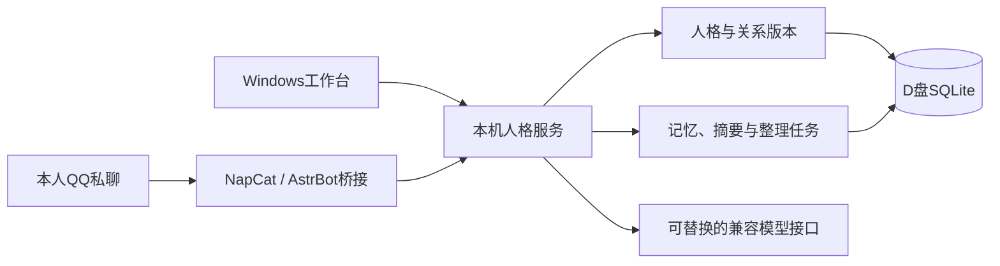

<div align="center">

# Persona-Centric Agent Runtime

### 以人格为中心的私聊陪伴运行时

新增 **M6.0 角色系统**：结构化人设、设定书、版本与请求快照，见[使用与验证说明](docs/M6.0.md)、[实施计划](docs/M6.0-角色系统实施计划.md)、[施工总计划](docs/施工总计划/README.md)。整个M6自然交互尚未完成；下文M5收尾为历史基线。

人格、记忆与关系持续保存，模型与聊天渠道可以替换。


[快速开始](#快速开始) · [项目进度](#项目进度) · [待完成事项](#待完成事项) · [文档导航](#文档导航)

</div>

---

一个面向**单人私聊陪伴**的本地项目：在 Windows 工作台或本人 QQ 好友私聊中，与同一个持久化人格交流。重点是对话连续性、长期记忆、关系维护，以及出错后的可理解恢复。

**当前为源码开发版本，M1–M5 已实现。** M2/M3 真人验收通过；用户授权后，M4核心补验和M5核心机器验收已通过，真实24小时等条件项保留。用户已确认M5验收通过并收尾；架构与目标拟调整，暂不准备M6。完整结论见 [项目状态](docs/STATUS.md)及[M5收尾总结](docs/M5-收尾总结.md)。

## 核心能力

| 能力 | 当前实现 |
| --- | --- |
| 双入口私聊 | Tkinter 工作台 + 本人 QQ 好友纯文本私聊；同人格共享长期记忆，近期会话分开 |
| 持久化人格 | 新人格独立身份；同一人格可编辑核心、表达和关系，比较版本并回退 |
| 可靠对话 | 连续消息逐条有序、不合并；受理标识去重、队列和阶段耗时、失败显式重试 |
| 长对话接续 | 有来源、可失效的会话摘要；显示上下文缺口与使用的记忆版本 |
| 长期记忆 | 显式录入、多来源候选、确认、修订及撤回；旧来源屏蔽防止派生摘要重新带回 |
| 每日整理 | 按本机24小时间隔全量更新周期开始时的当前人格；正常记忆自动生效、冲突待授权 |
| 可控状态 | 手动临时状态及期限，到期退出后续调用；不自动推断情绪 |
| 独立管理 | 本机HTTP服务、NapCat/AstrBot独立环境、归属核对、备份导出及DPAPI凭据保护 |

自动整理受额度限制，到限后等待续跑；未配置整理模型时不调用。手动整理及可选空闲增量候选仍须人工确认。每日更新不会自动修改人格核心、显式关系或临时状态。

## 项目进度

| 阶段 | 目标 | 实现 | 验收状态 |
| --- | --- | --- | --- |
| M1 | 人格、会话、事件与显式记忆持久化 | 已完成 | 纳入后续闭环与回归 |
| M2 | 工作台、本机服务、模型及QQ本人私聊 | 已完成 | 用户确认全流程通过 |
| M3 | 连续消息、响应观测与失败恢复 | 已完成 | 用户确认通过 |
| M4 | 长期记忆、摘要及每日更新 | 已完成 | **核心通过；O01–O03待验** |
| M5 | 人格/关系版本、状态及连续性 | 已完成，v0.5.0 | **用户确认通过并收尾；跨模型待补** |
| M6及后续 | 等待架构与目标调整 | 尚未实现 | 暂缓准备 |

最近一次M5完整离线回归 **135项通过**；恢复分支及界面针对性 **38项通过**，机器验收窗口再次执行38项通过，轮次有重叠不相加。另有真实模型、实际工作台及恢复验收，见 [M4/M5验收总结](docs/acceptance/M4-M5-机器验收总结.md)；这些本机记录不是持续集成状态。

## 快速开始

### 1. 准备环境

需要 Windows、已安装的 **Python 3.12** 和 `uv`。仓库提供源码，不附虚拟环境、模型密钥、QQ客户端或第三方组件二进制。

克隆后在仓库根目录打开PowerShell：

```powershell
git clone https://github.com/FoxofCAUC/Persona-Centric-Agent-Runtime.git
cd Persona-Centric-Agent-Runtime

# 创建D盘数据目录，不调用模型。
python -B -m persona_runtime init-storage

# 仅作用于当前PowerShell会话及其子进程。
$env:UV_CACHE_DIR = 'D:\Persona-Centric Agent Runtime\cache\uv'
$env:PIP_CACHE_DIR = 'D:\Persona-Centric Agent Runtime\cache\pip'
$env:PYTHONPYCACHEPREFIX = 'D:\Persona-Centric Agent Runtime\cache\pycache'
$env:TEMP = 'D:\Persona-Centric Agent Runtime\tmp'
$env:TMP = 'D:\Persona-Centric Agent Runtime\tmp'
$env:UV_PROJECT_ENVIRONMENT = 'D:\Persona-Centric Agent Runtime\.venv'

uv venv --no-managed-python --python 3.12 'D:\Persona-Centric Agent Runtime\.venv'
uv sync --frozen --no-managed-python
.\scripts\dev.ps1 db init
```

已部署用户使用现有环境，不重复创建或覆盖数据。数据库升级先备份，再事务迁移。

### 2. 开始窗口对话

双击根目录 **`启动人格工作台.bat`**，或运行：

```powershell
.\scripts\dev.ps1 gui
```

1. 首页点击“只启动人格服务”。
2. 在“人格与记忆”创建模板或导入JSON，明确选中并切换人格。
3. 在“模型”填写Chat Completions兼容接口、模型名和密钥并保存。
4. 到“聊天”恢复或新建会话，发送消息。
5. 在“人格与关系”管理同身份设定与版本，在“记忆整理”查看任务、候选和每日计划。

打开窗口、保存配置不调用模型；发送、显式测试和重试可能计费。关闭窗口保留后台服务，已配置并开启的每日整理仍可能运行。

### 3. QQ本人好友私聊

QQ部署使用独立AstrBot **4.29.1** 环境和本项目桥接插件，不让AstrBot再次生成普通模型回复。

**当前组件准备仍有本机约定：** 默认从 `D:\QQ_Bot_2\napcat-shell` 复制NapCat程序，排除账号配置、缓存、日志与令牌，不修改原项目。其他机器须先处理该来源路径，不能认为“准备组件”适用于任意安装。独立SDK与组件准备可能联网下载依赖。

部署后配置Bot QQ与本人QQ，启动服务、登录并核对OneBot。详见 [QQ部署与启停](docs/M2.md#qq-本人好友私聊)。群聊、临时私聊、其他联系人和非纯文本消息仍拒绝。

## 运行与存储



当前运行时 **0.5.0**、数据库结构 **6**，桥接插件 **0.3.0** 保持兼容。

| 位置 | 内容 |
| --- | --- |
| Git仓库 | 源码、模板、测试、进度和验收手册 |
| `D:\Persona-Centric Agent Runtime\data\database` | 数据库、人格、会话、记忆及版本事实 |
| 数据根目录下 `config` / `runtime` | 配置、DPAPI密文、实例状态与锁 |
| `logs` / `backups` / `exports` | 元数据日志、备份、导出及本机验收证据 |
| `.venv` / `components` / `cache` / `tmp` | 依赖环境、独立组件、缓存与临时文件 |

`PERSONA_RUNTIME_HOME` 可显式覆盖业务数据根目录；磁盘不可用时失败，不自动退回C盘。现有Windows启动/开发脚本的项目解释器仍使用默认D盘 `.venv`，并非完全可移植启动器。`.env.example` 仅作参考，不会自动加载。

默认端口均绑定回环地址：人格服务 **8765**、NapCat管理页 **6399**、AstrBot管理页 **6285**、OneBot **6299**。正常启停核对归属，不接管未知端口。

## 待完成事项

- **M4条件项**：真实24小时、可选空闲增量、额度实际恢复续跑仍待验。见 [逐项清单](docs/acceptance/M4-补验跟踪.md)。
- **M5条件项**：第二模型对照未执行；三轮真实自然度样本通过，不保证所有场景质量。工作台按用户授权替代QQ业务入口，实际平台收发未在本轮执行。
- **部署通用化**：解耦第三方组件来源和固定解释器路径，完善新机器环境准备；当前没有独立可执行安装包。
- **后续方向待定**：因架构与目标拟调整，暂不准备M6；旧知识增强路线保留为历史设想。

规则召回不等于语义检索，引用校验不保证模型判断正确，QQ也不保证严格恰好一次投递。发送不确定时先人工核对，不自动从头重发。完整边界与优先级见 [项目状态与后续工作](docs/STATUS.md)。

## 文档导航

| 想了解什么 | 文档 |
| --- | --- |
| 当前版本、进度和缺口 | [项目状态](docs/STATUS.md) · [更新记录](CHANGELOG.md) |
| M5人格/关系操作 | [收尾总结](docs/M5-收尾总结.md) · [使用说明](docs/M5.md) · [真人手册](docs/acceptance/M5-人格与关系真人验收手册.md) |
| M4记忆与每日整理 | [使用说明](docs/M4.md) · [补验跟踪](docs/acceptance/M4-补验跟踪.md) |
| 窗口/QQ基础部署 | [M2部署与启停](docs/M2.md)，其中阶段版本描述为历史基线 |
| 命令行持久化接口 | [M1操作说明](docs/usage.md) |
| 长期路线与架构 | [开发路线](docs/项目目标与开发路线.md) · [架构](docs/architecture.md) |
| 后续开发交接 | [当前交接](docs/HANDOFF.md) · [验收目录](docs/acceptance/README.md) |

## 开发与验证

```powershell
.\scripts\dev.ps1 paths
.\scripts\dev.ps1 db status
.\scripts\test.ps1
```

全量测试需要D盘项目环境及独立AstrBot SDK环境。新机器只准备核心环境时可先跑持久化测试：

```powershell
& 'D:\Persona-Centric Agent Runtime\.venv\Scripts\python.exe' -B -m unittest discover -s tests -p test_runtime.py -v
```

自动验证使用D盘隔离数据、模拟模型和模拟QQ，不自动登录或发真实消息。真人结果与截图留在本机，不提交Git。提交前请阅读 [协作约定](AGENTS.md)。

## 代码来源与许可证

部分工作台基础代码经授权从既有TRPG项目复用，当前运行不依赖其源码，详见 [复用记录](docs/REUSE.md)。仓库不分发NapCat、QQ或AstrBot二进制，第三方组件遵循各自许可和使用条件。

本仓库目前尚未指定开源许可证；公开可见不等于已授予任意使用或再分发许可。
