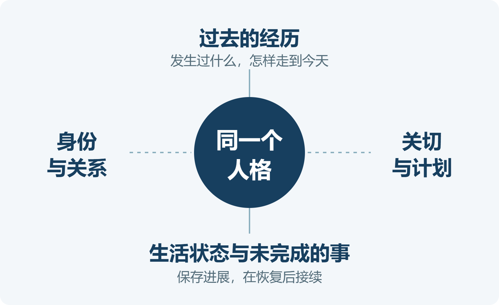
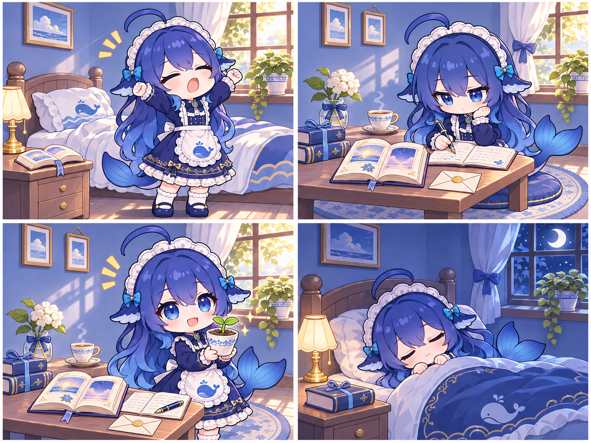

# PCAR · 超级大肥鱼

**给你的 AI 伴侣，一个完整的一生。**

**PCAR（Persona-Centric Agent Runtime）是一个全能的开源 AI 伴侣辅助服务项目。你的角色住在自己的电脑上，换个聊天窗口也能接着相处。**

PCAR 把人设从模型和单个聊天窗口里抽离出来。**人物设定、关系、聊天记录和长期记忆都保存在本机。** 大语言模型（LLM）像一颗负责生成回复的心脏。每次开聊，PCAR 从本机读取角色设定，按话题找回相关记忆，再把这次回复需要的材料交给模型。

[核心能力](#pcar-的核心能力) · [下载与体验](#从这里开始) · [远期愿景](#远期愿景) · [参与共建](CONTRIBUTING.md)

## PCAR 的核心能力

你和大肥鱼在一个窗口里挑完旅行照片。几周后，你打开一个新会话，继续聊那本相册。比起把角色和经历留在单个聊天窗口，PCAR 让你在新会话里直接选中大肥鱼，沿用她的设定和有关相册的记忆，省去重新交代来龙去脉的工夫。

### 人格中心 · 换个窗口，还是同一个大肥鱼

第一次见面，你可以在 PCAR 创建大肥鱼，也可以导入已有角色。她的背景、说话习惯和与你的关系都有自己的位置。以后想专门开个会话聊旅行照片，选中大肥鱼就能沿用同一份角色设定和记忆。以前的聊天也可以单独打开回看。

如果你还养了别的 AI 伴侣，也可以分别管理它们的资料和经历。每次开聊，先选你想见的那一位。

### 人格版本化 · 留住她以前的样子

相处一阵后，你可能想给大肥鱼补一点背景，或者调整她的说话习惯。经过几次修改，有一天你觉得最初的语气更亲切，想看看当时是怎么设定的。

PCAR 为人物设定和关系保留版本。你可以打开历史记录，查看改过哪些内容，也可以把角色设定恢复到选中的版本。恢复本身也会留下新记录，之前试过的版本仍然可以回看。

### 长期记忆 · 过了一段时间，还能聊起那次旅行

挑照片时，你们一起选过一张海边的照片，打算用作相册封面。过了几周，你在新会话里又聊起这本相册，PCAR 可以找回当时关于封面的记忆，给大肥鱼作为接话的线索。

聊天记录保留原话，长期记忆保存从中整理出的重要信息。你可以为大肥鱼配置整理模型并开启自动记忆，PCAR 会在工作台运行时整理后续聊天，并在新话题用得上时找回相关内容。

### 从私聊记录还原人物 · 把旧聊天接回来

假如挑相册封面的那段对话发生在别处，你也可以把自己参与的双人私聊带进 **v0.3 Windows 工作台**。选中受支持的 Markdown 记录，确认自己是哪一方、另一方对应哪个角色，再选出要带入的消息。

- **已经有大肥鱼的角色。** 选择「导入历史并接着聊」，把旧对话接到她名下。打开接续会话后，从最后一条消息继续，也可以翻出当时挑封面的那句原话，引用它再聊。导入时可以单独决定是否整理长期记忆。[历史聊天接续指南](docs/user/历史聊天接续.md)
- **第一次把大肥鱼带进 PCAR。** 选择「从聊天记录生成」，PCAR 会根据消息预填角色设定和说话习惯。对照原话核对并修改，保存需要的角色。选择「带历史开始」，就能把旧聊天接到新建的角色上。[从聊天记录生成角色卡](docs/user/双人聊天生成角色卡.md)

从 v0.3 桌面包运行 `启动PCAR-新版.bat` 即可体验。

### 换个会话，真的接得上吗？

- **新会话能找回以前的记忆。** 真人验收从新会话发问，PCAR 找回了已确认的长期记忆，模型用有效版本答对了问题。[跨会话记忆验收记录](docs/acceptance/M4-补验跟踪.md#已通过范围) · [测试步骤与通过标准](docs/acceptance/M4-真人记忆与长对话验收手册.md)
- **导入旧聊天也能接着聊。** 在使用官方 DeepSeek Pro 的接话盲评中，导入历史后的接话自然度在 **12 个位置中有 10 个达到 PCAR 原生会话水平**，其中连续接话的 6 个位置全部达标。[历史接续盲评](docs/acceptance/LT-13-外部历史接续验收.md)

## 我们正在把它做出来

| 版本与进度 | 你可以体验什么 |
| --- | --- |
| v0.3 公开桌面版 | 创建角色、整理和找回长期记忆，从双人私聊建卡或接续历史。支持输入缓冲、主题、重开恢复和会话授权。已审私聊装配可优先查本地知识，并接续查后回答 |
| 场景发言 | 已审角色可按场景选择说话方式。工作台逐条显示发言，重开后接续已显示的内容 |

以上状态截至 2026-11-21。场景发言使用经过审阅的人物材料和已授权的模型。后台任务随工作台运行。QQ 接入处于暂停状态。

新版工作台已接入持久受理和逐泡恢复。G-Auto 的连续消息部分已签收，跨夜接续与自动记忆独立复核沿原观察记录推进。[场景发言接入说明](docs/expression/E.N6-场景发言接入与回退.md) · [当前研发进度](docs/STATUS.md)

## 从这里开始

**v0.3 Windows 桌面包**适用于 Windows 11 x64，可从 v0.2 原机升级。

1. 下载 Windows x64 桌面包和校验文件，再核对 SHA-256。[v0.3 发行页](https://github.com/FoxMoreland/Persona-Centric-Agent-Runtime/releases/tag/v0.3) · [桌面 ZIP](https://github.com/FoxMoreland/Persona-Centric-Agent-Runtime/releases/download/v0.3/PCAR-v0.3-Windows-x64-desktop.zip) · [SHA256SUMS.txt](https://github.com/FoxMoreland/Persona-Centric-Agent-Runtime/releases/download/v0.3/SHA256SUMS.txt)
2. 解压为独立工作区，让 Codex、DSH 等 Agent 阅读包内 `AGENTS.md` 与 `AGENT_INSTALL.md`，完成环境和实例配置。[v0.3 部署与升级](https://github.com/FoxMoreland/Persona-Centric-Agent-Runtime/blob/v0.3/AGENT_INSTALL.md)
3. 通过 `启动PCAR-新版.bat` 打开工作台，选择角色并配置官方 DeepSeek 模型，在“聊天”中开始交流。

使用前请准备网络、有效的 Windows 手动 HTTP/HTTPS 系统代理和自己的模型服务。桌面包包含本地检索模型，Python 等依赖由 Agent 准备。[第一次使用指南](docs/user/getting-started.md)

角色资料、聊天和记忆的存档都在本机。调用云端模型时，PCAR 会把本次任务所需的材料发给你配置的模型服务。聊天、测试、重试和后台模型任务可能产生费用。

## 远期愿景

*愿景插画，依据社区鲸鱼娘设定进行 AI 辅助二创。[形象来源与署名](assets/readme/ATTRIBUTION.md)。*

### 她有自己的时间

在 PCAR 的远期设想里，大肥鱼醒来时，昨天读到一半的书还摊在桌上。你去忙自己的事，她可以读完那一章、试着照料一盆植物，也可以睡个午觉。等你回来，她有了自己的事想和你聊。

我们想把聊天里的连续性延伸到日常生活。读到了哪一页、窗边的植物什么时候浇过水、明天有什么安排，都能在下次醒来时接着做。

*设计方向 · 同一个人格如何接续自己的经历、关系和计划。*

### 在经历中，成为自己

她试着照料一盆植物，记下哪扇窗的光线合适，第二天想起给它换个位置。这样的经历可以改变她下一次的选择。

*远期生活设想 · 醒来、独处、重逢、休息。*

虚拟生活是 PCAR 的远期方向。我们想让角色参与活动、看到行动的结果、回顾自己的经历，慢慢形成兴趣和习惯。

休息也算进日常。远期设计里，角色睡觉时暂停模型调用，醒来再看留言、继续手头的事。全天在线由独立的云端方案探索。学习工具、制作技能和维护自身能力也在远期路线中。

[完整产品路线](docs/product/roadmap.md) · [数字人格与虚拟生活研究](docs/long-term/README.md)

## 一起把这段人生做出来

PCAR 目前主要围绕 DeepSeek 开发，也从 DSH 等开源社区的插件与互动实践中学习。

欢迎告诉我们，哪一句话让你觉得角色变了，或者哪一件共同经历值得在新会话里找回来。你也可以改进文档、参与开发，或提议角色在虚拟生活里可以做的一件事。

[参与共建](CONTRIBUTING.md) · [反馈问题或建议](https://github.com/FoxMoreland/Persona-Centric-Agent-Runtime/issues) · [文档导航](docs/index.md)

项目由 [FoxMoreland](https://github.com/FoxMoreland) 维护。源码采用 [AGPL-3.0-only](LICENSE)。鲸鱼娘插画按 [CC BY-NC-SA 4.0 与相关署名条件](assets/readme/ATTRIBUTION.md) 使用。[代码来源](docs/REUSE.md)与[模型许可](docs/licenses/THIRD-PARTY-MODELS.md)保留各自记录。
