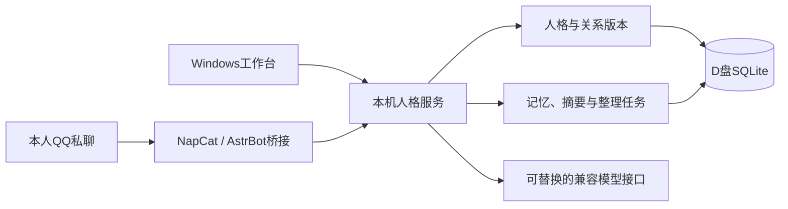

<div align="center">

> **M7.3施工与验收：** M7.3规定范围验收完成，历史条件继续携带。0.7.3.dev1/主库13/导出10/桥接0.6.0；最终全量427项454.702秒通过，32/8人工集、迁移恢复、实际工作台与QQ通过。真实5次主要＋2次整理，共15,700 tokens、7份Manifest。长时门按用户修订采用受控截止模拟与5秒调度管线，未宣称真实30分钟通过。模拟退出，原人格、完整配置/30/6/20、每日整理及三服务停止初态恢复，无未决测试输入。仅准备M7.4；用户随后授权提交本地与远端，源码/测试/工具已归档为e7d45d5，文档独立提交并普通推送，实际结果见Git日志及D盘git-publication.json。 [使用说明](docs/M7.3.md) · [证据与未完成项](docs/acceptance/M7.3-机器验收结论.md)。

> **M7.2当前收尾（2026-10-28）：** M7.2规定范围验收完成，历史条件继续携带。0.7.2.dev1/主库12/导出9/桥接0.6.0；自动召回默认开启、跨会话另开、明确引用失败零调用，缓冲及回复模式保持。最终全量390项161.670秒通过，48/16人工集、两条副本恢复及实际Tk通过；真实8次固定主要＋1次整理＋1次修复复验，共20,340 tokens，实际QQ一片纯文本sent可追溯。原R01中文句号漏召回及SDK超时现场保留；R01已修复复验关闭。原人格、完整配置/30/6/20、每日整理开关及三服务停止初态恢复，无未决输入/新片段。 [实现与使用](docs/M7.2.md) · [机器结论](docs/acceptance/M7.2-机器验收结论.md) · [M7.3准备](docs/M7.3-开工输入与待定事项.md)。下方旧版本及未实施描述保留为历史，不代表当前状态。

# Persona-Centric Agent Runtime

> **2026-10-29规划更新：** 采纳[M7.5角色语义激活](docs/M7.5.md)，置于M7.4验收后、M8.A前；首次交付真实本地Embedding，前三包自检、第四包唯一联合验收。当前尚未施工，运行版本不变；详见[指导1.2](docs/pcar_project_plan_zh.md)。

> **2026-10-29 规划修订，规划已采纳：** 先实现无需日常监管的陪伴运行，包含自动记忆、运行恢复、世界知识与热梗/时政更新，再接入 Director 和研究人格演化。详见[指导1.1](docs/pcar_project_plan_zh.md)、[路线及核心决议](docs/无人值守陪伴优先-路线修订草案.md)与[G-AUTO验收门](docs/acceptance/无人值守陪伴-阶段门与验收矩阵.md)。这些是未来目标，当前版本和默认行为未改变；用户已在审阅交付后授权提交推送本次规划。

### 以人格为中心的私聊陪伴运行时

[MIT 开源协议](LICENSE)

> M7.0历史收尾：规定范围验收完成，历史条件继续携带。实际QQ引用、撤回零调用、正式工作台、导出8、重启数据及最终运行恢复均已核对，见[最终收尾](docs/acceptance/M7.0-最终收尾-20261028.md)。M7.1已据此完善为[v2开工规划](docs/M7.1-中文全文与时间检索开工规划.md)，工程尚未实施，封存原稿保留历史。

> M6历史收尾：M6核心范围收尾，历史条件继续携带。M6.4全量237项、72次质量对照及实际QQ合批/纯文本门通过，见[M6.4](docs/M6.4.md)。

当前运行时0.7.4.dev1、结构14、导出11、桥接0.7.0。M7.4规定范围验收完成，26次真实调用、QQ余段取消与恢复通过，历史条件携带，见[阶段进度](docs/M7.4.md)及[机器结论](docs/acceptance/M7.4-机器验收结论.md)。M7.3历史验收保持。[M7.2](docs/M7.2.md)已通过规定范围验收；M4 O01–O03、M5 P09及M6.1旧付费续跑继续携带。十份[施工文档](docs/施工总计划/README.md)已同步，下一步仅准备M7.5。

人格、记忆与关系持续保存，模型与聊天渠道可以替换。


[M7.1使用说明](docs/M7.1.md) · [快速开始](#快速开始) · [项目进度](#项目进度) · [待完成事项](#待完成事项) · [文档导航](#文档导航)

</div>

---

一个面向**单人私聊陪伴**的本地项目：在 Windows 工作台或本人 QQ 好友私聊中，与同一个持久化人格交流。重点是对话连续性、长期记忆、关系维护，以及出错后的可理解恢复。

**以下M7.1验收状态为历史快照；当前版本与实际运行状态见上方M7.3进度。** 正式服务保持验收前停止状态；最新证据见[M7.1机器结论](docs/acceptance/M7.1-机器验收结论.md)。

## 核心能力

| 能力 | 当前实现 |
| --- | --- |
| 双入口私聊 | Tkinter 工作台 + 本人 QQ 好友纯文本私聊；同人格共享长期记忆，近期会话分开 |
| 持久化人格 | 新人格独立身份；同一人格可编辑核心、表达和关系，比较版本并回退 |
| 可靠对话 | 默认逐条有序，可按人格/入口手动开启5秒缓冲；原文持久受理、队列、失败显式恢复 |
| 长对话接续 | 有来源、可失效的会话摘要；显示上下文缺口与使用的记忆版本 |
| 长期记忆 | 显式录入、多来源候选、确认、修订及撤回；旧来源屏蔽防止派生摘要重新带回 |
| 每日整理 | 按本机24小时间隔全量更新周期开始时的当前人格；正常记忆自动生效、冲突待授权 |
| 可控状态 | 手动临时状态及期限，到期退出后续调用；不自动推断情绪 |
| 独立管理 | 本机HTTP服务、NapCat/AstrBot独立环境、归属核对、备份导出及DPAPI凭据保护 |
| 档案与工作集 | 管理员中文/时间查询与完整回合；M7.2默认当前会话自动召回，可关闭或另开跨会话 |
| 会话与主题 | 运行中空闲30分钟或手动封存、只读回放、手动整理、接续与主题/Thread；规定范围已验，长时门使用受控模拟 |
| 精确档案与引用 | 按ID恢复完整输入回合与实际发送片段；本人QQ支持文字附一个原生引用；失败引用零模型调用 |

自动整理受额度限制，到限后等待续跑；未配置整理模型时不调用。手动整理及可选空闲增量候选仍须人工确认。每日更新不会自动修改人格核心、显式关系或临时状态。

## 项目进度

| 阶段 | 目标 | 实现 | 验收状态 |
| --- | --- | --- | --- |
| M1 | 人格、会话、事件与显式记忆持久化 | 已完成 | 纳入后续闭环与回归 |
| M2 | 工作台、本机服务、模型及QQ本人私聊 | 已完成 | 用户确认全流程通过 |
| M3 | 连续消息、响应观测与失败恢复 | 已完成 | 用户确认通过 |
| M4 | 长期记忆、摘要及每日更新 | 已完成 | **核心通过；O01–O03待验** |
| M5 | 人格/关系版本、状态及连续性 | 已完成，v0.5.0 | **用户确认通过并收尾；跨模型待补** |
| M6.0 | 角色资料、版本和设定书 | 已实现 | 核心机器验收完成 |
| M6.1 | 输入持久化与缓冲 | 已实现，0.6.1.dev1 | 快速QQ合批本次通过，旧付费显式续跑条件继续携带 |
| M6.2 | 情境表达与结构化回复 | 源码已实现，0.6.2.dev1 | 实现及部署已完成，72次联合质量对照通过 |
| M6.3 | 片段可靠投递 | 已实现，0.6.3.dev1 | 222项全量、实际工作台、本人QQ/三片顺序和单片恢复通过 |
| M6.4 | 联合验收与核心收尾 | 0.6.4.dev1 | 237项全量、72次对照、QQ合批及纯文本复验通过；历史条件继续携带 |
| M7.0 | 原始档案、精确引用及来源恢复 | 已实现并部署 | 规定范围验收完成，最终QQ运行恢复通过；历史条件继续携带 |
| M7.1 | 中文全文、时间与只读工作集 | 已实现，0.7.1.dev1 | 人工80/80、实际隔离工作台、主库副本恢复通过；详见阶段结论 |
| M7.2及后续 | CognitiveContext、会话及表达硬化 | 待准备阶段合同 | 自动召回、Session/Thread及向量等未实现 |

历史M6.1完整回归187项通过81.315秒；详细证据及条件限制见[M6.1说明](docs/M6.1.md)。

历史M5完整离线回归 **135项通过**；恢复分支及界面针对性 **38项通过**，机器验收窗口再次执行38项通过，轮次有重叠不相加。另有真实模型、实际工作台及恢复验收，见 [M4/M5验收总结](docs/acceptance/M4-M5-机器验收总结.md)；这些本机记录不是持续集成状态。

## 快速开始

### 1. 准备环境

需要 Windows、已安装的 **Python 3.12** 和 `uv`。仓库提供源码，不附虚拟环境、模型密钥、QQ客户端或第三方组件二进制。

克隆后在仓库根目录打开PowerShell：

```powershell
git clone https://github.com/FoxofCAUC/Persona-Centric-Agent-Runtime.git
cd Persona-Centric-Agent-Runtime

# 创建D盘数据目录，不调用模型。
python -B -m persona_runtime init-storage

# 仅作用于当前PowerShell会话及其子进程。
$env:UV_CACHE_DIR = 'D:\Persona-Centric Agent Runtime\cache\uv'
$env:PIP_CACHE_DIR = 'D:\Persona-Centric Agent Runtime\cache\pip'
$env:PYTHONPYCACHEPREFIX = 'D:\Persona-Centric Agent Runtime\cache\pycache'
$env:TEMP = 'D:\Persona-Centric Agent Runtime\tmp'
$env:TMP = 'D:\Persona-Centric Agent Runtime\tmp'
$env:UV_PROJECT_ENVIRONMENT = 'D:\Persona-Centric Agent Runtime\.venv'

uv venv --no-managed-python --python 3.12 'D:\Persona-Centric Agent Runtime\.venv'
uv sync --frozen --no-managed-python
.\scripts\dev.ps1 db init
```

已部署用户使用现有环境，不重复创建或覆盖数据。数据库升级先备份，再事务迁移。

### 2. 开始窗口对话

双击根目录 **`启动PCAR.bat`**，或运行：

```powershell
.\scripts\dev.ps1 gui
```

1. 首页点击“只启动人格服务”。
2. 在“人格与记忆”创建模板或导入JSON，明确选中并切换人格。
3. 在“模型”填写Chat Completions兼容接口、模型名和密钥并保存。
4. 到“聊天”恢复或新建会话，发送消息。
5. 在“人格与关系”管理同身份设定与版本，在“记忆整理”查看任务、候选和每日计划。

打开窗口、保存配置不调用模型；发送、显式测试和重试可能计费。服务只在控制台存活期间运行；关闭控制台会自动强制停止全部相关服务，完成后退出窗口。控制台关闭期间不执行每日整理。若 Windows 要求管理员授权，请完成授权；停止失败时窗口保留并显示原因。

### 3. QQ本人好友私聊

QQ部署使用独立AstrBot **4.29.1** 环境和本项目桥接插件，不让AstrBot再次生成普通模型回复。

**当前组件准备仍有本机约定：** 默认从 `D:\QQ_Bot_2\napcat-shell` 复制NapCat程序，排除账号配置、缓存、日志与令牌，不修改原项目。其他机器须先处理该来源路径，不能认为“准备组件”适用于任意安装。独立SDK与组件准备可能联网下载依赖。

部署后配置Bot QQ与本人QQ，启动服务、登录并核对OneBot。详见 [QQ部署与启停](docs/M2.md#qq-本人好友私聊)。本人私聊支持非空文字附一个QQ原生引用；群聊、临时私聊、其他联系人、纯引用及其他媒体仍拒绝。引用仅恢复同人格与同QQ身份范围的本地档案，不从平台自动取回历史。

## 运行与存储



当前运行时 **0.7.0.dev1**、数据库结构 **11**、全量导出 **8**、桥接插件 **0.6.0**。QQ出站使用纯文本，原语义回复及传输片段分别留存。

| 位置 | 内容 |
| --- | --- |
| Git仓库 | 源码、模板、测试、进度和验收手册 |
| `D:\Persona-Centric Agent Runtime\data\database` | 数据库、人格、会话、记忆及版本事实 |
| 数据根目录下 `config` / `runtime` | 配置、DPAPI密文、实例状态与锁 |
| `logs` / `backups` / `exports` | 元数据日志、备份、导出及本机验收证据 |
| `.venv` / `components` / `cache` / `tmp` | 依赖环境、独立组件、缓存与临时文件 |

`PERSONA_RUNTIME_HOME` 可显式覆盖业务数据根目录；磁盘不可用时失败，不自动退回C盘。现有Windows启动/开发脚本的项目解释器仍使用默认D盘 `.venv`，并非完全可移植启动器。`.env.example` 仅作参考，不会自动加载。

默认端口均绑定回环地址：人格服务 **8765**、NapCat管理页 **6399**、AstrBot管理页 **6285**、OneBot **6299**。正常启停核对归属，不接管未知端口。

## 待完成事项

- **M4条件项**：真实24小时、可选空闲增量、额度实际恢复续跑仍待验。见 [逐项清单](docs/acceptance/M4-补验跟踪.md)。
- **M5条件项**：第二模型对照未执行；M6.4固定72次样例比较通过，不保证所有场景质量；实际QQ收发及纯文本读回已有独立证据。
- **部署通用化**：解耦第三方组件来源和固定解释器路径，完善新机器环境准备；当前没有独立可执行安装包。
- **下一阶段**：采用已完善的[M7.1 v2开工规划](docs/M7.1-中文全文与时间检索开工规划.md)与[验收清单](docs/acceptance/M7.1-检索施工与验收清单.md)，先签收基线、人工集与离线选型。工程尚未实施，原稿保留历史；Session/Thread、向量检索、联网及演化仍为后续阶段。

规则召回不等于语义检索，引用校验不保证模型判断正确，QQ也不保证严格恰好一次投递。发送不确定时先人工核对，不自动从头重发。完整边界与优先级见 [项目状态与后续工作](docs/STATUS.md)。

## 文档导航

| 想了解什么 | 文档 |
| --- | --- |
| 当前版本、进度和缺口 | [项目状态](docs/STATUS.md) · [更新记录](CHANGELOG.md) |
| 后续开发指导 | [PCAR项目规划书](docs/pcar_project_plan_zh.md) · [现状与路线衔接](docs/后续开发指导与规划衔接.md) |
| M5人格/关系操作 | [收尾总结](docs/M5-收尾总结.md) · [使用说明](docs/M5.md) · [真人手册](docs/acceptance/M5-人格与关系真人验收手册.md) |
| M4记忆与每日整理 | [使用说明](docs/M4.md) · [补验跟踪](docs/acceptance/M4-补验跟踪.md) |
| 窗口/QQ基础部署 | [M2部署与启停](docs/M2.md)，其中阶段版本描述为历史基线 |
| 命令行持久化接口 | [M1操作说明](docs/usage.md) |
| 长期路线与架构 | [开发路线](docs/项目目标与开发路线.md) · [架构](docs/architecture.md) |
| 后续开发交接 | [当前交接](docs/HANDOFF.md) · [验收目录](docs/acceptance/README.md) |

## 开发与验证

```powershell
.\scripts\dev.ps1 paths
.\scripts\dev.ps1 db status
.\scripts\test.ps1
```

全量测试需要D盘项目环境及独立AstrBot SDK环境。新机器只准备核心环境时可先跑持久化测试：

```powershell
& 'D:\Persona-Centric Agent Runtime\.venv\Scripts\python.exe' -B -m unittest discover -s tests -p test_runtime.py -v
```

自动验证使用D盘隔离数据、模拟模型和模拟QQ，不自动登录或发真实消息。真人结果与截图留在本机，不提交Git。提交前请阅读 [协作约定](AGENTS.md)。

## 代码来源与许可证

部分工作台基础代码经授权从既有TRPG项目复用，当前运行不依赖其源码，详见 [复用记录](docs/REUSE.md)。仓库不分发NapCat、QQ或AstrBot二进制，第三方组件遵循各自许可和使用条件。

本项目采用 **[MIT 开源协议](LICENSE)**，版权声明为 `Copyright (c) 2026 FoxofCAUC`。第三方代码、组件及资源仍遵循各自许可证和使用条件；本项目的 MIT 声明不替代其许可。
