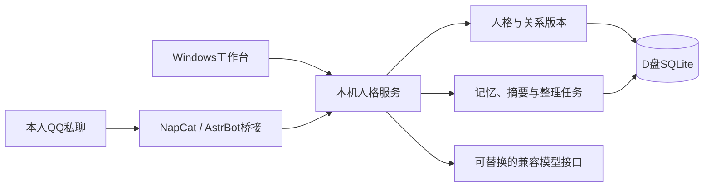

# Persona-Centric Agent Runtime（PCAR）

**PCAR 的目标是开发一个能够持续陪伴、让人愿意长期相处的 AI 伴侣。**

它应有鲜明而自然的人物感，能接住日常分享、玩笑、情绪和认真交谈，让相处逐渐形成熟悉感。用户愿不愿意继续聊、是否总被客服腔和机械回应打断，决定项目是否有效。

对话连续性、长期记忆、关系维护和故障恢复，是让这份陪伴更好发生的支持能力。工程正确性与可溯源应服务产品体验，不能用更多通过的检查、完整的架构或精细的记录，代替一个好相处的 AI 伴侣。


[MIT 开源协议](LICENSE)

[产品方向与大肥鱼参考线](docs/AI伴侣产品方向与大肥鱼参考线.md) · [当前状态](docs/STATUS.md) · [快速开始](#快速开始) · [文档导航](#文档导航)

当前采用 **v8 伴侣聊天**：本地选材、原生文本、即时通讯表达指导，无表达样例。新建、原生导入和复制角色的工作台、QQ入口统一默认v8；可以在入口政策中关闭并恢复启用前设置。已有角色及历史请求不会随初始化自动改写。

阶段6后台百轮、记忆修复及阶段7正式交付验收已完成；M8.D已交付自动覆盖、独立复核、事实更正与局部修复。工程、隔离真实、正式短验收、清理及验收限流偏差分别记录于[当前状态](docs/STATUS.md)和[实施记录](docs/M8.D-自动记忆实施记录.md)。后台仍随工作台启停，不宣称无人值守或G-AUTO通过。

[完整施工指导](docs/AI伴侣底层重构总施工指导.md) · [大肥鱼参考结论](docs/AI伴侣产品方向与大肥鱼参考线.md) · [源码交付清单](source-delivery.json) · [当前M8.A交接](docs/M8.A-v8当前系统职责交接.md)

M8.A受管整理统一了授权、领取、逐次调用额度和原回执恢复；工程、真实验证和正式接入进度见[实施记录](docs/M8.A-受管整理实施记录.md)及[验收手册](docs/acceptance/M8.A-受管整理验收手册.md)。后台仍随工作台启停，未知调用不会因重启自动重发。

自动记忆按角色一次性开启，新建、原生导入和复制默认关闭。开启后有效对话按最多10轮自动提取和独立复核，明确更正形成版本，无法裁定的内容隔离；不需要逐批提交或批准。处理覆盖、记忆处置和可用摘要分别显示，详见[M8.D操作与验收手册](docs/acceptance/M8.D-自动记忆验收手册.md)。

当前自动整理额度为每小时60次、滚动24小时240次，提取、复核、修复与重试共同计数。人工手动调用不设次数额度，仍记录真实用量；其他原本不限额的自动项保持不限额。详见[额度规则](docs/自动调用额度与人工免限额.md)。

## 已有支持能力

这些能力为陪伴体验提供基础；下表不作为自然度、人物辨识或整体产品效果已经通过的声明。

| 能力 | 当前实现 |
| --- | --- |
| 双入口私聊 | Tkinter 工作台与本人 QQ 好友纯文本私聊；记忆取用受人格、渠道及账号范围约束，近期会话分开 |
| 人物资料与关系 | 人格有独立身份，可编辑核心、表达和关系，比较版本并回退 |
| 连续消息 | 有序受理、队列及按人格/入口配置的5秒缓冲，失败后显式恢复 |
| 长对话与记忆 | 会话摘要、长期记忆、来源修订与撤回，避免失效材料重新带回 |
| 日常整理 | 一次性开启后的自动提取、独立复核和版本化发布；不确定项隔离，不自动改写人格核心或显式关系 |
| 角色材料检索 | 已有本地语义检索与选材能力；并不保证选中材料就能改善表达 |
| 会话与引用 | 工作集召回、会话封存与接续、主题整理、档案查询及本人 QQ 原生引用 |
| 运行管理 | 本机服务、独立QQ桥接环境、手动临时状态、备份导出和凭据保护 |

未配置整理模型时不调用；具体整理计划、额度和授权以现有配置为准。群聊、多联系人、人格自主演化和完整无人值守陪伴不在当前已完成能力中。

## 快速开始

### 1. 准备环境

需要 Windows、已安装的 **Python 3.12** 和 `uv`。仓库提供源码，不附虚拟环境、模型密钥、QQ客户端或第三方组件二进制。

克隆后在仓库根目录打开PowerShell：

```powershell
git clone https://github.com/FoxofCAUC/Persona-Centric-Agent-Runtime.git
cd Persona-Centric-Agent-Runtime

# 创建D盘数据目录，不调用模型。
python -B -m persona_runtime init-storage

# 仅作用于当前PowerShell会话及其子进程。
$env:UV_CACHE_DIR = 'D:\Persona-Centric Agent Runtime\cache\uv'
$env:PIP_CACHE_DIR = 'D:\Persona-Centric Agent Runtime\cache\pip'
$env:PYTHONPYCACHEPREFIX = 'D:\Persona-Centric Agent Runtime\cache\pycache'
$env:TEMP = 'D:\Persona-Centric Agent Runtime\tmp'
$env:TMP = 'D:\Persona-Centric Agent Runtime\tmp'
$env:UV_PROJECT_ENVIRONMENT = 'D:\Persona-Centric Agent Runtime\.venv'

uv venv --no-managed-python --python 3.12 'D:\Persona-Centric Agent Runtime\.venv'
uv sync --frozen --no-managed-python
.\scripts\dev.ps1 db init
```

已部署用户使用现有环境，不重复创建或覆盖数据。数据库升级先备份，再事务迁移。

### 2. 开始窗口对话

双击根目录 **`启动PCAR.bat`**，或运行：

```powershell
.\scripts\dev.ps1 gui
```

1. 首页点击“只启动人格服务”。
2. 在“人格与记忆”创建模板或导入JSON，明确选中并切换人格。
3. 在“模型”填写Chat Completions兼容接口、模型名和密钥并保存。
4. 到“聊天”恢复或新建会话，发送消息。
5. 在“人格与关系”管理同身份设定与版本，在“记忆整理”查看任务、候选和每日计划。

打开窗口、保存配置不调用模型；发送、显式测试和重试可能计费。服务只在控制台存活期间运行；关闭控制台会自动强制停止全部相关服务，完成后退出窗口。控制台关闭期间不执行每日整理。若 Windows 要求管理员授权，请完成授权；停止失败时窗口保留并显示原因。

### 3. QQ本人好友私聊

QQ部署使用独立AstrBot **4.29.1** 环境和本项目桥接插件，不让AstrBot再次生成普通模型回复。

**当前组件准备仍有本机约定：** 默认从 `D:\QQ_Bot_2\napcat-shell` 复制NapCat程序，排除账号配置、缓存、日志与令牌，不修改原项目。其他机器须先处理该来源路径，不能认为“准备组件”适用于任意安装。独立SDK与组件准备可能联网下载依赖。

部署后配置Bot QQ与本人QQ，启动服务、登录并核对OneBot。详见 [QQ部署与启停](docs/M2.md#qq-本人好友私聊)。本人私聊支持非空文字附一个QQ原生引用；群聊、临时私聊、其他联系人、纯引用及其他媒体仍拒绝。引用仅恢复同人格与同QQ身份范围的本地档案，不从平台自动取回历史。

## 运行与存储



当前候选版本 **0.7.6.dev23**，数据库结构 **20**、全量导出 **17**、配置 **2**、桥接插件 **0.7.2**。QQ出站使用纯文本，原语义回复及传输片段分别留存。候选版本号不代表实验能力已经正式启用。

| 位置 | 内容 |
| --- | --- |
| Git仓库 | 源码、模板、测试、进度和验收手册 |
| `D:\Persona-Centric Agent Runtime\data\database` | 数据库、人格、会话、记忆及版本事实 |
| 数据根目录下 `config` / `runtime` | 配置、DPAPI密文、实例状态与锁 |
| `logs` / `backups` / `exports` | 元数据日志、备份、导出及本机验收证据 |
| `.venv` / `components` / `cache` / `tmp` | 依赖环境、独立组件、缓存与临时文件 |

`PERSONA_RUNTIME_HOME` 可显式覆盖业务数据根目录；磁盘不可用时失败，不自动退回C盘。现有Windows启动/开发脚本的项目解释器仍使用默认D盘 `.venv`，并非完全可移植启动器。`.env.example` 仅作参考，不会自动加载。

默认端口均绑定回环地址：人格服务 **8765**、NapCat管理页 **6399**、AstrBot管理页 **6285**、OneBot **6299**。正常启停核对归属，不接管未知端口。

## 使用边界与待完成事项

自然交流、人物差异和长期相处仍需真实体验验证。新实验不会因离线通过就自动成为正式默认；已知的历史待验项继续保留，详见[当前状态](docs/STATUS.md)。

目前没有独立可执行安装包，第三方组件来源和解释器路径仍有本机约定。引用校验不能保证模型判断正确；QQ发送状态不确定时需要核对，不能自动从头重发。私人角色和聊天资料不提交到仓库；验证副本及其派生正文按约定在审阅后清除。

## 文档导航

| 想了解什么 | 文档 |
| --- | --- |
| 产品目标、开发取舍与外部参考 | [AI伴侣产品方向与大肥鱼参考线](docs/AI伴侣产品方向与大肥鱼参考线.md) |
| 当前版本、进度和缺口 | [当前状态](docs/STATUS.md) |
| 后续开发指导 | [现状与路线衔接](docs/后续开发指导与规划衔接.md) |
| 人格与关系操作 | [M5使用说明](docs/M5.md) · [真人手册](docs/acceptance/M5-人格与关系真人验收手册.md) |
| 记忆与每日整理 | [M4使用说明](docs/M4.md) · [补验跟踪](docs/acceptance/M4-补验跟踪.md) |
| 窗口与QQ基础部署 | [M2部署与启停](docs/M2.md)，其中阶段版本描述为历史基线 |
| 命令行持久化接口 | [M1操作说明](docs/usage.md) |
| 现有架构与历史规划 | [架构](docs/architecture.md) · [历史开发路线](docs/项目目标与开发路线.md) |
| 开发交接与验收操作 | [交接](docs/HANDOFF.md) · [验收目录](docs/acceptance/README.md) |
| 历史说明与更新 | [纠偏前README原文](docs/archive/README-产品定位纠偏前-20261103.md) · [更新记录](CHANGELOG.md) |

归档保留了本次调整前的完整README，包括各阶段当时的判断和未提交的最新补充。归档中的“当前”“下一阶段”和相对链接沿用原文语境，不作为新的施工指令。

## 开发与验证

先查看当前路径和数据库版本：

```powershell
.\scripts\dev.ps1 paths
.\scripts\dev.ps1 db status
```

默认按改动影响运行必要的局部检查，遵循[分级验证原则](docs/开发验证与验收分级原则.md)。全量测试入口为 `.\scripts\test.ps1`，需要D盘项目环境及独立AstrBot SDK环境，不是每次文档或局部修订的必做步骤。核心持久化测试可单独运行：

```powershell
& 'D:\Persona-Centric Agent Runtime\.venv\Scripts\python.exe' -B -m unittest discover -s tests -p test_runtime.py -v
```

离线验证使用隔离数据、模拟模型和模拟QQ。真实调用、用户体验和实际QQ投递分别记录，不能相互冒充。用户偏好与具体出戏点是产品判断的重要依据；工程检查负责发现缺陷，不替代体验判断。提交前请阅读[协作约定](AGENTS.md)。

## 代码来源与许可证

部分工作台基础代码经授权从既有TRPG项目复用，当前运行不依赖其源码，详见 [复用记录](docs/REUSE.md)。仓库不分发NapCat、QQ或AstrBot二进制，第三方组件遵循各自许可和使用条件。

本项目采用 **[MIT 开源协议](LICENSE)**，版权声明为 `Copyright (c) 2026 FoxofCAUC`。第三方代码、组件及资源仍遵循各自许可证和使用条件；本项目的 MIT 声明不替代其许可。
