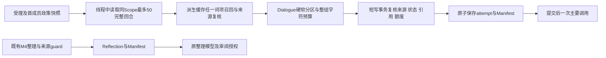

# 架构与实施基线：私聊陪伴主线

## M7.2实际任务上下文

运行时0.7.2.dev1、主库12、导出9、桥接0.6.0。[cognitive](../persona_runtime/cognitive.py)协调准备、最终复核和追加式审计；[context_builders](../persona_runtime/context_builders.py)实现五类任务视图；[context_policy](../persona_runtime/context_policy.py)复用既有入口政策权威；[schema_m72](../persona_runtime/schema_m72.py)只增加请求快照和清单，不预建未来情绪/治理/Session实体。

普通召回过期/故障可回退安全基础上下文，明确引用失效停止、零主要调用。检索不持主库写事务，历史/缓存不成为第二正文权威。输入哈希对应实际messages序列；清单只保存元数据，原文展开重新鉴权。全局连通性主调用的清单scope为null，可由管理员在desktop检查明确ID，不能假装属于当前人格或经QQ范围读取。

Dialogue和Reflection接入真实调用；Affect/Director/Planning仅返回未就绪合同，不创建状态或任务。新工作台页调用管理员context.preview/inspect；后台刷新及迟到响应受人格/入口/目标代次保护。旧context_uses保留兼容字段并关联context_id。实际行为与边界见[M7.2](M7.2.md)，下方为此前架构快照。

> **M7.2当前收尾（2026-10-28）：** M7.2规定范围验收完成，历史条件继续携带。0.7.2.dev1/主库12/导出9/桥接0.6.0；自动召回默认开启、跨会话另开、明确引用失败零调用，缓冲及回复模式保持。最终全量390项161.670秒通过，48/16人工集、两条副本恢复及实际Tk通过；真实8次固定主要＋1次整理＋1次修复复验，共20,340 tokens，实际QQ一片纯文本sent可追溯。原R01中文句号漏召回及SDK超时现场保留；R01已修复复验关闭。原人格、完整配置/30/6/20、每日整理开关及三服务停止初态恢复，无未决输入/新片段。 [实现与使用](M7.2.md) · [机器结论](acceptance/M7.2-机器验收结论.md) · [M7.3准备](M7.3-开工输入与待定事项.md)。下方旧版本及未实施描述保留为历史，不代表当前状态。

> **M7.1已实现（2026-10-28）：** 0.7.1.dev1，主库11/导出8/桥接0.6.0保持。权威批量投影与精确read_exact共用project_turn，快照A → 派生分区事务 → 查询 → 快照B/digest及候选正文复核；普通QQ只投影确认sent文本。archive_query/corpus/index/search及desktop_archive_search组成管理员检索/只读recent_50工作集。四个管理action在线程执行，桥接拒绝；单派生库有路径/ACL、维护锁、实例/代次CAS和幂等。没有主库change-log、后台续建、自动聊天召回或CognitiveContext。见[阶段实现](M7.1.md)与[机器结论](acceptance/M7.1-机器验收结论.md)。
>
> 本阶段正式环境初态/终态三服务停止；实际界面使用隔离人工数据与本机API，副本恢复和正式只读核对分别取证。下面M7.0在线/索引未实现等描述属于历史阶段快照。

> **目标架构指导（2026-10-28）：** 后续设计采用[用户新增规划](pcar_project_plan_zh.md)的持久Persona、单一权威、任务级上下文、候选/证据链、双重Gate和分层治理方向；[衔接说明](后续开发指导与规划衔接.md)列出与当前实现的差异。这些目标模块仍为规划，不能将其中实体和流程视作本页下方已实现API或表结构。

> **2026-10-28 M7.0规定范围验收完成：** 运行时0.7.0.dev1、结构11、导出8、桥接0.6.0。精确档案/完整回合引用、实际QQ正常与不可用引用、工作台、导出、重启及最终运行恢复均有证据；三个服务归属明确并运行，原人格、政策及30/6/20额度恢复，无未决输入。本轮恢复无新增主要/整理调用及确认片重放。见[最终收尾](acceptance/M7.0-最终收尾-20261028.md)及[机器验收结论](acceptance/M7.0-机器验收结论.md)。
> [M7.1复评](M7.1-封存规划复评.md)结论为“局部修订后复用”，原规划继续封存，不自动开工。历史M4 O01–O03、M5 P09及M6.1旧付费显式续跑继续携带，不声明全部历史条件通过。下方旧版本和服务状态按原执行日期保留。

> **M7.0暂停时的历史快照（2026-10-28，恢复门现已关闭）：** 运行时0.7.0.dev1、结构11、导出8、桥接0.6.0已部署。精确档案/完整回合引用、实际QQ正常与不可用引用、正式工作台草稿保护、导出和最终重启数据一致性已有证据；原人格、政策及30/6/20额度已恢复，用户选择“暂不恢复，保存交接”，最终QQ运行恢复门暂停，尚不声明M7.0全部退出。见[机器验收结论](acceptance/M7.0-机器验收结论.md)及[续验交接](acceptance/M7.0-续验交接-20261028.md)。

> 2026-10-28控制台生命周期修订：服务须持活跃窗口租约，宿主监测窗口进程身份并绑定Windows Job；正常关闭自动管理员强停，异常退出回收宿主和子进程。无窗口时禁止常驻服务启动，关闭期间每日整理不执行。修复过程见[历史暂停交接](acceptance/M7.0-暂停验收与控制台生命周期交接-20261028.md)，当前结论见上方最终收尾。
> **M7.0新增精确档案域：** archive只读投影与scope约束；input_references同受理事务固定来源绑定；reference_checks保留调用前失败与重试检查。context注入完整目标回合，先复核来源/预算；QQ引用只用sent纯文本。本项目host在SDK接收前安装进程内get_reply=False保护。管理面archive.list/get/resolve/preview不开放给桥接，原文/投递账本不改写。详见[M7.0](M7.0.md)；M7.1索引未实现且规划封存。

> **M6.4历史基线（2026-10-28）：** M6.4联合验收完成，M6核心范围收尾，历史条件继续携带。0.6.4.dev1 / 结构10 / 导出7 / 桥接0.5.0；本次全量237项通过（86.141秒）。72次固定质量对照完成，两种情境模式均22/24不劣于兼容模式；实际QQ快速三输入同批及修复后纯文本平台读回通过。首组含Markdown缺陷记录保留。合计74次真实主要调用、144,059 tokens，金额未知。原人格、入口政策及30/6/20额度已恢复，按验收前状态恢复人格服务停止、AstrBot/QQ在线。M4 O01–O03、M5 P09及M6.1旧付费显式续跑条件仍待验；M7仅准备，不提前实现。见[M6.4联合结论](M6.4.md)和[质量对照](acceptance/M6.4-质量对照结果.md)。下面带旧日期的状态是历史实施记录。

## M6.4 QQ纯文本展示

新增qq_text转换器，语义ReplyBatch/事件不改；QQ传输片段在落账和hash前去Markdown装饰，保留正文、URL、数字及代码内容。旧逐条桥接同样转换；不修改历史已发送账本，不新增模型调用、数据库或接口。平台读回核对实际片段。详见[M6.4](M6.4.md)。

## 历史实施：M6.3 已实现回复域（2026-10-27）

源码0.6.3.dev1/结构10/全量导出7。M6.2 ReplyBatch 在 QQ 生成完成事务中继续保存完整事件和语义段，并新增按人格、用户、Bot、联系人隔离的投递 stream 与 450 字传输片段。每片持有 hash、修订号、claim token、attempt、平台消息 ID、状态和错误；`sending` 重启后变 `uncertain`，不自动重发。v2 claim/result/resolve 通过事务 CAS 和 operation_id 幂等，旧 `/v1` 路径拒绝领取已有新账本的回复。正式迁移、实际QQ送达和工作台真人操作待验。

M6.2回复政策按人格/入口版本化为 `legacy_full`、`context_full`、`context_structured`，在受理时与 M6.1 批次政策快照共同固定；默认兼容全文。Behavior Resolver 为本地确定性词法弱提示，不增加模型调用或写入用户状态。角色表达样例可按弱情境匹配。

结构化模式以单次主模型调用请求 `ReplyBatch`，由 `reply_batch.py` 严格校验后，在同一完成事务中保存完整回复事件、语义批次、段和完成用量。错误不自动修复或二次调用；用量保留且不创建回复事件。M6.3逐片账本和发送尝试明细在[阶段说明](M6.3.md)中定义。管理员 `reply.*` 可管理策略，桥接令牌无权更改策略或处置投递。当前全量导出格式7包含投递账本并剔除凭据；D盘运行库经只读检查为结构8，副本8→9→10恢复、真实模型和QQ送达尚未验。

## M6.1 已实现输入域（2026-10-27）

新路径：获准文本 → 原子RawEvent/Event/Receipt → InputBatch → 唯一turn → 完整成员上下文 → 既有完整回复/投递。结构8增加政策版本/指针、raw_events、ingress_receipts、input_batches、input_batch_members、batch_operations与turns.input_batch_id；复合归属外键及turn批次范围触发器防串身份。SDK档案明确normalized_payload，旧历史不补造。

批次政策数据库为唯一权威；首条固定core/expression/relationship/character，模型封批固定，state执行前查。BEGIN IMMEDIATE串行化受理与封批，网络调用在提交后。统一turn_input同时供上下文、近期历史、规则召回、M4整理/进度/撤回和导出读取；user_event_id仅兼容首条。任一成员撤回保守屏蔽整轮及相关派生内容。

v1继续逐条，新客户端v2受理回执/批次查询，管理员才可改政策/处置批次。monotonic驱动，UTC诊断；重启标中断，显式恢复，正常停止拒绝未决输入。角色包与私人档案分离；当前全量导出7排除模型凭据并纳入投递证据。结构回复及逐片送达源码均已实现，Session生命周期仍未实现。详见[M6.3](M6.3.md)。

## M6.0新增角色域（2026-10-27）

角色扩展独立版本，复用persona_id；core/expression/relationship/state仍是原字段权威。结构7增加character_versions/heads/operations及turns.character_snapshot，旧数据扩展初版标migration，旧turn空快照不补造。管理员character.*接口、原生包、结构化工作台与确定性设定激活见[M6.0](M6.0.md)。不新增模型职责/依赖/渠道权限。下方为既有架构和历史状态。

2026-10-27最新决定：用户确认M5验收通过，阶段收尾；因架构与项目目标拟调整，暂不准备M6。M4 O01–O03及M5 P09保留未执行。见[M5收尾总结](M5-收尾总结.md)。 下面目标架构为已交付基线与历史方向，尚未执行新架构调整。

## 已确认的产品方向

1. 人格是持续存在的主体，模型是可替换的能力提供者。
2. 建立与用户长期相处的 AI 朋友，开发重心为高完成度私聊；群聊退出主要里程碑，只保留未来另行讨论的扩展可能。
3. 对话、记忆整理、检索和上下文管理可由不同模型承担。
4. 个人经历、关系和世界知识持久化，不依赖单个窗口上下文。
5. 新知识可经搜索补充，带来源和时间；人格演化应可追溯、可回退。
6. 项目生成的数据优先存储于 D 盘同名目录。
7. M3 优先响应速度、连续发消息、失败恢复；后续再推进记忆、人格与可信知识。当前完整路线以 [项目目标与开发路线](项目目标与开发路线.md) 为准。

## 目标架构

消息渠道 → 适配与会话管理 → 人格运行时 → 模型调度 → 回复

人格运行时负责核心人格、当前状态、记忆召回、世界知识、上下文组装；后台任务负责事件整理与候选更新。
QQ / AstrBot 接入层与核心逻辑分离，当前仅服务本人私聊和本地工作台。保留原始事件，后续摘要和索引应可重建；不因保留扩展点而提前开放群消息或其他联系人。

## 实施顺序

- M0：项目骨架、独立开发环境、D 盘路径规则（本次初始化）。
- M1（已实现）：人格、关系、事件、会话、显式记忆的数据结构；SQLite 持久化、重启恢复、人格隔离、记忆修订撤回、导出备份。
- M2（已实现，用户确认真人全流程通过，已收尾）：可扩展 Tk 工作台、本机人格服务、一个兼容接口模型、规则记忆召回、窗口和 QQ 本人好友私聊闭环、独立组件启停。
- M3（0.3.0 已实现，用户确认真人验收通过，已收尾）：私聊阶段耗时、独立状态刷新、逐条有序消息、受理回执恢复、可选排队取消/QQ 等待提示；详见 [收尾总结](M3-收尾总结.md)。
- M4（0.4.0已实现，核心补验通过）：T01–T06真人、T07–T10及O04/O05机器通过，O01–O03待补，见 [收尾总结](M4-收尾总结.md)；来源摘要、候选审阅、纠错屏蔽、规则召回解释、后台预算与每日全量更新已交付。
- M5（0.5.0已实现、用户确认验收通过并收尾）：同身份核心/表达/关系独立版本、比较回退、显式状态及到期、手动关系证据建议、受理版本快照和追溯，见 [M5说明](M5.md)；联合验收仍携带M4待验项。
- M6（历史规划，暂缓准备）：可信世界知识与按需搜索，包含来源、时效、知识更正和本地补充。
- 可选扩展：语音、图片或主动问候另定需求与授权；群聊与多参与者不列入当前主线。

M2 总结见 [阶段收尾](M2-收尾总结.md)，M3 设计起点和待定项见 [开发准备](M3-开发准备.md)。

M1 使用标准库 SQLite；M2 新增 aiohttp 与独立 AstrBot 环境。窗口、HTTP 服务、对话编排、模型客户端、存储和渠道适配器分层。模型首版采用 Chat Completions 兼容协议，具体提供商由用户在窗口填写；向量检索和 Agent 框架尚未选型。

正式人格导入分配全新 UUID，不继承模板期的关系、会话或记忆。当前人格选择持久化，历史会话归属不随切换改变。
事件追加记录，记忆关联同一人格和用户的来源事件；修订以新记录连接旧版本，撤回不物理删除。
当前保留本地单用户私聊边界，M3 不以多参与者身份改造为前置任务。若未来另行启用社交渠道，届时再独立设计与验证身份和可见范围。

M2 数据库版本 3：M1 表结构保留，新增入口会话映射、请求、调用尝试和投递状态；版本 3 为 QQ 请求绑定来源账号，避免切换账号后旧消息误投。M1 与早期 M2 结构均经备份后事务升级。
M3 数据库版本 4 新增请求活动、提示领取记录和取消时间，迁移前 SQLite 备份、事务升级。客户端未确认输入使用 D 盘 DPAPI 加密日志和跨进程文件锁，原请求标识先查询后显式提交；QQ 后台只核对回执，不自动重放。对话变化以活动序号查询，独立于服务身份扫描。完整响应没有首段时间数据；没有运行中取消或流式输出。
M4 数据库版本5新增任务/尝试、摘要、多来源候选、审阅、来源屏蔽、自动进度、每日周期和上下文使用记录。后台在同一本机服务中运行，管理员接口管理，QQ插件不参与整理。每日任务绑定当前人格全量分批扫描，正常记忆自动生效、冲突待审；手动/可选空闲增量候选仍须确认。纠错保护统一在业务服务中执行，命令行也会使旧来源和摘要失效。
M5结构6新增设定版本与当前指针、幂等操作、关系建议及前台设定快照。旧设定/关系作为迁移初版，不伪造旧版本。状态在调用开始时按UTC期限生效，回退不恢复失效记忆或关系来源；每日任务不改核心/表达/关系/状态，模型仍是可替换能力提供者。
每个请求和每次显式重试冻结模型配置，密钥快照保持 DPAPI 密文。用户事件先写入，成功回复和完成状态原子提交；失败轮次不进入正常近期上下文。
QQ 插件停止 AstrBot 默认模型传播，模型生成只在本项目服务内进行。平台消息 ID 去重；待发送回复由原始处理器和后台投递器竞争同一原子发送权。发送不确定状态不自动重发。
