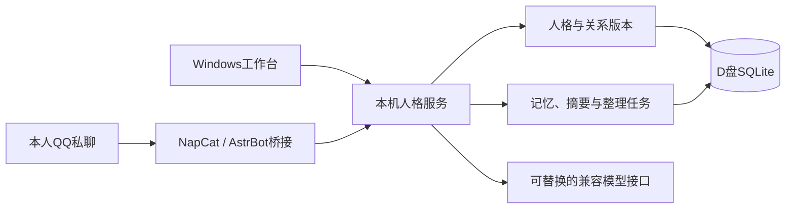

<!-- 2026-11-03 real streaming smoke -->
2026-11-03 [G11首组流式真实冒烟通过](docs/CR3-A.1-流式单组真实冒烟结果.md)：5调用含1辅助协议失败后重试恢复，3主首尝成功，收据完整、正常限组停止。自动策略拒绝临时鉴权及目录清理，收尾未完成；未续21组，真实自然度收益未验证，正式仍Shadow/default v2。
<!-- /2026-11-03 real streaming smoke -->

<!-- 2026-11-03 Windows pre-smoke readiness -->
2026-11-03 已完成[Windows真实冒烟前准备](docs/CR3-A.1-Windows冒烟前准备.md)：150项局部检查、R0的34零差异、22组86次及单组4次模拟通过；新增严格单组验收。当前仅准备，真实调用为0、自然度收益未验证，正式仍Shadow/default v2。下一入口为确认[单组真实冒烟](docs/acceptance/CR3-A.1-流式真实冒烟验收手册.md)，不自动执行或提交推送。
<!-- /2026-11-03 Windows pre-smoke readiness -->

<!-- 2026-11-03 stream runner pre-smoke closure -->
2026-11-03 流式恢复运行器完成、真实冒烟前阶段性收尾：新增scripts/dialogue_stream_recovery.py（cr3-stream-recovery-v1，包CR3-A.1-real-consumption-ablation-stream-4），以responses-3运行器为骨架仅改为anthropic-messages-stream-v1（stream:true、90秒空闲读超时、无总时限/max_tokens/reasoning_effort）；继承4个前序包（保守27预留/16失败/1未知），prepare前跑三份只读审计；--max-groups供冒烟，包内后续真实批次导入先前已结清结果不重放。运行器测试25项通过；以b12b40e为基线全量逐项对比无任何状态变化，新增49项全部通过，约800项为沙箱环境出错（盘符路径/DPAPI/缺D盘证据等）两边一致，须Windows复跑。

收尾中修正：上一轮的手工清理补充记录误放入responses-3封存目录，会致其审计evidence_inventory_changed并阻断新包prepare；已原样移至PCAR-dialogue-refactor/CR3-A.1-post-seal-supplements/，449哈希与清单复核一致。零真实调用/QQ/正式服务/私人副本。

下一步（用户在Windows执行）：复跑测试→stream-4\simulation-v1离线prepare/simulate/verify→另行授权后execute --real --max-groups 1冒烟（G11一组，预期约4、上限16次物理调用）。Responses传输与生产provider_compat仍非流式。入口：[运行器与冒烟前收尾](docs/CR3-A.1-流式恢复运行器与冒烟前收尾.md)。
<!-- /2026-11-03 stream runner pre-smoke closure -->

<!-- 2026-11-03 gateway stream fix -->
2026-11-03 网关500/524离线诊断与流式传输修复：CR3-A.1四轮恢复受阻的主因判定为所有实验传输均为stream:false，联合辅助长推理在约120秒内无字节返回，中转自身报500（120.7–121.8秒）或Cloudflare报524（125.8–126.5秒）；换协议无效因三种传输均非流式。同网关同G11请求的流式独立探测9/9成功（总136–219秒）。为强推断，未经网关方确认。

scripts/dialogue_anthropic_transport.py新增须显式选用的anthropic-messages-stream-v1：stream:true，SSE折叠为与非流式同一消息对象并复用parse_message；仅空闲读超时（默认90秒，可设None），无总时限或输出上限；断流/流内error/沉默分别映射provider_network_error/provider_aborted/provider_timeout（均为既有可重试码，用量未知不记0）。旧uncapped-v1默认合同17组输入逐字节不变。传输测试41项通过（新增24），变异检查与真实aiohttp本地模拟通过；依赖模块修改前后逐项状态一致，72项沙箱环境出错（D盘tmp路径69、msvcrt3）须Windows/Python3.12复跑。

未接线运行器、未改Responses传输、生产provider_compat及reasoning_effort；零真实调用/QQ/正式服务，真实网关效果待授权冒烟。入口：[诊断与修复](docs/CR3-A.1-网关500-524诊断与流式传输修复.md)。
<!-- /2026-11-03 gateway stream fix -->

<!-- 2026-11-03 stage closure -->
2026-11-03 阶段性收尾：dev19累计交流链路工程及隔离协议工具保存并纳入本地提交，用户已停止模型测试，不自动继续。Responses最后保守预留1次结果未知，真实效果未验；临时凭据已清理，两个运行目录删除受自动策略阻断，清空未完成。正式Shadow/default v2和数据版本不变，未推送或部署。详见[当前交接](docs/CR3-A.1-Responses恢复实测.md)及D盘对应handoff.json；下方原阶段状态保留历史。
<!-- /2026-11-03 stage closure -->

<!-- CR3-A current -->
2026-11-03 CR3-A离线工程完成，候选0.7.6.dev19、HEADbb68120上的原未提交成果保留。最终offline-v4完成48主/72mock，95项去重局部检查、R0的34零差异及24控制请求对开工renderer正文/wire等价通过。直接路径12配对相同，其余仅消费块差异；234个隔离库无active/running/隐藏选择观察。新合同分必须交流、状态约束、可选人物反应及具体缺项，绑定运行时来源/Frame/表达版本；同一次辅助接线，不改v2主提示/选材/采样/预算。旧v1保持，聚合引用按真实正文说话者校验。

本期结论：交流消费分工与轻量人物取舍接口工程完成、离线模拟通过；真实准确性、人物辨识和自然度收益尚未验证。CR2.1最新用户更正为5胜1平6负，仅在新D盘补充；旧3胜1平8负封存与机器评分保留，更正发生在映射揭示后，不是独立盲审。下方CR2.1原统计按历史读。

正式Shadow、表达/选择默认v2，结构20/导出17/配置2/桥接0.7.2保持；零真实生成/QQ/正式服务/实际私人副本/提交推送部署，不进Live/M8。v1准备不采纳、v2停止36主及v3加固前48主全部保留，勿替代最终v4。下一入口只制定CR3-A.1真实对照计划，不自动调用；R4-A/C、R4-B/路由及CR4未完成项仍保留。

入口：[CR3-A结果](docs/CR3-A-交流消费分工与轻量人物取舍.md)，D盘CR3-A-communication-consumption/closure.json和handoff.json为最终封存入口。封存后仅scripts/dialogue_communication_audit.py只读核查，禁止报告回写或重跑旧批。
<!-- /CR3-A current -->

<!-- CR2.1 current -->
2026-11-03 CR2.1真实诊断及12组用户复核已完成，工程验收完成、未见稳定自然度改善。128主/64配对/232物理调用（224成功、8失败均原生重试恢复）；5×524、1×520、2×有正文但authority合同校验拒绝分别保留。已知1,390,812 tokens，6次用量及金额未知。49项去重局部检查、最终224模拟、R0的34零差异、64真实旧renderer等价通过；160库active/running=0，临时鉴权清理完成。

用户12组冻结映射解码为新路径3胜1平8负；机器全量5胜31平28负，原分数/原答/匿名正文保持，原答与逐组映射仅存D盘证据。用户偏好新路径的3组中，2组主请求相同、1组后端标记缺失，均不作组件收益证明。冻结任务/边界两臂各64通过、32Frame的92关键项正确，但附加历史误读及条件收紧/缺项膨胀风险另存；新16分流挑战4漏/4过度分流，未修规则。本轮不正式启用，不改CR1结论或发布门槛。

0.7.6.dev18/HEADbb68120上的原CR2未提交改动保留；运行时/旧提示/预算/采样未改，正式Shadow/default v2，结构20/导出17/配置2/桥接0.7.2保持。正式/独立评测7538保护文件及CR0/CR1/CR2旧封存不变；本次用户结算新增模型调用0，零QQ、正式服务、实际私人副本、提交推送部署。下一最小建议CR3交流消费合同离线设计，具体施工范围待新计划确认，未自动实施。R4-B待集成/CR4，R4-A/C留CR3，私人副本/多轮留CR4。

入口：[CR2.1结果](docs/CR2.1-共享情境真实诊断.md)及验收手册；D盘CR2.1-real-diagnosis/closure.json、handoff.json及source-CR2.1-final.zip为最终封存入口，原checkpoint为复核前历史。仅scripts/dialogue_context_real_audit.py只读核查，禁止再次execute、成功重放或报告回写。下方历史状态保留。
<!-- /CR2.1 current -->

<!-- CR2 current -->
2026-11-02 CR2共享情境、自动分流与自动理解离线工程完成，候选0.7.6.dev18，施工基线bb68120，当前源码未提交。有效包offline-v3完成64主请求/112次mock生成（旧选择32、联合辅助16、主回复64）；自动臂16直回/16辅助，无隐藏旧辅助。85项去重局部检查、32份旧渲染请求等价与R0的34零差异通过；16组主请求相同，16组仅情境块变化，参数相同、无未解释差异，活跃预留0。v1准备失败及v2的112次未采纳模拟全部保留，不能混作验收包。

正式Shadow、表达/选择默认v2及结构20/导出17/配置2/桥接0.7.2保持；零真实模型、QQ、正式服务、实际私人副本、提交推送部署。自动理解是已接线算法的模拟验收，不证明真实准确性或自然度改善；CR1原结论不改。下一入口仅制定CR2真实诊断方案，不自动收费生成；R4-B待真实验证，R4-A/C留CR3，私人副本与长多轮留CR4。活泼性优先及拟稿礼貌回请允许原则继续有效。

当前入口：[CR2结果](docs/CR2-共享情境与自动理解离线实施.md)；D盘CR2-shared-context/closure.json与handoff.json为封存及恢复入口。封存后仅用dialogue_context_audit.py --verify-closure只读核查。下方CR1及更早状态均按历史读取。
<!-- /CR2 current -->

<!-- CR1 current -->
2026-11-02 CR1已完成：24共享v2选材＋144主回复，169物理调用（1超时第1重试恢复），已知544317 tokens、1次失败用量及金额未知。39项去重局部检查、168次新执行器模拟与R0的34零差异通过，原生active预留为0；用户12组匿名复核和礼貌拟稿裁定已结算，首版判断/分数/输出保留。结论未见稳定自然度改善，不宣称发布通过；下一最小建议CR2共同材料/消费者适配，尚未实施。当前[结果](docs/CR1-人工正确输入诊断结果.md)、[手册](docs/acceptance/CR1-人工正确输入诊断验收手册.md)；D盘CR1-oracle-diagnosis/closure.json和handoff.json为完成入口。dev17/HEAD8864775未提交，Shadow/default v2不变；无新增生成、QQ、正式服务、私人副本、提交推送部署。下方旧状态按历史理解。
<!-- /CR1 current -->

<!-- CR0 current -->
2026-11-02 CR0合同与共享情境骨架完成，候选0.7.6.dev17，HEAD8864775，源码未提交。36模拟、28项去重局部检查和R0的34场景零差异通过；自动理解和真实表达效果未验证。正式Shadow、表达/选择器默认v2，结构20/导出17/配置2/桥接0.7.2保持。零真实模型、QQ、正式服务及实际私人副本验证；R4-A/B/C仍未完成。

当前入口：[CR0结果](docs/CR0-交流链路合同与共享情境骨架.md)，下一阶段仅准备[CR1诊断](docs/CR1-人工正确输入诊断准备草案.md)，不自动开始真实调用。私人副本纳入后续验证并验收后清理、不提交；不客服式、不人机式和即时通讯自然度指标已登记，数值门槛待CR1确认。D盘CR0包保留原freeze及报告序列化修复，无成功重放。下方旧状态按历史理解。
<!-- /CR0 current -->

<!-- R4-A current -->
2026-11-02已按用户要求完成dev16阶段性收尾，原自动目标已暂停后清除，R4-A不再自动连续施工。下一工作由新的大规模重构范围决定；不自行启动默认v2/v8实测，不新增策略或模型调用。

v8离线工程准备完成：48模拟/24对通过，40项去重局部检查、42旧版渲染与R0的34请求零差异通过，无活跃预留。v8真实效果未验证，R4-A整体仍未通过；R4-B/C未完成，原生界面未执行。当前dev16、HEAD526e800，源码未提交；已保存源码ZIP、差异和最终指纹，补齐原先缺失的revision-008-offline-closure.json。

长期活泼性优先原则、未来实测“候选任务全过/相对对照不得退步”的用户授权、旧证据与旧成绩不追改、首次加3次重试和成功不重放继续携带。正式Shadow/default v2，结构20/导出17/配置2/桥接0.7.2不变。累计仍347真实调用，v8新增0；无QQ、正式服务、私人/正式数据变更、提交推送部署。

本次只做封存和重构交接，不宣称自然度改善或发布通过。新重构不必沿用v8，但须明确兼容与验收边界。当前入口：[dev16收尾与重构交接](docs/M7.6.3-R4-A-dev16阶段收尾与重构交接.md)；机器交接revision-008-stage-handoff.json优先于历史active记录。
<!-- /R4-A current -->

2026-11-01 新供应商240秒续验最新：按用户追加授权更换至e-flowcode.cc的grok-4.7网关，选择器上限及当前配置改为240秒，主回复180秒保持；候选0.7.6.dev10。鉴权目录GET与首条真实生成通过，独立补齐34/34请求，保留旧14成功，共48回复/24对照。新增70次调用（68成功、2网络失败均第1次重试恢复），累计105/384；成功选择不重跑，无悬挂回执或活跃预留。最长选择63.08秒正常完成。

[240秒续验记录](docs/M7.6.3-R3.1-新供应商240秒续验.md) · [验收手册](docs/acceptance/M7.6.3-R3.1-240秒续验手册.md)

55项局部检查、34请求/68次模拟和R0的34冻结场景通过。重型保护核查移至隔离调用计时前；工作台测试等待覆盖完整首次加3次重试，240秒配置下977秒。v1—v4提示、召回、预算、采样及默认v2未改；正式Shadow，不启动正式服务、QQ、提交推送部署。正式配置仅追加授权超时，正式数据库保持开工时指纹；开工前用户换供应商后的既有配置/数据库变化已记录，未覆盖。

工程和真实收集完成，效果未过：适用入模合并20/22→21/22，但新供应商两臂均14/15；不适用2→1，回应前提冲突1→1。机器偏好7胜11平6负；14组同请求，6组可分析子集2胜2平2负，不支持宣称v4更自然或正式启用。两个供应商分别报告；原R3.1阻断与旧证据不改。合计已知365,868 tokens，9次失败用量及金额未知，推理计数按各网关原回执解释，不重复累加。

下一最小主线为R4-A复述式表达与样例套用，再到R4-B情境缺口、R4-C人格动作兑现，均尚未实施；不再自动追加选择器实测，不进Live/M8。原生界面视觉复核未执行。见新供应商240秒续验记录与手册，证据在D盘`exports/acceptance/M7.6.3-R3.1-provider240-continuation`，终态以`closure.json`、`execution-reconciliation.json`和`real/analysis/final-report.json`为准。下方旧阻断按原批次历史理解。

2026-11-01 R3.1最新：隔离v3/v4真实对照工具与离线准备完成，真实批次因P04-stance-experiment选择位置首次加3次重试均超时而硬停止，真实验收未完成。候选0.7.6.dev9、工具r3-real-v1；结构20/导出17/配置2/桥接0.7.2、正式Shadow和默认v2不变，既有运行时和提示词未改。

42项局部测试、5项材料保护注入、48请求/96次模拟及R0的34冻结场景通过。实测P01/P02冒烟通过后执行到P04，保留14/48完整回复、7/24配对；1请求失败、33未执行。35次物理调用（21选择/14主回复，28成功/7超时），6次为重试、2请求恢复；无成功重放、未终结回执或活跃预留。已知141,744 tokens，7次失败用量及金额未知。不能删除blocked或自动续跑。

已观察配对适用入模6/7→7/7，不适用/前提冲突/无关背景均0；局部进展与后续更正等重点尚未覆盖，不能判整批效果。机器偏好3胜2平2负17未知，5组主请求相同，另外2组可分析子集1胜1平。记录了机械套用和一处无依据补写用户辨认原因；后者主请求相同，不能归因v4。完整结果保留，不正式启用v4。

R3.1按硬规则结算后回到R4主线：R4-A复述式表达、R4-B情境缺口、R4-C人格动作兑现，另定最小计划，不无限追加选择器试验；这些修复仍未实施。旧v1/v2成绩与门槛不变。零QQ、正式服务、私人/正式数据变更、提交推送部署；原生界面未执行，不进Live/M8。

见[阶段记录](docs/M7.6.3-R3.1-冻结材料真实对照.md)、[验收手册](docs/acceptance/M7.6.3-R3.1-v3-v4真实对照验收手册.md)。证据在D盘`exports/acceptance/M7.6.3-R3.1-frozen-real-comparison`；以blocked、stop-reconciliation、real/run-status与final-assessment为终态入口。封存后只读核对，下方R3及更早内容按历史理解。

2026-11-01 R3最新：回应前提校准与v4离线验证已完成。候选0.7.6.dev9，工具r3-prerequisite-v1；结构20/导出17/配置2/桥接0.7.2不变。开工核对R2.1的549源码和734证据全部一致，原未提交工作区及HEAD 19bca9e保留。新增可选character-selector-v4，只在v3表达样例部分增加正文前提、过程迁移、局部完成、当前意愿与整条样例判断规则；默认仍v2，v1—v3正文与处理行为保持。

12个全新场景、两人工角色、144逐正文标签冻结；48请求/96次正常模拟、14组15子例故障、56项去重局部检查通过。v1—v3的9份请求等价，R0的34冻结场景零差异。24组中4组主请求相同、20组仅样例变化。P06-stance唯一适用e3未进前五候选，原样保留限制，不补塞或改召回。模拟响应独立于标签，含刻意不适用选择，不能作为v4准确性或自然度收益证据。

结论仅为“规则与工程准备完成、模拟通过、真实效果未验证”。正式Shadow/默认v2保持；零真实调用、QQ、正式服务启动、私人/正式数据变更、提交推送部署。R2/R2.1旧封存与C21计分不改；原生界面未执行。下一最小入口仅另定v3/v4真实对照计划及调用上限，不继承256次授权、不自动启用v4。C23复述式表达、原情境缺口与动作兑现仍未完成，不进Live/M8。

见[R3阶段记录](docs/M7.6.3-R3-回应前提校准与v4离线验证.md)、[验收手册](docs/acceptance/M7.6.3-R3-v4离线验证验收手册.md)。证据为D盘`exports/acceptance/M7.6.3-R3-selector-prerequisites`；封存后仅只读核对，不重跑会回写旧包的报告器/检查器。下方R2.1及更早断点按历史理解。

2026-11-01 R2.1最新：冻结8场景真实对照已完整完成，32回复/16配对，共66次生成（64成功、2次选择超时均在第1次重试恢复），未触及256次上限。候选仍0.7.6.dev8，独立工具r2-real-v1；35项局部测试、32请求/64调用模拟及R0的34个冻结场景通过。R2原工具、材料、1425旧证据及生产运行时/提示词未改，结构20/导出17/配置2/桥接0.7.2不变。

工程完成，效果按冻结口径出现材料适用性退步：适用入模5/10→8/10，但不适用0/16→1/16（C21-detail选入progress，原标签只允许tradeoff）。机器偏好3胜12平1负；12组主请求相同不能算选择收益，4组可分析子集2胜1平1负。事实/任务/引用边界未见退步，但未满足“支持继续保留v3实验方向”的全部条件，不正式启用。已知258,815 tokens，两个超时用量及金额未知。保留全部结果和原标签，不追加生成或重放成功项。

正式Shadow、默认v2保持；零QQ、正式服务、私人/正式数据改动、提交推送部署。原生界面本轮未执行。下一单变量建议仅强化选择器对回应前提与当前完成状态的相容性核查，使用新材料，不同时改主提示/召回/角色结构；本轮未实施。原情境缺口与动作兑现仍未完成，不进Live/M8。

见[R2.1阶段记录](docs/M7.6.3-R2.1-冻结材料真实对照.md)、[验收手册](docs/acceptance/M7.6.3-R2.1-冻结材料真实对照验收手册.md)。证据为D盘`exports/acceptance/M7.6.3-R2.1-frozen-real-comparison`，最终阅读结论在`real/analysis/final-report.json`；下方R2及更早断点按历史理解。

2026-11-01 R2最新：表达样例适用边界与离线对照准备已完成。候选保持0.7.6.dev8，工具包r2-calibration-v1；生产运行时、提示词、结构20/导出17/配置2/桥接0.7.2均未改。以dev8的536源码及99证据核对为起点，新增24场景、2人工角色、288条“场景＋角色＋材料＋正文哈希”标签。交流意图适配为主判据、窄情境标签为辅助。96正常请求/192模拟调用、12组13子例故障验证、31项局部测试、R0的34个冻结场景均通过。正式Shadow/默认v2、原R1严格与宽松成绩保持；零真实调用、QQ、正式服务、提交推送部署。

C24两角色的formal样例未进前五候选，已单列缺失，不补塞或替换；不影响固定8场景子集。模拟选择是独立人工夹具，包含刻意错误，任何选择率或输出差异都不是v3效果证据。当前结论为“准备完成、模拟通过、真实效果未执行”。下一最小入口仅依据C01/C03/C05/C09/C17/C18/C21/C23冻结子集制定独立有限额实测计划，另定调用预算；不自动发起生成、不改主提示或正式启用v3。原情境缺口与动作兑现仍未完成，不进Live/M8。

见[R2阶段记录](docs/M7.6.3-R2-表达样例适用边界与离线准备.md)、[R2验收手册](docs/acceptance/M7.6.3-R2-离线对照准备验收手册.md)。证据为D盘`exports/acceptance/M7.6.3-R2-example-calibration`。下方dev8重试及更早断点为历史记录；日常聊天首次加最多3次重试规则继续有效。

2026-11-01 dev8最新：按用户“最多3次自动重试，并同时加入日常聊天运行时”的追加授权，主回复与选择器已实现首次失败后最多3次重试（最多4次物理调用）；成功不重放，权限/来源/额度/账目/取消立即停止，选择器重试耗尽中止本轮。逐次审计、取消终态与跨小时额度统计已接入。154项局部测试通过（含R0的34个冻结场景），3请求/8次故障注入模拟通过。仅补剩余3请求，新增6次真实调用全部成功，旧超时在第1次重试恢复；保留原29条成功，现有32条回复/16组对照。Grok含闸门保守71次、已知265,754 tokens，旧超时用量仍未知。

工程和真实数据收集完成，效果分开结算：严格适用入模9/12→10/12，但排除样例0/16→2/16；事前冻结宽松口径9/12→12/12、排除0/16。机器偏好4胜12平，其中3胜主请求相同，另一胜后端指纹变化，未证明选择器带来自然度改善。默认v2、正式Shadow保持；保留v3实验方向，不正式启用。旧dev7阻断、DeepSeek结果及原终态缺口均保留，不混算、不删除stop或补造用量。正式文件/私人设置/冻结集不变，零QQ/正式服务/提交推送部署，结构20/导出17/配置2/桥接0.7.2不变。下一最小入口仅整理适用边界、套用样例与归因限制并制定新材料验证方案，不追加本批次调用；原情境缺口与动作兑现仍未完成，不进Live/M8。

见[三次重试与完整续验](docs/M7.6.3-R1-三次自动重试与续验.md)、[dev8验收手册](docs/acceptance/M7.6.3-R1-三次重试验收手册.md)；证据为D盘`exports/acceptance/M7.6.3-R1-grok47/retry-three`。下方旧断点按历史理解；旧“无自动重试”约定在本次聊天与隔离测试授权范围内由上述规则替代，后台整理/编译/观察的生成流程未扩展。

2026-11-01 Grok定向适配最终：用户更换为UniAPI的grok-4.7，候选0.7.6.dev7。选择器严格JSON Schema、结构回复/选择低推理强度及无正文失败诊断已接入；主提示/采样额度/默认v2不变。6/6兼容闸门与32请求/64调用离线模拟通过；真实续验在R08-detail-experiment选择器60秒超时后阻断。59条预留、58成功，第59条因取消未写终态；1条本地主attempt被账本在发出前拦截，未产生额外主调用。29/32完整回复、14/16完整对照；本轮含闸门共65条保守调用、已知235,676 tokens，1次用量未知。配齐样例入模9/10→10/10，严格/宽松排除与无关背景均0/14；3胜11平0负2未知中的3胜均主请求相同，不能归因v3，效果未证实。76项局部+7项保护测试通过，取消缺口另离线复现，未修复；R0的34场景保持。正式Shadow、默认v2，零QQ/正式服务/提交推送部署。下一最小工作仅离线补齐取消终态记录；保留blocked与全部原结果，不自动补跑，不提高超时，不启用v3。原情境缺口与动作兑现仍未完成，不进Live/M8。 [Grok适配与续验结论](docs/M7.6.3-R1-Grok47适配与续验.md)。证据：D盘exports/acceptance/M7.6.3-R1-grok47的closure.json、blocked-details.json及stop-reconciliation.json。下方旧断点按历史理解。

# Persona-Centric Agent Runtime

**供应商排查更新：** 当前连接正常。隔离实测确认JSON模式返回纯空白；关闭该模式能得到中文，但不符合回复结构。客户端未吞正文，稳定格式修复仍待验证。生产代码、配置及R1效果成绩保持。[排查结论](docs/M7.6.3-R1-供应商空响应排查.md)。

**R1续验更新：** 已按授权有限重试并增加宽松评分。新增11次调用，4成功7空白失败，连续第五次失败后停止；现有23/32完整回复、11/16完整对照，真实验证仍未完成。默认v2、正式Shadow及候选dev6保持。[续验结论](docs/M7.6.3-R1-续验与宽松适用性分析.md)。下方原R1结果按历史阅读。

**供应商原则：常规开发以DeepSeek官方API为重点基线，本次用户指定的Grok按最新定向授权执行；其他供应商和中转站的服务质量及兼容性不作保障。** [完整总则](docs/模型供应商支持总则.md)。明确的数据删除授权优先于历史保留要求。


下述原R1快照候选为`0.7.6.dev6`、主库20、导出17、配置2、桥接0.7.2。M7.6.3-R1表达样例独立选择与只读诊断已实现，默认选择器仍v2；166项局部检查和R0的34个冻结场景通过，停测后账本保护另31项通过（重叠不累加）。真实对照保存56条调用、19条完整回复与9次空响应，因账目完整性异常停测，效果验证未完成；不建议正式启用v3。日常仍Shadow，冻结质量门不变，情境缺口与动作兑现仍待修复。[R1说明](docs/M7.6.3-R1-表达样例独立选择.md) · [R1验收手册](docs/acceptance/M7.6.3-R1-表达样例独立选择验收手册.md) · [当前状态](docs/STATUS.md) · [R0基线](docs/M7.6.3-R0-提示词装配基线.md)。下方旧版本与阶段快照按其日期阅读。

> **2026-10-29规划更新：** 采纳[M7.5角色语义激活](docs/M7.5.md)，置于M7.4验收后、M8.A前；首次交付真实本地Embedding，前三包自检、第四包唯一联合验收。当前尚未施工，运行版本不变；详见[指导1.2](docs/pcar_project_plan_zh.md)。

> **2026-10-29 规划修订，规划已采纳：** 先实现无需日常监管的陪伴运行，包含自动记忆、运行恢复、世界知识与热梗/时政更新，再接入 Director 和研究人格演化。详见[指导1.1](docs/pcar_project_plan_zh.md)、[路线及核心决议](docs/无人值守陪伴优先-路线修订草案.md)与[G-AUTO验收门](docs/acceptance/无人值守陪伴-阶段门与验收矩阵.md)。这些是未来目标，当前版本和默认行为未改变；用户已在审阅交付后授权提交推送本次规划。

### 以人格为中心的私聊陪伴运行时

[MIT 开源协议](LICENSE)

> M7.0历史收尾：规定范围验收完成，历史条件继续携带。实际QQ引用、撤回零调用、正式工作台、导出8、重启数据及最终运行恢复均已核对，见[最终收尾](docs/acceptance/M7.0-最终收尾-20261028.md)。M7.1已据此完善为[v2开工规划](docs/M7.1-中文全文与时间检索开工规划.md)，工程尚未实施，封存原稿保留历史。

> M6历史收尾：M6核心范围收尾，历史条件继续携带。M6.4全量237项、72次质量对照及实际QQ合批/纯文本门通过，见[M6.4](docs/M6.4.md)。

当前运行时0.7.4.dev1、结构14、导出11、桥接0.7.0。M7.4规定范围验收完成，26次真实调用、QQ余段取消与恢复通过，历史条件携带，见[阶段进度](docs/M7.4.md)及[机器结论](docs/acceptance/M7.4-机器验收结论.md)。M7.3历史验收保持。[M7.2](docs/M7.2.md)已通过规定范围验收；M4 O01–O03、M5 P09及M6.1旧付费续跑继续携带。十份[施工文档](docs/施工总计划/README.md)已同步，下一步仅准备M7.5。

人格、记忆与关系持续保存，模型与聊天渠道可以替换。


[M7.1使用说明](docs/M7.1.md) · [快速开始](#快速开始) · [项目进度](#项目进度) · [待完成事项](#待完成事项) · [文档导航](#文档导航)

</div>

---

一个面向**单人私聊陪伴**的本地项目：在 Windows 工作台或本人 QQ 好友私聊中，与同一个持久化人格交流。重点是对话连续性、长期记忆、关系维护，以及出错后的可理解恢复。

**以下M7.1验收状态为历史快照；当前版本与实际运行状态见上方M7.3进度。** 正式服务保持验收前停止状态；最新证据见[M7.1机器结论](docs/acceptance/M7.1-机器验收结论.md)。

## 核心能力

| 能力 | 当前实现 |
| --- | --- |
| 双入口私聊 | Tkinter 工作台 + 本人 QQ 好友纯文本私聊；同人格共享长期记忆，近期会话分开 |
| 持久化人格 | 新人格独立身份；同一人格可编辑核心、表达和关系，比较版本并回退 |
| 可靠对话 | 默认逐条有序，可按人格/入口手动开启5秒缓冲；原文持久受理、队列、失败显式恢复 |
| 长对话接续 | 有来源、可失效的会话摘要；显示上下文缺口与使用的记忆版本 |
| 长期记忆 | 显式录入、多来源候选、确认、修订及撤回；旧来源屏蔽防止派生摘要重新带回 |
| 每日整理 | 按本机24小时间隔全量更新周期开始时的当前人格；正常记忆自动生效、冲突待授权 |
| 可控状态 | 手动临时状态及期限，到期退出后续调用；不自动推断情绪 |
| 独立管理 | 本机HTTP服务、NapCat/AstrBot独立环境、归属核对、备份导出及DPAPI凭据保护 |
| 档案与工作集 | 管理员中文/时间查询与完整回合；M7.2默认当前会话自动召回，可关闭或另开跨会话 |
| 会话与主题 | 运行中空闲30分钟或手动封存、只读回放、手动整理、接续与主题/Thread；规定范围已验，长时门使用受控模拟 |
| 精确档案与引用 | 按ID恢复完整输入回合与实际发送片段；本人QQ支持文字附一个原生引用；失败引用零模型调用 |

自动整理受额度限制，到限后等待续跑；未配置整理模型时不调用。手动整理及可选空闲增量候选仍须人工确认。每日更新不会自动修改人格核心、显式关系或临时状态。

## 项目进度

| 阶段 | 目标 | 实现 | 验收状态 |
| --- | --- | --- | --- |
| M1 | 人格、会话、事件与显式记忆持久化 | 已完成 | 纳入后续闭环与回归 |
| M2 | 工作台、本机服务、模型及QQ本人私聊 | 已完成 | 用户确认全流程通过 |
| M3 | 连续消息、响应观测与失败恢复 | 已完成 | 用户确认通过 |
| M4 | 长期记忆、摘要及每日更新 | 已完成 | **核心通过；O01–O03待验** |
| M5 | 人格/关系版本、状态及连续性 | 已完成，v0.5.0 | **用户确认通过并收尾；跨模型待补** |
| M6.0 | 角色资料、版本和设定书 | 已实现 | 核心机器验收完成 |
| M6.1 | 输入持久化与缓冲 | 已实现，0.6.1.dev1 | 快速QQ合批本次通过，旧付费显式续跑条件继续携带 |
| M6.2 | 情境表达与结构化回复 | 源码已实现，0.6.2.dev1 | 实现及部署已完成，72次联合质量对照通过 |
| M6.3 | 片段可靠投递 | 已实现，0.6.3.dev1 | 222项全量、实际工作台、本人QQ/三片顺序和单片恢复通过 |
| M6.4 | 联合验收与核心收尾 | 0.6.4.dev1 | 237项全量、72次对照、QQ合批及纯文本复验通过；历史条件继续携带 |
| M7.0 | 原始档案、精确引用及来源恢复 | 已实现并部署 | 规定范围验收完成，最终QQ运行恢复通过；历史条件继续携带 |
| M7.1 | 中文全文、时间与只读工作集 | 已实现，0.7.1.dev1 | 人工80/80、实际隔离工作台、主库副本恢复通过；详见阶段结论 |
| M7.2及后续 | CognitiveContext、会话及表达硬化 | 待准备阶段合同 | 自动召回、Session/Thread及向量等未实现 |

历史M6.1完整回归187项通过81.315秒；详细证据及条件限制见[M6.1说明](docs/M6.1.md)。

历史M5完整离线回归 **135项通过**；恢复分支及界面针对性 **38项通过**，机器验收窗口再次执行38项通过，轮次有重叠不相加。另有真实模型、实际工作台及恢复验收，见 [M4/M5验收总结](docs/acceptance/M4-M5-机器验收总结.md)；这些本机记录不是持续集成状态。

## 快速开始

### 1. 准备环境

需要 Windows、已安装的 **Python 3.12** 和 `uv`。仓库提供源码，不附虚拟环境、模型密钥、QQ客户端或第三方组件二进制。

克隆后在仓库根目录打开PowerShell：

```powershell
git clone https://github.com/FoxofCAUC/Persona-Centric-Agent-Runtime.git
cd Persona-Centric-Agent-Runtime

# 创建D盘数据目录，不调用模型。
python -B -m persona_runtime init-storage

# 仅作用于当前PowerShell会话及其子进程。
$env:UV_CACHE_DIR = 'D:\Persona-Centric Agent Runtime\cache\uv'
$env:PIP_CACHE_DIR = 'D:\Persona-Centric Agent Runtime\cache\pip'
$env:PYTHONPYCACHEPREFIX = 'D:\Persona-Centric Agent Runtime\cache\pycache'
$env:TEMP = 'D:\Persona-Centric Agent Runtime\tmp'
$env:TMP = 'D:\Persona-Centric Agent Runtime\tmp'
$env:UV_PROJECT_ENVIRONMENT = 'D:\Persona-Centric Agent Runtime\.venv'

uv venv --no-managed-python --python 3.12 'D:\Persona-Centric Agent Runtime\.venv'
uv sync --frozen --no-managed-python
.\scripts\dev.ps1 db init
```

已部署用户使用现有环境，不重复创建或覆盖数据。数据库升级先备份，再事务迁移。

### 2. 开始窗口对话

双击根目录 **`启动PCAR.bat`**，或运行：

```powershell
.\scripts\dev.ps1 gui
```

1. 首页点击“只启动人格服务”。
2. 在“人格与记忆”创建模板或导入JSON，明确选中并切换人格。
3. 在“模型”填写Chat Completions兼容接口、模型名和密钥并保存。
4. 到“聊天”恢复或新建会话，发送消息。
5. 在“人格与关系”管理同身份设定与版本，在“记忆整理”查看任务、候选和每日计划。

打开窗口、保存配置不调用模型；发送、显式测试和重试可能计费。服务只在控制台存活期间运行；关闭控制台会自动强制停止全部相关服务，完成后退出窗口。控制台关闭期间不执行每日整理。若 Windows 要求管理员授权，请完成授权；停止失败时窗口保留并显示原因。

### 3. QQ本人好友私聊

QQ部署使用独立AstrBot **4.29.1** 环境和本项目桥接插件，不让AstrBot再次生成普通模型回复。

**当前组件准备仍有本机约定：** 默认从 `D:\QQ_Bot_2\napcat-shell` 复制NapCat程序，排除账号配置、缓存、日志与令牌，不修改原项目。其他机器须先处理该来源路径，不能认为“准备组件”适用于任意安装。独立SDK与组件准备可能联网下载依赖。

部署后配置Bot QQ与本人QQ，启动服务、登录并核对OneBot。详见 [QQ部署与启停](docs/M2.md#qq-本人好友私聊)。本人私聊支持非空文字附一个QQ原生引用；群聊、临时私聊、其他联系人、纯引用及其他媒体仍拒绝。引用仅恢复同人格与同QQ身份范围的本地档案，不从平台自动取回历史。

## 运行与存储



当前运行时 **0.7.0.dev1**、数据库结构 **11**、全量导出 **8**、桥接插件 **0.6.0**。QQ出站使用纯文本，原语义回复及传输片段分别留存。

| 位置 | 内容 |
| --- | --- |
| Git仓库 | 源码、模板、测试、进度和验收手册 |
| `D:\Persona-Centric Agent Runtime\data\database` | 数据库、人格、会话、记忆及版本事实 |
| 数据根目录下 `config` / `runtime` | 配置、DPAPI密文、实例状态与锁 |
| `logs` / `backups` / `exports` | 元数据日志、备份、导出及本机验收证据 |
| `.venv` / `components` / `cache` / `tmp` | 依赖环境、独立组件、缓存与临时文件 |

`PERSONA_RUNTIME_HOME` 可显式覆盖业务数据根目录；磁盘不可用时失败，不自动退回C盘。现有Windows启动/开发脚本的项目解释器仍使用默认D盘 `.venv`，并非完全可移植启动器。`.env.example` 仅作参考，不会自动加载。

默认端口均绑定回环地址：人格服务 **8765**、NapCat管理页 **6399**、AstrBot管理页 **6285**、OneBot **6299**。正常启停核对归属，不接管未知端口。

## 待完成事项

- **M4条件项**：真实24小时、可选空闲增量、额度实际恢复续跑仍待验。见 [逐项清单](docs/acceptance/M4-补验跟踪.md)。
- **M5条件项**：第二模型对照未执行；M6.4固定72次样例比较通过，不保证所有场景质量；实际QQ收发及纯文本读回已有独立证据。
- **部署通用化**：解耦第三方组件来源和固定解释器路径，完善新机器环境准备；当前没有独立可执行安装包。
- **下一阶段**：采用已完善的[M7.1 v2开工规划](docs/M7.1-中文全文与时间检索开工规划.md)与[验收清单](docs/acceptance/M7.1-检索施工与验收清单.md)，先签收基线、人工集与离线选型。工程尚未实施，原稿保留历史；Session/Thread、向量检索、联网及演化仍为后续阶段。

规则召回不等于语义检索，引用校验不保证模型判断正确，QQ也不保证严格恰好一次投递。发送不确定时先人工核对，不自动从头重发。完整边界与优先级见 [项目状态与后续工作](docs/STATUS.md)。

## 文档导航

| 想了解什么 | 文档 |
| --- | --- |
| 当前版本、进度和缺口 | [项目状态](docs/STATUS.md) · [更新记录](CHANGELOG.md) |
| 后续开发指导 | [PCAR项目规划书](docs/pcar_project_plan_zh.md) · [现状与路线衔接](docs/后续开发指导与规划衔接.md) |
| M5人格/关系操作 | [收尾总结](docs/M5-收尾总结.md) · [使用说明](docs/M5.md) · [真人手册](docs/acceptance/M5-人格与关系真人验收手册.md) |
| M4记忆与每日整理 | [使用说明](docs/M4.md) · [补验跟踪](docs/acceptance/M4-补验跟踪.md) |
| 窗口/QQ基础部署 | [M2部署与启停](docs/M2.md)，其中阶段版本描述为历史基线 |
| 命令行持久化接口 | [M1操作说明](docs/usage.md) |
| 长期路线与架构 | [开发路线](docs/项目目标与开发路线.md) · [架构](docs/architecture.md) |
| 后续开发交接 | [当前交接](docs/HANDOFF.md) · [验收目录](docs/acceptance/README.md) |

## 开发与验证

```powershell
.\scripts\dev.ps1 paths
.\scripts\dev.ps1 db status
.\scripts\test.ps1
```

全量测试需要D盘项目环境及独立AstrBot SDK环境。新机器只准备核心环境时可先跑持久化测试：

```powershell
& 'D:\Persona-Centric Agent Runtime\.venv\Scripts\python.exe' -B -m unittest discover -s tests -p test_runtime.py -v
```

自动验证使用D盘隔离数据、模拟模型和模拟QQ，不自动登录或发真实消息。真人结果与截图留在本机，不提交Git。提交前请阅读 [协作约定](AGENTS.md)。

## 代码来源与许可证

部分工作台基础代码经授权从既有TRPG项目复用，当前运行不依赖其源码，详见 [复用记录](docs/REUSE.md)。仓库不分发NapCat、QQ或AstrBot二进制，第三方组件遵循各自许可和使用条件。

本项目采用 **[MIT 开源协议](LICENSE)**，版权声明为 `Copyright (c) 2026 FoxofCAUC`。第三方代码、组件及资源仍遵循各自许可证和使用条件；本项目的 MIT 声明不替代其许可。
