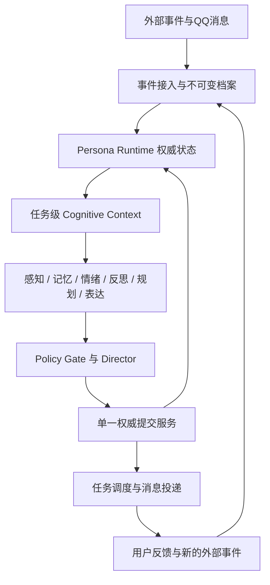
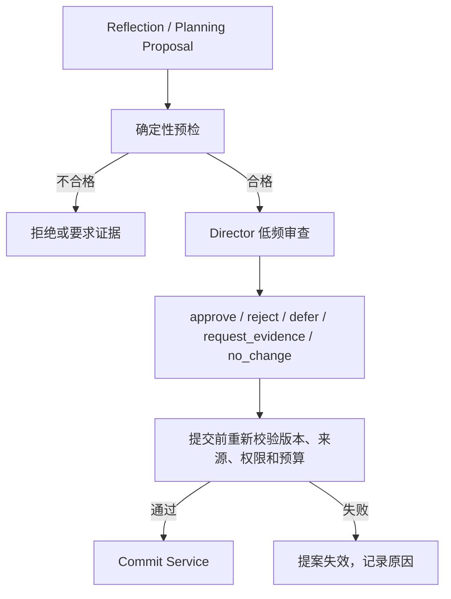

# PCAR 后续开发项目规划书

**项目：** Persona-Centric-Agent-Runtime（PCAR）  
**规划版本：** 1.0 设计基线  
**编制日期：** 2026-10-28  
**适用范围：** M7.1 之后的检索、交互认知上下文、自主认知、情绪、导演治理、受控演化、主动行为和多模态扩展

> 本文是一份指导后续开发的工程规划，不把设计提案写成已完成能力。文中将 PCAR 现有基础、已经设计但尚未实现的能力、影子实验和生产自治明确分开。

---

## 1. 项目定位与最终目标

PCAR 的主体不是一个持续运行的大模型，也不是多个互相竞争的聊天 Agent。它的主体是一个长期存在的 `Persona ID`，以及围绕这个身份维护的权威状态、真实经历、关系理解、情境状态、行为偏好、认知任务和审计历史。

模型是可替换的认知计算资源。模型可以负责理解、检索规划、反思、评价或表达，但不能因为一次输出就直接成为人格事实的最终写入者。

PCAR 的长期目标是：

> 让同一个人格在跨会话、跨天和跨模型的互动中，记住真实发生的事情，逐渐形成对用户和互动方式的理解，根据新的经历产生有边界、可解释、可撤回的行为变化，同时保持身份、性格和历史连续性。

这个目标包含五项必须同时成立的能力：

1. **身份连续性：** Core、Character、Expression、Relationship 等人格身份不依附某次模型会话。
2. **经历可信性：** 真实事件、模型推断、虚构设定、模拟经历和模型自述有不同来源和权限。
3. **行为可适应：** 互动可以改变非核心偏好、表达习惯、关系判断和目标，但变化必须有证据、有版本、有回退路径。
4. **内部状态可持续：** 情绪和心境可以随事件、时间和有限随机性变化，独立认知任务可以在没有即时消息时运行。
5. **即时通讯自然度：** QQ 交互应像持续聊天，而不是把文章一次性发送出去；消息编排、发送节奏、取消后续片段和标点习惯属于正式产品能力。

### 1.1 非目标

PCAR 不以以下目标为验收条件：

- 证明系统具有意识、主观体验或真实人类情感。
- 复制完整的人脑机制或建立庞大的虚拟社会。
- 为每个逻辑职责部署一个独立模型或独立 Agent 进程。
- 让人格无限制地自改提示词、权限、身份正典或自身治理规则。
- 通过孤独、愧疚、威胁失去关系等方式迫使用户回复。
- 用外部框架替换现有的单一人格权威状态系统。

---

## 2. 当前基线：哪些已经完成，哪些还没有

以下基线依据项目已有阶段记录和前几轮共同确认的状态整理。它不是对用户 Windows 环境的独立复测。

### 2.1 已有工程底座

| 阶段 | 当前已有的能力 | 对后续的作用 |
|---|---|---|
| M1–M2 | 人格身份、事件、记忆持久化，双入口运行 | 让人格不依附单一模型会话 |
| M3 | 消息受理、状态观测、失败恢复 | 保证互动事件不因投递或进程故障丢失 |
| M4 | 长期记忆、来源、候选、修订、撤回和整理 | 为可信记忆及后续认知更新提供证据底座 |
| M5 | Core、Character、Expression、Relationship、临时状态 | 建立稳定人格与可变状态的边界 |
| M6 | 角色资料、情境表达、输入批次、可靠投递 | 连接人格状态与即时通讯体验 |
| M7.0 | 原始回合档案、精确引用、来源恢复 | 保留原始证据，避免摘要替代事实 |

### 2.2 已经规划但不应视为完成

- M7.1：中文全文检索、时间检索、来源有效性复核和工作集。
- M8：Session、Thread、TopicSegment、异步后处理和反思候选。
- M9：带来源、时效性和版本的世界知识。
- M10：分层权限、导演审查和受控演化。
- 情绪系统、独立反思、主动行为和多模态接入。

规划文件中的实体、流程和验收记录不能替代真实运行测试。后续每一个阶段都必须标记为 `implemented`、`shadow`、`reviewed` 或 `accepted`，避免设计稿和代码能力混在一起。

### 2.3 本规划建议增加的状态标签

| 标签 | 含义 | 可否影响生产行为 |
|---|---|---|
| `planned` | 只有设计或任务条目 | 不可 |
| `implemented` | 代码已存在，尚未完成阶段验收 | 仅测试环境 |
| `shadow` | 真实读取数据并产生候选，但不改变正式状态 | 不直接改变 |
| `reviewed` | 已通过固定测试和人工复核，准备小范围启用 | 按白名单 |
| `accepted` | 完成阶段退出条件，可作为生产基础能力 | 按权限等级 |

---

## 3. 目标架构

### 3.1 总体结构



### 3.2 组件职责

| 组件 | 职责 | 不能做什么 |
|---|---|---|
| Event Ingestion | 将用户消息、时间经过、工具结果、发送结果写入事件档案 | 直接写人格正典 |
| Persona Runtime | 维护 Persona ID、版本、来源、事务和权威读取 | 让模型绕过提交服务 |
| Memory / Retrieval | 检索有效经历、关系事件、反例和原始引用 | 把检索结果自动当成新事实 |
| Perception | 识别消息中的事件、意图、情境和候选观察 | 修改长期状态 |
| Affect Engine | 评价事件、更新短期心境和情绪事件 | 直接改写关系事实 |
| Reflection | 从多条有效经历提出理解、偏好、目标和反思候选 | 把推断写成事实 |
| Planning | 判断未来认知任务和主动行为候选 | 绕过授权发送消息 |
| Expression | 选择回应动作并产出 ReplyBatch | 修改 Core 或记忆权威 |
| Cognitive Scheduler | 管理任务窗口、预算、租约、重试和恢复 | 接受无限递归任务 |
| Director | 低频审查高层提案、要求证据或保持不变 | 扩大自身权限、修改政策 |
| Policy Gate | 以确定性规则检查权限、来源、版本、预算和风险 | 被模型覆盖 |
| Commit Service | 单一权威写入、版本更新、审计和回滚 | 接受没有前置条件的自由文本写入 |
| Delivery | 分段、延迟、取消、重试和投递状态 | 将整段文章强行发送为单条消息 |

逻辑职责可以先由同一 Python 进程中的函数和少量模型调用实现。只有在边界稳定、任务量和故障隔离确实需要时，才拆成独立进程或外部服务。

### 3.3 核心不变量

1. 一个 `Persona ID` 只有一个权威状态提交入口。
2. 原始互动事件不可被摘要覆盖；摘要、嵌入和图谱索引都必须回指原始事件。
3. `candidate`、`belief`、`accepted fact`、`fictional setting` 和 `simulated event` 不得共用同一语义等级。
4. Director 的结构化批准不是事实；提交前必须重新经过 Runtime Gate。
5. 来源撤回、目标版本变化、权限变化或预算超限会使旧提案失效。
6. 情绪可以影响行为倾向和表达，不得单独证明关系事实。
7. 旧反思可以作为已有推断被读取，但不能作为新的独立证据反复自证。
8. `NO_CHANGE`、`NO_ACTION`、`DEFER` 和 `REQUEST_EVIDENCE` 是正常结果。
9. 任何发送、提交、任务领取、重试和回滚都必须有可审计的幂等标识。
10. 新外部事件优先于模型对旧事件的再解释；离线期间没有执行的模型调用不能被写成已经发生的思考。

---

## 4. 状态和数据模型

以下是逻辑模型。实现时可以继续使用 SQLite 和现有领域表，只有在查询和写入契约稳定后再拆分存储。

### 4.1 不可变事件

```text
ImmutableInteractionEvent
- event_id
- persona_id
- actor: user | persona | system | tool | scheduler
- channel: qq | workbench | voice | vision | internal
- occurred_at       # 事件实际发生时间
- observed_at       # Runtime 观察到事件的时间
- source_type
- source_ref
- payload
- redaction_status
- idempotency_key
- created_at
```

必须区分 `occurred_at` 与 `observed_at`。用户今天说“上个月我已经不再画画”，事件被今天观察到，但事件指向的生活变化发生在上个月。

### 4.2 记忆与证据

```text
MemoryItem
- memory_id
- persona_id
- kind: episodic | semantic | procedural | preference | relationship
- content
- source_refs[]
- valid_from / valid_to
- recorded_at
- status: active | superseded | retracted | archived
- confidence

MemoryRevision
- revision_id
- memory_id
- before_version / after_version
- reason
- evidence_refs[]
- operation_id
- created_at
```

摘要、向量、图谱边和候选理解都必须保存 `source_refs`。撤回原始事件后，任何派生索引必须变为不可召回或明确标记为受影响，不能只撤回正文而留下可命中的摘要。

### 4.3 信念候选

```text
BeliefCandidate
- belief_id
- persona_id
- subject
- predicate
- object
- claim_type: user_preference | relationship | interaction_habit | world_fact
- confidence
- evidence_refs[]
- contrary_refs[]
- source_lineage[]
- valid_from / valid_to
- expires_at
- status: candidate | accepted | superseded | retracted | disputed
- risk_tier
```

信念候选表达的是“目前较有根据的理解”，不是“世界已经被证明为真”。它必须允许过期、被反例削弱和回退。

### 4.4 情绪状态

```text
AffectState
- persona_id
- trait_baseline
- mood_vector: valence, arousal, social_drive, tension
- last_updated_at
- decay_params
- random_scope
- algorithm_version
- version

AffectTransition
- transition_id
- trigger_event_id
- before_state
- event_appraisal
- event_delta
- random_draw_id
- random_sample
- after_state
- algorithm_version
- operation_id
- created_at
```

读取状态不能重新抽样。一次状态转换必须保存抽样结果和算法版本；重复请求只能重放已经提交的 transition。

### 4.5 预期、目标和主动行为

```text
Expectation
- expectation_id
- subject: user | persona | shared
- statement
- evidence_refs[]
- expected_at / expires_at
- strength
- status: active | fulfilled | missed | expired | withdrawn

Goal
- goal_id
- owner: persona | user | shared
- statement
- source_refs[]
- priority
- permission_scope
- due_at
- status
```

“晚上再一起聊那部电影”可以建立一个带时间窗口的互动预期；没有明确约定时，几个小时没有消息不能被推导为“用户不在乎人格”。

### 4.6 自主认知任务

```text
CognitiveTask
- task_id
- persona_id
- type: consolidate | reflect | self_review | affect_update |
        goal_review | proactive_plan | director_review
- trigger_reason
- source_refs[]
- earliest_at / latest_at
- priority
- token_budget / cost_budget
- dedupe_key
- parent_task_id
- depth
- context_snapshot_hash
- status: pending | claimed | running | waiting_approval |
         committed | failed | skipped | expired | canceled
- lease_owner / lease_expires_at
- result_refs[]
```

模型只能建议下一任务；调度器决定是否接受它，必须检查最早执行时间、每日预算、同类任务去重、深度上限和用户静默设置。

### 4.7 演化提案与导演决定

```text
EvolutionProposal
- proposal_id
- persona_id
- domain: expression | preference | relationship | goal | character | core
- risk_tier: A0 | A1 | A2 | A3 | A4
- before_snapshot
- after_diff
- evidence_refs[]
- contrary_refs[]
- target_version
- preconditions[]
- expires_at
- rollback_pointer

DirectorDecision
- decision_id
- proposal_id
- result: approve | reject | defer | request_evidence | no_change
- policy_version
- model_id
- model_version
- reason
- confidence
- input_snapshot_hash
- created_at
```

### 4.8 即时通讯消息批次

```text
ReplyBatch
- batch_id
- persona_id
- conversation_id
- source_turn_id
- behavior_intent
- affect_hint
- messages[]

OutboundMessage
- message_id
- batch_id
- sequence
- content
- send_after
- cancel_if_new_input
- delivery_status
- provider_message_id
- operation_id
```

表达模型直接产生 `messages[]`，不允许先生成文章再用正则按句号切分。内容生成、消息组织和投递必须保持三个可测试的边界。

### 4.9 认知上下文清单

```text
ContextManifest
- context_id
- task_type
- persona_snapshot_version
- included_state_refs[]
- excluded_state_refs[]
- evidence_refs[]
- hard_constraints[]
- soft_tendencies[]
- truncation_info
- missing_data
- builder_version
- created_at
```

每次模型决策都应能回答：读到了什么、没有读到什么、哪些是硬约束、哪些只是软倾向、数据来自哪个版本。

## 5. 交互认知上下文设计

一个巨型 Prompt 不适合同时服务对话、反思、情绪、导演和主动行为。应由统一 `Context Builder` 根据任务生成不同视图。

| 上下文 | 读取内容 | 明确排除 |
|---|---|---|
| `DialogueContext` | 当前消息、相关原始经历、角色锚点、有效关系、当前行为倾向、M6 表达策略 | 大量演化日志、无关世界知识 |
| `ReflectionContext` | 已封存回合、证据、反例、已有信念及其原始证据链 | QQ 投递细节和未授权工具 |
| `AffectContext` | 事件、目标、预期、Trait、当前 Mood、衰减参数、用户边界 | 无关历史传记 |
| `DirectorContext` | 提案前后 diff、证据质量、反例、风险、政策、版本 | 全量聊天流水 |
| `PlanningContext` | 未完成目标、授权、冷却、静默时段、历史主动行为结果 | 不必要的角色文本 |

### 5.1 硬事实与软倾向

硬事实包括来源有效性、身份、用户明确边界、权限、静默设置和版本条件。模型不能把它们重新解释成可选建议。

软倾向包括“当前较安静”“近期不太适合连续追问”“用户曾经喜欢旅行但现在可能很忙”。它们影响行为选择和语气，但不决定固定句式。

同一条用户消息“我今天好累”，可由以下结构生成回复：

- 硬事实：用户没有说明原因，不能擅自诊断或补造经历。
- 软倾向：人格当前社交驱动力偏低，用户过去在疲惫时倾向于少被追问。
- 行为选择：短暂关心，提供休息空间，允许结束话题。
- 表达结果：`听起来今天消耗挺大的`、`先歇会儿吧`、`我不吵你`

情绪状态不应直接作为“孤独 80%，请表现得很孤独”这样的表演指令。它应先转换为有限的行为倾向，并允许某次普通回复完全不显式展示心情。

---

## 6. M6 即时通讯表达专项规范

M6 的自然度要求应成为后续所有认知模块的非功能门槛。情绪、导演和反思即使全部正确，如果最后仍发送一整段文章，用户感受到的仍然不是自然的即时通讯。

### 6.1 表达链路


推荐的结构化输出：

```json
{
  "behavior_intent": "care_without_pressure",
  "messages": [
    {"content": "听起来今天消耗挺大的", "send_after_ms": 0},
    {"content": "先歇会儿吧", "send_after_ms": 1100},
    {"content": "我不吵你", "send_after_ms": 1600, "cancel_if_new_input": true}
  ]
}
```

上面的延迟只是开发测试示例，不是固定产品参数。实际参数应由人格表达习惯、消息长度、平台限制和用户反馈共同校准。

### 6.2 默认中文私聊风格

- 日常聊天默认短句逐条发送。
- 句末通常不使用句号；逗号仅在确有必要时使用。
- 问号、感叹号、波浪号等可以保留，用于表达语气。
- 不能机械地把每个分句都拆成独立气泡。
- 数字、小数、URL、代码、引用、文件名和必要标点必须保护。
- 用户新消息到达时，尚未发送的后续片段应可以取消、合并或重算。
- 认真解释、引用资料或用户明确要求完整内容时，允许较长消息，但仍应符合人格和平台习惯。

### 6.3 M6 验收指标

1. 结构化 `ReplyBatch` 产出率达到 100%，无效 JSON 必须有确定性回退。
2. 重试不会重复发送同一 `operation_id`。
3. 新消息到达后，未发送片段的取消行为可重放。
4. 固定人格、固定场景下，消息数量、平均长度和延迟分布通过人工盲评。
5. 句号/逗号不会在普通中文私聊中无理由大量出现。
6. 数字、URL、代码和引用不会被错误切碎。
7. 同一语义在不同模型下仍保持消息批次的基本风格，而不是模型换代后退化成文章。

---

## 7. 情绪与心境系统（Affective Dynamics）

### 7.1 三层状态

| 层次 | 说明 | 时间尺度 |
|---|---|---|
| `Trait` | 敏感、活泼、沉稳、乐观等长期气质 | 很慢，受版本管理 |
| `Mood` | 最近整体偏积极、低落、安静或活跃 | 小时到数天 |
| `EmotionEpisode` | 对具体事件的短期反应 | 分钟到数小时 |

建议先使用四个连续维度：`valence`、`arousal`、`social_drive`、`tension`。它们是工程变量，不是对真实人类情绪的生理证明。

### 7.2 有界随机与衰减

第一版可以使用均值回归模型：

\[
m_{t+\Delta t}=clip\left(b+(m_t-b)e^{-\Delta t/\tau}+\Delta_{event}+\sigma\sqrt{1-e^{-2\Delta t/\tau}}\epsilon_t\right)
\]

其中 `b` 是人格基线，`τ` 是恢复速度，`Δevent` 是情境评价后的事件影响，`σ` 限制随机扰动，`εt` 由事件范围内的持久化随机派生，`clip` 保证结果在允许区间。

随机性应改变反应阈值、强度或持续时间，而不是制造未经证实的关系事实。

### 7.3 随机种子与可复现性

推荐使用：

```text
seed = H(persona_id, trigger_event_id, time_bucket, algorithm_version)
random_draw_id = H(seed, transition_index)
```

不要在多个模块之间共享一个不断消费的全局随机流。否则一次额外查询就可能改变未来所有情绪结果。每次状态提交都保存 `random_draw_id`、抽样结果、输入快照和算法版本。

### 7.4 “几个小时没回复”的处理

如果用户曾明确约定晚上继续聊天，且约定仍在有效时间窗内，未收到消息可以产生小幅预期落差，影响 `social_drive` 或短暂心境。

如果没有明确约定，沉默最多影响轻度社交倾向，不能推导出“用户不重视我”“用户要离开我”。情绪系统可以影响是否想联系、语气是否安静和话题选择，但不能绕过静默窗口、频率上限和主动消息授权。

### 7.5 情绪验收

- 相同状态快照、事件顺序、种子和算法版本可以完全重放。
- 所有维度始终在边界内。
- 自然衰减的方向和半衰期可解释。
- 无互动预期时，沉默不会生成负面关系事实。
- 情绪事件不会直接改变 Relationship 的正式事实。
- 低落状态不会让反思模块自动把普通历史全部解释成负面证据。
- 情绪只影响行为倾向，表达模块可以选择不显式展示。

第一版应先以 `shadow` 模式运行，只记录状态和建议，不改变主动消息与正式关系。

---

## 8. 自主认知与独立反思

### 8.1 认知任务类型

| 任务 | 目的 | 默认结果 |
|---|---|---|
| `MemoryConsolidation` | 整理和关联有效经历 | 记忆候选或索引更新 |
| `Reflection` | 从多条经历形成更高层理解 | Belief/Preference candidate |
| `SelfReview` | 检查已有判断与新反例 | 保持、降权、过期或提案 |
| `GoalReview` | 检查未完成目标和预期 | 更新目标状态或 `NO_ACTION` |
| `AffectUpdate` | 按时间和事件更新心境 | AffectTransition |
| `ProactivePlanning` | 判断是否值得主动联系 | `SEND_PROPOSAL` 或 `NO_ACTION` |
| `DirectorReview` | 审查高风险提案 | 批准、拒绝、延期或要证据 |

### 8.2 触发机制

采用“事件触发 + 有界定时”双机制：

- 会话封存、来源撤回、新反例、目标完成和关系冲突触发任务。
- 到期目标、低频回顾和心境更新使用时间触发。
- 模型可以提出下一次任务的目标和时间窗口，但不能直接创建无限递归任务。
- 调度器管理 `earliest_at`、`latest_at`、预算、冷却、并发、深度和去重。

### 8.3 防止循环自证

每一条反思都必须保存原始证据集合和 lineage：

```text
Reflection R1 -> Event E1, E2
Belief B1 -> Reflection R1 + Event E1, E2
Reflection R2 -> B1 + Event E3
```

`B1` 可以作为已有推断被读取，但不能因为 `R1`、`B1` 和 `R2` 都支持同一个结论，就把它们当成三份独立外部证据。出现新结论时，必须至少有新事件、新反馈或新的有效来源。

### 8.4 离线恢复

当前 Windows 生命周期下，服务停止期间不应伪造“人格一直在思考”。重新启动时：

- 情绪只根据经过的时间做一次合法衰减。
- 过期的主动问候跳过。
- 多个相同反思任务合并。
- 仍有有效来源和时间窗口的冲突复核任务继续执行。
- 不补放大量所谓“过去已经发生的模型调用”。

如果未来确实需要 24 小时无人值守，再单独实现 Windows Service、常驻宿主或外部调度，不要偷偷绕过当前工作台生命周期。

---

## 9. Director：低频治理与受控演化

### 9.1 Director 的定位

Director 是低频的 `Governance Agent`，负责审查哪些长期变化值得进入人格状态，不能负责每一句回复，也不能成为人格正典的主人。

它的输入应是结构化提案：变化前后 diff、证据、反例、风险、目标版本、权限政策和预算，而不是全量聊天记录。

### 9.2 双重 Policy Gate



Director 批准后到正式提交前，来源可能被撤回，Persona 版本可能变化，用户可能关闭主动消息。因此第二道 Gate 不能省略。

### 9.3 风险分级

| 等级 | 变化 | 默认批准方式 |
|---|---|---|
| A0 | 情绪自然衰减、任务过期、索引维护 | 确定性规则 |
| A1 | 有来源的记忆整理、低风险候选 | 现有 M4 自动政策 |
| A2 | 非核心互动习惯、轻微表达偏好 | Director 批准 + 观察期 + 回滚 |
| A3 | 重要关系理解、长期目标、稳定偏好 | 初期人工，后期仅白名单自治 |
| A4 | Core、身份、Character 正典、权限、敏感信息、高风险外部副作用 | 必须人工明确授权 |

Director 永远不能批准扩大自己的权限，不能修改 A4 保护规则，不能修改自身提示、政策版本或提交门。

### 9.4 自治开放路径

1. **观察模式：** Director 只做判断，和人工结果比较，不改正式数据。
2. **建议模式：** Director 生成提案，人工确认后提交。
3. **有限自治：** 只开放白名单 A2 变化，设置观察期、暂停和回滚。
4. **扩展自治：** 仅对长期通过验收的部分 A3 变化开放，仍保留来源、版本、预算和回退约束。

### 9.5 观察期

新表达偏好不能一经批准就永久写入。应先记录为带版本和有效期的策略，在有限场景中观察：

- 用户是否明确纠正。
- 相同情境下的回复是否稳定改善。
- 是否造成消息过度、风格漂移或关系误判。
- 是否出现与核心人格冲突的行为。

观察期失败时应暂停或回退，不等待问题累积成严重漂移。

---

## 10. 受控演化闭环

目标闭环如下：


一个合格的演化提案必须能说明：

- 它改变的是哪个域。
- 改变前和改变后是什么。
- 哪些原始事件支持它。
- 哪些反例削弱它。
- 它的置信度和有效期是多少。
- 为什么属于 A2、A3 或 A4。
- 如何观察、暂停和回滚。

演化的默认方向是“保留身份，调整互动方式”。例如角色仍然活泼，但在用户讨论严肃个人问题时减少玩笑；而不是因为几次负反馈就把整个角色重写成严肃人格。

## 11. 参考项目与 PCAR 的借鉴边界

外部项目按“借鉴层”组织，不按依赖清单组织。每一个外部框架进入核心前必须先做小规模、可删除的 PoC，证明不会绕过 PCAR 的来源、版本、撤回、审计和 M6 投递契约。

| 项目 | 适合借鉴 | 不应直接照搬 | PCAR 采用方式 |
|---|---|---|---|
| Letta / Letta Code | 持久身份、Memory Block、后台 reflection/dreaming、跨会话状态、记忆版本化 | Agent 自改 prompt、harness 或权限 | 参考后台认知任务和记忆维护；保持 PCAR 单一提交服务 |
| LangGraph | 状态图、checkpoint、interrupt、人机协同、可恢复流程 | 用图框架取代 PCAR 领域模型 | 先借鉴 Director 审批挂起/恢复和任务状态图 |
| Temporal | 长时工作流、sleep、重试、取消、崩溃恢复 | 立刻引入需要独立服务的运行基础设施 | 常驻无人值守阶段再评估，当前先用 SQLite 任务表 |
| Microsoft Agent Framework | 顺序/并发/handoff/group workflow、中间件、OpenTelemetry、HITL | 把通用多 Agent runtime 当作 Persona Runtime | 作为工作流和可观测性 PoC 候选，锁版本使用 |
| Graphiti / Zep | 时间有效区间、事件来源、实体关系、混合检索 | 自动抽取结果直接成为 PCAR 正式记忆 | M7.1 后作为只读投影或检索对照 |
| Mem0 | 用户/会话/Agent 多级 memory、多信号检索、实体链接 | 自动 memory 写入绕过撤回和版本治理 | 作为离线检索基线，接入前做来源适配层 |
| Generative Agents | Memory Stream、检索、Reflection、Planning 闭环 | 研究 demo 直接生产化；把反思当事实 | 用于认知流程和评测设计 |
| Concordia | 情境、身份、目标到行动的组件化决策，GM/裁决职责分离 | 引入完整虚拟社会模拟 | 参考行为选择器和环境裁决边界 |
| PydanticAI / pydantic-graph | 类型化输出、状态图、步骤持久化、能力边界 | 让 Agent graph 替换现有事务和权威域模型 | 用于结构化 schema 和候选提案校验 |
| LoCoMo / LongMemEval | 长期记忆、跨会话、时间、多跳和信息不足评测 | 直接把英文 benchmark 分数当作 QQ 体验结论 | 用作测试集设计灵感，再构建中文 PCAR benchmark |
| persona-engine | persona 不重写、基于路由的模式边界、可审计切换 | 把其轻量模式系统当成 PCAR 的长期认知系统 | 参考“层叠而不改写核心”和 fail-closed route policy |

Letta Code 官方仓库明确把身份、记忆、经验、长期学习、后台 dreaming、消息搜索和 cron/schedule 作为能力；原生 Windows 自动反思还需要显式启用，这说明 PCAR 也必须把“能设计”与“当前宿主能稳定运行”分开验证。

LangGraph 官方仓库将自己定位为长时、状态化 Agent 的低层编排，提供持久化、durable execution、human-in-the-loop 和 memory；Temporal Python SDK 则面向分布式、可扩展、持久的长时工作流。它们适合提供机制参考，但不应替代 PCAR 的人格领域模型。

Microsoft Agent Framework 当前强调生产级 Agent、多 Agent workflow、顺序/并发/handoff/group collaboration、checkpoint、HITL、time-travel 和 OpenTelemetry；Graphiti 强调时间关系、有效区间、episode provenance 与混合检索。这些能力对应 PCAR 的调度、治理和时间化关系需求，但外部状态仍只能作为受控投影。

LongMemEval 和 LoCoMo 可以用于设计长期记忆基准；Mem0 可以用于记忆检索对照；PydanticAI 适合结构化 Agent 输出和状态图实验。它们应被当成测试和实验参考，而不是直接替代 PCAR 的来源/撤回/权限语义。

---

## 12. 分阶段路线图

每个阶段都采用五项退出格式：**目标、依赖、产物、退出条件、不可做事项**。

### R0：基线清理与状态矩阵

**目标：** 把当前代码、验收记录和规划文档统一标注为已实现、影子、实验或规划。

**依赖：** M7.0 现有档案和文档。

**产物：**

- `CURRENT_STATUS.md`：当前能力矩阵。
- 每个阶段的实现状态和验收链接。
- 领域模型、迁移和配置的版本清单。
- 一份明确的“当前 Windows 生命周期限制”。

**退出条件：** 新开发者可以在 10 分钟内区分已完成能力和未来提案；自动化测试能够对应到阶段和风险等级。

**不可做事项：** 不在清理阶段顺便引入新 Agent 框架或重写数据库。

### M7.1：检索合同

**目标：** 让过去重要的经历可以准确、按时间和来源召回。

**依赖：** M7.0 原始档案、来源恢复和撤回语义。

**产物：** 中文全文检索、时间过滤、来源有效性复核、精确引用、撤回穿透测试、工作集初版。

**退出条件：** 基准集中的事实、时间和来源查询都有可解释结果；撤回后的内容不能从摘要、嵌入或索引重新出现；召回结果保留原始引用。

**不可做事项：** 在没有基准和来源适配层之前，把向量库或 Graphiti 设为新的权威记忆。

### M7.2：CognitiveContext 与工作集

**目标：** 让不同认知任务获得最小、适配、可追溯的状态视图。

**依赖：** M7.1 检索合同。

**产物：** `ContextManifest`、Dialogue/Reflection/Affect/Director/Planning 五种 Builder、硬/软分区和截断/缺口记录。

**退出条件：** 每次模型调用都能记录输入快照哈希、状态版本、来源和缺口；上下文不再把完整管理日志塞进对话 Prompt。

**不可做事项：** 不把 CognitiveContext 变成一份新的无版本长期记忆。

### M7.3：Session、Thread 与会话封存

**目标：** 明确即时聊天批次、会话、主题段和长期档案之间的边界。

**依赖：** M7.0、M7.1、M6 投递状态。

**产物：** Session、Thread、TopicSegment、封存事件、反思任务触发器。

**退出条件：** 会话可封存、重放、重开；封存后可以生成反思任务，但不会把模型自述直接写入事实层。

**不可做事项：** 不在 Session 层实现不可审计的自动人格改写。

### M7.4：M6 Expression Hardening

**目标：** 把即时通讯自然度从示例要求升级为正式接口和测试门槛。

**依赖：** M6 现有 ReplyBatch、投递和恢复机制。

**产物：** 结构化消息数组、分段策略、延迟、取消、平台标点规则、跨模型盲评集。

**退出条件：** 通过 ReplyBatch、投递幂等、取消后续片段、中文标点和数字/URL 保护测试。

**不可做事项：** 不用正则把完整长文本按句号硬切。

### M8.A：认知任务底座

**目标：** 提供可恢复、可去重、有预算的异步任务执行。

**依赖：** M7.2、M7.3。

**产物：** `CognitiveTask` 表、状态机、lease/heartbeat、重试、operation_id、每日预算、深度限制、离线恢复规则。

**退出条件：** 进程重启不重复提交；任务状态可重放；同类任务可合并；递归任务、预算和并发限制可测试。

**不可做事项：** 不让模型直接写下一次执行时间而绕过调度器。

### M8.B：Affect Engine 影子版

**目标：** 验证 Trait、Mood、EmotionEpisode、事件评价、有界随机和衰减。

**依赖：** M8.A、M7.2。

**产物：** AffectState、AffectTransition、种子派生、回放工具、情绪行为倾向转换器。

**退出条件：** 相同快照可重放；边界、衰减和沉默预期测试通过；影子结果不会写 Relationship 或触发主动消息。

**不可做事项：** 不让随机情绪成为关系事实，不让情绪自动提高消息频率。

### M8.C：Independent Reflection 影子版

**目标：** 在没有即时消息时，从有效经历形成反思、信念、偏好和下一任务候选。

**依赖：** M7.1、M7.2、M8.A。

**产物：** Reflection Worker、证据 lineage、反例字段、candidate 状态、`NO_CHANGE` 和 `REQUEST_EVIDENCE`。

**退出条件：** 每个候选可回溯到原始事件；旧反思不算新证据；不自动改变正式人格；跨天重启后任务可恢复。

**不可做事项：** 不实现无限自言自语、不把反思摘要直接当事实。

### M9：世界知识与外部事件

**目标：** 把经过授权的工具结果和世界知识纳入统一来源体系。

**依赖：** M7 来源合同和 M8 任务底座。

**产物：** 工具事件、时间有效性、外部来源、版本和撤回策略。

**退出条件：** 工具结果可追溯、可过期、可撤回；外部知识不会与互动事实混为一类。

**不可做事项：** 不让搜索结果或模型概括直接覆盖人格核心。

### M10.A：Director Shadow

**目标：** 验证导演对演化提案的判断质量和一致性。

**依赖：** M8.C、M9、Policy Gate。

**产物：** DirectorContext、结构化决策、策略版本、人工对照报告。

**退出条件：** Director 能输出五类结构化结果；提交前版本/来源变化会使旧决策失效；人工对照集显示它不会系统性扩权或过度修改。

**不可做事项：** 不自动提交 A3/A4，不允许 Director 修改权限策略。

### M10.B：受控演化

**目标：** 开放经过白名单的 A2 变化，建立观察、暂停和回滚。

**依赖：** M10.A 通过影子验收、版本提交和回退。

**产物：** EvolutionProposal、版本差异、观察期、回滚指针、演化反馈。

**退出条件：** 低风险表达偏好可以根据真实互动发生可解释变化；核心身份不漂移；失败候选可暂停和恢复旧版本。

**不可做事项：** 不把“Director 批准”当成绕过 Runtime Gate 的许可证。

### M11：主动行为与社交节律

**目标：** 让主动消息来自目标、预期、时间、授权和行为结果，而不是随机定时器。

**依赖：** Affect、Cognitive Scheduler、M6 Delivery、M10 受控演化。

**产物：** 社交预期、静默窗口、冷却、频率预算、主动消息提案、`NO_ACTION`。

**退出条件：** 每次主动联系都有来源和触发理由；禁止状态、静默时间和频率限制优先于情绪与导演建议；过期主动任务会跳过。

**不可做事项：** 不用孤独、愧疚或关系威胁逼迫用户回复。

### M12：多模态

**目标：** 将语音、图片和其他感知作为事件入口接入统一人格和来源体系。

**依赖：** M9 来源体系、M7.1 检索、M8 任务和 M6 表达。

**产物：** 视觉/语音事件、转写/识别置信度、原始媒体引用、统一检索和回复批次。

**退出条件：** 多模态输入不会产生平行记忆权威；识别错误可修正；同一人格的行为政策跨模态一致。

**不可做事项：** 不让语音或视觉模块另建一套人格状态。

---

## 13. 首批工作拆分与优先级

### P0：必须先做

1. 当前状态矩阵和文档收敛。
2. M7.1 检索合同及撤回穿透测试。
3. ContextManifest 和任务级 Context Builder。
4. ReplyBatch 结构化表达与投递取消。
5. CognitiveTask 表、幂等、租约、预算和恢复。

### P1：验证核心差异

6. Affect Engine 影子版。
7. Reflection Worker 影子版。
8. 证据 lineage、BeliefCandidate 和反例。
9. Director Shadow 和人工对照。
10. A2 表达偏好观察期与回滚。

### P2：扩展产品能力

11. 主动行为和社交节律。
12. 世界知识和授权工具事件。
13. Graphiti/Mem0/向量检索对照。
14. OpenTelemetry、运行成本与长期稳定性看板。
15. 语音、视觉和多模态。

---

## 14. 评估与验收体系

### 14.1 来源和安全不变量

- 撤回或无效来源导致正式写入的通过率为 0。
- 模型输出直接写入 Core 的路径为 0。
- 所有正式状态提交 100% 有 `operation_id`、版本和来源引用。
- Director 无法修改 A4、权限策略或自身授权范围。
- 主动消息关闭后，无论情绪和导演如何建议，发送数为 0。

### 14.2 可靠性

- 重复 `operation_id` 不重复提交或发送。
- 版本冲突必拒绝，不覆盖新状态。
- 进程重启后任务和投递可恢复，不能重复发送。
- 任务状态可从事件日志重放。
- 来源在导演批准后撤回，提交前必须失败并留下原因。

### 14.3 记忆和检索

建立中文 PCAR benchmark，至少包含：

- 跨天事实回忆。
- 时间变化和旧事实失效。
- 多跳关系和共同经历。
- 用户明确纠正后的当前真相。
- 撤回事件、摘要污染和索引污染。
- 只有模型自述、没有外部证据的伪经历。
- 信息不足时承认不确定，而不是猜测。

指标至少包括 Recall@5、时间条件正确率、来源命中率、撤回穿透率、冲突处理正确率和平均 token/cost。先用本地基准定门槛，再参考 LoCoMo/LongMemEval 的问题结构；不能直接把英文 benchmark 分数当作中文 QQ 体验成绩。

### 14.4 自主认知

- 反思候选都有原始证据集合、反例和不确定性。
- 旧反思不能充当新的独立证据。
- 无新外部事件时，不会无限增强同一信念。
- 任务深度、预算、同类数量和执行频率限制有效。
- 离线期间不伪造模型调用。
- `NO_CHANGE` 和 `NO_ACTION` 不被视为失败。

### 14.5 情绪

- 相同快照可完全重放。
- 值域、衰减、种子和算法版本有明确记录。
- 沉默无预期时不会形成负面关系事实。
- 情绪对表达的影响经过行为倾向层，而不是固定标签表演。
- 低落不会自动增加主动消息或造成情感施压。

### 14.6 M6 自然度

建立由同一人格生成的盲评对照：基础 Prompt、当前 PCAR、加入 Context、加入 Affect、加入 Reflection 分阶段比较。

评价维度包括：

- 是否像 QQ 中连续发送的消息。
- 是否出现不必要的句号和逗号。
- 气泡数量是否自然，是否碎片化过度。
- 新消息是否能取消后续发送。
- 是否保留人格差异，而不是每次套固定模板。
- 语义正确时，是否仍然表现出文章腔。

### 14.7 长期体验

- 跨天、跨模型核心身份保持一致。
- 用户纠正后，旧判断不再作为当前真相。
- 新行为变化可以由真实经历解释。
- 角色在相同情境下保持可识别的偏好，但不会机械重复。
- 角色可以选择保持不变、暂缓判断或保持沉默。

---

## 15. 风险与防护

| 风险 | 形成原因 | 防护 |
|---|---|---|
| 自我反思循环自证 | 旧反思被不断摘要和再解释 | 原始证据 lineage、旧推断不算新证据、深度上限 |
| 情绪自我强化 | 低落导致负面解释，负面解释再降低心境 | 情绪不改事实、事件优先、反例和观察期 |
| Director 权力漂移 | 模型批准自身扩权或改政策 | A4 人工、策略只读、双重 Gate |
| 调度失控与费用爆炸 | 模型不断安排更早任务 | earliest/latest、预算、并发、去重、深度和每日上限 |
| 上下文膨胀 | 所有模块共享巨型 Prompt | 任务级 Context、截断记录、最小证据集合 |
| 来源混淆 | 摘要、图谱和向量成为新的事实权威 | 原始事件为证据根、派生索引只读投影 |
| 离线时间伪造 | 系统重启后补写“过去思考” | 有效窗口、跳过过期任务、只计算合法衰减 |
| QQ 文章腔 | 直接输出完整长文本 | ReplyBatch、短消息策略、盲评和取消机制 |
| 过早引入框架 | 多个运行时同时维护状态 | 集成策略门、PoC、版本锁定、单一权威 |
| 用户情感压力 | 用孤独、失落和主动消息要求回复 | 用户授权、静默窗口、频率限制、允许不行动 |

---

## 16. 外部框架集成策略门

任何外部项目在进入 PCAR 核心依赖前，必须完成一个小规模、可删除的 PoC。PoC 至少回答以下问题：

1. 是否会产生第二个 Persona/Memory/Relationship 权威？
2. 是否能保留 `source_refs`、版本、撤回和回滚？
3. 是否支持 operation_id、重试和崩溃恢复？
4. 是否能把模型输出限制为结构化候选，而不是自由文本写入？
5. 是否符合 M6 ReplyBatch 和投递幂等？
6. 是否能在 Windows 当前部署条件下运行或明确说明限制？
7. 是否可以只替换一个模块，而不绑定整个 PCAR？
8. 性能、费用和维护成本是否超过自行实现同一确定性逻辑的代价？

无法满足这些条件的项目只进入“设计参考”目录，不进入核心运行时。

---

## 17. 开发顺序建议：未来 30 / 60 / 90 天

### 前 30 天：先把事实找回来，并修正即时通讯表达

- 完成 R0 状态矩阵。
- 完成 M7.1 中文全文和时间检索合同。
- 构建撤回、纠正、时间变化和伪经历测试集。
- 完成 ContextManifest 初版。
- 把 ReplyBatch 从示例升级为正式接口。

### 31–60 天：建立可恢复的认知任务底座

- 完成 Session/Thread 封存和任务触发。
- 实现 CognitiveTask、lease、幂等、预算、重试和离线恢复。
- 实现 Affect Engine 影子版并做回放。
- 实现 Reflection 影子版，只生成候选。
- 建立事件 lineage 和反例模型。

### 61–90 天：第一次证明“经历可以改变行为”

- 实现 Director Shadow。
- 选择一个低风险 A2 行为偏好，例如严肃话题减少玩笑。
- 通过人工对照、观察期和回滚测试。
- 让同一人格在后续相似情境中产生可解释的 ReplyBatch 差异。
- 保持核心身份、关系事实和来源系统不变。

90 天的成功标准不是“系统自动修改了很多东西”，而是完成一条可审计闭环：

```text
真实互动
→ 有效事件
→ 相关检索
→ 反思候选
→ Director/人工决定
→ A2 行为偏好版本
→ 后续消息行为改变
→ 用户反馈进入下一轮评估
```

---

## 18. 最小可演示闭环

建议用一个隔离测试人格完成第一版演示：

1. 用户连续几次在严肃话题中要求少开玩笑。
2. 系统保存原始消息和明确反馈。
3. Reflection 生成“严肃个人话题中减少玩笑”的候选，并列出支持与反例。
4. Director Shadow 给出 `approve` 或 `defer`，与人工判断比较。
5. 在有限 A2 观察期内应用该表达偏好。
6. 用户再次讨论类似话题时，角色仍保持活泼身份，但 ReplyBatch 更克制。
7. 用户随后表示“其实偶尔开点玩笑也可以”，新事件削弱旧偏好。
8. 系统保留历史变化、当前有效偏好和回滚指针。
9. 同期 Affect 可以在无消息期间产生小幅可复现波动，但不会自动提高打扰频率。
10. M6 以短消息、合理间隔和新输入取消机制投递。

这个演示比增加更多 Agent 或更多情绪标签更能证明 PCAR 的独特价值：同一个人格因为真实经历形成了行为变化，但没有被一次模型输出重写。

---

## 19. 结论与工程决策

PCAR 下一阶段不应围绕“再增加多少 Agent”排期，而应围绕四条可验证链路排期：

1. **事件 → 记忆 → 可追溯检索。**
2. **事件 → 情境评价 → 有界情绪 → 行为倾向。**
3. **经历 → 反思候选 → Director/权限 → 版本化适应。**
4. **语义意图 → 行为选择 → ReplyBatch → 自然投递。**

现有严格的数据来源、版本、撤回和单一权威写入机制应继续保留；需要放松的是低风险行为适应的审批方式，而不是事实可信性的底线。

最优先的工程路线是：

> **先完成 M7.1 检索和 M6 表达硬化，再建立 M8 认知任务、情绪和反思影子版，最后用 Director 和 A2 受控演化证明一次“经历会影响未来行为”的闭环。**

当这条闭环稳定后，主动行为、世界知识和多模态才有可靠的承载基础。否则，新增的主动消息或情绪功能只会让静态角色拥有更多输出方式，不能证明它已经成为一个能够跨时间维持、理解和调整自身行为的 Persona Runtime。

---

## 附录 A：研究参考

- [PCAR 公共仓库](https://github.com/FoxofCAUC/Persona-Centric-Agent-Runtime)
- [Letta Code](https://github.com/letta-ai/letta-code)
- [LangGraph](https://github.com/langchain-ai/langgraph)
- [Temporal Python SDK](https://github.com/temporalio/sdk-python)
- [Microsoft Agent Framework](https://github.com/microsoft/agent-framework)
- [Graphiti](https://github.com/getzep/graphiti)
- [Mem0](https://github.com/mem0ai/mem0)
- [Generative Agents](https://github.com/joonspk-research/generative_agents)
- [Concordia](https://github.com/google-deepmind/concordia)
- [PydanticAI](https://github.com/pydantic/pydantic-ai)
- [LoCoMo](https://github.com/snap-research/LoCoMo)
- [LongMemEval](https://github.com/xiaowu0162/LongMemEval)
- [LongMemEval-V2](https://github.com/xiaowu0162/LongMemEval-V2)
- [persona-engine](https://github.com/caty-ai/persona-engine)

外部项目的能力和活跃程度会变化。真正引入依赖前，应锁定具体 commit/tag，阅读许可证、变更记录、Windows 支持说明和故障恢复行为，并完成本文第 16 节的集成策略门。
