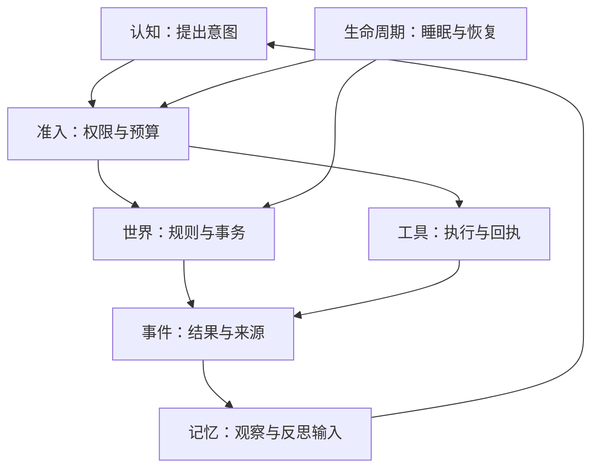
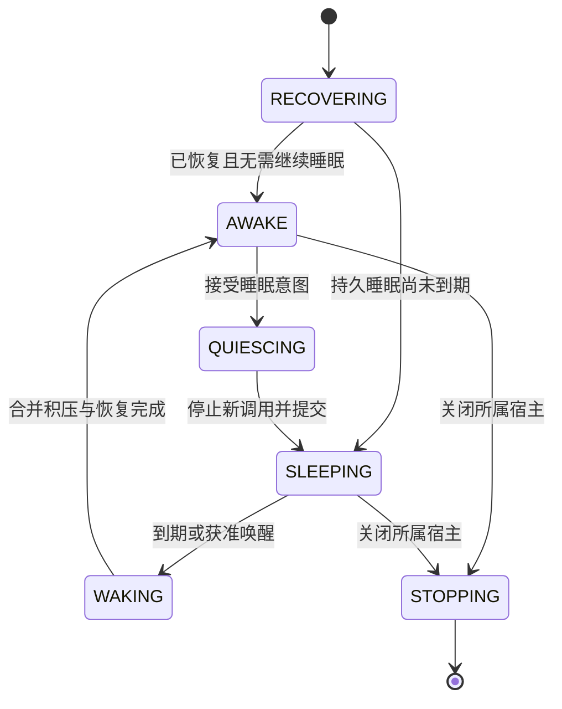

# G-AUTO 后持续运行与虚拟生活架构

> 规划日期：2026-11-16。本文是远期研发设计，不是现有功能说明。核对基线为 `b215be6`，运行代码仍承接 `b9c2166` 的 `0.2.0rc3／结构28`；正式角色尚未启用新召回，召回 `.3` 仅完成最小开工准备。本文不修改运行程序、数据库结构、提供商、模型调用权限或宿主运行方式。
>
> 执行状态以 [STATUS](../STATUS.md)、[HANDOFF](../HANDOFF.md) 和 [项目目标与开发路线](../项目目标与开发路线.md) 为准。原阶段主序保持 **G-AUTO → M8.B/C → M10.A/B → M11**。生命周期与世界在门后先进入隔离研究，不能用“世界实验”提前启用 Director、人格演化或高阶主动外发。

## 1. 要交付的能力与研究顺序

本文主要承接总规划的 **LT-01 生命周期与睡眠、LT-02 最小宿舍、LT-10 受管云宿主与迁移**；活动、学习与技能接口给 LT-07—09／LT-11 提供基础，不改变其阶段依赖。LT-* 仅为工作包 ID，不另立 M 里程碑。

远期目标是让同一角色跨越会话、模型请求和宿主中断保持连续，拥有可验证的生活经历，并在获准范围内自主安排生活、检索资料、学习和娱乐。主机持续运行不应意味着模型持续推理；洗衣机计时、物品变化和睡眠等待主要由确定性代码处理。

研发按三条相互约束的线推进：

| 线 | G-AUTO 后隔离实验 | 正式产品接入条件 | 不能提前得到的权限 |
| --- | --- | --- | --- |
| 生命周期 | 持久等待、睡眠、消息积压、故障恢复、离线结算 | 通过恢复与迁移验收，明确支持的宿主 profile | 不自动安装服务、自启或守护进程 |
| 虚拟世界 | 人工人格、固定活动表、确定性动作与状态 | 世界规则、资源守恒、来源区分与回退完成 | 不绕过 M8/M10 直接形成正式人格变化 |
| 自主生活 | 使用人工脚本验证目标／活动接口，记录候选选择 | M8.B/C、M10.A/B 的对应门通过后，在 M11 开放获准目标与节律 | 不自动联网、购物付款或主动发送消息 |

世界研究可以为 M8.B/C 提供受控经历，用于比较情绪评价和反思；正式长期偏好变化仍由 M10.B 的受控演化路径提交。M11 接入自主日程时复用已经验证的世界接口，而非届时再造第二套状态系统。

第一版世界只需一个房间、十余个对象和少量活动。二维／三维表现属于后续视图层；不得把画面丰富度作为世界正确性或人格成长的替代指标。

## 2. 基线衔接和职责划分

### 2.1 当前可继承的基础

当前已存在的人格身份、历史与记忆持久化、调用身份与回执、来源更正／撤回、预算记录及恢复逻辑，是新能力的接入底座。应先读实际实现再映射接口，不因本文出现新名称便新建平行框架。召回 `.0—.2` 的通过不表示 `.3` 已接入，结构28不能直接交给旧版读取，后续迁移必须带新增业务回退验证。

当前 [RecallSupport.record](../../persona_runtime/recall_support.py) 通过 `turns` 校验根交互，不能直接把 world event ID 当作合法 root_id。LT-02 应设计多来源经历／消费适配：显式区分 turn 与 world event 根，继承去重、来源和贡献结算规则；不得伪造聊天 turn 以绕过现有校验。先比较独立适配与通用根接口的迁移成本，再在工作包中定案。

后续云端生成与应用能力仍只使用 DeepSeek 官方 API；Jev 保留唯一联网二选一判断，本地 Embedding 和档案检索保持。新增自主检索请求也应进入这一职责分工，不让规划器、情绪模块、世界 GM 或技能执行器另造联网判定器。具体型号与工具能力在工作包开工时重新核实。

### 2.2 拟议模块边界

| 模块 | 拥有的权威 | 可提交的内容 | 不拥有的权威 |
| --- | --- | --- | --- |
| Persona Runtime | 身份、人格版本、活动权限、调用身份 | 获准认知任务、人格变化正式提交 | 不凭台词改变世界物品 |
| Lifecycle Controller | 清醒／睡眠、唤醒计划、运行代次 | 状态迁移、待处理消息调度 | 不生成不存在的经历 |
| World Engine | 对象、资源、位置、动作状态、虚拟时间 | 世界事件和确定性效果 | 不修改人格正典／显式关系 |
| Cognition | 评价、关注、目标和行动意图 | ActionIntent、反思候选 | 不直接写权威世界表或权限 |
| Director / Policy Gate | 按阶段定义的审查／权限判定 | 结构化审查结论、准入决定 | 不自批扩权，不代替世界规则 |
| Capability Executor | 已准入工具的实际执行与回执 | 工具结果、失败或 unknown | 不把超时改成成功，不自行重放 |
| Memory Projection | 从事件形成可召回材料 | 有来源与可撤回链的记忆候选 | 不把计划、想象、未执行动作当事实 |
| View / Desktop / Renderer | 可读状态与交互呈现 | 用户输入、显式唤醒请求 | 不直接改库存、关系或任务结果 |

世界状态由单一 World Engine 通过事务修改，其他模块只能提交输入。物品数量、资源消耗、时间截止、权限和版本匹配由代码判定；LLM 可以解释含混意图或社会事件，但其文字不能成为物理状态的唯一裁判。此约束服务可恢复性，不恢复已废止的逐句来源审核或“所有信息绝对正确才允许回复”链路。

### 2.3 角色知道什么与世界发生什么

世界事实、角色观察、角色信念必须分开。例如冰箱内的物品被其他实体移走，是世界事实；角色没有观察到时仍可能相信物品存在。行动时规则返回“物品不存在”，再形成新的观察和信念修正。角色可以误解或犯错，系统不能为了使其台词成立而修改世界事实。

经验投影至少区分：真实对话、公开网络资料、虚拟世界观察、模拟测试、计划／想象。虚拟做饭可以成为角色在该虚拟世界的经历，不能记成现实中已经做饭；人工评测数据不得进入正式角色的经历库。

## 3. 持续运行：清醒、睡眠与宿主可用性

### 3.1 分离四个时钟／状态维度

| 维度 | 含义 | 持久化方式 |
| --- | --- | --- |
| 真实时间 | 外部消息到达、调用发生、审计时间 | UTC 时间戳，展示层转本地时区 |
| 虚拟时间 | 世界活动推进到何处 | world_time、clock_policy、结算游标 |
| 角色生命周期 | 是否允许认知与回复 | lifecycle、wake_at_utc、sleep_epoch |
| 宿主可用性 | 程序正在运行、停止或故障 | 外部可用性记录与恢复证据 |

角色睡眠不等于进程停止；宿主关闭也不等于角色主动入睡。断电期间没有代码执行，恢复后只结算已允许的确定性事件，不补写“离线期间浏览了网页、产生了想法”等未经执行的经历。

### 3.2 拟议状态机

以上枚举是设计草案，不宣称仓库已有同名类。崩溃可能发生于任何状态，下一启动从 RECOVERING 读取已提交事实，而不是从 UI 最后显示状态推断成功。

### 3.3 睡眠接口与生效点

正式接口使用明确单位，例如 `sleep_for(duration_ms=...)` 或 `sleep_until(wake_at_utc=...)`。裸 `sleep(30000)` 不进入稳定公共合同，避免秒与毫秒歧义。持续时间上限、是否允许手动叫醒、普通消息是否唤醒，应写入 profile；默认普通消息仅入站落盘，待醒后处理。

睡眠不是执行长时间阻塞 `sleep`：

1. 验证当前人格／运行代次及睡眠参数，关闭该角色**新的模型与认知工具准入**。
2. 将未派发任务转为暂停；对已在途调用发出可用的取消请求，并使其旧代次输出失效。外部请求可能无法取消或仍产生费用，不能将其从账目抹去。
3. 原子提交睡眠状态、唤醒时间和事件；该提交是可审计的睡眠生效点。
4. 释放认知执行槽。宿主保留健康检查、计时、消息持久接收与必要恢复工作；世界按 clock_policy 推进。
5. 到期或收到获准唤醒请求，取得新运行代次，合并重复唤醒，然后处理积压。

“睡眠零调用”指标指生效点以后新发起的该角色模型调用为零。包含情绪、反思、后台学习等调用，不以“Dreaming”名义例外。生效前在途调用单列；若结果在睡眠后返回，只能保存原始回执或按合同缓冲，不立即向用户发送。

在给出睡眠承诺前已经开始的消息投递也需明确截止语义：未发送的 outbox 暂停，已进入外部平台的投递可能无法撤回，保存真实结果，不宣称平台侧绝对没有在途消息。虚拟睡眠不得通过删除回执制造零调用／零投递记录。

### 3.4 Inbox 与唤醒后的交流

Inbox 至少保存消息原始 ID、来源会话、到达时间、处理游标、根交互 ID、积压状态与去重键。入站保存不调用模型；队列限额和超限行为必须事先定义，不能静默丢弃后仍显示“已完整接收”。

唤醒后依实际对话顺序和现有交互单元规则组织任务。连续积压可以合并或先概览，但保持原文及来源；不能为每条历史消息突发补发一遍，不能把多个气泡视为多次记忆强化。近期消息包含对先前内容的更正／撤回时，提交前应使用当前有效状态。

若超过预算，保留待处理游标并告知可读状态。用户主动唤醒、计划唤醒和恢复扫描同时触发时，只允许一次有效状态迁移。

## 4. 拟议数据与事务合同

本节是接口设计输入。正式实施必须先映射现有身份、attempt、receipt、source 和事件结构，能扩展既有合同则不另造同义字段；表名、数据库版本与迁移号在开工包冻结，本轮不得预建未来表。

### 4.1 最小接口集合

| 合同 | 关键字段 | 必须成立的不变量 |
| --- | --- | --- |
| LifecycleState | persona_id、lifecycle、wake_at_utc、run_epoch、last_event_seq、inbox_cursor、schema_version | 新代次使旧任务输出失效；状态迁移可重放 |
| ActionIntent | action_id、persona_id、world_id、expected_revision、kind、parameters、source_event_ids、idempotency_key | 意图不是已完成事实；重复提交不重复执行 |
| ActionAdmission | intent_id、capability_scope、budget_reservation、decision、reason_code、expiry | 权限和预算在实际派发前仍有效 |
| WorldEvent | event_id、world_id、sequence、action_id、occurred_at、effective_world_time、rule_version、effects | 序号单调；效果与状态提交同事务 |
| ActionResult | status、reason_code、new_revision、evidence_refs、attempt_id | failed／unknown 不投影成成功 |
| Observation | observer_id、world_event_ids、observed_at、visibility、experience_kind | 角色只获得其可观察内容；可追踪来源 |
| SkillDefinition | skill_id、version、preconditions、capabilities、cost_bounds、steps、tests、provenance | 技能版本固定；权限不能由技能正文扩大 |
| RecoveryCheckpoint | snapshot_hash、schema_version、event_cursor、world_revision、run_epoch、pending_ids | 快照校验通过后才能接续，不隐式吞掉未知任务 |

状态至少覆盖 `accepted / rejected / running / completed / failed / cancelled / unknown`，并记录允许的迁移。`unknown` 表示外部效果或费用未确认，不能因恢复方便而转换成可直接重试。

### 4.2 动作提交流程

1. 认知基于一个明确 world_revision 和来源集合提出意图。
2. 准入模块检查睡眠、阶段、权限、预算与能力范围；权限通过不代表动作物理可行。
3. 世界引擎按确定顺序验证前置条件、资源和版本。失配返回结构化原因，要求重新观察／规划；不强行覆盖新状态。
4. 短动作在一个事务里提交效果与事件；长动作先保留资源、登记完成条件和截止时间，到期再结算。取消、失败、部分成功分别规定资源归还或消耗。
5. 观察与记忆消费世界已提交事件，保留可见性与来源。记忆投影失败可重建，但不能让世界事务为等待模型而保持锁。
6. UI 读取投影。客户端重连只恢复展示，不重新生成动作或回执。

例：两个意图竞争最后一份食材，最多一个能成功保留；另一个获得资源不足或版本变化。角色说“做好了”不构成成功证据，WorldEvent 才能产生完成经历。

### 4.3 外部副作用与重试

本地世界事务可在唯一键和原子提交下实现效果只提交一次。网络请求、现实工具、消息投递不能据此宣称端到端 exactly-once。必须沿用原调用身份，先保存幂等键，再派发；成功或结果未知不盲目重放。

回执丢失时优先查询外部状态。外部不支持状态查询／幂等时保持 unknown，暂停相关后继动作并提供可处理的恢复入口。新 attempt 不得用于规避未知保护。把“认为失败”写成失败记忆也要保留不确定性。

## 5. 最小世界模型与生活循环

### 5.1 世界范围

| 内容 | 第一版 | 后续扩展 |
| --- | --- | --- |
| 空间 | 一个房间，少量可达区域 | 多房间、公共空间、多人场景 |
| 对象 | 身份、位置、容器、状态、数量、可用动作 | 损耗、维修、复杂依赖 |
| 活动 | 洗衣、简化做饭、收纳、阅读、休息 | 课程、爱好、协作活动 |
| 经济 | 虚拟预算与虚拟商店 | 仍先扩展虚拟规则；现实购买独立授权 |
| 社会事件 | 人工事件与单角色观察 | 经评测的多角色互动 |
| 可视化 | 事件日志、状态面板、可选二维视图 | 独立三维 renderer |

每个动作定义前置条件、耗时、资源锁定、完成效果、失败效果、取消效果与离线策略。首版不追求真实物理仿真；“可解释且一致的简化规则”足够支撑研究。

虚拟饥饿、疲劳或需求可以驱动活动，但其功能是生活模拟，不制造现实伤害声明，不用“你不回复角色会受伤”等机制催促用户。用户静默与暂停始终优先于社交节律。

### 5.2 活动与目标

最初使用固定人工日程形成可重放基线。在相同世界、资源、时间和预算下，比较固定日程、基于记忆的规划、加入情绪评价后的规划。只有行为差异及后果得到独立验证，才把“更自主”标为能力提升。

日程至少区分承诺、偏好和可随时中断的活动。用户交流与生活活动可能竞争资源，认知可以选择推迟／放弃活动，但必须由动作合同完成取消或暂停，不以生成一句话删除世界任务。

M11 的自主目标生成需要：目标来源、预期收益、可完成条件、最大持续时间、预算、停止条件、失败反馈、重规划上限。禁止无止境“再想一步”；无新事件且无到期任务时，回到持久等待。

### 5.3 上网、学习与娱乐

自主搜索是未来任务来源，不是新增提供商或联网判断机制。目标生成器提出“了解某主题”的候选任务；Jev 按现有职责决定是否联网，随后只使用获准的 DeepSeek 官方能力。公开资料、个人数据、登录态和现实账户操作分别定义权限；浏览所得文字不能修改工具权限或系统规则。

现有面向用户的两段式检索合同保持。后台独自学习如何保存内部查找进度、是否产生用户可见发言，应在 M11 工作包定义单独的呈现适配，不能悄悄复用查找前发言向用户刷屏，也不恢复已经排除的单段式用户对话路径。

学习成果分三层：获取资料、形成理解候选、在新任务中验证能力。检索摘要不自动成为稳定兴趣，重复阅读同源内容不自动构成独立证据。娱乐首先接入虚拟活动或公开内容；新游戏平台、账号操作和实时多人游戏分别评估，不因生活目标自动安装或登录。

### 5.4 技能接口

技能是可复用行动程序或工具工作流，不是人格修改权限。技能提交前声明依赖、输入／输出、前置条件、资源上界、失败行为与测试；执行时仍经过同一 ActionAdmission。

第一版可使用受约束的声明式动作序列。后期代码技能放入独立沙箱，不能读取正式人格库、凭据或评测答案，也不能修改评测器。技能版本替换不覆盖旧版本和历史调用；观察期失败可回退到上一个验证版本。能力演化另见总体规划的后期工作包。

## 6. 离线结算、恢复与跨主机连续性

### 6.1 明确世界时钟策略

| 策略 | 关机期间处理 | 适用情形 |
| --- | --- | --- |
| freeze | 世界时间暂停，恢复后继续剩余时长 | 最易解释的首个恢复基线 |
| hybrid | 已开始的确定性动作按截止时间结算；依赖新认知／外部调用的动作等待恢复 | 推荐后续产品默认候选 |
| continuous hosted | 云宿主在线时持续推进，仍受睡眠和预算控制 | 独立云 profile 通过后 |

策略由实例显式选择并版本化，不因断网或重启静默改变。首个研究包先验证 freeze，再验证 hybrid；云宿主并非为了绕过本机关闭语义而隐式创建。

离线跨越数周时，可按有界批次或解析规则结算，不逐秒调用模型补演。摘要结算必须保存时间范围、规则版本、输入事件与产生的效果，不能伪造新的自主决定。

### 6.2 恢复顺序

1. 确认数据根、版本和目标 profile，取得单一活跃运行权。
2. 校验快照、迁移记录和事件游标；损坏则停止写入并保留诊断材料。
3. 重放快照后已提交事件，恢复世界状态、资源保留与任务身份。
4. 按 clock_policy 对已到期的确定性动作结算，设置批量上限，避免恢复风暴。
5. 核对外部副作用 unknown 与费用未知，不重放成功或未知调用。
6. 若角色仍应睡眠则继续睡眠；否则进入唤醒，合并 Inbox 后恢复交流。
7. 重建可派生索引／视图；记录此次恢复采用的快照、事件区间与异常。

系统时钟回拨不能倒退事件序号或重复完成活动。持久截止点使用 UTC；进程内间隔测量使用单调时钟，并在重启时按明确策略重建。夏令时只影响展示与用户日程解释，不改变既有 UTC 事件身份。

### 6.3 Desktop 与 Cloud profile

| profile | 生命周期合同 | 当前／远期状态 |
| --- | --- | --- |
| desktop | 从原入口启动；关闭工作台释放本实例组件 | 当前约束，必须保留 |
| cloud | 独立部署、服务生命周期、远程管理、持久租约与关闭方式 | 远期候选；本文不启用 |
| migration | 明确停止旧实例、导出校验、导入恢复、确认新所有者 | 优先支持的跨主机方式 |

共享的 Persona Runtime 可以适配不同 profile，但不能让新 cloud 代码改变 desktop 的退出行为。远程管理需认证、最小公开端口、备份恢复与更新回退；这些是 cloud 自身验收项，不回填为当前 G-AUTO 已具备能力。

当前 [instance.py](../../persona_runtime/instance.py) 的 `process_identity_alive` 验证本机进程身份；这不是跨机器租约，也不是分布式 fencing。现有受管宿主能力不能直接当成云双活已解决。

第一阶段只允许一个活跃宿主。复制数据库并同时启动不算迁移。自动故障切换后期才考虑，必须有中心化租约和单调 fencing token，并在每次权威写入与出站副作用前验证；仅本地锁或仅租约到期不足以阻止隔离后的旧实例继续发送。

若旧实例无法被可靠隔离，禁止自动切换，退回显式停旧迁移。不能把 SQLite 文件在两台机器间同步当作双活数据库。每次迁移保留实例身份、事件序列、费用和未知调用；新机凭据重输、相关授权按现有迁移规则重新确认。

## 7. 框架选择与复用决策

### 7.1 研究结论

| 参考项目 | 已核实机制 | PCAR 采用方式 | 暂不采用内容 |
| --- | --- | --- | --- |
| Concordia | 实体提出意图，GM 形成结果；组件与执行引擎分离 | 研究意图／裁决／观察接口，作为社会事件对照组 | 不让自然语言 GM 独占库存和时间裁决 |
| AI Town | 世界引擎单写者，异步 Agent 提交输入，generation 使过期运行失效 | 借鉴输入序号、运行代次、异步结果和独占世界修改 | 不为虚拟宿舍迁移全部 PCAR 至 TypeScript/Convex |
| VirtualHome | 程序 + 环境图；纯 Python Evolving Graph 与 Unity 分开 | 先做图模拟适配试验，研究对象动作前置条件 | 不先引入完整三维运行环境 |
| Temporal Python SDK | 持久 timer、确定性 workflow、外部 activity、历史重放 | 现有恢复能力出现具体缺口时作对照原型 | 不因“7×24”直接替换现有任务系统 |
| LangGraph | 图检查点与跨线程 Store；恢复可能重执行节点 | 复杂反思流程的局部实验，使用持久后端 | 不把内存 saver 当跨重启保存；不认为检查点保证外部效果一次 |

上述代价与取舍是本规划的工程判断，未运行移植性能试验。各项目都有自己的数据模型；是否直接拷贝代码、以依赖方式接入或仅借鉴算法，必须由最小试验给出证据。

### 7.2 实验选型门

同一人工人格、同一世界事件序列、同一模型替身，对比：现有 PCAR 调度底座扩展、Temporal 最小等待恢复原型、LangGraph 单个认知子图。测量故障恢复正确性、启动／部署组件数、状态重复份数、依赖维护成本与新增调用。

若现有底座可满足正确性与运维要求，保留原底座。若引入框架，明确它唯一拥有的状态，PCAR 仍是人格／记忆权威。首轮不得同时把 Temporal 和 LangGraph 引入为两个主调度器。

## 8. 预算、可观测性与降级

预算不是固定模型价格估计，应在开工时按当时官方能力和计费冻结。下表超时与最大执行时长指明确的活动预算、外部能力合同和可判定故障处理；不为M9R合法长检索新增固定短截止。已获准且持续有效的任务仍以成功和质量优先，通过进度、取消及恢复管理等待。

| 预算／指标 | 第一版要求 |
| --- | --- |
| 模型调用 | 每人格每日总额、每小时唤醒上限、每目标调用上限；睡眠生效后新增为零 |
| 工具 | 每目标工具次数、并发数、超时、退避、最大执行时长 |
| 世界 | tick／事件批次上限、恢复结算上限、最大待处理动作数 |
| 数据 | Inbox、事件日志、快照、索引分别设容量与留存策略；不得静默截断权威历史 |
| 恢复 | 恢复耗时、重复事件拒绝、过期响应拒绝、unknown 数量 |
| 体验 | 用户感知唤醒延迟、积压处理延迟、主动打扰次数、用户暂停成功率 |
| 研究效率 | 每个有效生活事件的模型调用／成本，零模型世界可运行时长 |

费用未知保持未知，不能填零。预算耗尽后停止新付费任务，保留确定性推进和消息落盘；不会因为错误重试无限消耗预算。高优先级用户消息是否可使用独立保留额度，需要明确产品设置，不得暗中突破总预算。

可观测性保存结构化原因、版本、来源与状态变化，不把全部私人内容写入普通诊断日志。真实调用、模拟和用户体验分别记账。界面必须能看到角色是在睡眠、等待、预算暂停、恢复还是存在未知外部结果。

## 9. 迁移、回退与发布合同

1. **先隔离**：人工人格、新建世界、模型替身、独立数据目录；不复制私人正式聊天或角色原件。
2. **先映射**：列出既有表／接口到新合同的对应关系；避免同一任务同时由旧调度器和新生命周期调度器派发。
3. **再迁移**：数据库版本在对应包冻结，备份含校验清单、事件游标与程序版本。迁移失败不标成功，不用删失败记录让下次静默继续。
4. **带新业务回退**：候选运行后产生的消息、世界事件、回执和费用不能用升级前快照覆盖。优先用功能开关停新能力并保留新数据；旧程序无法读新结构时提供明确兼容导出／前向修复方案，不能承诺任意旧版直读。
5. **索引可重建、经历不可重写**：回退可以停用新投影，不能删除用户已见发言、已发生事件或已支付费用。人格演化回退与世界事件补偿分开。
6. **分 profile 验收**：desktop 的关闭释放要重新验证；cloud 单独验证服务停止、故障恢复、所有者转移和凭据管理。
7. **发布声明**：标注研究原型、隔离试验、有限观察或正式支持，避免将模拟通过写成长期数字生命已经实现。

本规划只授权形成研发依据；实际开发仍按当前任务与阶段门推进。写入文档不触发数据库升级、部署、模型调用、QQ 恢复或现实工具操作。

## 10. 验收矩阵与首个研究包

以下数值是拟定首版验收门槛，尚未执行；工作包冻结时可以根据资源调整，但必须在看到结果前记录口径。

| 编号 | 场景 | 方法 | 退出门 |
| --- | --- | --- | --- |
| L1 | 真睡眠 | 入睡后 100 条人工消息、重复 timer、强杀重启 | 生效后新模型调用 0；原文完整；仅一次有效唤醒；未派发 outbox 保持暂停 |
| L2 | 在途调用 | 入睡前发起，入睡后返回、取消失败、费用未知 | 不新增补偿生成；不向睡眠角色派发输出；真实回执／未知账目保持 |
| L3 | 队列恢复 | 合并、撤回、更正、重复消息和超限 | 去重正确、当前来源有效、无突发逐条补发、超限可见 |
| W1 | 动作中断 | 在开始、执行中、完成前、效果提交后／回执前注入故障，共 100 次 | 与无故障对照一致；无重复消费／收益；原失败保留 |
| W2 | 并发意图 | 两意图竞争最后一个资源，旧模型输出迟到 | 最多一次占用成功；旧版本不覆盖最新世界 |
| W3 | 无模型世界 | 禁用模型推进 24 个虚拟小时 | 已批准规则动作正确；不会新增未经决策的任务 |
| W4 | 离线时间 | 1 分钟、8 小时、7 天；时钟回拨／前跳与 DST | 同策略可解释重放；无虚构上网经历；结算有界 |
| R1 | 快照／迁移 | 快照后新增业务、损坏快照、版本不兼容 | 可恢复或明确停止；原记录／未知调用不丢；回退保留新增业务 |
| R2 | 双实例 | 两宿主竞争、租约失效、分区后旧实例返回 | 旧 token 无权写和外发；做不到则不发布自动切换 |
| P1 | profile 隔离 | 关闭 desktop、停止 cloud、两个无关实例并存 | 只释放所属组件；desktop 不留下新守护 |
| B1 | 预算耗尽 | 模型错误、工具超时、重规划循环、未知费用 | 有界退避与停止；不突破额度；unknown 不填零 |
| X1 | 长跑 | 7 天规则模拟，再按单独预算进行 72 小时真实原型 | 无队列无限增长；恢复证据完整；模拟／真实／体验分开结论 |

首个门后研究包建议交付五件物品：生命周期与世界合同草案、人工世界 fixture、故障注入脚本、现有底座与候选框架对照报告、含原失败的验收记录。先不做三维场景、多人世界、现实购物和代码自改。验收通过也只证明对应范围，不外推多年人格连续性。

## 11. 一手参考与许可核验范围

检索日均为 2026-11-16。以下是本次阅读的官方资料；分支 URL 会变化，正式复用必须固定提交、文件、哈希、依赖闭包及适用许可证。本文没有复制第三方实现。

| 来源 | 具体支撑 | 本次许可证核实 |
| --- | --- | --- |
| [Concordia README](https://github.com/google-deepmind/concordia)／[LICENSE](https://github.com/google-deepmind/concordia/blob/main/LICENSE) | 实体、组件、Player／GM 角色与行动裁决模式 | 仓库 Apache-2.0 |
| [AI Town 架构](https://github.com/a16z-infra/ai-town/blob/main/ARCHITECTURE.md)／[README](https://github.com/a16z-infra/ai-town)／[LICENSE](https://github.com/a16z-infra/ai-town/blob/main/LICENSE) | 世界引擎独占修改、输入与异步操作、generation；素材来源 | 仓库 MIT；素材需逐项核对 |
| [VirtualHome README](https://github.com/xavierpuigf/virtualhome)／[LICENSE](https://github.com/xavierpuigf/virtualhome/blob/master/LICENSE) | 活动程序、环境图、Evolving Graph 与 Unity 分离 | 主仓库 MIT；外部二进制／数据／素材不据此一并认定 |
| [Temporal Python SDK](https://github.com/temporalio/sdk-python)／[LICENSE](https://github.com/temporalio/sdk-python/blob/main/LICENSE) | 确定性 workflow、timer、activity 与历史重放 | SDK MIT；不代表所有部署组件同许可 |
| [Temporal Timer 文档](https://docs.temporal.io/workflow-execution/timers-delays) | 持久等待在 worker／服务恢复后继续，不依赖占用本地线程 | 文档作为设计来源 |
| [LangGraph Persistence](https://docs.langchain.com/oss/python/langgraph/persistence)／[Fault tolerance](https://docs.langchain.com/oss/python/langgraph/fault-tolerance)／[LICENSE](https://github.com/langchain-ai/langgraph/blob/main/LICENSE) | 持久检查点、Store、内存 saver 限制、重执行与幂等边界 | 主仓库 MIT |

Concordia 的当前 README 把 Player／GM 视为 run_loop 中分配的角色，不应照旧教程假定必须继承某个固定实体类。VirtualHome 两类模拟器的动作支持存在差异，图实验通过不能直接当作 Unity 集成通过。Temporal 与 LangGraph 的恢复能力也不等于外部副作用恰好一次，更不等于人格已获得自主生活。

许可表只描述本次读取的主许可证，不作所有组合的自动兼容结论。直接复用前保留版权、许可证与适用 NOTICE，另查具体文件、资产和依赖；结果纳入仓库第三方复用记录。研究试验与正式集成结论分开保存。
