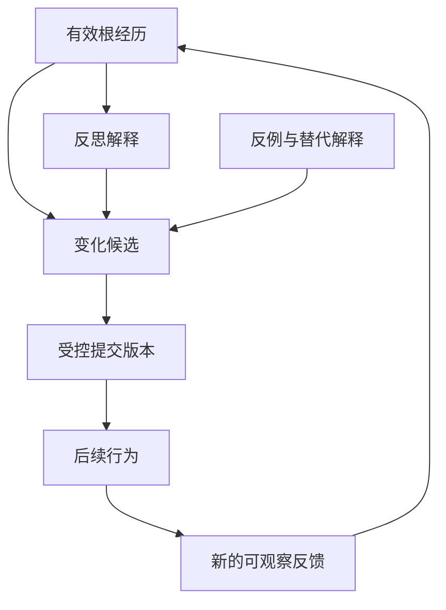

# G-AUTO 后认知反思与受控成长开发指导

形成日期：2026-11-16。性质：远期研发规划与实验规范，尚未开工；本文件不代表 M8.B/C、M10.A/B 或人格自主演化已实现。

本分册回答一个具体问题：角色怎样从实际经历中修正对用户、关系与自身的认识，并在保持身份连续性的同时产生可验证的行为变化。基本路径是 **G-AUTO → M8.B 情绪影子／M8.C 独立反思影子 → M10.A Director Shadow → M10.B 白名单受控演化**。先形成可解释候选，再验证行为收益，最后开放有限自动采用。

这里的“成长”指有证据、可修订的认知与策略变化，不以模型声称自己成长、反思文本变长或关系数值上升作为完成标准。人物仍应自然交流、表达判断并允许犯错；证据和治理机制主要约束持久变化，不新增“每句话必须先通过 Director”的前台审批链。

## 1. 与当前工程和已有研究的衔接

截至本次规划，当前运行基线仍为 0.2.0rc3／结构 28；召回配套 .0—.2 已完成，.3 仅最小开工准备收口，新排序尚未正式接入。近期开工入口以 [STATUS](../STATUS.md)、[HANDOFF](../HANDOFF.md) 和 [召回 .3 最小准备](../召回配套.3-最小开工准备.md) 为准。本分册不跳过消息核心链封口、表达 E0—E6、工作台重写、无人值守闭环及 G-AUTO。

可承接的现有接点包括：

| 已有接点 | 可承接职责 | 本分册仍需新增并验证的内容 |
| --- | --- | --- |
| [cognitive.py](../../persona_runtime/cognitive.py)、上下文 Manifest | 记录输入快照、状态版本、来源及提交前复查 | 反思专用最小材料投影、候选证据绑定与派生影响 |
| [recall_sources.py](../../persona_runtime/recall_sources.py) | 按权威来源取材、范围与有效性检查、lineage | 跨消息根经历与独立性组，不把召回热度当发展证据 |
| [disposition_core/contracts.py](../../persona_runtime/disposition_core/contracts.py) | 类型化作用域、交流行动与原型合同 | 情绪／反思候选的独立合同及有限行为消费 |
| [persona_management.py](../../persona_runtime/persona_management.py)、现有人格版本 | 人格管理、操作身份、版本检查 | 演化白名单、观察期版本、当前删除约束下的回滚 |
| M8.A／M8.D 受管整理与自动记忆 | 任务身份、调用回执、日常记忆维护 | 独立人格反思；普通记忆整理本身不等于此能力 |
| 表达 E0—E6 的规划接口 | 主稿、表达产物、真实发言分开记录 | 只把已确认的真实交流作为相关关系经验；不按气泡重复计数 |

这些是已读源码和文档中的接点，不是对全部演化功能的实现确认。已有 `ReflectionBuilder` 或 `DirectorBuilder` 名称也不等于完整反思与 Director 已验收。正式开工时需重新核对当时实现，提交字段映射与迁移 ADR，不在本规划中预占数据库结构编号。

本分册承接 [社会科学开发指导](../social-science/README.md) 四册，而不替换其原件：第二册提供用户／关系／自我模型及证据合同，第三册 D4 对应反思影子与候选，D5 对应受控采用，第四册提供实验与分母定义。旧文档里的供应商、世界知识编排或早期表达假设如与最新 [AGENTS](../../AGENTS.md) 和 [M9R 规划](../M9R-DeepSeek原生能力接入与后续研发规划.md) 冲突，以当前路线为准。

云端生成、反思与 Director 只规划使用 DeepSeek 官方 API；Jev 仍是联网二选一判断的独立例外，本地 Embedding 与档案检索保留。参考项目采用其他模型不构成新增提供商的理由。本轮仅形成文档，没有启动真实调用、修改正式角色、恢复 QQ 或启用后台自治。

## 2. 理论怎样转成工程假设

以下对应关系继承社会科学四册；它们支持研究问题，不保证算法效果，也不把工程分数称为心理测量量表。

| 理论视角 | 对应设计问题 | 首先验证的行为 | 不能由此推出的结论 |
| --- | --- | --- | --- |
| 关系图式 | 角色对特定对象和互动情境有什么预期 | 同一对象倾诉与求助时采用不同回应行动 | 一次亲近表达已经改变正式关系身份 |
| CAPS 情境化人格观 | 稳定倾向怎样依情境体现 | 同一倾向在不同情境下产生连续但不机械相同的行为 | 全部情境都应采用同一语气 |
| TESSERA 等人格发展视角 | 经历、评价、反应与重复模式怎样联系 | 新的独立经历是否支持较窄且可迁移的策略调整 | 聊天次数或强烈情绪可以直接换算人格变化幅度 |
| 叙事身份 | 角色如何解释已经成立的变化 | 隐藏成长总结后仍能表现出对应行为 | 一段连贯自述就是实际成长证据 |
| 互动修复与情境隐私 | 纠正、边界、受众如何影响下一次交流 | 明确纠正及时生效，私有材料不跨范围使用 | 所有正常交流都需要额外审批 |
| OCC 情绪评价及 FAtiMA | 同一事件对不同信念、目标意味着什么 | 情绪变化可追溯且确实影响有限选择 | 计算情绪等于主观体验 |

开发任务必须以失败和预期行为开头。例如：“有明确倾诉意图且没有请求方案时，减少抢先给建议；同时明确求助时仍完整分析。”不能只写“更像人”或“更有感情”。人物可以保留独立意见，不把全盘迎合作为适应成功。

## 3. 三类长期认识与短期状态必须分开

| 逻辑对象 | 保存内容 | 示例作用范围 | 不允许隐式发生的变化 |
| --- | --- | --- | --- |
| `UserUnderstanding` | 用户自述、事实、目标、情境偏好、解释假设 | 某用户在讨论项目失败时倾向先讲经过 | 改写角色性格；推断固定心理诊断 |
| `DyadicRelationship` | 双方惯例、领域信任、边界、共同经历和未解决误会 | 这段关系中的称呼、玩笑条件及修复规则 | 以熟悉度扩大权限、披露或关系身份 |
| `PersonaSelfModel` | 核心身份引用、已提交倾向、兴趣、习惯及经验性自我认识 | 角色在含混求助情境下形成的窄范围判断习惯 | 吸收作者秘密；随用户近期情绪同步重写自身 |
| `SituationAppraisal` | 当前社会行动、目标相关性、解释候选、不确定性 | 本轮分享成功或请求解决问题 | 每轮永久更新性格 |
| `AffectState` | 可衰减的心境、情绪事件及其原因 | 一次计划受阻后的短暂失落 | 直接产生用户态度、关系或正典事实 |
| `ReflectionRecord` | 模式解释、替代解释、反例与候选 | 多次不同经历可能支持一个条件规则 | 变成新的独立外部经历 |

关系维度优先采用“可读陈述＋条件＋来源”，分别记录熟悉性、领域信任、互动规范、边界和关系感受，不设置驱动所有行为的总好感度。用户愿意谈项目，不等于愿意被追问所有私事；技术信任增加，也不自动提高主动消息频率。

变化范围遵循最小足够原则：本轮调整 → 这段关系的条件规则 → 某类情境下的一般倾向 → 更稳定的经验性自我认识。只来自同一用户、同类事件的材料，首先支持关系局部适应，不直接泛化到“角色对所有人都改变了”。

明确的当前请求、称呼禁用及用户对自己意图的纠正，应在已有权限内即时消费并可靠保存，不等待长期反思或观察期。观察期主要针对系统推断出的非核心演化候选。明确事实与边界更新、演化推断、作者正典修改采用不同通道。

## 4. 证据合同与派生链

以下均为拟议逻辑字段，需映射到现有来源、事件、Manifest、操作身份与版本结构，不要求创建同名表。

| 字段组 | 最小内容 | 约束 |
| --- | --- | --- |
| 身份 | `record_id`、`persona_id`、`subject_id`、`scope`、`audience_scope` | 不能靠昵称合并主体；后台可读不等于角色可知 |
| 时间 | `occurred_at`、`recorded_at`、`valid_from/to` | 允许未知或区间；旧事重新提及不改发生时间 |
| 来源 | `source_type`、`source_event_ids`、`source_versions`、`root_episode_ids` | 保留原始事件，摘要不能成为唯一证据 |
| 派生 | `derivation_parent_ids`、`independence_group`、判定理由 | 多个根也可能相关，独立性可为 unknown |
| 处置 | 内容有效性、当前权限、注意层次、候选状态、执行状态 | 各维分开，不能用一个 active 字段混合表示 |
| 技术条件 | 模型标识、提示版本、算法版本、输入哈希、调用身份 | 技术改动不是角色新经历；不在日志复制密钥或完整私有正文 |
| 解释 | 支持、反例、替代解释、适用条件、复核条件 | 允许 tentative、disputed、unknown，不捏造概率精度 |

必须区分用户陈述、角色已发言、模型草稿、工具结果、世界裁决、作者设定与运行状态。世界引擎确认的做饭失败可以形成虚拟生活经历；角色仅计划做饭不算完成。工具回执能证明读到某页，不证明用户赞同该页观点；模型模拟出的他人反应不算真实用户反馈。

### 4.1 同根与相关证据的计数

一次互动可能产生多条输入、主稿、多个气泡、摘要、事实提取与反思。它们保留自己的记录身份，但共享相应原始根与派生关系。来源被重复读取、恢复任务被执行、同一事件被复述，不增加独立发展证据。

新提及如果带来纠正或新反馈，可产生新的“陈述／反馈事件”；其中新增信息与被重新提及的旧经历要分别记录。不能为了避免重复而丢掉真正的新证据，也不能把旧争执的十次复述当十次争执。

召回热度、显著性、可信性和发展意义是四个不同问题。容易召回表示容易进入候选，不意味着事实更可靠或更适合塑造人格。反思的内部读取不作为有效回忆贡献结算；只有后来独立发生的真实对话或获准行动实际消费，才按该领域已验证的消费合同结算。后台读取、摘要与反思本身不能制造自我强化来源。

### 4.2 派生链的边界

图中的回路只有在新行为产生新的可观察事件时才获得新证据。旧解释再次被摘要、被另一模型赞同、被角色自己复述，均不自动增加事实支持。独立复核是流程职责独立，不代表同一 DeepSeek 模型的两个输出具有独立统计证据。

## 5. C1—C3 认知研究切片

这里的 C1—C3 是本分册的研究切片，用于承接“情境评价—显著性与元记忆—经历巩固”的研究建议；不新增 M 阶段编号，也不与历史测试用例 C01 等混用。正式认知调用放在 G-AUTO 后，门前仅可准备文档与人工夹具。

### C1 情境评价

**假设：** 对当前交流行动和目标的明确表示，能够改善角色选择先倾听、分析、调侃、澄清、不同意或收尾的适当性。

输入只取当前输入、允许的少量相关经历、当前目标、关系条件规则、有效边界与已冻结版本。输出包括主要社会行动、目标相关性、可能解释、不确定性、候选行为及依据，不输出固定台词或永久人格补丁。

先在影子轨道记录与当前实际行为的差异，不影响回复。优先研究利用已有理解／生成接点提供短投影的方式，只有独立调用显示足够增益时才增加一步。研究约定、审批流程、证据计数、句数要求不能变成人物提示中的元说明。

交付为情境合同、正反情境集、输出校验及错误归因报告。必须包括分享与求助、玩笑与认真、当前指令与历史偏好相反、已知与不知道四类对照。通过条件是行动改善且任务质量与角色独立判断未退化，单纯语气更甜或短句更多不算通过。

### C2 显著性与元记忆

**假设：** 显式保留“为什么值得关注、知道多少、哪里可能错”，比只按相似度或热度整理更有助于长期判断。

输出候选可包含 `goal_relevance`、`surprise_reason`、`unresolved_question`、`confidence_class`、`review_condition` 和来源引用。这些是工程分类，不预设通用心理强度分数。高情绪事件可以值得复核，但不自动比普通重复实践更适合改变人格。

元记忆必须能表达“不知道”“只听说过”“这条解释存在冲突”“原来源已撤回”。校验关注未知是否被保留、过期事实能否停用、冷资料是否仍可找回。实验中分别控制热度与证据有效性，避免把检索更多材料造成的提升归功于元记忆结构。

首版不替换已完成的召回配套。只使用独立影子投影比较当前检索结果与加入元记忆后的候选质量；进入正式路径需要证明作用和成本。

### C3 经历巩固

**假设：** 对跨时段、跨情境经历的有限整理，可以形成更可用的关系规则或自我认识，同时保留反例与修订能力。

输入由新有效根经历、相关已有主张、反例和版本构成，输出为保留、合并、限定范围、降为待复核、候选或 `NO_CHANGE`。记录事件间联系和解释，保留原始经历；不把全部历史压缩后仅剩一篇成长故事。

触发来源为明确反馈、目标结果、有效来源更正、关系规则冲突及有界后台批次。时间到达只表示可以检查，不要求产生成长。宿主关闭或人格休眠时不得运行“Dreaming”；仅在角色清醒且后台调用策略允许时执行，睡眠生效后新角色模型调用必须为零。

交付应同时包含整理后的候选、未改变项及原因、旧解释被否定的案例。若每次批次都产生更强人格结论，优先排查提示诱导和重复证据，而不是认为成长速度良好。

## 6. M8.B 情绪影子

情绪模型区分较稳定的人格基线、缓慢变化的心境与具体事件触发的情绪片段。事件先经过角色对目标、信念与情境的评价，再产生有限状态变化；同一事件可以有多种解释。参考 FAtiMA 的评价—决策区分，先研究 Python 原型，C# 原库只作为候选参照或独立服务实验。[R3]

拟议 `AffectTransition` 至少保存前状态、事件与评价引用、时间区间、状态增量、衰减参数、算法版本和后状态。若引入随机性，随机派生绑定人格、事件、转换序号和算法版本并持久化，不使用被额外查询任意推进的全局随机流。确定性状态更新可重放，不承诺云端语言输出逐字确定。

首版影子实验只观察，不改变主动消息、正式关系或人物核心。有限消费随后单独验收，允许影响关注对象、候选活动与表达强度；表达端可以不直接说出情绪。情绪不是每句必须露出的表情词。

必须验证的反例包括：

- 没有明确约定时，用户沉默或宿主停机不产生“被抛弃”的关系事实。
- 有明确约定但暂未完成时，允许记录预期落差及未知原因，不自动升级关系归因。
- 用户澄清意图后，相关评价可修订，情绪不继续只寻找负面解释。
- 心境低落不使检索端过滤掉全部正面反例；事件消退后状态回归应可解释。
- 模型失败、网络超时、预算耗尽是运行状态，不生成“用户讨厌角色”的经历。

验收同时看边界内数值、时间推进、重启恢复、相同输入重放，以及有限行为差异。规划不预定一套“最佳”强度或半衰期；候选参数应依据可观察效果冻结、对比并保留失败值。

## 7. M8.C 独立反思影子

反思任务以新证据或反例为触发，按用途装配材料。日常记忆整理保留事实；独立反思负责提出对经历模式的解释；Director 负责低频审查；权威提交服务决定正式状态是否生效。不能让一份模型输出同时扮演证据、判断与最终写库权威。

### 7.1 拟议候选合同

| 类别 | 必需信息 |
| --- | --- |
| 任务身份 | `proposal_id`、`operation_id`、触发任务、创建时间、模型与提示版本 |
| 目标 | 用户／关系／自我模型类型，主体、范围、允许字段路径、风险等级 |
| 变化 | 原规则／版本、候选 diff、适用条件、明确例外 |
| 证据 | 根来源、来源版本、派生父项、独立性组、支持与反例 |
| 推断 | 替代解释、不确定项、为何选择当前范围、为何此时检查 |
| 行为预测 | 应改变的选择、不应改变的情境、可否定条件 |
| 应用前提 | 目标／证据／政策／权限版本，依赖能力，候选有效期 |
| 观察与撤销 | 观察条件、停止条件、回滚目标、影响对象查询方式 |
| 结果 | `NO_CHANGE`、`needs_evidence`、候选、失败或未知；不可混合为成功 |

不在合同中要求模型提交私有完整思维链。保存可审阅的结构化结论、依据和备选解释即可，原始协议记录按既有可见范围管理。

### 7.2 反例检索及无变化

候选产生前必须执行一次针对反例和替代解释的有界检查，不能只让模型看支持候选的材料。检查至少覆盖：同一情境的相反反馈、当前明确请求、变化是否只来自基座或提示更新、证据是否仅来自同一事件链、是否已有更小范围规则足以解决问题。

`NO_CHANGE` 是完成检查后证据不支持变化；`needs_evidence` 是有具体缺口；`failed` 是执行失败；`unknown` 是结果未确认。它们不能互相冒充。没有新证据时不递归安排下一次模型反思来“想得更深入”。候选被拒后，只有新增有效证据、明确复核请求或政策变化才可重新提出。

模型可以请求补充公共知识或观察新结果，但不能为了反思自行披露聊天原文或无限浏览。确需联网时沿当前 Jev 与 DeepSeek 原生资料路径及角色授权执行；本地证据不足不自动授予外部访问。

### 7.3 影子完成条件

影子轨道生成候选并保留审阅结果，不修改正式用户、关系或自我模型。只有工程不变量通过、候选能正确归类、反例和无变化处置稳定、冻结情境中显示有希望的行为收益，才允许申请 M10.A 实际接入。候选数量不设增长目标。

## 8. M10.A Director Shadow 与 M10.B 有限采用

Director 是低频变化审查角色，不插入每句聊天。输入为候选 diff、必要证据、反例、目标版本、授权政策与预算，不默认读取全量聊天或作者不可知材料。输出为批准待提交、拒绝、延期、需证据或无变化，并引用结构化依据。

### 8.1 沿用 A0—A4，不混淆权限

| 等级 | 范围 | 本计划的采用方式 |
| --- | --- | --- |
| A0 | 时间衰减、任务过期、索引维护 | 确定性规则，沿已批准生命周期策略 |
| A1 | 有来源日常记忆、普通用户事实与知识维护 | 既有授权和提交机制；不强制转成 Director 审批 |
| A2 | 非核心互动习惯、轻微表达偏好与窄范围倾向 | M10.B 首批白名单；审查通过、观察期、可暂停与回滚 |
| A3 | 重要关系理解、稳定偏好、长期目标 | 首期人工决定；后续自治须另有明确范围及长期证据 |
| A4 | Core、身份、作者正典、明确关系身份、权限与高风险外部副作用 | 作者明确授权；Director 不得自批扩权 |

同一层级不替代具体字段白名单。角色可以想做某事、表达观点或建议目标；系统是否正式改写长期状态、执行外部动作，则依对应权限处理。普通已授权更新无需逐项重新向用户索取许可。

### 8.2 两次确定性检查

1. 审查前检查来源存在、版本有效、角色可知、作用域、路径白名单、风险层级、预算与候选期限。
2. Director 生成结构化审查回执；Shadow 只记录，与冻结人工／规则结果比较。
3. 正式采用时在事务内再次检查来源、权限、政策与目标当前版本；审查期间发生变更则标记 stale，不强写旧结论。
4. 同一事务写入新版本、来源依赖、候选处置、观察期和审计回执；失败不得部分生效。

只有第二次检查和事务提交成功才标为正式采用。`accepted_for_commit` 不是 `committed`。重启按原操作身份核对回执，不重发成功或未知的收费调用；若新状态已包含相同规则，按 superseded/no-op 结算，不能为凑成长版本再写一遍。

### 8.3 观察期与退出

首批只选择少数可逆、语义明确的 A2 字段，逐类开放；不同时改变大量人格维度。观察期兼顾经过时间、实际有效暴露次数和场景覆盖，不能因为停机数天就自动毕业。具体期限与样本量在开工前基于基线和预算登记，本文件不把任意天数定为已验证标准。

观察状态为 proposed → reviewed → committed_observing → adopted／paused／reverted。提交后保留前后版本、触发来源与停止条件。用户明确否定、核心身份冲突、无关情境明显漂移、来源撤回或权限收回应立即停止受影响规则消费；普通软性效果不足则按冻结条件终止或延长，不能边看结果边修改及格线。

观察失败后记录原因和再次申请条件，避免下一次反思立刻把同一补丁加回。解释性自我叙事在状态提交后生成，只描述已经成立的变化，不反过来成为其证据。隐去叙事仍应观察到目标行为差异。

## 9. 撤回级联、回滚和恢复

依赖图至少覆盖 evidence → claim → relationship rule／self belief → disposition projection → narrative／cache。撤回处理先使受影响对象不可再被正常消费，再按范围重算；不能等完整后台复核结束才停止使用已经明确不可用的材料。

| 情形 | 必须采取的处置 |
| --- | --- |
| 唯一根证据被撤回 | 依赖主张、规则、叙事与缓存暂停或失效 |
| 存在其他独立来源 | 标为待复核，按剩余证据重算；不一律全删或全留 |
| 来源被更正 | 旧版本不能支撑当前结论；检查是否缩小、替换或取消规则 |
| 作者在审查期间改了人格 | 旧候选 stale，保留差异；不能覆盖作者新版本 |
| 回滚到旧版本 | 恢复旧行为状态，同时叠加当前权限、撤回和删除墓碑 |
| 备份恢复或跨设备迁移 | 先复核当前有效性和停用规则，再允许投影消费 |
| 影响图过大或不完整 | 暂停受影响范围的演化消费，继续使用合法基础能力并保留未知项 |

回滚不删除已经发生的对话或世界行为，不伪造“从未采用过”历史，也不自动重发纠正文案。它撤销后续规则采用并留下新处置版本。后续认知必须能区分“当时做过错误判断”与“这个判断现在仍正确”。

明确边界与其原始叙述的保留语义分开：依据当前删除政策，可以最小化保留“不要使用某称呼”的禁用状态，同时停止保存或使用原文；用户要求连状态也清除时遵照具体范围。不得利用回滚重新激活被禁止的内容，也不能以删除一段叙述为由默默取消仍然有效的明确边界。

故障注入应覆盖：提议保存后崩溃、审查回执后崩溃、提交前来源撤回、事务提交后界面未收到确认、部分缓存未刷新、观察期跨重启和时钟回拨。物理调用与逻辑提交分别去重；未知金额继续标未知。

## 10. 与自主生活、上网学习和能力演化的接口

虚拟生活提供可裁决的活动结果；在线学习提供带来源与时效的公共知识；人与角色的互动提供关系证据。三者可以共同触发反思，但来源性质不能被合并抹平。读到某种生活方式不等于实践过；练习某种技能成功不等于性格已经改变；系统规划了模拟对话不等于用户作出反馈。

对自主目标先区分一次活动、持续项目、习惯候选与身份叙事。完成一次阅读任务只确认任务状态；多次自主选择与后续行为可能支持兴趣候选；长期偏好是否正式采用仍按 A2/A3 范围处理。虚拟物品和预算变化由世界引擎提交，认知模块不能通过文字宣称直接改变库存。

能力演化另用 `SkillProposal` 或 `RuntimeChangeProposal`，与 `PersonaChangeProposal` 分离。借鉴 Voyager 的目标—技能—环境反馈、DGM 的候选—隔离评测—版本选择，最多先形成隔离候选；本分册不授权执行生成代码、改运行权限、修改测试标准或部署生产。人格“希望学会”不是代码可信的证据，代码基准提高也不是人格成长的证据。

知识检索可将 Graphiti 作为时间关系影子索引比较，主权威仍为 PCAR。没有证明当前 SQLite／本地向量方案存在可量化缺口之前，不增加第二套状态权威或强制图数据库。[R5]

## 11. 实验设计与指标

### 11.1 逐层对照

沿社会科学第四册保留独立状态副本：A 为现有事实记忆基线，B 加用户／关系理解，C 加情境化行为与反馈修复，D 加受控反思与规则修订。相邻条件比较增量作用；在 D 内再关闭情绪、反思、规则修订或成长叙事，判断行为差异来自哪里。这是社会认知逐层实验；[自主能力与验收](04-自主能力与研究验收.md)的固定人格／仅反思／受控演化三臂专门检验成长增量，属于另一实验。运行ID分别使用`social-layer-*`与`growth-arm-*`，不能把两套A/B/C标签的成绩混合。

固定可控制的模型标识、提示版本、状态快照、合法材料、权限与预算，接口实际支持的采样参数才可登记为已控制。不能将同一供应商升级或上下文增加造成的收益计作人格演化。候选开发集和未参与调参的保留集分开；不能把 D 生成的规则回灌 A 后仍称其为基线。

参考 SOTOPIA 的多维社会互动评测、PersonaGym 的新情境人格忠实度、LongMemEval 的对话记忆及 V2 的环境经验；它们都不能单独证明 PCAR 的长期成长。PCAR 需增加来源撤回、跨模型身份连续性、有限变化后的行为迁移与回滚实验。[R6—R9]

### 11.2 必需场景

下列是未来验收规格，不是已执行结果；可对应社会科学第三册 T01—T22 扩展，保留原编号含义。

| 场景 | 预期判断／行为 | 重点检查 |
| --- | --- | --- |
| 同一句话分别出现在玩笑、倾诉和求助中 | 随情境选择行动，不按关键词固定解释 | C1 对语境的敏感性 |
| 当前要求简洁，历史偏好详细 | 采用当前要求，不全局删除旧偏好 | 用户模型时效与范围 |
| 同一旧事被反复提及、切片、摘要 | 保留新提及，旧经历独立计数不增加 | lineage 与独立性 |
| 旧反思被再次送入，没有新事件 | NO_CHANGE 或维持不确定，不增加成长置信 | 防循环自证 |
| 多次证据只来自同一关系情境 | 形成局部条件规则，不能全局改性格 | 范围控制 |
| 提供明确相反情境／反馈 | 限定或撤销候选，而非删去反例 | 可否定性 |
| 私有背景存在角色未知部分 | 反思与自我叙事均不可消费 | 可知性与受众 |
| 来源在审查后被撤回 | 提交失败并使依赖投影停用 | 双重检查 |
| 重启期间收到了新边界 | 恢复先采用当前边界，旧候选失效 | 竞态与版本 |
| 观察期中用户明确否定 | 暂停候选，保留原因，不反复申请 | 退出有效性 |
| 回滚版本曾引用已删除内容 | 旧行为只在当前合法范围内恢复 | 删除墓碑 |
| 服务离线或用户没有回复 | 不补造互动、情绪危机或共同经历 | 时间语义 |
| 固定状态换模型／提示版本 | 登记技术差异，不记为人格成长 | 混淆变量 |
| 隐藏成长总结，给出未见过场景 | 目标行为仍变化，无关行为保持 | 行为迁移 |
| 主稿有内容但真实发言未送达 | 不认定用户收到、不生成反馈 | 回执语义 |
| 虚拟家务失败后再次尝试 | 可利用失败教训，条件变化时不套旧技能 | 经验迁移与元记忆 |

### 11.3 分开报告硬性条件与品质指标

来源越权、正式无依据写入、跨人格污染、重复提交和撤回后复活属于硬性失败，不能被平均高分抵销。以下比例必须同时公布分子、分母、失败、未知和排除项：

| 指标 | 建议计算口径 | 注意事项 |
| --- | --- | --- |
| 证据追溯完整率 | 可定位有效根来源的被审持久主张／全部被审持久主张 | 完整不代表解释一定正确 |
| 更正生效率 | 正确采用更正的后续匹配场景／此类场景 | 同时统计过度泛化 |
| 无依据关系扩张率 | 出现无依据关系或权限扩张的风险场景／全部风险场景 | 普通闲聊不能稀释分母 |
| 情境行动通过率 | 落入可接受行动集合的完成且可判定场景／对应场景 | 执行失败与未知另报 |
| 无关漂移率 | 非目标情境发生非预期变化／全部非目标情境 | 冻结技术条件 |
| 撤回覆盖率 | 已停止采用的确认受影响对象／确认受影响对象 | 用人工注入依赖校验漏检分母 |
| 决策有效性 | 候选在保留场景改善与退化的配对分布 | 不只看候选通过率 |
| 运行代价 | 每批／每有效根经历调用数、token、成本与延迟分布 | 成功重试不当作新场景；未知费用不填零 |

`NO_CHANGE` 不追求越高越好：既要有应保持不变的场景，也要有确有证据应修订的场景，分别看漏改与过改。自然度、熟悉感与被理解感保留用户实际审阅，自动裁判不代填。

所有样本量、期限、预算和品质阈值都须在相应实验开工前登记，并标为规划值；本分册没有新增实测数值。小样本优先报告原始计数与分布，需要推断时采用符合配对和事件聚类的统计方法。同一用户的多条消息不是多个独立参与者。

模拟时间推进用于可复现机制检验；真实长期观察用于体验探索，二者分别标注。公开资产优先采用合成人格、合成经历与去除私人细节的失败结构，不发布正式角色原件、聊天或账号信息。

## 12. 可执行工作包与停止条件

本分册映射总规划：LT-03对应M8.B情绪Shadow，LT-04对应M8.C独立反思Shadow，LT-05对应M10.A，LT-06对应M10.B；C1—C3是这些包内部的研究切片。A3扩围是后续研究，不在首批LT-06自动采用范围内。

| 工作包 | 依赖 | 主要交付 | 进入下一包的证据 |
| --- | --- | --- | --- |
| 认知合同准备 | 现有规划可读；仅文档／人工夹具 | 字段映射 ADR、来源分类、失败基线、范围与权限矩阵 | 设计与现有权威体系没有重复或冲突 |
| C1—C3 影子原型 | G-AUTO 与相关状态／来源合同可用 | 类型化输入输出、候选投影、反例检索、NO_CHANGE、成本账目 | 工程不变量通过且有明确行为假设 |
| M8.B 情绪影子 | C1 及生命周期时间语义 | 状态转换、衰减、种子、重放、评价解释 | 反例与恢复检查通过，无关系事实误写 |
| M8.C 反思影子 | C2/C3、有效来源与任务身份 | 候选合同、独立性、反例、版本失效、影子报告 | 候选范围合理、无循环自证、保留情境有潜在收益 |
| M10.A Director Shadow | G-AUTO、M8.C、确定性预检 | 独立审查回执、冻结对照、错误分类、双重检查 | 没有绕过权限，审查有效且不过度阻塞正常交流 |
| M10.B A2 观察期 | M10.A 通过、明确白名单与退出政策 | 原子提交、观察、暂停、回滚、撤回级联 | 行为迁移与无关稳定性通过；用户体验按实际审阅 |
| A3 扩围研究 | A2 长期记录及逐类新授权 | 新假设、独立保留场景、影响及代价报告 | 不从 A2 的局部成功自动推出 A3 可靠 |

C1—C3 与情绪／反思研究可以在各自前置满足后并行，正式采纳仍按门槛推进。无需等精美三维宿舍才能研究情境和反思；人工事件与最小世界裁决足以建立首轮可复现实验。也不能把反思成功作为跳过世界引擎正确性或高阶主动行为验收的依据。

任何包出现以下情况应停在影子或回退：只能改善成长叙事而行为无差异；改善依赖额外未计费资源；不确定性被系统性压成确定结论；对反例持续合理化；需要重写人格权威或每句审批才能工作；副作用权限扩大；基本聊天、任务完成或恢复可靠性明显退化。暂停后提交失败机制与最小修正，不用增加更多模型角色掩盖问题。

每个未来实现包至少提交：问题与假设、当前源码接点、字段／迁移说明、模型及算法版本、授权范围、开发与保留场景、原始失败、实际调用账目、端到端样例、回滚证据、尚未验证项及下一入口。本次仅交付本研发指导，不产生上述实现验收结论。

## 13. 核实的参考项目与使用方式

查阅日期为 2026-11-16。本表固定的是研究快照，不是 PCAR 已集成版本。代码、数据、素材、依赖与商标分别核验，后续真正复制文件时记录路径、哈希、原始许可证、NOTICE 和修改说明。

| 编号 | 一手来源与快照 | 已核实机制／证据 | 对 PCAR 的用途与限制 |
| --- | --- | --- | --- |
| R1 | [Letta Code](https://github.com/letta-ai/letta-code/tree/57d61bd34f963e686847279f2cccee47a4d9c69e)；[Memory 文档](https://docs.letta.com/configuration/memory) | MemFS、Dreaming、Skills、Mods；代码 Apache-2.0 | 学习版本化认知与后台候选；Dreaming 会调用模型，不等于角色休眠；不用其框架替代本地权威 |
| R2 | [Generative Agents 论文](https://arxiv.org/abs/2304.03442)；[源码](https://github.com/joonspk-research/generative_agents/tree/fe05a71d3e4ed7d10bf68aa4eda6dd995ec070f4) | 经历、反思、规划，25 角色及组件消融；代码 Apache-2.0 | 复现机制对照；短期可信行为不证明多年人格成长 |
| R3 | [FAtiMA Toolkit](https://github.com/GAIPS/FAtiMA-Toolkit/tree/56b7cbd992f953cfe21a7b12cb1a0e6cdf6ccf9f)；[2019 论文](https://www.ifaamas.org/Proceedings/aamas2019/pdfs/p2357.pdf)；[2022 论文](https://doi.org/10.1145/3510822) | OCC 评价、情绪决策、社会重要性；C#，Apache-2.0 | 研究评价与决策机制，先适配 Python 原型；不声称复现人类情绪 |
| R4 | [OpenSouls](https://github.com/opensouls/opensouls/tree/0eb05965117c5d46c5643ae38e01856730202137) | WorkingMemory、cognitiveSteps、MentalProcesses；MIT，仓库标为 Legacy release | 认知过程与恢复状态机对照，非新核心依赖 |
| R5 | [Graphiti](https://github.com/getzep/graphiti/tree/3eafcc8118bbb4d97370166c03bb3c398b6e8f75) | 时间关系、来源、混合检索；Apache-2.0，需图后端 | 先比较影子投影、时态查询和代价，不替换权威库 |
| R6 | [SOTOPIA](https://github.com/sotopia-lab/sotopia/tree/a0aaafb440e570e5e61b7c44a44e5e417c545383)；[评价维度](https://docs.sotopia.world/concepts/evaluation_dimension) | 多维社会互动评测；MIT | 关系与边界场景；不以单一成功率评价陪伴 |
| R7 | [PersonaGym 论文](https://aclanthology.org/2025.findings-emnlp.368/)；[源码](https://github.com/vsamuel2003/PersonaGym/tree/536f705e610289c38d84e083fcea6ea5093d3a25) | 动态情境人格忠实度；Findings EMNLP 2025；代码 MIT | 人格连续性对照；需自行增加演化后的连续性测试 |
| R8 | [LongMemEval](https://github.com/xiaowu0162/LongMemEval/tree/9e0b455f4ef0e2ab8f2e582289761153549043fc) | 对话记忆、知识更新、时间推理与拒答；MIT | 记忆回归，不替代人格行为验证 |
| R9 | [LongMemEval-V2](https://github.com/xiaowu0162/LongMemEval-V2/tree/2cc8c540bdb87fe6761629b585e727e1c4704520) | 环境状态、动态变化、流程、陷阱、前提感知及查询延迟；Apache-2.0 | 生活／学习经验基准参考，不宣称直接覆盖人格成长 |

Letta Code 的 [LICENSE](https://github.com/letta-ai/letta-code/blob/57d61bd34f963e686847279f2cccee47a4d9c69e/LICENSE) 另行排除品牌名称、徽标、图像与 ASCII art 的 Apache 授权。LongMemEval 与 V2 的代码许可证不同，应分项登记。论文与仓库主许可证不自动覆盖全部数据或素材；本规划未复制这些项目源码，也未运行其服务或完整基准。

这条研究线最终应公开的是可复现合同、合成事件集、对照配置、失败分类与版本变化证据，使后来者能够判断“经历是否真正改变了后续选择”，而不只是阅读角色关于成长的描述。
