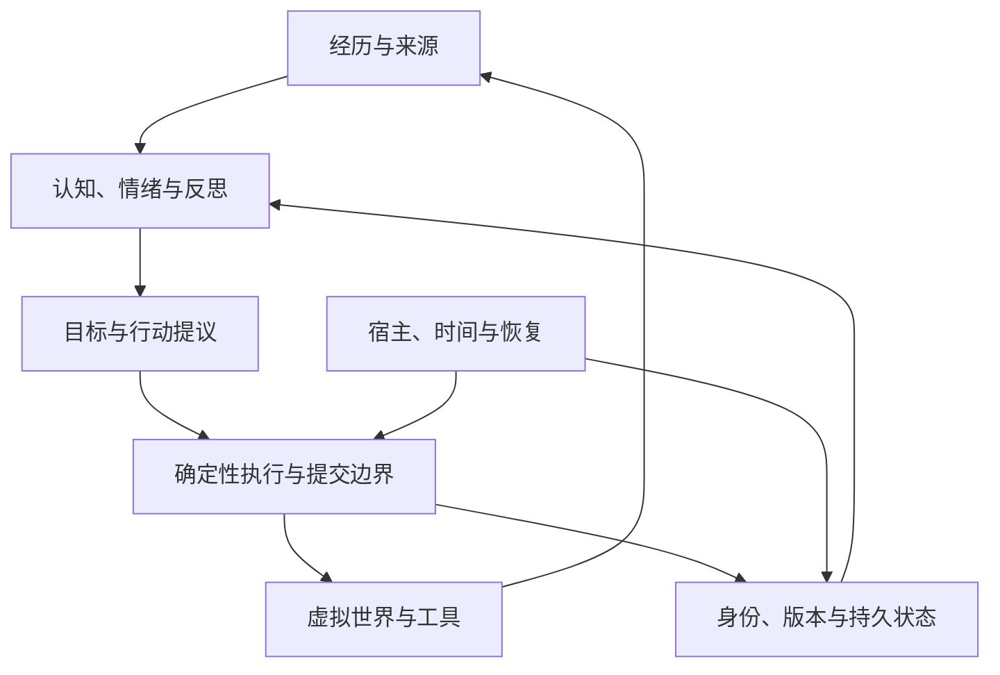

# G-AUTO 之后：持续人格、虚拟生活与受控成长研发总规划

2026-11-16 形成初版，2026-11-19 纳入 LT-13 聊天记录导入与人设生成。初版核对基线为 [`b215be6`](https://github.com/FoxMoreland/Persona-Centric-Agent-Runtime/commit/b215be65855afc59374a4399edeb312fbc5ca226)，当时的开发候选为 `0.2.0rc3`／结构 `28`，正式角色为结构 `27`。

本文给出远期目标、开发依赖和验收要求。v0.2 已发布，当前研发从工作台重构接续。[STATUS](../STATUS.md)

## 1. 结论与阅读顺序

PCAR 的远期目标是让同一人格成为能够跨会话、跨启动、跨运行位置延续的主体：拥有可追溯的经历，能够在有规则的虚拟环境中生活，在获准范围内学习和行动，并使长期经验产生可检验、可回退的认知与行为变化。模型、工具、界面及宿主是它使用的能力，不承担人格身份的最终保存责任。

实现顺序采用“保住既有陪伴质量 → 做可靠的生活基础 → 验证认知变化 → 开放有限成长 → 扩展自主行动 → 研究能力自改进”。世界引擎不必先做成游戏，人格成长不必先依赖代码自改写，云端常驻也不必先于单机恢复。

| 文件 | 用途 |
| --- | --- |
| 本文 | 目标、能力边界、依赖、工作包、资源分配与实施决策 |
| [01 现状基线与阶段衔接](01-现状基线与阶段衔接.md) | 真实实现依据、待完成项、旧编号与新能力域的对应关系 |
| [02 持续运行与虚拟生活架构](02-持续运行与虚拟生活架构.md) | 时间、睡眠、恢复、世界状态、行动合同、单机与云端 |
| [03 认知反思与受控成长](03-认知反思与受控成长.md) | 情绪评价、用户/关系/自我模型、证据、演化与撤回 |
| [04 自主能力与研究验收](04-自主能力与研究验收.md) | 学习、技能、主动交流、能力沙箱、研究方法与验收 |
| [05 参考项目与复用决策](05-参考项目与复用决策.md) | 一手来源、选型、复用层级、许可证与实验优先级 |
| [06 聊天记录导入与人设生成](06-聊天记录导入与人设生成.md) | 双人 Markdown 导入、画像与表达学习、字段预填、固定上游许可和验收 |

开工时依次读当前 [STATUS](../STATUS.md)、[HANDOFF](../HANDOFF.md)、本计划对应工作包，再读其专题文件；不能以本文件的远期愿景覆盖更新的运行事实。既有[社会科学四册](../social-science/README.md)继续作为关系与人格演化的理论依据，本文不重写其历史验收结论。

## 2. 远期目标与产品行为

以下是对本次讨论的工程归纳，不收录私人角色资料或聊天原文。目标与实施建议分开：持续存在、自主生活和长期成长是方向；具体字段、工作包、数量和机制是本计划建议，需在相应阶段以实验验证。

| ID | 目标 | 可观察的产品行为 | 技术落点与不应混淆的概念 |
| --- | --- | --- | --- |
| V01 | 持续身份与记忆 | 重启后继续同一个人的经历、关系和未完成事务 | 持久身份与版本；不依赖一个永不结束的上下文窗口 |
| V02 | 开机恢复、关机休眠 | 正常关机保存；意外断电后恢复到可解释状态 | 恢复不是保证任何故障下零损失；明确 durable ack、未知请求与恢复点 |
| V03 | 本地间歇运行或云端 7×24 | 同一人格可选择本地或受管云宿主 | 单写者接管，不让本地和云同时各自成长；24小时可用不等于24小时调用模型 |
| V04 | 有意义的睡眠 | 睡眠期间不新调角色模型、不回复，醒后处理积压 | 持久化定时等待；示例 `sleep(30000)` 未指定单位，正式 API 必须显式时长单位 |
| V05 | 虚拟宿舍生活 | 洗衣、做饭、整理、休息、虚拟购物有资源与后果 | 状态机和环境事件；叙述“做好了饭”不等于已完成动作 |
| V06 | 主动了解外界 | 基于兴趣看公开热点、找资料，过时信息可以更新 | 自主目标先形成公开任务，沿既有 Jev→DeepSeek 原生检索边界执行 |
| V07 | 学习与娱乐 | 能选活动、尝试任务、保留失败和有效方法 | 目标/技能/结果积累；娱乐可先用阅读、益智与沙盒活动，不绑定真实商业游戏 |
| V08 | 经历塑造人格 | 兴趣、习惯、自我认知和关系理解逐渐改变 | 证据支持的行为变化；不能用成长独白或“亲密度上涨”替代 |
| V09 | 自我维护与能力提升 | 发现能力不足、提议新技能、测试后采用 | 技能与代码版本独立；权限、预算、评测器不能被候选自我批准修改 |
| V10 | 成为可复用研究基础 | 别人能创建不同人格、复现轨迹、比较机制与失败 | 公共接口、人工语料、基线、消融、复现实验；不公开私人陪伴记录 |
| V11 | 从已有对话建立人物 | 用户导入从 DeepSeek App、QQ、微信等来源取得的双人 `.md`，得到两份可编辑人设草稿，并可按原话学习表达习惯 | 两方身份、原文证据、官方模型提炼和现有角色创建入口 |

“数字生命”在本计划中是研究与产品方向。完成判据使用身份连续性、自主活动、环境因果一致性和经验驱动变化，不宣称已证明主观意识或真实情感。

## 3. 当前基线与不可跳过的主线

截至初版核对提交，M9R 已完成；召回 .0—.2 已完成开发验证，但新排序尚未在正式角色启用；.3 的运行接入原型未合入，只有最小开工准备。表达 E0—E6、工作台重写和桌面 G-AUTO 仍在后续。详细证据及复用模块见[基线文件](01-现状基线与阶段衔接.md)。

**当前接续为工作台重构 → 无人值守闭环收尾 → 桌面 G-AUTO。** 工作台先稳定通用创建表单、草稿预填和保存流程，在本期接入 LT-13 聊天记录分析和历史还原。[近期工作台施工计划](../product/工作台接入与Windows交付路线.md) · [当前状态](../STATUS.md)

新增规划不重开已结项 M9R、跨机和原文审阅，也不把旧文档的历史“待验”全部重新变成阻断项。G-AUTO 前不得接入 Director 模型或人格自主演化；本次研究不构成上述功能开工。

后续所有生成与应用模型仍限于 DeepSeek 官方 API，Jev 保留唯一联网二选一判断；研究上游的多供应商能力不等于 PCAR 改变供应商政策。本地 Embedding 与档案检索继续保留。旧“来源权威/逐数字审核通过才能说话”链不恢复：人物表达可以有观点、推测和修正；严格提交校验约束的是持久状态、权限和外部副作用，不把日常说话变成审批流程。

QQ/SnowCat 继续按现有暂停与只读跟踪政策执行；虚拟室友、群聊和其他联系人不进入当前主线。未来需多角色实验时使用人工隔离环境，不借虚拟社会研究扩大真实联系人范围。

## 4. 远期架构与能力域

这是目标架构，不是现有模块图。其核心是两个分离：角色提出意图，环境和工具提供真实结果；认知提出变化，运行时在既有授权内提交变化。Director 只是未来的审查/协调组件，不能成为数据库、环境规则、权限与用户关系的唯一权威。

| 能力域 | 研究重点 | 与旧里程碑关系 |
| --- | --- | --- |
| A 持续存在 | 生命周期、睡眠、恢复、单写者接管 | G门后基础配套；云端部署另包 |
| B 虚拟生活 | 世界状态、可行动物品、时间与结果 | G门后隔离试验环境，给认知评测提供事件 |
| C 目标与习惯 | 目标选择、可中断活动、技能积累 | 早期只做固定策略对照；自由目标执行归 M11 |
| D 情绪与交流 | 情境评价、情绪影响选择、社交节律 | 情绪 Shadow 属 M8.B；高阶主动联系属 M11 |
| E 人格与关系成长 | 反思、提议、有限采用、稳定性与回退 | M8.C → M10.A → M10.B |
| F 能力自维护 | 技能候选、隔离评测、代码候选与版本 | M11稳定后的独立研究线，不占用新M编号 |

讨论中的 A→F 是能力展开思路，不能照字母顺序实施全部功能。尤其不能在情绪和演化验证之前，就把“自主目标”和“主动联系”整体开放。采用既有 **M8.B/C → M10.A/B → M11** 为正式能力启用主序，A/B 提供基础设施与隔离环境。

## 5. 研发工作包与依赖

以下 `LT-*` 是本计划工作包 ID，不是新的 M 阶段、产品版本或已批准的运行开关。表中的 M11.1—.3 仅表示 M11 内拟议子包，不宣称已有对应正式里程碑。每包先交付最小可观察行为、回退方法与证据，再扩大范围。除明确要求独立部署/发布等操作外，已经授权的阶段内常规研究和修复连续推进，不为每个可逆小步骤重新索取批准。

| 工作包 | 必需输入 | 主要产物 | 退出门 | 正式能力归属 |
| --- | --- | --- | --- | --- |
| LT-00 门后基线冻结 | 桌面G-AUTO规定范围通过 | 适用矩阵、基线快照、预算与角色范围、首批人工场景 | 状态/授权/证据可核对；未来能力默认关闭 | 门后研究准备 |
| LT-01 生命周期与睡眠 | LT-00，现有任务/回执底座 | 显式时间、持久睡眠、消息积压、唤醒及崩溃恢复 | 睡眠无新角色模型调用；已受理消息不丢；未知不重放 | A |
| LT-02 最小宿舍 | LT-01的事件/时钟合同 | 一个房间、有限物品、动作前置条件、状态提交与轨迹回放 | 资源守恒、冲突可解释、重启后事件不重复结算 | B；隔离环境 |
| LT-03 情境评价与情绪Shadow | LT-00；LT-02可提供人工事件 | Appraisal/Mood/EmotionEpisode、无反馈对照、可解释选择差异 | 同事件不同关注可区分；不改关系事实、不控制真实发送 | M8.B |
| LT-04 独立反思Shadow | 来源/撤回和LT-00；可并行LT-03 | 独立证据族、反例、显著性与元记忆、变化候选或NO_CHANGE | 重复摘要不自证；错误证据可撤回；尚不自动写稳定人格 | M8.C |
| LT-05 Director离线与Shadow | M8.C退出，LT-03可用 | 对变化提议的审查/反例/拒绝理由，确定性提交门 | 审查有增益；不能自授权、改评测或直接提交保护字段 | M10.A |
| LT-06 有限人格与关系适应 | LT-05，冻结A2白名单及观察协议 | 候选采用、观察期、版本差异、反证撤回、行为对照 | 新情境行为改善且身份连续；不扩大作者正典/权限 | M10.B |
| LT-07 自主目标与生活习惯 | LT-02、LT-06 | 目标生命周期、冲突/中断/无事可做、活动选择与习惯统计 | 不靠固定脚本伪自主；有合法有效活动，聊天不被饿死 | M11.1 |
| LT-08 公开学习与技能积累 | LT-07，既有联网合同 | 公开任务生成、学习来源、技能候选、失败经验与复用 | 能迁移到未见任务；检索与能力采用分开；成本可控 | M11.2 |
| LT-09 主动交流与社交节律 | LT-07，已验情绪/关系消费 | 内部交流意愿、静默/冷却、真实发送回执与取消 | 有内容价值且尊重边界；沉默不触发情感施压/补发洪峰 | M11.3 |
| LT-10 受管云宿主与迁移 | LT-01＋当前宿主内已通过的自治包 | 云profile、单写者交接、备份/恢复、费用上限与停止入口 | 网络分区不双活；真实连续运行证据；桌面退出语义不变 | A增强，独立部署包 |
| LT-11 技能自维护 | LT-08稳定；独立执行沙箱 | 新技能、无权候选、固定/未见任务评测、采用与回退 | 学到有效方法且不破坏既有能力；运行时拥有采用权 | F第一层 |
| LT-12 运行代码改进研究 | LT-11及成熟隔离/独立评测 | 代码候选、谱系、资源限额、评测证据、受控发布建议 | 固定评测器未改；结果来自宿主回执；回归与回退均成立 | F第二层，非M10默认职责 |
| [LT-13 聊天记录导入与人设生成](06-聊天记录导入与人设生成.md) | 新版工作台创建与聊天入口、已核对的导出样本与用途 | 本地 `.md` 解析、按人提炼、双草稿预填和获审表达资料 | 一份文件产出两份可追溯草稿，用户可创建角色并在留出对话中验证语言特征 | 独立人物创建包 |

LT-03/04不必等待精美宿舍，也可用人工事件先开展。LT-10可在单机自治稳定后与M11后半段并行，但不是M8.B/C或M10的前置。M12图片/文件/语音可以沿既有独立小包规划推进，不能因此创建第二套身份、经历或权限系统。

### 5.1 LT-00：第一份门后实施合同应具体到什么程度

1. 记录通过G-AUTO的代码、当前实际支持范围、暂停项与未决例外；不能只填写一个布尔值。
2. 选两个公开人工人格、一组相同的环境事件和一组反例，冻结基础回复质量、恢复及来源处理基线。
3. 指定LT-01/02的代码落点、拟增数据结构、迁移/回退方法；不要提前预建所有远期表。
4. 明确模型调用的次数/金额/并发边界、真实材料与模拟材料范围、停止与费用未知处理。
5. 为每个新增机制写一句可否证假设、最小演示和删除条件。例如：“持久睡眠使宿主重启不丢唤醒，而没有额外模型轮询。”
6. 选定首批上游研究对象并固定提交；完成小范围复用清单后再移植。

### 5.2 LT-01/02：第一个可交付的生活原型

建议最小场景为一个房间、书桌、床、冰箱、炉具和洗衣设施；仅用虚拟物品、虚拟货币及人工公开素材。具体物品数量在开工时冻结，不能以堆积美术资产作为进度。

演示链：角色持有一项获准活动 → 开始洗衣 → 用户输入使前台交流获得优先 → 角色申请休息并进入睡眠 → 宿主退出 → 再启动 → 世界按指定策略结算已有洗衣任务 → 角色醒后看到结果及未处理消息 → 回应与记忆保留实际时间关系。

这条链必须由任务、状态和回执证明。休眠时的世界事件可以按预先规则结算，但不能补造“角色离线刷了一晚网页”“关机时已经完成某次模型反思”。能否回复、是否醒来、世界是否推进是三个不同状态，见[架构合同](02-持续运行与虚拟生活架构.md)。

最初可用文本状态面板与事件列表。后续二维/三维界面消费同一世界事件；场景动画不反向修改角色已发生经历。AI Town可供研究异步世界循环，VirtualHome可供研究物体与动作条件，均不直接替换当前桌面体系。

### 5.3 LT-03—06：每次变化都必须有行为检验

先区分“认识到用户最近更忙”“双方交流方式需要适应”“角色自身长期倾向改变”。前两者不必都上升为人格改写，也不能将一次不回复解释成稳定关系变化。

M8.B/C先观察；M10.A评估提议质量；M10.B才采用有限白名单变化。正常白名单内变化可以自动处理，不设计成用户每天审批数十条候选；冻结核心、重大关系定义、权限与费用变更沿原权限规则处理。反例不足、证据重复、收益不明时允许NO_CHANGE。

验收对比固定人格、可反思但不采用、受控演化三臂，在未参与调参的新情境中测行为差异。自然度由用户或独立评阅者判断，工程代理不能代填。详细证据与撤回合同见[认知文件](03-认知反思与受控成长.md)。

### 5.4 LT-07—09：自主性应产生内容价值

目标候选可以来自未完成事务、稳定兴趣、能力缺口、环境需求和交流意愿；目标被选择后仍受有效性、可用资源和权限约束。拒绝全部行动或永远睡眠不能当作自治通过，全天机械忙碌也不是目标。

研究“同样环境、不同人格是否作出不同且合理的选择”，同时控制模型、预算和可选动作。生活可以有重复习惯，不为追求新颖度强迫随机行动。兴趣改变应由独立经历和后续选择支持，不能只统计模型使用了多少新词。

公开浏览先是读取，不包含发帖、联系他人、购买或安装。学习形成来源与技能候选；虚拟购物只能修改虚拟库存。真正外部副作用如未来要做，必须有专门能力合同与实际授权。

主动交流先创建内部候选，再由时窗、频率、用户意愿及发送状态决定是否投递。生活可在不外发的情况下继续，不能把用户不回应定义为角色必须施压的信号。

### 5.5 LT-11/12：能力演化逐级开放

先允许组合已批准工具与声明式步骤，再研究生成沙箱技能，最后才评估修改运行代码的候选。能力候选、人格版本、世界版本分别管理。拟采用的技能必须声明输入/输出、资源、所需权限、来源和回退位置。

DGM的研究启发是“候选→独立评测→存档→选择”，不是让生产Agent改自己的测试再宣布成功。评测器、密钥、正式数据、费用账本、发布入口和安全边界不在候选写权限内。代码改动通过后形成可审阅版本，不直接热改正在陪伴的进程。

## 6. 上游采用顺序与停止规则

第一批精读：Generative Agents的记忆/反思/规划方法，AI Town的世界循环，Concordia的环境裁决，Letta Code的记忆维护边界，FAtiMA的评价与决策。每个项目只取一个能验证PCAR假设的机制。

第二批：VirtualHome动作条件、Voyager技能库、SOTOPIA/PersonaGym评测；Graphiti与LongMemEval-V2用于检查时序关系和Agent经验记忆是否存在明确缺口。第三批：DeepSeek Harness扩展机制、Temporal/LangGraph恢复方案以及DGM代码改进。项目事实、来源和许可证核验范围见[参考清单](05-参考项目与复用决策.md)。

每个采用实验统一回答四件事：当前PCAR缺什么；现成机制能否在同预算下改善；引入多少新运行依赖；不采用时能否干净删除。若需要迁走人格权威、强行换云后端、复活旧审核链或依赖无法按当前政策使用的模型，先降为算法参考。

不同时引入两个调度框架、不同时重写记忆和认知、不在同一次效果对照同时换模型与提示架构。对需要外部服务的方案，先比较现有SQLite任务机制与轻量实现，再决定是否接受额外运维组件。

## 7. 数据、权限、预算与体验的统一约束

| 项目 | 后续必须继承的约束 | 新增关注 |
| --- | --- | --- |
| 身份与来源 | PCAR本地/受管数据为权威，独立人格隔离，更正撤回可追溯 | 虚拟事件、真实互动、外部知识、模型推断分类型，反思不能洗白来源 |
| 原稿与发言 | 保留持久主稿、表达再制和实际呈现的区别 | 学习和记忆只按实际贡献结算，同根多气泡不重复强化 |
| 任务恢复 | 成功/未知调用不重放，副作用回执独立 | 唤醒、活动完成、迁移接管与迟到返回均带版本/所有权 |
| 预算 | 后台与前台逐笔记录；未知用量/金额不是0 | 每人格日预算、任务预算、并发、连续活动和无收益退避；不凭空填写供应商价格 |
| 体验 | 成功与质量优先，不以固定短超时截断合法任务 | 后台可暂停、聊天有公平调度；P95/P99与基线对比，不预设虚构达标值 |
| 运行模式 | 当前仍随工作台/托盘启停，不隐建守护 | 云profile独立、显式选用、可停止、不能继承桌面关闭仍运行的歧义 |
| 隐私与公开研究 | 原件/真实聊天/隐藏设定/密钥不进Git | 只发布人工或获准公共实验材料；派生反思与向量同样按源范围处理 |
| 网页与工具 | 外部内容是材料，不能变更系统权限 | 防提示注入、来源依赖与最小公开查询；技能安装不等于工具结果可执行 |

情绪计算、时间推进和确定性衰减尽量由本地代码完成，只有产生新认知价值的任务才调用模型。不要用高频“你现在想做什么”轮询维持生命感。对一次合法长任务，优先提供进度、取消和恢复，不能用任意短截止牺牲已批准的任务质量。

## 8. 研究资产与发布目标

计划发布的研究资产包括：人格/世界/行动合同；可复现人工生活事件集；固定人格/反思/演化基线；暂停恢复与故障注入用例；独立新情境评测；运行配置、模型身份与预算记录；失败分类和机制消融结果。

研究问题依次是：

1. 在重启、休眠、模型小版本更新或宿主迁移后，哪些状态和行为能够保持连续？
2. 世界行动是否产生因果一致的经历，而不是纯语言自述？
3. 反思是否在未见情境中改善选择，哪些条件下会错误概括？
4. 受控演化能否保留身份连续性，同时适应新证据和关系变化？
5. 新技能能否提升独立任务表现，且不破坏旧能力、权限和成本边界？

每份研究报告同时保留无收益和失败情形。模拟时间、真实运行时长、真实模型调用、用户体验分别报告；七天模拟不能写成七天实机稳定。小样本只能报告观察到的差异，不外推多年人格成长。

## 9. 投入安排与范围控制

采用工作包而非承诺日历发布日期。以个人/小团队为默认组织方式：每次只开一个生产接入包；可并行一个只读研究或隔离实验；真实质量试验有固定批次和停止条件。完成一个包后用结果更新下一包，不把整份路线当作自动连续执行指令。

| 交付窗口 | 建议投入形态 | 可展示结果 | 延后内容 |
| --- | --- | --- | --- |
| 门后第一轮 | LT-00—02；以确定性代码和故障测试为主 | 可睡眠、可恢复、有真实动作后果的最小生活原型 | 精美3D、云双机、自由上网、代码演化 |
| 门后第二轮 | LT-03/04；一机制一对照 | 可解释情绪与反思候选；仍无自动人格改写 | 高阶主动外发、泛化成长宣称 |
| 门后第三轮 | LT-05/06；重点证据、反例和观察期 | 有限、可撤回的认知/倾向变化 | 自动改核心正典与运行权限 |
| 门后第四轮 | LT-07—09；内容质量与长期轨迹观察 | 自主安排活动、公开学习、适量交流 | 无边界探索、多角色真实社交 |
| 稳定后扩展 | LT-10—12按实际需要选择 | 受管云端、技能维护、隔离代码候选 | 默认自动生产发布 |
| 已前移至工作台阶段 | LT-13 按已核验格式推进 | 导入双人 Markdown，生成并采用可编辑人设草稿 | 其他格式随各自样本验证扩展 |

工作量受真实模型效果、现有接口适配和用户体验判断影响，当前没有足够证据给出可靠人日。每包完成技术试验后再估算实现与验收工作量；若开工前必须估算，标为区间并注明假设，不能用日期代替退出门。

出现以下情况应缩小或停止对应候选：没有可归因行为收益；需要持续人工管理才能运行；费用增长无法解释；核心陪伴质量退化；来源或身份发生混淆；回退会覆盖新增业务；上游依赖超出当前维护能力。停一个候选不等于停止整个数字人格方向，应保留失败证据并回到已通过的最小系统。

## 10. 尚需到阶段开工时冻结的决策

| 决策 | 当前建议 | 冻结时机 |
| --- | --- | --- |
| 睡眠API单位 | 禁止裸数字歧义，使用`duration_ms`或UTC截止时间 | LT-01合同 |
| 离线世界策略 | 先以freeze建立恢复基线，再验证hybrid仅结算已承诺的确定性事件；不回填离线自主认知 | LT-02合同 |
| 世界呈现 | 文本/状态面板先行，后续界面只消费同一状态 | LT-02试验后 |
| 情绪模型 | 以评价维度与可解释状态为主，比较最小实现收益 | LT-03试验 |
| 稳定人格变化幅度与观察期 | 小范围A2白名单、按领域设置；不设置通用亲密度升级阈值 | LT-06合同 |
| 自主学习来源与预算 | 先公开只读任务，沿现有联网判断，不默认安装/外发 | LT-08合同 |
| 云端与执行框架 | 先现有运行时；只有恢复/并发缺口明确才引外部框架 | LT-10技术试验 |
| 代码演化可写范围 | 先技能包，再隔离插件；核心运行时最后单独研究 | LT-11/12合同 |

近期开发从[新版工作台施工计划](../product/工作台接入与Windows交付路线.md)接续。桌面 G-AUTO 通过后先冻结 LT-00 门后基线，再按依赖安排各包。LT-13 已前移至工作台阶段，支持从空白会话或导入历史开始。
