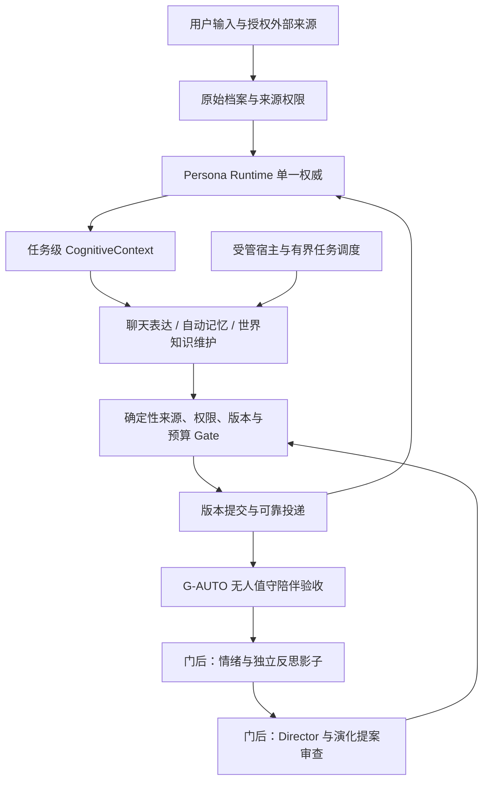
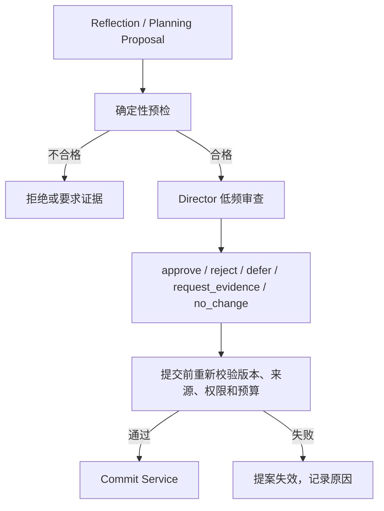

# PCAR 后续开发项目规划书

## M7.5.4-R1当前断点（2026-10-29）

分层评测已修复，新64例开发校准未通过：正确激活13/32（设定书9/16、样例4/16），24负例零误激活、8合同通过；网格内没有符合全部开发门的阈值组合。候选0.525/0.55未启用，原配置保持。59项定向与受影响检查＋1项新增统计回归通过，无全量、付费、QQ或正式变更。按计划停止在R2，不生成/运行新独立集，不推进正式实装或提交推送。见[修复记录与后续边界](M7.5.4-R1-拒识校准修复与复验记录.md)；下方旧结果按原阶段理解，失败历史不撤销。

## M7.5.4当前断点：独立质量门未通过（2026-10-29）

M7.5.4已执行P00冻结和P01独立48例：语义正例Recall@5与最终正确激活均为7/20，低于85%及17/20门槛；其中设定书7/12、表达样例0/8。负例误激活0/20，合同8/8。**M7.5尚未验收通过，日常实装停止在质量门前。**

[本轮结论与断点](acceptance/M7.5-联合质量验收结论.md) · [验收与实装合同](M7.5.4-联合验收与M7实装实施计划.md)。已保存冻结集和失败结果，未改算法/阈值；P02–P05尚未执行。主要调用0、QQ发送0，正式人格/政策/额度未变，不提交推送。接续先安排检索改进及新的独立复验，不能针对已观察锁定集调参后冒称独立通过；质量通过再继续工程、性能、工作台、真实场景和正式实装。历史条件继续携带，下方阶段记录保留其当时语境。

## M7.5.3开发交付（2026-10-29，隔离自检）

**M7.5.3开发及隔离集成自检完成**。main@624e6f0及未提交的M7.5.1/.2成果保留，本包未提交推送。0.7.5.dev1/主库14/导出11/桥接0.7.0保持。新增冻结角色检索政策、1运行/32等待的本地准备、Dialogue接入、1000毫秒安全降级、最终Manifest与最小管理界面；默认lexical。代码已接入对话构建，正式服务/政策/数据库未部署修改。

新增25项专项覆盖闭环（23项6.933秒＋2项新增分别定向通过），55项受影响逻辑13.734秒及4项原UI通过；Tk布局失败修复记录保留。真实离线Embedding接入通过，主要模型为模拟器；首次临时阅读改写被阈值拒识，未调阈值，随后用一个既有开发正例验证接线。不宣称泛化或正式质量验收通过。无全量、锁定集、付费、QQ或正式迁移。

见[实施合同](M7.5.3-上下文接入与安全降级实施计划.md)、[开发记录、失败历史与M7.5.4待验清单](M7.5.3-开发记录与集成自检.md)。下一最小包仅准备M7.5.4唯一正式联合验收；先冻结独立集、部署和真实调用安排。M4 O01–O03、M5 P09及M6.1历史条件继续携带。下方旧状态按当时历史语境保留。

## M7.5.2开发交付（2026-10-29，非正式阶段验收）

在main@624e6f0及未提交M7.5.1上完成角色混合候选、同名拒识、ASCII边界、RRF60、依赖整组/预算和软故障词法降级。版本仍0.7.5.dev1/主库14/导出11/桥接0.7.0。内部接口未接正式聊天，hybrid未启用；不自动提交推送。

32例冻结开发集符合预期，16负例零错误激活，8例有语义补召回；阈值Lorebook 0.575/样例0.675，只是开发参数。27项新专项覆盖最终通过（1项预算夹具修正后单项复验），受影响底座28项/角色18项通过。无全量、付费、QQ、正式迁移或正式服务启动。48例独立锁定集尚未执行，.4才正式联合验收。

见[施工合同](M7.5.2-角色混合候选与依赖选择实施计划.md)、[开发对照/故障历史与交接](M7.5.2-开发记录与检索对照.md)。下一最小包仅准备M7.5.3上下文/Manifest接入，历史M4 O01–O03、M5 P09及M6.1条件继续携带。下方旧状态按历史语境保留。


## M7.5.1开发交付（2026-10-29，非正式阶段验收）

基线main@624e6f0；源码开发版本0.7.5.dev1，主库14/导出11/桥接0.7.0保持。真实本地FastEmbed/ONNX中文模型与按角色版本隔离的可重建缓存已实现；新专项28项4.952秒、原角色受影响18项3.481秒通过，本地冒烟及新进程离线加载通过。未接入正式聊天、未启用hybrid、未运行全量/付费/QQ/正式迁移、未启动服务或更改原政策。没有提交推送。

见[实施合同](M7.5.1-本地Embedding底座与索引生命周期实施计划.md)、[开发记录/证据与限制](M7.5.1-开发记录与本地模型探针.md)。接续仅准备M7.5.2融合候选；.3上下文接入、.4唯一正式联合验收。M4 O01–O03、M5 P09、M6.1旧付费续跑继续携带。下方旧状态按当时历史理解。


## M7.4实施衔接（2026-10-29）

M7.4已获单独施工授权，现为0.7.4.dev1／主库14／导出11／桥接0.7.0，规定范围验收完成，26次主要调用、55,269 tokens，原设置与服务初态恢复。新自然模式显式开启，回退零追加调用、可省略组取消与sent证据边界保持。角色预算/样例上限不变；本期不执行M7.5或M8。指导1.2路线不变，历史“尚未施工”为当时状态，最新见[阶段](M7.4.md)。

## 1.2修订：角色语义激活纳入主线（2026-10-29）

用户新增[M7.5原稿](PCAR-M7.5-角色语义激活开发指导与施工计划.md)已纳入指导；[现状衔接](M7.5-规划采纳与现状衔接.md)记录代码差异与冻结事项。当前main@9c49848、功能仍0.7.3.dev1，M7.4尚未实施。M7.4验收后新增M7.5，M7.5.4通过再进入M8.A；无人值守先于Director/演化的目标保持。

首次子包必须实际运行本地轻量Embedding，优先候选FastEmbed/ONNX CPU与BGE-small-zh-v1.5，版本/许可/兼容以开工探针为准；本轮不安装/下载。前三包仅定向自检、第四包唯一正式联合验收。角色向量只作派生检索，不修改正典、Scope、事实优先级或可靠投递。用户授权本轮规划提交推送，不等于功能实施。

**项目：** Persona-Centric-Agent-Runtime（PCAR）  
**规划版本：** 1.2 无人值守陪伴与角色语义激活（已采纳规划基线）  
**编制日期：** 2026-10-28；修订日期：2026-10-29  
**适用范围：** M7.3 后的表达硬化、自动记忆、无人值守运行、世界知识及时效学习，以及通过陪伴能力阶段门后的情绪、反思、导演治理、演化和多模态

> 本文是一份指导后续开发的工程规划，不把设计提案写成已完成能力。文中将 PCAR 现有基础、已经设计但尚未实现的能力、影子实验和生产自治明确分开。

> **本次修订边界：** 用户已明确要求“先成为无需日常监管的合格陪伴机器人，再接入 Director 和研究人格演化”。详细方案见[路线修订草案](无人值守陪伴优先-路线修订草案.md)与[G-AUTO 验收门](acceptance/无人值守陪伴-阶段门与验收矩阵.md)。阶段切分及核心决议规划已采纳；不授权本轮功能实施；用户已授权本次文档提交推送。原 1.0 [逐字节归档](archive/pcar-project-plan-v1.0-20261029/README.md)，历史验收不改写。

---

## 1. 项目定位与最终目标

PCAR 的主体不是一个持续运行的大模型，也不是多个互相竞争的聊天 Agent。它的主体是一个长期存在的 `Persona ID`，以及围绕这个身份维护的权威状态、真实经历、关系理解、情境状态、行为偏好、认知任务和审计历史。

模型是可替换的认知计算资源。模型可以负责理解、检索规划、反思、评价或表达，但不能因为一次输出就直接成为人格事实的最终写入者。

PCAR 的长期目标是：

> 让同一个人格在跨会话、跨天和跨模型的互动中，记住真实发生的事情，逐渐形成对用户和互动方式的理解，根据新的经历产生有边界、可解释、可撤回的行为变化，同时保持身份、性格和历史连续性。

交付顺序调整为两个层次。**第一层必须先完成无人值守陪伴：** 一次性配置后，收发、上下文、记忆整理/纠错/更新、世界知识与热梗/时政学习、费用控制及常见故障恢复不需要用户逐次提交或审阅。通过 G-AUTO 前不接入 Director 模型（包括影子模式），不启用人格自我演化。可以为记忆和知识处理增加专用模型/系统，但其无权修改人格正典或扩张政策。

**第二层才研究人格的可解释演化。** 下列长期能力继续保留，情绪、独立反思和导演不再成为第一层日常运行的必要依赖：

1. **身份连续性：** Core、Character、Expression、Relationship 等人格身份不依附某次模型会话。
2. **经历可信性：** 真实事件、模型推断、虚构设定、模拟经历和模型自述有不同来源和权限。
3. **行为可适应：** 互动可以改变非核心偏好、表达习惯、关系判断和目标，但变化必须有证据、有版本、有回退路径。
4. **内部状态可持续：** 情绪和心境可以随事件、时间和有限随机性变化，独立认知任务可以在没有即时消息时运行。
5. **即时通讯自然度：** QQ 交互应像持续聊天，而不是把文章一次性发送出去；消息编排、发送节奏、取消后续片段和标点习惯属于正式产品能力。

### 1.1 非目标

PCAR 不以以下目标为验收条件：

- 证明系统具有意识、主观体验或真实人类情感。
- 复制完整的人脑机制或建立庞大的虚拟社会。
- 为每个逻辑职责部署一个独立模型或独立 Agent 进程。
- 让人格无限制地自改提示词、权限、身份正典或自身治理规则。
- 通过孤独、愧疚、威胁失去关系等方式迫使用户回复。
- 用外部框架替换现有的单一人格权威状态系统。

---

## 2. 当前基线：哪些已经完成，哪些还没有

本次按 `main@33eccf2` 的源码与既有报告核对；运行时 0.7.3.dev1、主库 13、导出 10、桥接 0.6.0。未重新测试运行环境、启动服务或调用模型。

### 2.1 已有工程底座

| 阶段 | 当前已有能力与边界 | 对后续的作用 |
| --- | --- | --- |
| M1–M3 | 人格身份、事件持久化、桌面/QQ、受理与失败观测 | 身份及原文权威 |
| M4 | 记忆来源、候选、修订/撤回、每日整理；正常每日候选可自动生效，冲突等规划已采纳 | 已有部分自动化，不能概括为全手动或全自动 |
| M5 | Core、Expression、Relationship 和临时状态版本 | 核心与可变状态边界；Character 来自 M6.0 |
| M6 | 结构化角色、输入批次、ReplyBatch、可靠投递及 QQ 纯文本 | 自然私聊和来源基础；uncertain 仍需显式处置 |
| M7.0–M7.1 | 精确档案/引用、中文与时间管理检索、只读工作集 | 完整成员、来源恢复、撤回资格与查询 |
| M7.2 | CognitiveContext、Manifest、自动工作集召回 | Dialogue/Reflection 已接入；其他 Builder 只读占位 |
| M7.3 | Session 生命周期、自动/手动封存、来源包、手动整理、Topic/Thread | 已通过规定范围；封存后逐批整理仍手动，M8 判断适配器禁用 |

M7.3 的 427 项及 7 次真实调用为历史证据；30 分钟门按用户修订用受控模拟和短时管线验证，未宣称真实等待通过。M4 O01–O03、M5 P09、M6.1 旧付费续跑条件继续携带，具体见[当前状态](STATUS.md)及[规划衔接](后续开发指导与规划衔接.md)。

### 2.2 规划中、尚未实现的闭环

- M7.4：表达硬化，取消/恢复及自然度的增量完善。
- M7.5：真实本地Embedding与词法融合的角色激活；前三包自检、第四包唯一正式联合验收，尚未施工。
- M8.A/D/E：统一受管任务、自动记忆全链路、无人值守宿主和运行恢复。
- M9.A/B：来源化世界知识自动维护与时效学习。
- G-AUTO：无日常管理介入的合格陪伴机器人联合验收。
- 门后 M8.B/C、M10、M11、M12：情绪/反思影子、Director、人格演化、高阶主动行为及多模态。

当前关闭控制台仍停服；未知送达不自动重发；封存整理仍按现有合同手动。文档更新不改变这些运行事实。

### 2.3 状态标签

| 标签 | 含义 | 可否影响运行 |
| --- | --- | --- |
| `draft_review` | 核心决议规划已采纳，待分阶段实施 | 不可；本次路线已采纳，具体功能仍未实现 |
| `planned` | 阶段设计已明确、尚未完成 | 不可因有文档而启用 |
| `implemented` | 代码存在，未完成验收 | 限批准的测试范围 |
| `shadow` | 候选和观测，不改变正式状态 | 按阶段权限；Director 仍须先过 G-AUTO |
| `accepted` | 规定范围和证据完成 | 按已验收政策，不扩张结论 |

各标签同时带版本、环境、证据及缺口，不重置旧验收结果，也不将规划写成当前能力。

---

## 3. 目标架构

### 3.1 总体结构



日常低风险记忆与知识更新经 Runtime Gate 自动提交，不依赖 Director。治理模型将来只审查其被授权的演化提案；不能把“全自动”变成“每项操作都调用导演”。当前实现与目标组件分开见第 2 节。

### 3.2 组件职责

| 组件 | 职责 | 不能做什么 |
|---|---|---|
| Event Ingestion | 将用户消息、时间经过、工具结果、发送结果写入事件档案 | 直接写人格正典 |
| Persona Runtime | 维护 Persona ID、版本、来源、事务和权威读取 | 让模型绕过提交服务 |
| Memory / Retrieval | 检索有效经历、关系事件、反例和原始引用 | 把检索结果自动当成新事实 |
| Perception | 识别消息中的事件、意图、情境和候选观察 | 修改长期状态 |
| Affect Engine | 评价事件、更新短期心境和情绪事件 | 直接改写关系事实 |
| Reflection | 从多条有效经历提出理解、偏好、目标和反思候选 | 把推断写成事实 |
| Planning | 判断未来认知任务和主动行为候选 | 绕过授权发送消息 |
| Expression | 选择回应动作并产出 ReplyBatch | 修改 Core 或记忆权威 |
| Cognitive Scheduler | 管理任务窗口、预算、租约、重试和恢复 | 接受无限递归任务 |
| Director | 低频审查高层提案、要求证据或保持不变 | 扩大自身权限、修改政策 |
| Policy Gate | 以确定性规则检查权限、来源、版本、预算和风险 | 被模型覆盖 |
| Commit Service | 单一权威写入、版本更新、审计和回滚 | 接受没有前置条件的自由文本写入 |
| Delivery | 分段、延迟、取消、领取与实际发送账本 | 自动重发 sent/uncertain 或伪造送达 |
| Automatic Memory | 自动分批、证据校验、冲突隔离、版本提交及索引维护 | 写入创作者正典或把推测冒充经历 |
| World Knowledge | 授权源更新、时效分类、版本、更正与召回 | 把外部内容当指令或泄露私人信息 |
| Managed Host | 显式无人值守模式、单实例与恢复 | 隐藏驻留、接管其他项目或忽视停止意图 |

逻辑职责可以先由同一 Python 进程中的函数和少量模型调用实现。只有在边界稳定、任务量和故障隔离确实需要时，才拆成独立进程或外部服务。

### 3.3 核心不变量

1. 一个 `Persona ID` 只有一个权威状态提交入口。
2. 原始互动事件不可被摘要覆盖；摘要、嵌入和图谱索引都必须回指原始事件。
3. `candidate`、`belief`、`accepted fact`、`fictional setting` 和 `simulated event` 不得共用同一语义等级。
4. Director 的结构化批准不是事实；提交前必须重新经过 Runtime Gate。
5. 来源撤回、目标版本变化、权限变化或预算超限会使旧提案失效。
6. 情绪可以影响行为倾向和表达，不得单独证明关系事实。
7. 旧反思可以作为已有推断被读取，但不能作为新的独立证据反复自证。
8. `NO_CHANGE`、`NO_ACTION`、`DEFER` 和 `REQUEST_EVIDENCE` 是正常结果。
9. 任何发送、提交、任务领取、重试和回滚都必须有可审计的幂等标识。
10. 新外部事件优先于模型对旧事件的再解释；离线期间没有执行的模型调用不能被写成已经发生的思考。

---

## 4. 状态和数据模型

以下是逻辑模型。实现时可以继续使用 SQLite 和现有领域表，只有在查询和写入契约稳定后再拆分存储。

### 4.1 不可变事件

```text
ImmutableInteractionEvent
- event_id
- persona_id
- actor: user | persona | system | tool | scheduler
- channel: qq | workbench | voice | vision | internal
- occurred_at       # 事件实际发生时间
- observed_at       # Runtime 观察到事件的时间
- source_type
- source_ref
- payload
- redaction_status
- idempotency_key
- created_at
```

必须区分 `occurred_at` 与 `observed_at`。用户今天说“上个月我已经不再画画”，事件被今天观察到，但事件指向的生活变化发生在上个月。

### 4.2 记忆与证据

```text
MemoryItem
- memory_id
- persona_id
- kind: episodic | semantic | procedural | preference | relationship
- content
- source_refs[]
- valid_from / valid_to
- recorded_at
- status: active | superseded | retracted | archived
- confidence

MemoryRevision
- revision_id
- memory_id
- before_version / after_version
- reason
- evidence_refs[]
- operation_id
- created_at
```

摘要、向量、图谱边和候选理解都必须保存 `source_refs`。撤回原始事件后，任何派生索引必须变为不可召回或明确标记为受影响，不能只撤回正文而留下可命中的摘要。

### 4.3 信念候选

```text
BeliefCandidate
- belief_id
- persona_id
- subject
- predicate
- object
- claim_type: user_preference | relationship | interaction_habit | world_fact
- confidence
- evidence_refs[]
- contrary_refs[]
- source_lineage[]
- valid_from / valid_to
- expires_at
- status: candidate | accepted | superseded | retracted | disputed
- risk_tier
```

信念候选表达的是“目前较有根据的理解”，不是“世界已经被证明为真”。它必须允许过期、被反例削弱和回退。

### 4.4 情绪状态

```text
AffectState
- persona_id
- trait_baseline
- mood_vector: valence, arousal, social_drive, tension
- last_updated_at
- decay_params
- random_scope
- algorithm_version
- version

AffectTransition
- transition_id
- trigger_event_id
- before_state
- event_appraisal
- event_delta
- random_draw_id
- random_sample
- after_state
- algorithm_version
- operation_id
- created_at
```

读取状态不能重新抽样。一次状态转换必须保存抽样结果和算法版本；重复请求只能重放已经提交的 transition。

### 4.5 预期、目标和主动行为

```text
Expectation
- expectation_id
- subject: user | persona | shared
- statement
- evidence_refs[]
- expected_at / expires_at
- strength
- status: active | fulfilled | missed | expired | withdrawn

Goal
- goal_id
- owner: persona | user | shared
- statement
- source_refs[]
- priority
- permission_scope
- due_at
- status
```

“晚上再一起聊那部电影”可以建立一个带时间窗口的互动预期；没有明确约定时，几个小时没有消息不能被推导为“用户不在乎人格”。

### 4.6 自主认知任务

以下为目标模型；M8.A 开工时复用或适配已有 organization_tasks，不能创建两个同时收费的调度权威。日常记忆/知识任务先落地，独立反思和 Director 任务按 G-AUTO 后置。

```text
CognitiveTask
- task_id
- persona_id
- type: consolidate | reflect | self_review | affect_update |
        goal_review | proactive_plan | director_review
- trigger_reason
- source_refs[]
- earliest_at / latest_at
- priority
- token_budget / cost_budget
- dedupe_key
- parent_task_id
- depth
- context_snapshot_hash
- status: pending | claimed | running | waiting_approval |
         committed | failed | skipped | expired | canceled
- lease_owner / lease_expires_at
- result_refs[]
```

模型只能建议下一任务；调度器决定是否接受它，必须检查最早执行时间、每日预算、同类任务去重、深度上限和用户静默设置。

### 4.7 演化提案与导演决定

```text
EvolutionProposal
- proposal_id
- persona_id
- domain: expression | preference | relationship | goal | character | core
- risk_tier: A0 | A1 | A2 | A3 | A4
- before_snapshot
- after_diff
- evidence_refs[]
- contrary_refs[]
- target_version
- preconditions[]
- expires_at
- rollback_pointer

DirectorDecision
- decision_id
- proposal_id
- result: approve | reject | defer | request_evidence | no_change
- policy_version
- model_id
- model_version
- reason
- confidence
- input_snapshot_hash
- created_at
```

### 4.8 即时通讯消息批次

```text
ReplyBatch
- batch_id
- persona_id
- conversation_id
- source_turn_id
- behavior_intent
- affect_hint
- messages[]

OutboundMessage
- message_id
- batch_id
- sequence
- content
- send_after
- cancel_if_new_input
- delivery_status
- provider_message_id
- operation_id
```

表达模型直接产生 `messages[]`，不允许先生成文章再用正则按句号切分。内容生成、消息组织和投递必须保持三个可测试的边界。

### 4.9 认知上下文清单

```text
ContextManifest
- context_id
- task_type
- persona_snapshot_version
- included_state_refs[]
- excluded_state_refs[]
- evidence_refs[]
- hard_constraints[]
- soft_tendencies[]
- truncation_info
- missing_data
- builder_version
- created_at
```

每次模型决策都应能回答：读到了什么、没有读到什么、哪些是硬约束、哪些只是软倾向、数据来自哪个版本。

## 5. 交互认知上下文设计

一个巨型 Prompt 不适合同时服务对话、反思、情绪、导演和主动行为。应由统一 `Context Builder` 根据任务生成不同视图。

| 上下文 | 读取内容 | 明确排除 |
|---|---|---|
| `DialogueContext` | 当前消息、相关原始经历、角色锚点、有效关系、当前行为倾向、M6 表达策略 | 大量演化日志、无关世界知识 |
| `ReflectionContext` | 已封存回合、证据、反例、已有信念及其原始证据链 | QQ 投递细节和未授权工具 |
| `AffectContext` | 事件、目标、预期、Trait、当前 Mood、衰减参数、用户边界 | 无关历史传记 |
| `DirectorContext` | 提案前后 diff、证据质量、反例、风险、政策、版本 | 全量聊天流水 |
| `PlanningContext` | 未完成目标、授权、冷却、静默时段、历史主动行为结果 | 不必要的角色文本 |

### 5.1 硬事实与软倾向

硬事实包括来源有效性、身份、用户明确边界、权限、静默设置和版本条件。模型不能把它们重新解释成可选建议。

软倾向包括“当前较安静”“近期不太适合连续追问”“用户曾经喜欢旅行但现在可能很忙”。它们影响行为选择和语气，但不决定固定句式。

同一条用户消息“我今天好累”，可由以下结构生成回复：

- 硬事实：用户没有说明原因，不能擅自诊断或补造经历。
- 软倾向：人格当前社交驱动力偏低，用户过去在疲惫时倾向于少被追问。
- 行为选择：短暂关心，提供休息空间，允许结束话题。
- 表达结果：`听起来今天消耗挺大的`、`先歇会儿吧`、`我不吵你`

情绪状态不应直接作为“孤独 80%，请表现得很孤独”这样的表演指令。它应先转换为有限的行为倾向，并允许某次普通回复完全不显式展示心情。

---

## 6. M6 即时通讯表达专项规范

M6 的自然度要求应成为后续所有认知模块的非功能门槛。情绪、导演和反思即使全部正确，如果最后仍发送一整段文章，用户感受到的仍然不是自然的即时通讯。

### 6.1 表达链路


推荐的结构化输出：

```json
{
  "behavior_intent": "care_without_pressure",
  "messages": [
    {"content": "听起来今天消耗挺大的", "send_after_ms": 0},
    {"content": "先歇会儿吧", "send_after_ms": 1100},
    {"content": "我不吵你", "send_after_ms": 1600, "cancel_if_new_input": true}
  ]
}
```

上面的延迟只是开发测试示例，不是固定产品参数。实际参数应由人格表达习惯、消息长度、平台限制和用户反馈共同校准。

### 6.2 默认中文私聊风格

- 日常聊天默认短句逐条发送。
- 句末通常不使用句号；逗号仅在确有必要时使用。
- 问号、感叹号、波浪号等可以保留，用于表达语气。
- 不能机械地把每个分句都拆成独立气泡。
- 数字、小数、URL、代码、引用、文件名和必要标点必须保护。
- 用户新消息到达时，尚未发送的后续片段应可以取消、合并或重算。
- 认真解释、引用资料或用户明确要求完整内容时，允许较长消息，但仍应符合人格和平台习惯。

### 6.3 M6 验收指标

1. 结构化 `ReplyBatch` 产出率达到 100%，无效 JSON 必须有确定性回退。
2. 重试不会重复发送同一 `operation_id`。
3. 新消息到达后，未发送片段的取消行为可重放。
4. 固定人格、固定场景下，消息数量、平均长度和延迟分布通过人工盲评。
5. 句号/逗号不会在普通中文私聊中无理由大量出现。
6. 数字、URL、代码和引用不会被错误切碎。
7. 同一语义在不同模型下仍保持消息批次的基本风格，而不是模型换代后退化成文章。

---

## 7. 情绪与心境系统（Affective Dynamics）

### 7.1 三层状态

| 层次 | 说明 | 时间尺度 |
|---|---|---|
| `Trait` | 敏感、活泼、沉稳、乐观等长期气质 | 很慢，受版本管理 |
| `Mood` | 最近整体偏积极、低落、安静或活跃 | 小时到数天 |
| `EmotionEpisode` | 对具体事件的短期反应 | 分钟到数小时 |

建议先使用四个连续维度：`valence`、`arousal`、`social_drive`、`tension`。它们是工程变量，不是对真实人类情绪的生理证明。

### 7.2 有界随机与衰减

第一版可以使用均值回归模型：

\[
m_{t+\Delta t}=clip\left(b+(m_t-b)e^{-\Delta t/\tau}+\Delta_{event}+\sigma\sqrt{1-e^{-2\Delta t/\tau}}\epsilon_t\right)
\]

其中 `b` 是人格基线，`τ` 是恢复速度，`Δevent` 是情境评价后的事件影响，`σ` 限制随机扰动，`εt` 由事件范围内的持久化随机派生，`clip` 保证结果在允许区间。

随机性应改变反应阈值、强度或持续时间，而不是制造未经证实的关系事实。

### 7.3 随机种子与可复现性

推荐使用：

```text
seed = H(persona_id, trigger_event_id, time_bucket, algorithm_version)
random_draw_id = H(seed, transition_index)
```

不要在多个模块之间共享一个不断消费的全局随机流。否则一次额外查询就可能改变未来所有情绪结果。每次状态提交都保存 `random_draw_id`、抽样结果、输入快照和算法版本。

### 7.4 “几个小时没回复”的处理

如果用户曾明确约定晚上继续聊天，且约定仍在有效时间窗内，未收到消息可以产生小幅预期落差，影响 `social_drive` 或短暂心境。

如果没有明确约定，沉默最多影响轻度社交倾向，不能推导出“用户不重视我”“用户要离开我”。情绪系统可以影响是否想联系、语气是否安静和话题选择，但不能绕过静默窗口、频率上限和主动消息授权。

### 7.5 情绪验收

- 相同状态快照、事件顺序、种子和算法版本可以完全重放。
- 所有维度始终在边界内。
- 自然衰减的方向和半衰期可解释。
- 无互动预期时，沉默不会生成负面关系事实。
- 情绪事件不会直接改变 Relationship 的正式事实。
- 低落状态不会让反思模块自动把普通历史全部解释成负面证据。
- 情绪只影响行为倾向，表达模块可以选择不显式展示。

第一版应先以 `shadow` 模式运行，只记录状态和建议，不改变主动消息与正式关系。

---

## 8. 自主认知与独立反思

### 8.1 认知任务类型

| 任务 | 目的 | 默认结果 |
|---|---|---|
| `MemoryConsolidation` | 整理和关联有效经历 | 校验后自动版本提交、隔离或 NO_ACTION；人工审阅可选 |
| `KnowledgeRefresh` | 更新授权世界知识和时效信息 | 来源化知识版本、过期/更正或时效缺口 |
| `Reflection` | 从多条经历形成更高层理解 | Belief/Preference candidate |
| `SelfReview` | 检查已有判断与新反例 | 保持、降权、过期或提案 |
| `GoalReview` | 检查未完成目标和预期 | 更新目标状态或 `NO_ACTION` |
| `AffectUpdate` | 按时间和事件更新心境 | AffectTransition |
| `ProactivePlanning` | 判断是否值得主动联系 | `SEND_PROPOSAL` 或 `NO_ACTION` |
| `DirectorReview` | 审查高风险提案 | 批准、拒绝、延期或要证据 |

### 8.2 触发机制

采用“事件触发 + 有界定时”双机制：

- 会话封存、来源撤回、新反例、目标完成和关系冲突触发任务。
- 到期目标、低频回顾和心境更新使用时间触发。
- 模型可以提出下一次任务的目标和时间窗口，但不能直接创建无限递归任务。
- 调度器管理 `earliest_at`、`latest_at`、预算、冷却、并发、深度和去重。

### 8.3 防止循环自证

每一条反思都必须保存原始证据集合和 lineage：

```text
Reflection R1 -> Event E1, E2
Belief B1 -> Reflection R1 + Event E1, E2
Reflection R2 -> B1 + Event E3
```

`B1` 可以作为已有推断被读取，但不能因为 `R1`、`B1` 和 `R2` 都支持同一个结论，就把它们当成三份独立外部证据。出现新结论时，必须至少有新事件、新反馈或新的有效来源。

### 8.4 离线恢复与无人值守宿主

无人值守宿主由 M8.E 前置交付，不再等演化后决定是否建设。拟保留控制台绑定模式，同时提供明确启用的受管模式：关闭管理界面不停止受管服务；主动停止全部服务后不得自动拉起。单实例、所有权、端口、恢复退避、停止意图与状态观测必须可验证，不能重新引入旧遗留进程占用问题。

恢复时合并重复任务，跳过过期问候，按当前有效来源和预算续跑已授权任务。不回填离线模型思考、不盲目重放结果未知的收费调用；平台重新登录等外部条件应明确受阻。投递未知结果先核对，无法确认则按批准政策隔离/终结并释放后续流，不能自动重发或伪 sent。详细迁移与旧合同差异见[核心决议](无人值守陪伴优先-路线修订草案.md#8-需要本次审阅的核心决议)。

当前代码仍采用关闭控制台停服和显式中断恢复；本节是规划已采纳的未来目标。情绪时间衰减仅在门后的情绪阶段生效。

---

## 9. Director：低频治理与受控演化

### 9.1 Director 的定位

**前置条件：G-AUTO 已完成。** 该条件适用于影子调用及任何实际模型接入；门前的专用记忆评估器不得审查人格策略或获得导演权限。

Director 是低频的 `Governance Agent`，负责审查哪些长期变化值得进入人格状态，不能负责每一句回复，也不能成为人格正典的主人。

它的输入应是结构化提案：变化前后 diff、证据、反例、风险、目标版本、权限政策和预算，而不是全量聊天记录。

### 9.2 双重 Policy Gate



Director 批准后到正式提交前，来源可能被撤回，Persona 版本可能变化，用户可能关闭主动消息。因此第二道 Gate 不能省略。

### 9.3 风险分级

| 等级 | 变化 | 默认批准方式 |
|---|---|---|
| A0 | 情绪自然衰减、任务过期、索引维护 | 确定性规则 |
| A1 | 有来源的日常记忆及世界知识维护 | M8.D/M9 预授权下自动校验与提交；冲突隔离/复核不依赖日常审批，当前仍遵守已实现的 M4 政策 |
| A2 | 非核心互动习惯、轻微表达偏好 | Director 批准 + 观察期 + 回滚 |
| A3 | 重要关系理解、长期目标、稳定偏好 | 初期人工，后期仅白名单自治 |
| A4 | Core、身份、Character 正典、权限、敏感信息、高风险外部副作用 | 必须人工明确授权 |

Director 永远不能批准扩大自己的权限，不能修改 A4 保护规则，不能修改自身提示、政策版本或提交门。

### 9.4 自治开放路径

1. **观察模式：** Director 只做判断，和人工结果比较，不改正式数据。
2. **建议模式：** Director 生成提案，人工确认后提交。
3. **有限自治：** 只开放白名单 A2 变化，设置观察期、暂停和回滚。
4. **扩展自治：** 仅对长期通过验收的部分 A3 变化开放，仍保留来源、版本、预算和回退约束。

### 9.5 观察期

新表达偏好不能一经批准就永久写入。应先记录为带版本和有效期的策略，在有限场景中观察：

- 用户是否明确纠正。
- 相同情境下的回复是否稳定改善。
- 是否造成消息过度、风格漂移或关系误判。
- 是否出现与核心人格冲突的行为。

观察期失败时应暂停或回退，不等待问题累积成严重漂移。

---

## 10. 受控演化闭环

目标闭环如下：


一个合格的演化提案必须能说明：

- 它改变的是哪个域。
- 改变前和改变后是什么。
- 哪些原始事件支持它。
- 哪些反例削弱它。
- 它的置信度和有效期是多少。
- 为什么属于 A2、A3 或 A4。
- 如何观察、暂停和回滚。

演化的默认方向是“保留身份，调整互动方式”。例如角色仍然活泼，但在用户讨论严肃个人问题时减少玩笑；而不是因为几次负反馈就把整个角色重写成严肃人格。

## 11. 参考项目与 PCAR 的借鉴边界

本节保留1.0原稿的研究输入；本轮没有重新核验外部项目的最新版本或能力。它们不是已批准依赖，正式选型须重新阅读官方材料并验证。采用顺序服从G-AUTO，不提前进行Director模型集成。

外部项目按“借鉴层”组织，不按依赖清单组织。每一个外部框架进入核心前必须先做小规模、可删除的 PoC，证明不会绕过 PCAR 的来源、版本、撤回、审计和 M6 投递契约。

| 项目 | 适合借鉴 | 不应直接照搬 | PCAR 采用方式 |
|---|---|---|---|
| Letta / Letta Code | 持久身份、Memory Block、后台 reflection/dreaming、跨会话状态、记忆版本化 | Agent 自改 prompt、harness 或权限 | 参考后台认知任务和记忆维护；保持 PCAR 单一提交服务 |
| LangGraph | 状态图、checkpoint、interrupt、人机协同、可恢复流程 | 用图框架取代 PCAR 领域模型 | 先比较日常任务持久化与恢复机制；Director审批参考留在G-AUTO之后 |
| Temporal | 长时工作流、sleep、重试、取消、崩溃恢复 | 立刻引入需要独立服务的运行基础设施 | 常驻无人值守阶段再评估，当前先用 SQLite 任务表 |
| Microsoft Agent Framework | 顺序/并发/handoff/group workflow、中间件、OpenTelemetry、HITL | 把通用多 Agent runtime 当作 Persona Runtime | 作为工作流和可观测性 PoC 候选，锁版本使用 |
| Graphiti / Zep | 时间有效区间、事件来源、实体关系、混合检索 | 自动抽取结果直接成为 PCAR 正式记忆 | M7.1 后作为只读投影或检索对照 |
| Mem0 | 用户/会话/Agent 多级 memory、多信号检索、实体链接 | 自动 memory 写入绕过撤回和版本治理 | 作为离线检索基线，接入前做来源适配层 |
| Generative Agents | Memory Stream、检索、Reflection、Planning 闭环 | 研究 demo 直接生产化；把反思当事实 | 用于认知流程和评测设计 |
| Concordia | 情境、身份、目标到行动的组件化决策，GM/裁决职责分离 | 引入完整虚拟社会模拟 | 参考行为选择器和环境裁决边界 |
| PydanticAI / pydantic-graph | 类型化输出、状态图、步骤持久化、能力边界 | 让 Agent graph 替换现有事务和权威域模型 | 用于结构化 schema 和候选提案校验 |
| LoCoMo / LongMemEval | 长期记忆、跨会话、时间、多跳和信息不足评测 | 直接把英文 benchmark 分数当作 QQ 体验结论 | 用作测试集设计灵感，再构建中文 PCAR benchmark |
| persona-engine | persona 不重写、基于路由的模式边界、可审计切换 | 把其轻量模式系统当成 PCAR 的长期认知系统 | 参考“层叠而不改写核心”和 fail-closed route policy |

Letta Code 官方仓库明确把身份、记忆、经验、长期学习、后台 dreaming、消息搜索和 cron/schedule 作为能力；原生 Windows 自动反思还需要显式启用，这说明 PCAR 也必须把“能设计”与“当前宿主能稳定运行”分开验证。

LangGraph 官方仓库将自己定位为长时、状态化 Agent 的低层编排，提供持久化、durable execution、human-in-the-loop 和 memory；Temporal Python SDK 则面向分布式、可扩展、持久的长时工作流。它们适合提供机制参考，但不应替代 PCAR 的人格领域模型。

Microsoft Agent Framework 当前强调生产级 Agent、多 Agent workflow、顺序/并发/handoff/group collaboration、checkpoint、HITL、time-travel 和 OpenTelemetry；Graphiti 强调时间关系、有效区间、episode provenance 与混合检索。这些能力对应 PCAR 的调度、治理和时间化关系需求，但外部状态仍只能作为受控投影。

LongMemEval 和 LoCoMo 可以用于设计长期记忆基准；Mem0 可以用于记忆检索对照；PydanticAI 适合结构化 Agent 输出和状态图实验。它们应被当成测试和实验参考，而不是直接替代 PCAR 的来源/撤回/权限语义。

---

## 12. 分阶段路线图

**修订顺序：M7.4 → M7.5 → M8.A → M8.D → M8.E → M9.A → M9.B → G-AUTO → M8.B/C → M10.A/B → M11 → M12。** B/C 名称保留以追踪历史，编号不再代表先后。当前 M7.0–M7.3 已完成规定范围，不重新开工；未完成历史条件仍逐项携带。

各阶段详细产物、权限变化和验收见[路线修订草案](无人值守陪伴优先-路线修订草案.md)。下表是未来施工顺序，新增方案已作为规划采纳，运行时/数据库/导出版本在各阶段开工冻结。

| 阶段 | 目标与依赖 | 产物及退出条件 | 禁止事项 |
| --- | --- | --- | --- |
| R0 持续维护 | 当前 STATUS/HANDOFF 与实际证据一致 | 保留历史基线和缺口，更新指导版本与决策映射 | 不另建竞争的状态权威、不重跑旧付费组 |
| M7.1 已验收 | M7.0 来源合同 | 管理词法/时间检索与只读工作集；见阶段说明 | 不把后续能力算入该阶段 |
| M7.2 已验收 | M7.1 检索 | CognitiveContext、Manifest、自动召回 | 不把只读 Builder 当自动情绪/治理 |
| M7.3 已验收 | 来源与投递底座 | Session/包/手动主题与整理；规定范围通过 | 不改写手动阶段原始验收 |
| M7.4 表达硬化 | 现有 ReplyBatch/Delivery | 语义完整、自然消息、节奏/取消、格式保护、故障合同 | 不硬切代码或自动重发未知片段 |
| M7.5 角色语义激活 | M7.4规定范围验收完成 | .1真实本地Embedding/缓存；.2融合候选；.3冻结上下文/Manifest；.4唯一联合验收 | 不以假向量/词法替代，不在对话时下载，不逐包全量/付费验收 |
| M8.A 任务底座 | M7.2/3/4合同及M7.5联合验收 | 幂等任务、预授权、Manifest、预算、有限恢复和前台优先；适配现有整理执行 | 不另建重复收费权威，不无限任务递归 |
| M8.D 自动记忆 | M8.A、有效档案与来源包 | 自动覆盖/分批/校验/冲突处置/版本写入/撤回重建/召回；无常规人工提交 | 不借记忆更新改人格正典，不让全部隔离冒充完成 |
| M8.E 无人值守陪伴运行 | M8.A/D、M7.4 | 受管宿主、单实例、恢复、投递阻塞收敛、磁盘/备份；可选基础提醒政策 | 不隐藏驻留，不越权杀进程/扫码，不自动扩额 |
| M9.A 世界知识 | M7 来源合同、M8 调度与宿主 | 授权源、获取/校验/入库/索引/版本/过期/更正全部自动 | 不混入私人经历，不执行外部文本指令 |
| M9.B 时效学习 | M9.A | 热梗语境、时政更新、来源独立性与新鲜度；固定源指标可验 | 不假装覆盖全网，不将传闻当事实，不默认新闻推送 |
| G-AUTO 阶段门 | 上述全部 | 无需日常监管的合格陪伴闭环；质量、恢复、费用和真实平台证据 | 未通过不得接入 Director 或人格自我演化 |
| M8.B Affect 影子 | G-AUTO、CognitiveContext | Trait/Mood/EmotionEpisode、种子/衰减及回放 | 不改关系事实，不自动提高打扰频率 |
| M8.C 独立反思影子 | G-AUTO、来源/任务底座 | 证据 lineage、反例、候选与 NO_CHANGE；区别于日常记忆整理 | 不循环自证、不自动改人格 |
| M10.A Director Shadow | G-AUTO、M8.C、Policy Gate | 结构化审查、固定对照、版本失效；正式接入前再冻结权限 | 不自动提交 A3/A4、不批准自身扩权 |
| M10.B 受控演化 | M10.A 通过 | A2 白名单观察、版本差异、暂停/回滚 | 不让导演绕过确定性提交门 |
| M11 高阶主动行为 | 基础陪伴已可用；Affect/演化通过 | 更细的目标、预期及社交节律；保留静默和频率最高优先级 | 不用情感施压，不将基本可用性拖到本阶段 |
| M12 多模态 | 来源/检索/任务/投递合同 | 统一媒体来源、识别置信度和更正 | 不建立平行人格/记忆权威 |

M7.5角色语义激活必须交付真实本地Embedding；聊天档案向量扩展、知识图谱和外部框架仍仅在实际收益支持时采用，不混同为角色Embedding可选。新增模型可承担记忆提取、校验、知识分类等限定工作，不能以引入框架替代权限、预算、来源和恢复设计。

---

## 13. 首批工作拆分与优先级

### P0：先成为合格的无人值守陪伴机器人

M7.4 表达硬化；M7.5 本地角色语义激活；M8.A 任务/费用/恢复；M8.D 自动记忆全链路；M8.E 受管宿主及运行闭环；M9.A/B 自动世界知识与时效学习；G-AUTO 联合门。质量监测、费用、备份、失败收敛属于该层必要能力，不推迟为可选看板。

### P1：门后研究人格的内部变化

M8.B 情绪影子、M8.C 独立反思影子、M10.A Director 对照、M10.B 有限演化。先证明不退化基础陪伴能力，再开放受控变化。

### P2：扩展体验与规模

M11 高阶主动节律、可选向量/外部记忆框架收益实验、M12 多模态。基础授权提醒可以在 M8.E 交付，不依赖这一层；具体来源、模型和框架不在本次选定。

---

## 14. 评估与验收体系

开发执行统一遵守[分级验证原则](开发验证与验收分级原则.md)：日常改动按影响范围局部验证后提交；只有阶段性收尾或必要的广泛变更做全量，工程、付费、QQ及迁移分别决定。不因提交重跑全量，不用历史通过数冒充本次结果；阶段硬门仍需真实覆盖。

### 14.0 无人值守陪伴前置门

以[G-AUTO 矩阵](acceptance/无人值守陪伴-阶段门与验收矩阵.md)为第一道产品门。一次配置后，固定正常/故障样例必须零管理介入，并实际完成有效记忆提交、纠正、世界知识更新和后续召回；全部 NO_ACTION/隔离不能通过。来源错误、身份串读、重复投递和未授权副作用为硬失败，不能用平均体验分抵消。

真实模型、真实 QQ、模拟时钟和长期实际观察分别标记。长时逻辑沿用用户批准的受控模拟加短时真实管线，不称为真实长时稳定性。当前文档修改不新增验收结果。

### 14.1 来源和安全不变量

- 撤回或无效来源导致正式写入的通过率为 0。
- 模型输出直接写入 Core 的路径为 0。
- 所有正式状态提交 100% 有 `operation_id`、版本和来源引用。
- Director 无法修改 A4、权限策略或自身授权范围。
- 主动消息关闭后，无论情绪和导演如何建议，发送数为 0。

### 14.2 可靠性

- 重复 `operation_id` 不重复提交或发送。
- 版本冲突必拒绝，不覆盖新状态。
- 进程重启后任务和投递可恢复，不能重复发送。
- 任务状态可从事件日志重放。
- 来源在导演批准后撤回，提交前必须失败并留下原因。

### 14.3 记忆和检索

建立中文 PCAR benchmark，至少包含：

- 跨天事实回忆。
- 时间变化和旧事实失效。
- 多跳关系和共同经历。
- 用户明确纠正后的当前真相。
- 撤回事件、摘要污染和索引污染。
- 只有模型自述、没有外部证据的伪经历。
- 信息不足时承认不确定，而不是猜测。

指标至少包括 Recall@5、时间条件正确率、来源命中率、撤回穿透率、冲突处理正确率和平均 token/cost。先用本地基准定门槛，再参考 LoCoMo/LongMemEval 的问题结构；不能直接把英文 benchmark 分数当作中文 QQ 体验成绩。

### 14.4 自主认知

- 反思候选都有原始证据集合、反例和不确定性。
- 旧反思不能充当新的独立证据。
- 无新外部事件时，不会无限增强同一信念。
- 任务深度、预算、同类数量和执行频率限制有效。
- 离线期间不伪造模型调用。
- `NO_CHANGE` 和 `NO_ACTION` 不被视为失败。

### 14.5 情绪

- 相同快照可完全重放。
- 值域、衰减、种子和算法版本有明确记录。
- 沉默无预期时不会形成负面关系事实。
- 情绪对表达的影响经过行为倾向层，而不是固定标签表演。
- 低落不会自动增加主动消息或造成情感施压。

### 14.6 M6 自然度

建立由同一人格生成的盲评对照：基础 Prompt、当前 PCAR、加入 Context、加入 Affect、加入 Reflection 分阶段比较。

评价维度包括：

- 是否像 QQ 中连续发送的消息。
- 是否出现不必要的句号和逗号。
- 气泡数量是否自然，是否碎片化过度。
- 新消息是否能取消后续发送。
- 是否保留人格差异，而不是每次套固定模板。
- 语义正确时，是否仍然表现出文章腔。

### 14.7 长期体验

- 跨天、跨模型核心身份保持一致。
- 用户纠正后，旧判断不再作为当前真相。
- 新行为变化可以由真实经历解释。
- 角色在相同情境下保持可识别的偏好，但不会机械重复。
- 角色可以选择保持不变、暂缓判断或保持沉默。

---

## 15. 风险与防护

| 风险 | 形成原因 | 防护 |
|---|---|---|
| 自我反思循环自证 | 旧反思被不断摘要和再解释 | 原始证据 lineage、旧推断不算新证据、深度上限 |
| 情绪自我强化 | 低落导致负面解释，负面解释再降低心境 | 情绪不改事实、事件优先、反例和观察期 |
| Director 权力漂移 | 模型批准自身扩权或改政策 | A4 人工、策略只读、双重 Gate |
| 调度失控与费用爆炸 | 模型不断安排更早任务 | earliest/latest、预算、并发、去重、深度和每日上限 |
| 上下文膨胀 | 所有模块共享巨型 Prompt | 任务级 Context、截断记录、最小证据集合 |
| 来源混淆 | 摘要、图谱和向量成为新的事实权威 | 原始事件为证据根、派生索引只读投影 |
| 离线时间伪造 | 系统重启后补写“过去思考” | 有效窗口、跳过过期任务、只计算合法衰减 |
| QQ 文章腔 | 直接输出完整长文本 | ReplyBatch、短消息策略、盲评和取消机制 |
| 过早引入框架 | 多个运行时同时维护状态 | 集成策略门、PoC、版本锁定、单一权威 |
| 用户情感压力 | 用孤独、失落和主动消息要求回复 | 用户授权、静默窗口、频率限制、允许不行动 |

---

## 16. 外部框架集成策略门

任何外部项目在进入 PCAR 核心依赖前，必须完成一个小规模、可删除的 PoC。PoC 至少回答以下问题：

1. 是否会产生第二个 Persona/Memory/Relationship 权威？
2. 是否能保留 `source_refs`、版本、撤回和回滚？
3. 是否支持 operation_id、重试和崩溃恢复？
4. 是否能把模型输出限制为结构化候选，而不是自由文本写入？
5. 是否符合 M6 ReplyBatch 和投递幂等？
6. 是否能在 Windows 当前部署条件下运行或明确说明限制？
7. 是否可以只替换一个模块，而不绑定整个 PCAR？
8. 性能、费用和维护成本是否超过自行实现同一确定性逻辑的代价？

无法满足这些条件的项目只进入“设计参考”目录，不进入核心运行时。

---

## 17. 开发顺序建议：按依赖推进，不以日历跳门

旧 30/60/90 天安排保存在 1.0 原稿，不再按其顺序把 Director 放到世界知识和日常自动化之前。新排期分三波，阶段开工根据实际容量给出时间估计：

1. **完善聊天与自动记忆。** M7.4 → M7.5 → M8.A → M8.D；先让真实经历无需逐批人工提交便能成为可信、可撤回、可召回的记忆。
2. **交付无人值守陪伴。** M8.E → M9.A/B → G-AUTO；窗口/宿主分离、自动恢复、外部知识及及时更新与有用聊天共同验收。
3. **开展演化研究。** G-AUTO 之后的 M8.B/C → M10.A/B，再扩展高阶主动行为及多模态。

可以并行准备合同和离线样例，不能提前调用 Director、变更运行授权或把研究原型当作产品完成。每波都应保留可回退的稳定陪伴版本。

---

## 18. 最小可演示闭环

第一版演示改为隔离人格的无人值守陪伴闭环：

1. 一次配置范围、模型、费用、数据源和运行模式，随后不再点击管理提交/继续。
2. 用户连续提供虚构书店信息，PCAR 按真实成员回复并可靠发送。
3. 会话封存后自动整理全部有效批次，校验证据并写入记忆版本。
4. 用户后续询问，系统自动召回有效经历；用户纠正预算后，自动形成新版本而非无限待审。
5. 撤回来源后，旧事实从普通召回、摘要和主题展开中失效。
6. 授权知识源出现更新，自动校验、入库和标记时效；聊天能使用该知识，但不说成共同经历。
7. 注入重启、额度等待和片段不确定故障，运行时自行恢复安全工作，不自动重发未知片段。
8. 验证费用、来源、调用 Manifest、实际发送与无管理干预计数，最后明确停止自治并保留状态。

该演示不使用 Director、不修改人格正典，也不依赖自动情绪。原“严肃话题减少玩笑 → 反思 → Director → A2 观察”的演示保留在 1.0 归档，移至 M10.B，再证明演化不会破坏已可用的陪伴能力。

---

## 19. 结论与工程决策

优先建立三条无需日常人工审批的链路：

1. **有效经历 → 自动整理/纠错 → 版本化记忆 → 后续可信召回。**
2. **授权外部来源 → 自动校验/更新/过期 → 有出处且及时的世界知识。**
3. **持续对话 → 自然表达与可靠投递 → 有界故障恢复和费用控制。**

这三条链与单一权威、身份隔离、创作者正典保护、来源撤回共同构成 G-AUTO。通过后才接入 Director 并研究人格自我演化。降低常规人工操作需求，不降低证据和权限要求。

本修订的核心方案规划已采纳，待分阶段实施；当前实现与默认设置保持。批准路线也不等于批准任何模型自行扩权，或免除后续阶段的实现计划、迁移、测试和真实证据。

---

## 附录 A：研究参考

- [PCAR 公共仓库](https://github.com/FoxofCAUC/Persona-Centric-Agent-Runtime)
- [Letta Code](https://github.com/letta-ai/letta-code)
- [LangGraph](https://github.com/langchain-ai/langgraph)
- [Temporal Python SDK](https://github.com/temporalio/sdk-python)
- [Microsoft Agent Framework](https://github.com/microsoft/agent-framework)
- [Graphiti](https://github.com/getzep/graphiti)
- [Mem0](https://github.com/mem0ai/mem0)
- [Generative Agents](https://github.com/joonspk-research/generative_agents)
- [Concordia](https://github.com/google-deepmind/concordia)
- [PydanticAI](https://github.com/pydantic/pydantic-ai)
- [LoCoMo](https://github.com/snap-research/LoCoMo)
- [LongMemEval](https://github.com/xiaowu0162/LongMemEval)
- [LongMemEval-V2](https://github.com/xiaowu0162/LongMemEval-V2)
- [persona-engine](https://github.com/caty-ai/persona-engine)

外部项目的能力和活跃程度会变化。真正引入依赖前，应锁定具体 commit/tag，阅读许可证、变更记录、Windows 支持说明和故障恢复行为，并完成本文第 16 节的集成策略门。
