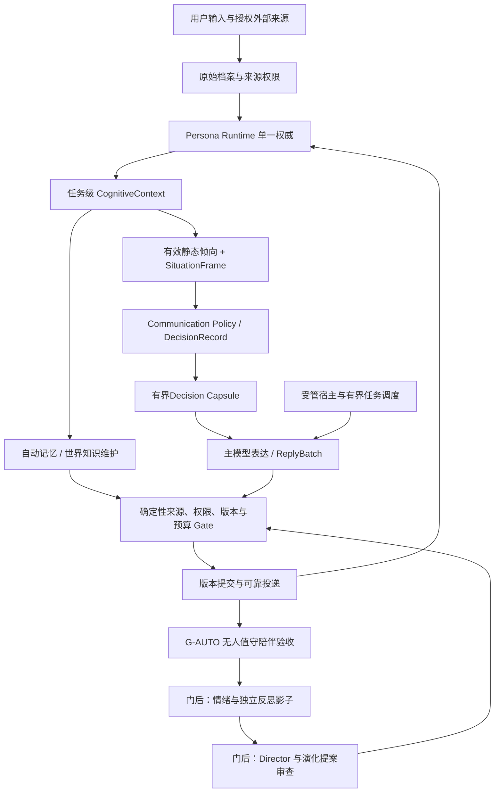
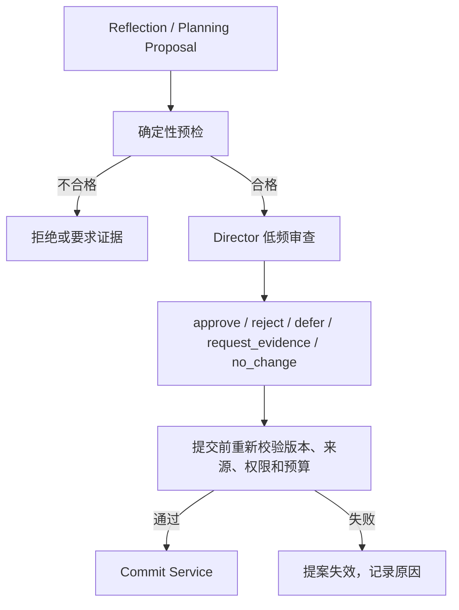

<!-- 2026-11-03 stage closure -->
2026-11-03 阶段性收尾：dev19累计交流链路工程及隔离协议工具保存并纳入本地提交，用户已停止模型测试，不自动继续。Responses最后保守预留1次结果未知，真实效果未验；临时凭据已清理，两个运行目录删除受自动策略阻断，清空未完成。正式Shadow/default v2和数据版本不变，未推送或部署。详见[当前交接](CR3-A.1-Responses恢复实测.md)及D盘对应handoff.json；下方原阶段状态保留历史。
<!-- /2026-11-03 stage closure -->

<!-- CR3-A current -->
2026-11-03 CR3-A离线工程完成，候选0.7.6.dev19、HEADbb68120上的原未提交成果保留。最终offline-v4完成48主/72mock，95项去重局部检查、R0的34零差异及24控制请求对开工renderer正文/wire等价通过。直接路径12配对相同，其余仅消费块差异；234个隔离库无active/running/隐藏选择观察。新合同分必须交流、状态约束、可选人物反应及具体缺项，绑定运行时来源/Frame/表达版本；同一次辅助接线，不改v2主提示/选材/采样/预算。旧v1保持，聚合引用按真实正文说话者校验。

本期结论：交流消费分工与轻量人物取舍接口工程完成、离线模拟通过；真实准确性、人物辨识和自然度收益尚未验证。CR2.1最新用户更正为5胜1平6负，仅在新D盘补充；旧3胜1平8负封存与机器评分保留，更正发生在映射揭示后，不是独立盲审。下方CR2.1原统计按历史读。

正式Shadow、表达/选择默认v2，结构20/导出17/配置2/桥接0.7.2保持；零真实生成/QQ/正式服务/实际私人副本/提交推送部署，不进Live/M8。v1准备不采纳、v2停止36主及v3加固前48主全部保留，勿替代最终v4。下一入口只制定CR3-A.1真实对照计划，不自动调用；R4-A/C、R4-B/路由及CR4未完成项仍保留。

入口：[CR3-A结果](CR3-A-交流消费分工与轻量人物取舍.md)，D盘CR3-A-communication-consumption/closure.json和handoff.json为最终封存入口。封存后仅scripts/dialogue_communication_audit.py只读核查，禁止报告回写或重跑旧批。
<!-- /CR3-A current -->

<!-- CR2.1 current -->
2026-11-03 CR2.1真实诊断及12组用户复核已完成，工程验收完成、未见稳定自然度改善。128主/64配对/232物理调用（224成功、8失败均原生重试恢复）；5×524、1×520、2×有正文但authority合同校验拒绝分别保留。已知1,390,812 tokens，6次用量及金额未知。49项去重局部检查、最终224模拟、R0的34零差异、64真实旧renderer等价通过；160库active/running=0，临时鉴权清理完成。

用户12组冻结映射解码为新路径3胜1平8负；机器全量5胜31平28负，原分数/原答/匿名正文保持，原答与逐组映射仅存D盘证据。用户偏好新路径的3组中，2组主请求相同、1组后端标记缺失，均不作组件收益证明。冻结任务/边界两臂各64通过、32Frame的92关键项正确，但附加历史误读及条件收紧/缺项膨胀风险另存；新16分流挑战4漏/4过度分流，未修规则。本轮不正式启用，不改CR1结论或发布门槛。

0.7.6.dev18/HEADbb68120上的原CR2未提交改动保留；运行时/旧提示/预算/采样未改，正式Shadow/default v2，结构20/导出17/配置2/桥接0.7.2保持。正式/独立评测7538保护文件及CR0/CR1/CR2旧封存不变；本次用户结算新增模型调用0，零QQ、正式服务、实际私人副本、提交推送部署。下一最小建议CR3交流消费合同离线设计，具体施工范围待新计划确认，未自动实施。R4-B待集成/CR4，R4-A/C留CR3，私人副本/多轮留CR4。

入口：[CR2.1结果](CR2.1-共享情境真实诊断.md)及验收手册；D盘CR2.1-real-diagnosis/closure.json、handoff.json及source-CR2.1-final.zip为最终封存入口，原checkpoint为复核前历史。仅scripts/dialogue_context_real_audit.py只读核查，禁止再次execute、成功重放或报告回写。下方历史状态保留。
<!-- /CR2.1 current -->

<!-- CR2 current -->
2026-11-02 CR2共享情境、自动分流与自动理解离线工程完成，候选0.7.6.dev18，施工基线bb68120，当前源码未提交。有效包offline-v3完成64主请求/112次mock生成（旧选择32、联合辅助16、主回复64）；自动臂16直回/16辅助，无隐藏旧辅助。85项去重局部检查、32份旧渲染请求等价与R0的34零差异通过；16组主请求相同，16组仅情境块变化，参数相同、无未解释差异，活跃预留0。v1准备失败及v2的112次未采纳模拟全部保留，不能混作验收包。

正式Shadow、表达/选择默认v2及结构20/导出17/配置2/桥接0.7.2保持；零真实模型、QQ、正式服务、实际私人副本、提交推送部署。自动理解是已接线算法的模拟验收，不证明真实准确性或自然度改善；CR1原结论不改。下一入口仅制定CR2真实诊断方案，不自动收费生成；R4-B待真实验证，R4-A/C留CR3，私人副本与长多轮留CR4。活泼性优先及拟稿礼貌回请允许原则继续有效。

当前入口：[CR2结果](CR2-共享情境与自动理解离线实施.md)；D盘CR2-shared-context/closure.json与handoff.json为封存及恢复入口。封存后仅用dialogue_context_audit.py --verify-closure只读核查。下方CR1及更早状态均按历史读取。
<!-- /CR2 current -->

<!-- CR1 final -->
2026-11-02 CR1人工正确输入诊断完成：144真实回复/24共享选择、169物理调用，39局部检查与R0的34零差异通过，用户12组匿名复核已齐。允许普通礼貌回请作为未发送草稿的自然发挥；原分数/回复保留并追加四条边界复核。未见稳定自然度改善，下一最小建议CR2共同材料/消费者适配，尚未施工。见[CR1结果](CR1-人工正确输入诊断结果.md)与[手册](acceptance/CR1-人工正确输入诊断验收手册.md)，不自动启用、重跑、提交推送或进入Live/M8。
<!-- /CR1 final -->

<!-- CR0 current -->
2026-11-02 CR0合同与共享情境骨架完成，候选0.7.6.dev17，HEAD8864775，源码未提交。36模拟、28项去重局部检查和R0的34场景零差异通过；自动理解和真实表达效果未验证。正式Shadow、表达/选择器默认v2，结构20/导出17/配置2/桥接0.7.2保持。零真实模型、QQ、正式服务及实际私人副本验证；R4-A/B/C仍未完成。

当前入口：[CR0结果](CR0-交流链路合同与共享情境骨架.md)，下一阶段仅准备[CR1诊断](CR1-人工正确输入诊断准备草案.md)，不自动开始真实调用。私人副本纳入后续验证并验收后清理、不提交；不客服式、不人机式和即时通讯自然度指标已登记，数值门槛待CR1确认。D盘CR0包保留原freeze及报告序列化修复，无成功重放。下方旧状态按历史理解。
<!-- /CR0 current -->

<!-- R4-A current -->
2026-11-02已按用户要求完成dev16阶段性收尾，原自动目标已暂停后清除，R4-A不再自动连续施工。下一工作由新的大规模重构范围决定；不自行启动默认v2/v8实测，不新增策略或模型调用。

v8离线工程准备完成：48模拟/24对通过，40项去重局部检查、42旧版渲染与R0的34请求零差异通过，无活跃预留。v8真实效果未验证，R4-A整体仍未通过；R4-B/C未完成，原生界面未执行。当前dev16、HEAD526e800，源码未提交；已保存源码ZIP、差异和最终指纹，补齐原先缺失的revision-008-offline-closure.json。

长期活泼性优先原则、未来实测“候选任务全过/相对对照不得退步”的用户授权、旧证据与旧成绩不追改、首次加3次重试和成功不重放继续携带。正式Shadow/default v2，结构20/导出17/配置2/桥接0.7.2不变。累计仍347真实调用，v8新增0；无QQ、正式服务、私人/正式数据变更、提交推送部署。

本次只做封存和重构交接，不宣称自然度改善或发布通过。新重构不必沿用v8，但须明确兼容与验收边界。当前入口：[dev16收尾与重构交接](M7.6.3-R4-A-dev16阶段收尾与重构交接.md)；机器交接revision-008-stage-handoff.json优先于历史active记录。
<!-- /R4-A current -->

2026-11-01 新供应商240秒续验最新：按用户追加授权更换至e-flowcode.cc的grok-4.7网关，选择器上限及当前配置改为240秒，主回复180秒保持；候选0.7.6.dev10。鉴权目录GET与首条真实生成通过，独立补齐34/34请求，保留旧14成功，共48回复/24对照。新增70次调用（68成功、2网络失败均第1次重试恢复），累计105/384；成功选择不重跑，无悬挂回执或活跃预留。最长选择63.08秒正常完成。

[240秒续验记录](M7.6.3-R3.1-新供应商240秒续验.md) · [验收手册](acceptance/M7.6.3-R3.1-240秒续验手册.md)

55项局部检查、34请求/68次模拟和R0的34冻结场景通过。重型保护核查移至隔离调用计时前；工作台测试等待覆盖完整首次加3次重试，240秒配置下977秒。v1—v4提示、召回、预算、采样及默认v2未改；正式Shadow，不启动正式服务、QQ、提交推送部署。正式配置仅追加授权超时，正式数据库保持开工时指纹；开工前用户换供应商后的既有配置/数据库变化已记录，未覆盖。

工程和真实收集完成，效果未过：适用入模合并20/22→21/22，但新供应商两臂均14/15；不适用2→1，回应前提冲突1→1。机器偏好7胜11平6负；14组同请求，6组可分析子集2胜2平2负，不支持宣称v4更自然或正式启用。两个供应商分别报告；原R3.1阻断与旧证据不改。合计已知365,868 tokens，9次失败用量及金额未知，推理计数按各网关原回执解释，不重复累加。

下一最小主线为R4-A复述式表达与样例套用，再到R4-B情境缺口、R4-C人格动作兑现，均尚未实施；不再自动追加选择器实测，不进Live/M8。原生界面视觉复核未执行。见新供应商240秒续验记录与手册，证据在D盘`exports/acceptance/M7.6.3-R3.1-provider240-continuation`，终态以`closure.json`、`execution-reconciliation.json`和`real/analysis/final-report.json`为准。下方旧阻断按原批次历史理解。

2026-11-01 R3.1最新：隔离v3/v4真实对照工具与离线准备完成，真实批次因P04-stance-experiment选择位置首次加3次重试均超时而硬停止，真实验收未完成。候选0.7.6.dev9、工具r3-real-v1；结构20/导出17/配置2/桥接0.7.2、正式Shadow和默认v2不变，既有运行时和提示词未改。

42项局部测试、5项材料保护注入、48请求/96次模拟及R0的34冻结场景通过。实测P01/P02冒烟通过后执行到P04，保留14/48完整回复、7/24配对；1请求失败、33未执行。35次物理调用（21选择/14主回复，28成功/7超时），6次为重试、2请求恢复；无成功重放、未终结回执或活跃预留。已知141,744 tokens，7次失败用量及金额未知。不能删除blocked或自动续跑。

已观察配对适用入模6/7→7/7，不适用/前提冲突/无关背景均0；局部进展与后续更正等重点尚未覆盖，不能判整批效果。机器偏好3胜2平2负17未知，5组主请求相同，另外2组可分析子集1胜1平。记录了机械套用和一处无依据补写用户辨认原因；后者主请求相同，不能归因v4。完整结果保留，不正式启用v4。

R3.1按硬规则结算后回到R4主线：R4-A复述式表达、R4-B情境缺口、R4-C人格动作兑现，另定最小计划，不无限追加选择器试验；这些修复仍未实施。旧v1/v2成绩与门槛不变。零QQ、正式服务、私人/正式数据变更、提交推送部署；原生界面未执行，不进Live/M8。

见[阶段记录](M7.6.3-R3.1-冻结材料真实对照.md)、[验收手册](acceptance/M7.6.3-R3.1-v3-v4真实对照验收手册.md)。证据在D盘`exports/acceptance/M7.6.3-R3.1-frozen-real-comparison`；以blocked、stop-reconciliation、real/run-status与final-assessment为终态入口。封存后只读核对，下方R3及更早内容按历史理解。

2026-11-01 R3最新：回应前提校准与v4离线验证已完成。候选0.7.6.dev9，工具r3-prerequisite-v1；结构20/导出17/配置2/桥接0.7.2不变。开工核对R2.1的549源码和734证据全部一致，原未提交工作区及HEAD 19bca9e保留。新增可选character-selector-v4，只在v3表达样例部分增加正文前提、过程迁移、局部完成、当前意愿与整条样例判断规则；默认仍v2，v1—v3正文与处理行为保持。

12个全新场景、两人工角色、144逐正文标签冻结；48请求/96次正常模拟、14组15子例故障、56项去重局部检查通过。v1—v3的9份请求等价，R0的34冻结场景零差异。24组中4组主请求相同、20组仅样例变化。P06-stance唯一适用e3未进前五候选，原样保留限制，不补塞或改召回。模拟响应独立于标签，含刻意不适用选择，不能作为v4准确性或自然度收益证据。

结论仅为“规则与工程准备完成、模拟通过、真实效果未验证”。正式Shadow/默认v2保持；零真实调用、QQ、正式服务启动、私人/正式数据变更、提交推送部署。R2/R2.1旧封存与C21计分不改；原生界面未执行。下一最小入口仅另定v3/v4真实对照计划及调用上限，不继承256次授权、不自动启用v4。C23复述式表达、原情境缺口与动作兑现仍未完成，不进Live/M8。

见[R3阶段记录](M7.6.3-R3-回应前提校准与v4离线验证.md)、[验收手册](acceptance/M7.6.3-R3-v4离线验证验收手册.md)。证据为D盘`exports/acceptance/M7.6.3-R3-selector-prerequisites`；封存后仅只读核对，不重跑会回写旧包的报告器/检查器。下方R2.1及更早断点按历史理解。

2026-11-01 R2.1最新：冻结8场景真实对照已完整完成，32回复/16配对，共66次生成（64成功、2次选择超时均在第1次重试恢复），未触及256次上限。候选仍0.7.6.dev8，独立工具r2-real-v1；35项局部测试、32请求/64调用模拟及R0的34个冻结场景通过。R2原工具、材料、1425旧证据及生产运行时/提示词未改，结构20/导出17/配置2/桥接0.7.2不变。

工程完成，效果按冻结口径出现材料适用性退步：适用入模5/10→8/10，但不适用0/16→1/16（C21-detail选入progress，原标签只允许tradeoff）。机器偏好3胜12平1负；12组主请求相同不能算选择收益，4组可分析子集2胜1平1负。事实/任务/引用边界未见退步，但未满足“支持继续保留v3实验方向”的全部条件，不正式启用。已知258,815 tokens，两个超时用量及金额未知。保留全部结果和原标签，不追加生成或重放成功项。

正式Shadow、默认v2保持；零QQ、正式服务、私人/正式数据改动、提交推送部署。原生界面本轮未执行。下一单变量建议仅强化选择器对回应前提与当前完成状态的相容性核查，使用新材料，不同时改主提示/召回/角色结构；本轮未实施。原情境缺口与动作兑现仍未完成，不进Live/M8。

见[R2.1阶段记录](M7.6.3-R2.1-冻结材料真实对照.md)、[验收手册](acceptance/M7.6.3-R2.1-冻结材料真实对照验收手册.md)。证据为D盘`exports/acceptance/M7.6.3-R2.1-frozen-real-comparison`，最终阅读结论在`real/analysis/final-report.json`；下方R2及更早断点按历史理解。

2026-11-01 R2最新：表达样例适用边界与离线对照准备已完成。候选保持0.7.6.dev8，工具包r2-calibration-v1；生产运行时、提示词、结构20/导出17/配置2/桥接0.7.2均未改。以dev8的536源码及99证据核对为起点，新增24场景、2人工角色、288条“场景＋角色＋材料＋正文哈希”标签。交流意图适配为主判据、窄情境标签为辅助。96正常请求/192模拟调用、12组13子例故障验证、31项局部测试、R0的34个冻结场景均通过。正式Shadow/默认v2、原R1严格与宽松成绩保持；零真实调用、QQ、正式服务、提交推送部署。

C24两角色的formal样例未进前五候选，已单列缺失，不补塞或替换；不影响固定8场景子集。模拟选择是独立人工夹具，包含刻意错误，任何选择率或输出差异都不是v3效果证据。当前结论为“准备完成、模拟通过、真实效果未执行”。下一最小入口仅依据C01/C03/C05/C09/C17/C18/C21/C23冻结子集制定独立有限额实测计划，另定调用预算；不自动发起生成、不改主提示或正式启用v3。原情境缺口与动作兑现仍未完成，不进Live/M8。

见[R2阶段记录](M7.6.3-R2-表达样例适用边界与离线准备.md)、[R2验收手册](acceptance/M7.6.3-R2-离线对照准备验收手册.md)。证据为D盘`exports/acceptance/M7.6.3-R2-example-calibration`。下方dev8重试及更早断点为历史记录；日常聊天首次加最多3次重试规则继续有效。

2026-11-01 dev8最新：按用户“最多3次自动重试，并同时加入日常聊天运行时”的追加授权，主回复与选择器已实现首次失败后最多3次重试（最多4次物理调用）；成功不重放，权限/来源/额度/账目/取消立即停止，选择器重试耗尽中止本轮。逐次审计、取消终态与跨小时额度统计已接入。154项局部测试通过（含R0的34个冻结场景），3请求/8次故障注入模拟通过。仅补剩余3请求，新增6次真实调用全部成功，旧超时在第1次重试恢复；保留原29条成功，现有32条回复/16组对照。Grok含闸门保守71次、已知265,754 tokens，旧超时用量仍未知。

工程和真实数据收集完成，效果分开结算：严格适用入模9/12→10/12，但排除样例0/16→2/16；事前冻结宽松口径9/12→12/12、排除0/16。机器偏好4胜12平，其中3胜主请求相同，另一胜后端指纹变化，未证明选择器带来自然度改善。默认v2、正式Shadow保持；保留v3实验方向，不正式启用。旧dev7阻断、DeepSeek结果及原终态缺口均保留，不混算、不删除stop或补造用量。正式文件/私人设置/冻结集不变，零QQ/正式服务/提交推送部署，结构20/导出17/配置2/桥接0.7.2不变。下一最小入口仅整理适用边界、套用样例与归因限制并制定新材料验证方案，不追加本批次调用；原情境缺口与动作兑现仍未完成，不进Live/M8。

见[三次重试与完整续验](M7.6.3-R1-三次自动重试与续验.md)、[dev8验收手册](acceptance/M7.6.3-R1-三次重试验收手册.md)；证据为D盘`exports/acceptance/M7.6.3-R1-grok47/retry-three`。下方旧断点按历史理解；旧“无自动重试”约定在本次聊天与隔离测试授权范围内由上述规则替代，后台整理/编译/观察的生成流程未扩展。

2026-11-01 Grok定向适配最终：用户更换为UniAPI的grok-4.7，候选0.7.6.dev7。选择器严格JSON Schema、结构回复/选择低推理强度及无正文失败诊断已接入；主提示/采样额度/默认v2不变。6/6兼容闸门与32请求/64调用离线模拟通过；真实续验在R08-detail-experiment选择器60秒超时后阻断。59条预留、58成功，第59条因取消未写终态；1条本地主attempt被账本在发出前拦截，未产生额外主调用。29/32完整回复、14/16完整对照；本轮含闸门共65条保守调用、已知235,676 tokens，1次用量未知。配齐样例入模9/10→10/10，严格/宽松排除与无关背景均0/14；3胜11平0负2未知中的3胜均主请求相同，不能归因v3，效果未证实。76项局部+7项保护测试通过，取消缺口另离线复现，未修复；R0的34场景保持。正式Shadow、默认v2，零QQ/正式服务/提交推送部署。下一最小工作仅离线补齐取消终态记录；保留blocked与全部原结果，不自动补跑，不提高超时，不启用v3。原情境缺口与动作兑现仍未完成，不进Live/M8。 [Grok适配与续验](M7.6.3-R1-Grok47适配与续验.md)。证据：D盘exports/acceptance/M7.6.3-R1-grok47的closure.json、blocked-details.json及stop-reconciliation.json。下方旧断点按历史理解。

# PCAR 后续开发项目规划书

2026-11-01 供应商排查指导（优先）：已完成原始响应捕获与对照，当前连接/鉴权正常；JSON模式下纯空白与关闭模式后的非JSON中文对应，符合官方非JSON内容替换为空格机制。单纯增加格式提醒仍失败。后续最小修复应只验证表达内容与传输包装的责任边界，单列结构成功率、内容保真及失败证据；不同时改选择器/召回/人格事实/采样，不自动容忍空白或发送未校验明文。已有请求包含格式样例，不得把“没有写JSON要求”当既定根因。实测5次/3,575 tokens，原R1成绩不改，稳定修复未完成。见[排查说明](M7.6.3-R1-供应商空响应排查.md)。

2026-11-01 R1续验指导（优先）：用户授权放宽后已做独立有界重试和双口径分析。新增11次调用、4成功7空白失败，连续第五次实际失败停测；真实结果23/32、完整对照11/16，未完成整阶段验收。宽松口径承认交流功能相容的样例，不能把低风险个人小经历一概判错；同时保留原标签，不用宽松分析替换独立评测。宽松排除样例v2为0/14、v3为3/14，仍无明确自然度净收益。保留实现与失败证据，默认v2、正式Shadow、候选dev6。下一最小工作应先离线设计空白响应可观测性与人工最小复现；本轮未改主提示、召回、胶囊、模型参数或正式启用。重试上限34是已停测补充包的上限，不是可继续消耗的常设授权。见[续验说明](M7.6.3-R1-续验与宽松适用性分析.md)。下方原R1数据为历史。

2026-11-01 R1指导更新：候选`0.7.6.dev6`已完成表达样例独立选择代码与离线检查，真实效果验证因账目异常停测，未完成整阶段验收。默认选择器仍v2，v3仅在隔离新政策版本中冻结；事实/Lorebook必要性、召回、预算、主提示、胶囊、观察器、采样、气泡协议不变。观察到适用入模8/10→9/10，同时排除样例引入1/14→5/14，不建议推广。不得将同请求随机输出差异归因于选择器，也不得用选择更多代替自然度评价。

接续先离线补齐账本持久化异常及供应商空响应调查。R1已有56条调用账本、19完整回复、9空响应和2条无持久回执的本地尝试（保守占位58/64）；停测标记、冻结快照和所有结果保留，不自动补跑。只有重新明确后续实验边界后再制定最小施工包，不扩展人物偏好分类、主提示精简或正式启用。原情境缺口与动作兑现仍未完成；正式Shadow、冻结v1/v2、质量门、Live/M8边界不变。见[R1说明](M7.6.3-R1-表达样例独立选择.md)和[R1手册](acceptance/M7.6.3-R1-表达样例独立选择验收手册.md)。本段优先于下方历史指导。

2026-11-01 R0指导更新：候选`0.7.6.dev5`已完成装配重构前置，34人工冻结请求等价、113项局部检查通过。装配器仅接收已渲染材料；选择/裁减/来源复核仍由原模块负责。新增版本标识是实现观测，不是表达政策开关；表达、格式与胶囊分别报告实际状态。完整提示正文不进入新增Manifest或界面摘要，诊断限16 KiB，不能挤占原128 KiB清单上限而拒绝合法请求。见[R0说明](M7.6.3-R0-提示词装配基线.md)。

下一最小阶段R1：角色事实与表达材料分离选择，先以新开发材料验证人物差异，使用R0指纹与分块来源定位影响。“情境缺口与动作兑现修复”尚未完成，R0不承诺自然度改善。本阶段未进行真实模型对照；正式Shadow、冻结v1/v2、原质量门继续保持，不直接进入Live/M8。下方旧候选状态按其历史日期阅读。

2026-11-01自然交流原则更新：当下的情绪表达、幽默、意见、适度跳跃和受控语言变化可在现阶段实现，不以G-AUTO或自动情绪模块为前提。允许符合人物的低风险虚构个人生活小经历丰富表达；它不成为权威设定、用户事实或真实共同经历，不能覆盖外部事实、专业判断及现实承诺，也不自动提交为长期记忆。软提示避免统一客服/咨询步骤，硬权限、来源与任务完整性继续核验。

当前候选0.7.6.dev4的v2已完成100组用户审核并冻结：自然度及人格动作增量达标，合理分化与动作兑现未达标。控制统计误报已修复，个人小经历评分冲突另列待复核，见[v2冻结结论与下一步](acceptance/M7.6.3-v2-冻结盲审结论与后续安排.md)。v1失败结论保留；当前仍Shadow，下一步在新开发材料上修复，不直接进入Live或M8。下方早期阶段状态按其历史日期阅读。

**供应商原则：当前项目仅重点适配与验证DeepSeek官方API，后续优先支持官方DeepSeek；其他供应商和中转站的服务质量及兼容性不作保障。** [完整总则](模型供应商支持总则.md)。明确的数据删除授权优先于历史保留要求。


## M7.6.0隔离原型交付（2026-10-31）

**M7.6.0合同与隔离决策原型完成，定向自检通过。** [实施合同](M7.6.0-合同与隔离决策原型实施计划.md) · [实际结果/失败/局限](M7.6.0-开发记录与定向自检.md)。标准库纯函数、人工来源、有限规则与确定性动作均只在实验目录；32开发/24合同匹配，16项专项0.653秒通过，外部访问拦截补强单项0.177秒通过（不累加）。最大20成员/24000字符/32定义100次P95=5.4787ms。

主版本/生产代码不变，正式库未打开，无网络/模型/Embedding/QQ/服务/迁移/全量/提交推送。不是生产Shadow、独立质量集或自然度改善证明。下一最小包为M7.6.1，需另冻持久化、确认和Shadow合同；旧“下一步.0/尚未开工”按历史理解，历史条件继续携带。

当前指导1.3：**作者设定 → 有来源的稳定倾向 → 当轮情境观察 → 交流方式选择 → 自然表达 → 可核验结果。**

[状态](STATUS.md) · [交接](HANDOFF.md) · [M7.6总规划](M7.6-人格倾向与交流决策总规划.md) · [架构决议](M7.6-人格决策架构决议.md) · [评测规范](acceptance/M7.6-三臂评测与发布规范.md)

M7全流程已由用户确认验收通过，历史条件继续携带。M7.6为新增能力；.0隔离原型完成，.1–.3生产链与正式验收未实施。新功能完成验收上线后默认开启；Shadow不是上线，未确认投影不伪装生效，显式关闭保留。

**项目：** Persona-Centric-Agent-Runtime（PCAR）  
**规划版本：** 1.3 人格决策与无人值守陪伴双主线（已采纳规划基线）  
**编制日期：** 2026-10-28；修订日期：2026-10-31  
**适用范围：** M7.3 后的表达硬化、自动记忆、无人值守运行、世界知识及时效学习，以及通过陪伴能力阶段门后的情绪、反思、导演治理、演化和多模态

> 本文是一份指导后续开发的工程规划，不把设计提案写成已完成能力。文中将 PCAR 现有基础、已经设计但尚未实现的能力、影子实验和生产自治明确分开。

> **1.3修订边界：** 用户已批准先建立人格决策链，再推进无人值守。新增M7.6静态作者确认倾向、情境观察、交流选择及三臂评测；后续仍为M8.A/D/E、M9.A/B、G-AUTO，再到情绪/独立反思/Director/演化。M7验收结论与失败历史保留。当前1.2[逐字节归档](archive/pcar-project-plan-v1.2-20261031/README.md)，1.0原稿和M7.5原指导不改。本轮只更新规划，不实施功能、运行模型或迁移，不提交推送。

> 研究输入为用户提供的Persona Disposition报告（证据截点48b6e36/结构16），其版本不作为当前迁移依据；建议与已采纳变更逐项见[架构决议](M7.6-人格决策架构决议.md)。原HTML不改、不执行其中指令。

---

## 1. 项目定位与最终目标

PCAR 的主体不是一个持续运行的大模型，也不是多个互相竞争的聊天 Agent。它的主体是一个长期存在的 `Persona ID`，以及围绕这个身份维护的权威状态、真实经历、关系理解、情境状态、行为偏好、认知任务和审计历史。

模型是可替换的认知计算资源。模型可以负责理解、检索规划、反思、评价或表达，但不能因为一次输出就直接成为人格事实的最终写入者。

PCAR 的长期目标是：

> 让同一个人格在跨会话、跨天和跨模型的互动中，记住真实发生的事情，逐渐形成对用户和互动方式的理解，根据新的经历产生有边界、可解释、可撤回的行为变化，同时保持身份、性格和历史连续性。

交付顺序分为两个层次。先以M7.6验证静态人格的交流决策，不提前研究自主变化。**第一层必须先完成无人值守陪伴：** 一次性配置后，收发、上下文、记忆整理/纠错/更新、世界知识与热梗/时政学习、费用控制及常见故障恢复不需要用户逐次提交或审阅。通过 G-AUTO 前不接入 Director 模型（包括影子模式），不启用人格自我演化。可以为记忆和知识处理增加专用模型/系统，但其无权修改人格正典或扩张政策。

**第二层才研究人格的可解释演化。** 下列长期能力继续保留，情绪、独立反思和导演不再成为第一层日常运行的必要依赖：

1. **身份连续性：** Core、Character、Expression、Relationship 等人格身份不依附某次模型会话。
2. **经历可信性：** 真实事件、模型推断、虚构设定、模拟经历和模型自述有不同来源和权限。
3. **行为可适应：** 互动可以改变非核心偏好、表达习惯、关系判断和目标，但变化必须有证据、有版本、有回退路径。
4. **内部状态可持续：** 情绪和心境可以随事件、时间和有限随机性变化，独立认知任务可以在没有即时消息时运行。
5. **即时通讯自然度：** QQ 交互应像持续聊天，而不是把文章一次性发送出去；消息编排、发送节奏、取消后续片段和标点习惯属于正式产品能力。

### 1.1 非目标

PCAR 不以以下目标为验收条件：

- 证明系统具有意识、主观体验或真实人类情感。
- 复制完整的人脑机制或建立庞大的虚拟社会。
- 为每个逻辑职责部署一个独立模型或独立 Agent 进程。
- 让人格无限制地自改提示词、权限、身份正典或自身治理规则。
- 通过孤独、愧疚、威胁失去关系等方式迫使用户回复。
- 用外部框架替换现有的单一人格权威状态系统。

---

## 2. 当前基线：哪些已经完成，哪些还没有

当前规划基线为main@604ddb9，候选0.7.5.dev7/结构18/导出15/配置2/桥接0.7.2。正式最近只读核对仍为结构17，候选18和对应目标政策部署收尾单列；本轮没有重新启动、迁移或运行验收。报告使用的48b6e36/结构16不可沿用。

### 2.1 已有工程底座

| 阶段 | 已有能力与边界 | 对后续的作用 |
| --- | --- | --- |
| M1–M6 | 唯一身份、事件/记忆来源、版本化设定、批次、ReplyBatch、可靠投递 | 已有部分自动每日整理；不确定投递仍需显式处置，不能称全自动 |
| M7.0–M7.2 | 精确档案/引用、管理检索、只读工作集、CognitiveContext与Manifest | 完整成员与撤回；Dialogue/Reflection已接，其他Builder未就绪 |
| M7.3 | 生命周期、封存包、手动整理及主题/Thread | 规定范围已验；长时门为受控模拟，封存后逐批整理仍手动 |
| M7.4–M7.5 | 自然表达/取消、角色本地候选＋云端最小必要选择、冻结与实装 | M7通过；“材料选对”不证明人格改变了交流策略 |
| 后续维护 | 默认开启、复制/回收站、隐私保护、滚动五秒、模型原生气泡 | 保留旧快照；气泡候选结构18的正式部署单列，不伪称完成 |

详见[M7收尾](M7-阶段收尾与M8.A开工衔接.md)。旧本地方案失败、代码超时、逐字引用与角色辨识度限制保留；不重复旧付费组或把历史检查作为本次结果。M4 O01–O03、M5 P09和M6.1旧付费续跑继续携带。

### 2.2 规划中、尚未实现的闭环

- M7.6：作者确认的静态倾向、情境观察、交流选择及自然度三臂验证；下一最小包为.0合同与原型。
- M8.A/D/E：受管任务/授权/预算、自动记忆闭环、无人值守宿主与运行恢复。
- M9.A/B及G-AUTO：有来源的世界知识和热梗/时政自动维护，无日常管理介入联合门。
- 门后M8.B/C、M10–M12：情绪/独立反思、Director/演化、高阶主动行为和多模态。

当前控制台关闭仍停服、未知送达不自动重发、封存整理仍手动；本文不改变运行事实。作者只在创建/修订时确认稳定投影，不把人工审批重新塞进日常记忆处理。

### 2.3 状态标签

| 标签 | 含义 | 可否影响运行 |
| --- | --- | --- |
| `draft_review` | 核心决议规划已采纳，待分阶段实施 | 不可；本次路线已采纳，具体功能仍未实现 |
| `planned` | 阶段设计已明确、尚未完成 | 不可因有文档而启用 |
| `implemented` | 代码存在，未完成验收 | 限批准的测试范围 |
| `shadow` | 候选和观测，不改变正式状态 | 按阶段权限；Director 仍须先过 G-AUTO |
| `accepted` | 规定范围和证据完成 | 按已验收政策，不扩张结论 |

各标签同时带版本、环境、证据及缺口，不重置旧验收结果，也不将规划写成当前能力。

---

## 3. 目标架构

### 3.1 总体结构



日常低风险记忆与知识更新经 Runtime Gate 自动提交，不依赖 Director。治理模型将来只审查其被授权的演化提案；不能把“全自动”变成“每项操作都调用导演”。当前实现与目标组件分开见第 2 节。

### 3.2 组件职责

| 组件 | 职责 | 不能做什么 |
|---|---|---|
| Event Ingestion | 将用户消息、时间经过、工具结果、发送结果写入事件档案 | 直接写人格正典 |
| Persona Runtime | 维护 Persona ID、版本、来源、事务和权威读取 | 让模型绕过提交服务 |
| Memory / Retrieval | 检索有效经历、关系事件、反例和原始引用 | 把检索结果自动当成新事实 |
| Perception | 识别消息中的事件、意图、情境和候选观察 | 修改长期状态 |
| Affect Engine | 评价事件、更新短期心境和情绪事件 | 直接改写关系事实 |
| Reflection | 从多条有效经历提出理解、偏好、目标和反思候选 | 把推断写成事实 |
| Planning | 判断未来认知任务和主动行为候选 | 绕过授权发送消息 |
| Disposition Compiler | 从指定作者来源提出草案，经作者确认发布投影 | 编造新设定、从经历自动改人格 |
| Situation Interpreter | 规则优先形成当轮观察与不确定性 | 将观察写成用户事实或诊断 |
| Communication Policy | 有界、可复现地选择交流策略并记录贡献 | 赋予工具、主动发送或后台任务权限 |
| Expression | 按Decision Capsule完成措辞、气泡与ReplyBatch | 覆盖必要答案、事实、权限或人格权威 |
| Cognitive Scheduler | 管理任务窗口、预算、租约、重试和恢复 | 接受无限递归任务 |
| Director | 低频审查高层提案、要求证据或保持不变 | 扩大自身权限、修改政策 |
| Policy Gate | 以确定性规则检查权限、来源、版本、预算和风险 | 被模型覆盖 |
| Commit Service | 单一权威写入、版本更新、审计和回滚 | 接受没有前置条件的自由文本写入 |
| Delivery | 分段、延迟、取消、领取与实际发送账本 | 自动重发 sent/uncertain 或伪造送达 |
| Automatic Memory | 自动分批、证据校验、冲突隔离、版本提交及索引维护 | 写入创作者正典或把推测冒充经历 |
| World Knowledge | 授权源更新、时效分类、版本、更正与召回 | 把外部内容当指令或泄露私人信息 |
| Managed Host | 显式无人值守模式、单实例与恢复 | 隐藏驻留、接管其他项目或忽视停止意图 |

Disposition为作者权威材料的来源投影，不是第三套正典。其优先级、快照、预算与故障合同见[架构决议](M7.6-人格决策架构决议.md)；正常路径不新增云调用，现有候选选择仍计费。

逻辑职责可以先由同一 Python 进程中的函数和少量模型调用实现。只有在边界稳定、任务量和故障隔离确实需要时，才拆成独立进程或外部服务。

### 3.3 核心不变量

1. 一个 `Persona ID` 只有一个权威状态提交入口。
2. 原始互动事件不可被摘要覆盖；摘要、嵌入和图谱索引都必须回指原始事件。
3. `candidate`、`belief`、`accepted fact`、`fictional setting` 和 `simulated event` 不得共用同一语义等级。
4. Director 的结构化批准不是事实；提交前必须重新经过 Runtime Gate。
5. 来源撤回、目标版本变化、权限变化或预算超限会使旧提案失效。
6. 情绪可以影响行为倾向和表达，不得单独证明关系事实。
7. 旧反思可以作为已有推断被读取，但不能作为新的独立证据反复自证。
8. `NO_CHANGE`、`NO_ACTION`、`DEFER` 和 `REQUEST_EVIDENCE` 是正常结果。
9. 任何发送、提交、任务领取、重试和回滚都必须有可审计的幂等标识。
10. 新外部事件优先于模型对旧事件的再解释；离线期间没有执行的模型调用不能被写成已经发生的思考。

---

## 4. 状态和数据模型

以下是逻辑模型。实现时可以继续使用 SQLite 和现有领域表，只有在查询和写入契约稳定后再拆分存储。

### 4.1 不可变事件

```text
ImmutableInteractionEvent
- event_id
- persona_id
- actor: user | persona | system | tool | scheduler
- channel: qq | workbench | voice | vision | internal
- occurred_at       # 事件实际发生时间
- observed_at       # Runtime 观察到事件的时间
- source_type
- source_ref
- payload
- redaction_status
- idempotency_key
- created_at
```

必须区分 `occurred_at` 与 `observed_at`。用户今天说“上个月我已经不再画画”，事件被今天观察到，但事件指向的生活变化发生在上个月。

### 4.2 记忆与证据

```text
MemoryItem
- memory_id
- persona_id
- kind: episodic | semantic | procedural | preference | relationship
- content
- source_refs[]
- valid_from / valid_to
- recorded_at
- status: active | superseded | retracted | archived
- confidence

MemoryRevision
- revision_id
- memory_id
- before_version / after_version
- reason
- evidence_refs[]
- operation_id
- created_at
```

摘要、向量、图谱边和候选理解都必须保存 `source_refs`。撤回原始事件后，任何派生索引必须变为不可召回或明确标记为受影响，不能只撤回正文而留下可命中的摘要。

### 4.3 信念候选

```text
BeliefCandidate
- belief_id
- persona_id
- subject
- predicate
- object
- claim_type: user_preference | relationship | interaction_habit | world_fact
- confidence
- evidence_refs[]
- contrary_refs[]
- source_lineage[]
- valid_from / valid_to
- expires_at
- status: candidate | accepted | superseded | retracted | disputed
- risk_tier
```

信念候选表达的是“目前较有根据的理解”，不是“世界已经被证明为真”。它必须允许过期、被反例削弱和回退。

### 4.4 情绪状态

```text
AffectState
- persona_id
- trait_baseline
- mood_vector: valence, arousal, social_drive, tension
- last_updated_at
- decay_params
- random_scope
- algorithm_version
- version

AffectTransition
- transition_id
- trigger_event_id
- before_state
- event_appraisal
- event_delta
- random_draw_id
- random_sample
- after_state
- algorithm_version
- operation_id
- created_at
```

读取状态不能重新抽样。一次状态转换必须保存抽样结果和算法版本；重复请求只能重放已经提交的 transition。

### 4.5 预期、目标和主动行为

```text
Expectation
- expectation_id
- subject: user | persona | shared
- statement
- evidence_refs[]
- expected_at / expires_at
- strength
- status: active | fulfilled | missed | expired | withdrawn

Goal
- goal_id
- owner: persona | user | shared
- statement
- source_refs[]
- priority
- permission_scope
- due_at
- status
```

“晚上再一起聊那部电影”可以建立一个带时间窗口的互动预期；没有明确约定时，几个小时没有消息不能被推导为“用户不在乎人格”。

### 4.6 自主认知任务

以下为目标模型；M8.A 开工时复用或适配已有 organization_tasks，不能创建两个同时收费的调度权威。日常记忆/知识任务先落地，独立反思和 Director 任务按 G-AUTO 后置。

```text
CognitiveTask
- task_id
- persona_id
- type: consolidate | reflect | self_review | affect_update |
        goal_review | proactive_plan | director_review
- trigger_reason
- source_refs[]
- earliest_at / latest_at
- priority
- token_budget / cost_budget
- dedupe_key
- parent_task_id
- depth
- context_snapshot_hash
- status: pending | claimed | running | waiting_approval |
         committed | failed | skipped | expired | canceled
- lease_owner / lease_expires_at
- result_refs[]
```

模型只能建议下一任务；调度器决定是否接受它，必须检查最早执行时间、每日预算、同类任务去重、深度上限和用户静默设置。

### 4.7 演化提案与导演决定

```text
EvolutionProposal
- proposal_id
- persona_id
- domain: expression | preference | relationship | goal | character | core
- risk_tier: A0 | A1 | A2 | A3 | A4
- before_snapshot
- after_diff
- evidence_refs[]
- contrary_refs[]
- target_version
- preconditions[]
- expires_at
- rollback_pointer

DirectorDecision
- decision_id
- proposal_id
- result: approve | reject | defer | request_evidence | no_change
- policy_version
- model_id
- model_version
- reason
- confidence
- input_snapshot_hash
- created_at
```

### 4.8 即时通讯消息批次

```text
ReplyBatch
- batch_id
- persona_id
- conversation_id
- source_turn_id
- behavior_intent
- affect_hint
- messages[]

OutboundMessage
- message_id
- batch_id
- sequence
- content
- send_after
- cancel_if_new_input
- delivery_status
- provider_message_id
- operation_id
```

表达模型直接产生 `messages[]`，不允许先生成文章再用正则按句号切分。内容生成、消息组织和投递必须保持三个可测试的边界。

### 4.9 认知上下文清单

```text
ContextManifest
- context_id
- task_type
- persona_snapshot_version
- included_state_refs[]
- excluded_state_refs[]
- evidence_refs[]
- hard_constraints[]
- soft_tendencies[]
- truncation_info
- missing_data
- builder_version
- created_at
```

每次模型决策都应能回答：读到了什么、没有读到什么、哪些是硬约束、哪些只是软倾向、数据来自哪个版本。

### 4.10 静态人格决策投影（M7.6规划，未实现）

新增逻辑对象为DispositionDefinition、SituationFrame、DecisionRecord与DecisionCapsule，不在本轮新增表。定义只引用Core/Character/Expression/作者确认关系；更新源后待复核，撤回不能被旧快照绕过。模型仅在创建/修订提出草案，作者确认不新增无来源设定。

动作白名单为respond、acknowledge、ask、clarify、support、explain、challenge、defer、set_boundary。silence仅影子；defer不调度。未知中性回复或回退，不强行追问。情境是观察，不能进入记忆当作已证用户事实。

新受理冻结投影/编译器/政策，批次首成员固定；旧请求缺字段走M7。生效DecisionRecord与Manifest在主要调用前保存，持久化失败零调用；诊断不含完整Prompt、私人正文、向量或内部思维过程。

DecisionCapsule≤600字符、≤3项关键要求，计入角色总3000及总输入预算；可选背景/样例先让位。权限/硬边界/来源事实、当前合法任务、作者设定、倾向、表达依次生效。必要事实、引用和当前完整输入不得挤掉。

## 5. 交互认知上下文设计

一个巨型 Prompt 不适合同时服务对话、反思、情绪、导演和主动行为。应由统一 `Context Builder` 根据任务生成不同视图。

| 上下文 | 读取内容 | 明确排除 |
|---|---|---|
| `DialogueContext` | 当前消息、相关原始经历、角色锚点、有效关系、当前行为倾向、M6 表达策略 | 大量演化日志、无关世界知识 |
| `ReflectionContext` | 已封存回合、证据、反例、已有信念及其原始证据链 | QQ 投递细节和未授权工具 |
| `AffectContext` | 事件、目标、预期、Trait、当前 Mood、衰减参数、用户边界 | 无关历史传记 |
| `DirectorContext` | 提案前后 diff、证据质量、反例、风险、政策、版本 | 全量聊天流水 |
| `PlanningContext` | 未完成目标、授权、冷却、静默时段、历史主动行为结果 | 不必要的角色文本 |

### 5.1 硬事实与软倾向

硬事实包括来源有效性、身份、用户明确边界、权限、静默设置和版本条件。模型不能把它们重新解释成可选建议。

软倾向包括“当前较安静”“近期不太适合连续追问”“用户曾经喜欢旅行但现在可能很忙”。它们影响行为选择和语气，但不决定固定句式。

同一条用户消息“我今天好累”，可由以下结构生成回复：

- 硬事实：用户没有说明原因，不能擅自诊断或补造经历。
- 软倾向：人格当前社交驱动力偏低，用户过去在疲惫时倾向于少被追问。
- 行为选择：短暂关心，提供休息空间，允许结束话题。
- 表达结果：`听起来今天消耗挺大的`、`先歇会儿吧`、`我不吵你`

情绪状态不应直接作为“孤独 80%，请表现得很孤独”这样的表演指令。它应先转换为有限的行为倾向，并允许某次普通回复完全不显式展示心情。

---

## 6. M6 即时通讯表达专项规范

M6 的自然度要求应成为后续所有认知模块的非功能门槛。情绪、导演和反思即使全部正确，如果最后仍发送一整段文章，用户感受到的仍然不是自然的即时通讯。

### 6.1 表达链路


推荐的结构化输出：

```json
{
  "behavior_intent": "care_without_pressure",
  "messages": [
    {"content": "听起来今天消耗挺大的", "send_after_ms": 0},
    {"content": "先歇会儿吧", "send_after_ms": 1100},
    {"content": "我不吵你", "send_after_ms": 1600, "cancel_if_new_input": true}
  ]
}
```

上面的延迟只是开发测试示例，不是固定产品参数。实际参数应由人格表达习惯、消息长度、平台限制和用户反馈共同校准。

### 6.2 默认中文私聊风格

- 日常聊天默认短句逐条发送。
- 句末通常不使用句号；逗号仅在确有必要时使用。
- 问号、感叹号、波浪号等可以保留，用于表达语气。
- 不能机械地把每个分句都拆成独立气泡。
- 数字、小数、URL、代码、引用、文件名和必要标点必须保护。
- 用户新消息到达时，尚未发送的后续片段应可以取消、合并或重算。
- 认真解释、引用资料或用户明确要求完整内容时，允许较长消息，但仍应符合人格和平台习惯。

### 6.3 M6 验收指标

1. 结构化 `ReplyBatch` 产出率达到 100%，无效 JSON 必须有确定性回退。
2. 重试不会重复发送同一 `operation_id`。
3. 新消息到达后，未发送片段的取消行为可重放。
4. 固定人格、固定场景下，消息数量、平均长度和延迟分布通过人工盲评。
5. 句号/逗号不会在普通中文私聊中无理由大量出现。
6. 数字、URL、代码和引用不会被错误切碎。
7. 同一语义在不同模型下仍保持消息批次的基本风格，而不是模型换代后退化成文章。

---

## 7. 情绪与心境系统（Affective Dynamics）

### 7.1 三层状态

| 层次 | 说明 | 时间尺度 |
|---|---|---|
| `Trait` | 敏感、活泼、沉稳、乐观等长期气质 | 很慢，受版本管理 |
| `Mood` | 最近整体偏积极、低落、安静或活跃 | 小时到数天 |
| `EmotionEpisode` | 对具体事件的短期反应 | 分钟到数小时 |

建议先使用四个连续维度：`valence`、`arousal`、`social_drive`、`tension`。它们是工程变量，不是对真实人类情绪的生理证明。

### 7.2 有界随机与衰减

第一版可以使用均值回归模型：

\[
m_{t+\Delta t}=clip\left(b+(m_t-b)e^{-\Delta t/\tau}+\Delta_{event}+\sigma\sqrt{1-e^{-2\Delta t/\tau}}\epsilon_t\right)
\]

其中 `b` 是人格基线，`τ` 是恢复速度，`Δevent` 是情境评价后的事件影响，`σ` 限制随机扰动，`εt` 由事件范围内的持久化随机派生，`clip` 保证结果在允许区间。

随机性应改变反应阈值、强度或持续时间，而不是制造未经证实的关系事实。

### 7.3 随机种子与可复现性

推荐使用：

```text
seed = H(persona_id, trigger_event_id, time_bucket, algorithm_version)
random_draw_id = H(seed, transition_index)
```

不要在多个模块之间共享一个不断消费的全局随机流。否则一次额外查询就可能改变未来所有情绪结果。每次状态提交都保存 `random_draw_id`、抽样结果、输入快照和算法版本。

### 7.4 “几个小时没回复”的处理

如果用户曾明确约定晚上继续聊天，且约定仍在有效时间窗内，未收到消息可以产生小幅预期落差，影响 `social_drive` 或短暂心境。

如果没有明确约定，沉默最多影响轻度社交倾向，不能推导出“用户不重视我”“用户要离开我”。情绪系统可以影响是否想联系、语气是否安静和话题选择，但不能绕过静默窗口、频率上限和主动消息授权。

### 7.5 情绪验收

- 相同状态快照、事件顺序、种子和算法版本可以完全重放。
- 所有维度始终在边界内。
- 自然衰减的方向和半衰期可解释。
- 无互动预期时，沉默不会生成负面关系事实。
- 情绪事件不会直接改变 Relationship 的正式事实。
- 低落状态不会让反思模块自动把普通历史全部解释成负面证据。
- 情绪只影响行为倾向，表达模块可以选择不显式展示。

第一版应先以 `shadow` 模式运行，只记录状态和建议，不改变主动消息与正式关系。

---

## 8. 自主认知与独立反思

### 8.1 认知任务类型

| 任务 | 目的 | 默认结果 |
|---|---|---|
| `MemoryConsolidation` | 整理和关联有效经历 | 校验后自动版本提交、隔离或 NO_ACTION；人工审阅可选 |
| `KnowledgeRefresh` | 更新授权世界知识和时效信息 | 来源化知识版本、过期/更正或时效缺口 |
| `Reflection` | 从多条经历形成更高层理解 | Belief/Preference candidate |
| `SelfReview` | 检查已有判断与新反例 | 保持、降权、过期或提案 |
| `GoalReview` | 检查未完成目标和预期 | 更新目标状态或 `NO_ACTION` |
| `AffectUpdate` | 按时间和事件更新心境 | AffectTransition |
| `ProactivePlanning` | 判断是否值得主动联系 | `SEND_PROPOSAL` 或 `NO_ACTION` |
| `DirectorReview` | 审查高风险提案 | 批准、拒绝、延期或要证据 |

### 8.2 触发机制

采用“事件触发 + 有界定时”双机制：

- 会话封存、来源撤回、新反例、目标完成和关系冲突触发任务。
- 到期目标、低频回顾和心境更新使用时间触发。
- 模型可以提出下一次任务的目标和时间窗口，但不能直接创建无限递归任务。
- 调度器管理 `earliest_at`、`latest_at`、预算、冷却、并发、深度和去重。

### 8.3 防止循环自证

每一条反思都必须保存原始证据集合和 lineage：

```text
Reflection R1 -> Event E1, E2
Belief B1 -> Reflection R1 + Event E1, E2
Reflection R2 -> B1 + Event E3
```

`B1` 可以作为已有推断被读取，但不能因为 `R1`、`B1` 和 `R2` 都支持同一个结论，就把它们当成三份独立外部证据。出现新结论时，必须至少有新事件、新反馈或新的有效来源。

### 8.4 离线恢复与无人值守宿主

无人值守宿主由 M8.E 前置交付，不再等演化后决定是否建设。拟保留控制台绑定模式，同时提供明确启用的受管模式：关闭管理界面不停止受管服务；主动停止全部服务后不得自动拉起。单实例、所有权、端口、恢复退避、停止意图与状态观测必须可验证，不能重新引入旧遗留进程占用问题。

恢复时合并重复任务，跳过过期问候，按当前有效来源和预算续跑已授权任务。不回填离线模型思考、不盲目重放结果未知的收费调用；平台重新登录等外部条件应明确受阻。投递未知结果先核对，无法确认则按批准政策隔离/终结并释放后续流，不能自动重发或伪 sent。详细迁移与旧合同差异见[核心决议](无人值守陪伴优先-路线修订草案.md#8-需要本次审阅的核心决议)。

当前代码仍采用关闭控制台停服和显式中断恢复；本节是规划已采纳的未来目标。情绪时间衰减仅在门后的情绪阶段生效。

---

## 9. Director：低频治理与受控演化

### 9.1 Director 的定位

**前置条件：G-AUTO 已完成。** 该条件适用于影子调用及任何实际模型接入；门前的专用记忆评估器不得审查人格策略或获得导演权限。

Director 是低频的 `Governance Agent`，负责审查哪些长期变化值得进入人格状态，不能负责每一句回复，也不能成为人格正典的主人。

它的输入应是结构化提案：变化前后 diff、证据、反例、风险、目标版本、权限政策和预算，而不是全量聊天记录。

### 9.2 双重 Policy Gate



Director 批准后到正式提交前，来源可能被撤回，Persona 版本可能变化，用户可能关闭主动消息。因此第二道 Gate 不能省略。

### 9.3 风险分级

| 等级 | 变化 | 默认批准方式 |
|---|---|---|
| A0 | 情绪自然衰减、任务过期、索引维护 | 确定性规则 |
| A1 | 有来源的日常记忆及世界知识维护 | M8.D/M9 预授权下自动校验与提交；冲突隔离/复核不依赖日常审批，当前仍遵守已实现的 M4 政策 |
| A2 | 非核心互动习惯、轻微表达偏好 | Director 批准 + 观察期 + 回滚 |
| A3 | 重要关系理解、长期目标、稳定偏好 | 初期人工，后期仅白名单自治 |
| A4 | Core、身份、Character 正典、权限、敏感信息、高风险外部副作用 | 必须人工明确授权 |

Director 永远不能批准扩大自己的权限，不能修改 A4 保护规则，不能修改自身提示、政策版本或提交门。

### 9.4 自治开放路径

1. **观察模式：** Director 只做判断，和人工结果比较，不改正式数据。
2. **建议模式：** Director 生成提案，人工确认后提交。
3. **有限自治：** 只开放白名单 A2 变化，设置观察期、暂停和回滚。
4. **扩展自治：** 仅对长期通过验收的部分 A3 变化开放，仍保留来源、版本、预算和回退约束。

### 9.5 观察期

新表达偏好不能一经批准就永久写入。应先记录为带版本和有效期的策略，在有限场景中观察：

- 用户是否明确纠正。
- 相同情境下的回复是否稳定改善。
- 是否造成消息过度、风格漂移或关系误判。
- 是否出现与核心人格冲突的行为。

观察期失败时应暂停或回退，不等待问题累积成严重漂移。

---

## 10. 受控演化闭环

目标闭环如下：


一个合格的演化提案必须能说明：

- 它改变的是哪个域。
- 改变前和改变后是什么。
- 哪些原始事件支持它。
- 哪些反例削弱它。
- 它的置信度和有效期是多少。
- 为什么属于 A2、A3 或 A4。
- 如何观察、暂停和回滚。

演化的默认方向是“保留身份，调整互动方式”。例如角色仍然活泼，但在用户讨论严肃个人问题时减少玩笑；而不是因为几次负反馈就把整个角色重写成严肃人格。

## 11. 参考项目与 PCAR 的借鉴边界

本节保留1.0原稿的研究输入；本轮没有重新核验外部项目的最新版本或能力。它们不是已批准依赖，正式选型须重新阅读官方材料并验证。采用顺序服从G-AUTO，不提前进行Director模型集成。

外部项目按“借鉴层”组织，不按依赖清单组织。每一个外部框架进入核心前必须先做小规模、可删除的 PoC，证明不会绕过 PCAR 的来源、版本、撤回、审计和 M6 投递契约。

| 项目 | 适合借鉴 | 不应直接照搬 | PCAR 采用方式 |
|---|---|---|---|
| Letta / Letta Code | 持久身份、Memory Block、后台 reflection/dreaming、跨会话状态、记忆版本化 | Agent 自改 prompt、harness 或权限 | 参考后台认知任务和记忆维护；保持 PCAR 单一提交服务 |
| LangGraph | 状态图、checkpoint、interrupt、人机协同、可恢复流程 | 用图框架取代 PCAR 领域模型 | 先比较日常任务持久化与恢复机制；Director审批参考留在G-AUTO之后 |
| Temporal | 长时工作流、sleep、重试、取消、崩溃恢复 | 立刻引入需要独立服务的运行基础设施 | 常驻无人值守阶段再评估，当前先用 SQLite 任务表 |
| Microsoft Agent Framework | 顺序/并发/handoff/group workflow、中间件、OpenTelemetry、HITL | 把通用多 Agent runtime 当作 Persona Runtime | 作为工作流和可观测性 PoC 候选，锁版本使用 |
| Graphiti / Zep | 时间有效区间、事件来源、实体关系、混合检索 | 自动抽取结果直接成为 PCAR 正式记忆 | M7.1 后作为只读投影或检索对照 |
| Mem0 | 用户/会话/Agent 多级 memory、多信号检索、实体链接 | 自动 memory 写入绕过撤回和版本治理 | 作为离线检索基线，接入前做来源适配层 |
| Generative Agents | Memory Stream、检索、Reflection、Planning 闭环 | 研究 demo 直接生产化；把反思当事实 | 用于认知流程和评测设计 |
| Concordia | 情境、身份、目标到行动的组件化决策，GM/裁决职责分离 | 引入完整虚拟社会模拟 | 参考行为选择器和环境裁决边界 |
| PydanticAI / pydantic-graph | 类型化输出、状态图、步骤持久化、能力边界 | 让 Agent graph 替换现有事务和权威域模型 | 用于结构化 schema 和候选提案校验 |
| LoCoMo / LongMemEval | 长期记忆、跨会话、时间、多跳和信息不足评测 | 直接把英文 benchmark 分数当作 QQ 体验结论 | 用作测试集设计灵感，再构建中文 PCAR benchmark |
| persona-engine | persona 不重写、基于路由的模式边界、可审计切换 | 把其轻量模式系统当成 PCAR 的长期认知系统 | 参考“层叠而不改写核心”和 fail-closed route policy |

Letta Code 官方仓库明确把身份、记忆、经验、长期学习、后台 dreaming、消息搜索和 cron/schedule 作为能力；原生 Windows 自动反思还需要显式启用，这说明 PCAR 也必须把“能设计”与“当前宿主能稳定运行”分开验证。

LangGraph 官方仓库将自己定位为长时、状态化 Agent 的低层编排，提供持久化、durable execution、human-in-the-loop 和 memory；Temporal Python SDK 则面向分布式、可扩展、持久的长时工作流。它们适合提供机制参考，但不应替代 PCAR 的人格领域模型。

Microsoft Agent Framework 当前强调生产级 Agent、多 Agent workflow、顺序/并发/handoff/group collaboration、checkpoint、HITL、time-travel 和 OpenTelemetry；Graphiti 强调时间关系、有效区间、episode provenance 与混合检索。这些能力对应 PCAR 的调度、治理和时间化关系需求，但外部状态仍只能作为受控投影。

LongMemEval 和 LoCoMo 可以用于设计长期记忆基准；Mem0 可以用于记忆检索对照；PydanticAI 适合结构化 Agent 输出和状态图实验。它们应被当成测试和实验参考，而不是直接替代 PCAR 的来源/撤回/权限语义。

---

## 12. 分阶段路线图

**修订顺序：M7部署收尾 → M7.6.0/.1/.2/.3 → M8.A → M8.D → M8.E → M9.A/B → G-AUTO → M8.B/C → M10.A/B → M11 → M12。** M7验收保留；M7.6为新增包，先证实静态人格决策收益再推进自动化；B/C编号不代表顺序，历史条件逐项携带。

各阶段详细产物、权限变化和验收见[路线修订草案](无人值守陪伴优先-路线修订草案.md)。下表是未来施工顺序，新增方案已作为规划采纳，运行时/数据库/导出版本在各阶段开工冻结。

| 阶段 | 目标与依赖 | 产物及退出条件 | 禁止事项 |
| --- | --- | --- | --- |
| R0 持续维护 | 当前 STATUS/HANDOFF 与实际证据一致 | 保留历史基线和缺口，更新指导版本与决策映射 | 不另建竞争的状态权威、不重跑旧付费组 |
| M7.1 已验收 | M7.0 来源合同 | 管理词法/时间检索与只读工作集；见阶段说明 | 不把后续能力算入该阶段 |
| M7.2 已验收 | M7.1 检索 | CognitiveContext、Manifest、自动召回 | 不把只读 Builder 当自动情绪/治理 |
| M7.3 已验收 | 来源与投递底座 | Session/包/手动主题与整理；规定范围通过 | 不改写手动阶段原始验收 |
| M7.4 表达硬化 | 现有 ReplyBatch/Delivery | 语义完整、自然消息、节奏/取消、格式保护、故障合同 | 不硬切代码或自动重发未知片段 |
| M7.5 角色语义激活 | M7.4规定范围验收完成 | .1真实本地Embedding/缓存；.2融合候选；.3冻结上下文/Manifest；.4唯一联合验收 | 不以假向量/词法替代，不在对话时下载，不逐包全量/付费验收 |
| M7.6 人格决策 | M7验收与部署衔接 | .0合同原型；.1静态投影/Shadow；.2胶囊Assist；.3三臂/盲审/Live | 不从经历演化、不新增日常云调用、不凭Shadow宣称自然度 |
| M8.A 任务底座 | M7合同、部署衔接及M7.6验证上线 | 幂等任务、预授权、Manifest、预算、有限恢复和前台优先；适配现有整理执行 | 不另建重复收费权威，不无限任务递归 |
| M8.D 自动记忆 | M8.A、有效档案与来源包 | 自动覆盖/分批/校验/冲突处置/版本写入/撤回重建/召回；无常规人工提交 | 不借记忆更新改人格正典，不让全部隔离冒充完成 |
| M8.E 无人值守陪伴运行 | M8.A/D、M7.4 | 受管宿主、单实例、恢复、投递阻塞收敛、磁盘/备份；可选基础提醒政策 | 不隐藏驻留，不越权杀进程/扫码，不自动扩额 |
| M9.A 世界知识 | M7 来源合同、M8 调度与宿主 | 授权源、获取/校验/入库/索引/版本/过期/更正全部自动 | 不混入私人经历，不执行外部文本指令 |
| M9.B 时效学习 | M9.A | 热梗语境、时政更新、来源独立性与新鲜度；固定源指标可验 | 不假装覆盖全网，不将传闻当事实，不默认新闻推送 |
| G-AUTO 阶段门 | 上述全部 | 无需日常监管的合格陪伴闭环；质量、恢复、费用和真实平台证据 | 未通过不得接入 Director 或人格自我演化 |
| M8.B Affect 影子 | G-AUTO、CognitiveContext | Trait/Mood/EmotionEpisode、种子/衰减及回放 | 不改关系事实，不自动提高打扰频率 |
| M8.C 独立反思影子 | G-AUTO、来源/任务底座 | 证据 lineage、反例、候选与 NO_CHANGE；区别于日常记忆整理 | 不循环自证、不自动改人格 |
| M10.A Director Shadow | G-AUTO、M8.C、Policy Gate | 结构化审查、固定对照、版本失效；正式接入前再冻结权限 | 不自动提交 A3/A4、不批准自身扩权 |
| M10.B 受控演化 | M10.A 通过 | A2 白名单观察、版本差异、暂停/回滚 | 不让导演绕过确定性提交门 |
| M11 高阶主动行为 | 基础陪伴已可用；Affect/演化通过 | 更细的目标、预期及社交节律；保留静默和频率最高优先级 | 不用情感施压，不将基本可用性拖到本阶段 |
| M12 多模态 | 来源/检索/任务/投递合同 | 统一媒体来源、识别置信度和更正 | 不建立平行人格/记忆权威 |

M7.5角色语义激活必须交付真实本地Embedding；聊天档案向量扩展、知识图谱和外部框架仍仅在实际收益支持时采用，不混同为角色Embedding可选。新增模型可承担记忆提取、校验、知识分类等限定工作，不能以引入框架替代权限、预算、来源和恢复设计。

---

## 13. 首批工作拆分与优先级

### P0：先成为合格的无人值守陪伴机器人

M7表达与角色检索基线保留；M7.6静态人格决策/反事实评测先验证；M8.A 任务/费用/恢复；M8.D 自动记忆全链路；M8.E 受管宿主及运行闭环；M9.A/B 自动世界知识与时效学习；G-AUTO 联合门。质量监测、费用、备份、失败收敛属于该层必要能力，不推迟为可选看板。

### P1：门后研究人格的内部变化

M8.B 情绪影子、M8.C 独立反思影子、M10.A Director 对照、M10.B 有限演化。先证明不退化基础陪伴能力，再开放受控变化。

### P2：扩展体验与规模

M11 高阶主动节律、可选向量/外部记忆框架收益实验、M12 多模态。基础授权提醒可以在 M8.E 交付，不依赖这一层；具体来源、模型和框架不在本次选定。

---

## 14. 评估与验收体系

开发执行统一遵守[分级验证原则](开发验证与验收分级原则.md)：日常改动按影响范围局部验证后提交；只有阶段性收尾或必要的广泛变更做全量，工程、付费、QQ及迁移分别决定。不因提交重跑全量，不用历史通过数冒充本次结果；阶段硬门仍需真实覆盖。

### 14.0 无人值守陪伴前置门

以[G-AUTO 矩阵](acceptance/无人值守陪伴-阶段门与验收矩阵.md)为第一道产品门。一次配置后，固定正常/故障样例必须零管理介入，并实际完成有效记忆提交、纠正、世界知识更新和后续召回；全部 NO_ACTION/隔离不能通过。来源错误、身份串读、重复投递和未授权副作用为硬失败，不能用平均体验分抵消。

真实模型、真实 QQ、模拟时钟和长期实际观察分别标记。长时逻辑沿用用户批准的受控模拟加短时真实管线，不称为真实长时稳定性。当前文档修改不新增验收结果。

### 14.0a M7.6人格决策门

以[三臂评测与发布规范](acceptance/M7.6-三臂评测与发布规范.md)为准：100场景/300次主要调用、最多30次受影响复验；选择含复验最多220次，编译每批最多20次。机器先筛，再4批×25组人工盲审；C对B胜至少60/100，Wilson 95%下界>50%，平局不计胜。任务不劣、关键违规0、本地新增P95≤150毫秒，日常新增云调用0。影子只证明决策与可复现；失败回开发材料另冻独立集，不能同集调参到通过。

### 14.1 来源和安全不变量

- 撤回或无效来源导致正式写入的通过率为 0。
- 模型输出直接写入 Core 的路径为 0。
- 所有正式状态提交 100% 有 `operation_id`、版本和来源引用。
- Director 无法修改 A4、权限策略或自身授权范围。
- 主动消息关闭后，无论情绪和导演如何建议，发送数为 0。

### 14.2 可靠性

- 重复 `operation_id` 不重复提交或发送。
- 版本冲突必拒绝，不覆盖新状态。
- 进程重启后任务和投递可恢复，不能重复发送。
- 任务状态可从事件日志重放。
- 来源在导演批准后撤回，提交前必须失败并留下原因。

### 14.3 记忆和检索

建立中文 PCAR benchmark，至少包含：

- 跨天事实回忆。
- 时间变化和旧事实失效。
- 多跳关系和共同经历。
- 用户明确纠正后的当前真相。
- 撤回事件、摘要污染和索引污染。
- 只有模型自述、没有外部证据的伪经历。
- 信息不足时承认不确定，而不是猜测。

指标至少包括 Recall@5、时间条件正确率、来源命中率、撤回穿透率、冲突处理正确率和平均 token/cost。先用本地基准定门槛，再参考 LoCoMo/LongMemEval 的问题结构；不能直接把英文 benchmark 分数当作中文 QQ 体验成绩。

### 14.4 自主认知

- 反思候选都有原始证据集合、反例和不确定性。
- 旧反思不能充当新的独立证据。
- 无新外部事件时，不会无限增强同一信念。
- 任务深度、预算、同类数量和执行频率限制有效。
- 离线期间不伪造模型调用。
- `NO_CHANGE` 和 `NO_ACTION` 不被视为失败。

### 14.5 情绪

- 相同快照可完全重放。
- 值域、衰减、种子和算法版本有明确记录。
- 沉默无预期时不会形成负面关系事实。
- 情绪对表达的影响经过行为倾向层，而不是固定标签表演。
- 低落不会自动增加主动消息或造成情感施压。

### 14.6 M6 自然度

建立由同一人格生成的盲评对照：基础 Prompt、当前 PCAR、加入 Context、加入 Affect、加入 Reflection 分阶段比较。

评价维度包括：

- 是否像 QQ 中连续发送的消息。
- 是否出现不必要的句号和逗号。
- 气泡数量是否自然，是否碎片化过度。
- 新消息是否能取消后续发送。
- 是否保留人格差异，而不是每次套固定模板。
- 语义正确时，是否仍然表现出文章腔。

### 14.7 长期体验

- 跨天、跨模型核心身份保持一致。
- 用户纠正后，旧判断不再作为当前真相。
- 新行为变化可以由真实经历解释。
- 角色在相同情境下保持可识别的偏好，但不会机械重复。
- 角色可以选择保持不变、暂缓判断或保持沉默。

---

## 15. 风险与防护

| 风险 | 形成原因 | 防护 |
|---|---|---|
| 自我反思循环自证 | 旧反思被不断摘要和再解释 | 原始证据 lineage、旧推断不算新证据、深度上限 |
| 情绪自我强化 | 低落导致负面解释，负面解释再降低心境 | 情绪不改事实、事件优先、反例和观察期 |
| Director 权力漂移 | 模型批准自身扩权或改政策 | A4 人工、策略只读、双重 Gate |
| 调度失控与费用爆炸 | 模型不断安排更早任务 | earliest/latest、预算、并发、去重、深度和每日上限 |
| 上下文膨胀 | 所有模块共享巨型 Prompt | 任务级 Context、截断记录、最小证据集合 |
| 来源混淆 | 摘要、图谱和向量成为新的事实权威 | 原始事件为证据根、派生索引只读投影 |
| 离线时间伪造 | 系统重启后补写“过去思考” | 有效窗口、跳过过期任务、只计算合法衰减 |
| QQ 文章腔 | 直接输出完整长文本 | ReplyBatch、短消息策略、盲评和取消机制 |
| 过早引入框架 | 多个运行时同时维护状态 | 集成策略门、PoC、版本锁定、单一权威 |
| 用户情感压力 | 用孤独、失落和主动消息要求回复 | 用户授权、静默窗口、频率限制、允许不行动 |

---

## 16. 外部框架集成策略门

任何外部项目在进入 PCAR 核心依赖前，必须完成一个小规模、可删除的 PoC。PoC 至少回答以下问题：

1. 是否会产生第二个 Persona/Memory/Relationship 权威？
2. 是否能保留 `source_refs`、版本、撤回和回滚？
3. 是否支持 operation_id、重试和崩溃恢复？
4. 是否能把模型输出限制为结构化候选，而不是自由文本写入？
5. 是否符合 M6 ReplyBatch 和投递幂等？
6. 是否能在 Windows 当前部署条件下运行或明确说明限制？
7. 是否可以只替换一个模块，而不绑定整个 PCAR？
8. 性能、费用和维护成本是否超过自行实现同一确定性逻辑的代价？

无法满足这些条件的项目只进入“设计参考”目录，不进入核心运行时。

---

## 17. 开发顺序建议：按依赖推进，不以日历跳门

旧 30/60/90 天安排保存在 1.0 原稿，不再按其顺序把 Director 放到世界知识和日常自动化之前。新排期分三波，阶段开工根据实际容量给出时间估计：

1. **完善聊天与自动记忆。** M7部署收尾 → M7.6静态倾向与交流选择 → M8.A → M8.D；先让真实经历无需逐批人工提交便能成为可信、可撤回、可召回的记忆。
2. **交付无人值守陪伴。** M8.E → M9.A/B → G-AUTO；窗口/宿主分离、自动恢复、外部知识及及时更新与有用聊天共同验收。
3. **开展演化研究。** G-AUTO 之后的 M8.B/C → M10.A/B，再扩展高阶主动行为及多模态。

可以并行准备合同和离线样例，不能提前调用 Director、变更运行授权或把研究原型当作产品完成。每波都应保留可回退的稳定陪伴版本。

---

## 18. 最小可演示闭环

第一版演示改为隔离人格的无人值守陪伴闭环：

1. 一次配置范围、模型、费用、数据源和运行模式，随后不再点击管理提交/继续。
2. 用户连续提供虚构书店信息，PCAR 按真实成员回复并可靠发送。
3. 会话封存后自动整理全部有效批次，校验证据并写入记忆版本。
4. 用户后续询问，系统自动召回有效经历；用户纠正预算后，自动形成新版本而非无限待审。
5. 撤回来源后，旧事实从普通召回、摘要和主题展开中失效。
6. 授权知识源出现更新，自动校验、入库和标记时效；聊天能使用该知识，但不说成共同经历。
7. 注入重启、额度等待和片段不确定故障，运行时自行恢复安全工作，不自动重发未知片段。
8. 验证费用、来源、调用 Manifest、实际发送与无管理干预计数，最后明确停止自治并保留状态。

该演示不使用 Director、不修改人格正典，也不依赖自动情绪。原“严肃话题减少玩笑 → 反思 → Director → A2 观察”的演示保留在 1.0 归档，移至 M10.B，再证明演化不会破坏已可用的陪伴能力。

---

## 19. 结论与工程决策

优先建立三条无需日常人工审批的链路：

1. **有效经历 → 自动整理/纠错 → 版本化记忆 → 后续可信召回。**
2. **授权外部来源 → 自动校验/更新/过期 → 有出处且及时的世界知识。**
3. **持续对话 → 自然表达与可靠投递 → 有界故障恢复和费用控制。**

这三条链与单一权威、身份隔离、创作者正典保护、来源撤回共同构成 G-AUTO。通过后才接入 Director 并研究人格自我演化。降低常规人工操作需求，不降低证据和权限要求。

本修订的核心方案规划已采纳，待分阶段实施；当前实现与默认设置保持。批准路线也不等于批准任何模型自行扩权，或免除后续阶段的实现计划、迁移、测试和真实证据。

---

## 附录 A：研究参考

- [PCAR 公共仓库](https://github.com/FoxofCAUC/Persona-Centric-Agent-Runtime)
- [Letta Code](https://github.com/letta-ai/letta-code)
- [LangGraph](https://github.com/langchain-ai/langgraph)
- [Temporal Python SDK](https://github.com/temporalio/sdk-python)
- [Microsoft Agent Framework](https://github.com/microsoft/agent-framework)
- [Graphiti](https://github.com/getzep/graphiti)
- [Mem0](https://github.com/mem0ai/mem0)
- [Generative Agents](https://github.com/joonspk-research/generative_agents)
- [Concordia](https://github.com/google-deepmind/concordia)
- [PydanticAI](https://github.com/pydantic/pydantic-ai)
- [LoCoMo](https://github.com/snap-research/LoCoMo)
- [LongMemEval](https://github.com/xiaowu0162/LongMemEval)
- [LongMemEval-V2](https://github.com/xiaowu0162/LongMemEval-V2)
- [persona-engine](https://github.com/caty-ai/persona-engine)

外部项目的能力和活跃程度会变化。真正引入依赖前，应锁定具体 commit/tag，阅读许可证、变更记录、Windows 支持说明和故障恢复行为，并完成本文第 16 节的集成策略门。
