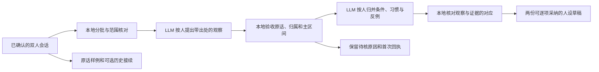

# LT-13 聊天记录分析的 LLM 调用机制

2026-11-19，基于 PCAR `2d05667`。这轮专看模型读取了什么、何时再次调用、输出怎样成为可审的人设。本轮首选 **person-simulator 的区间证据结构，结合 Jev 微信侧栏的会话提取和独立验收思路**。QQ 工具和 Lume 补足抽样与语言风格，suhui、ex-memory 和 Chrono Trace 提供人格、关系、长期记忆各自调用的参照。 [前次源码与接入研究](LT-13-双人聊天提炼人设源码研究.md)

## 哪些工作交给 LLM

下表按固定提交的正常路径计数。一次指一次生成请求，缓存、重试、视觉分析、向量化、试玩发言和评分调用分别记账。表中 `N` 是某条画像路线纳入的批数，`R` 是实际归并任务数。

| 仓库 | LLM 看什么，产生什么 | 基础生成请求 |
| --- | --- | --- |
| **person-simulator** | 单个目标及对方、主区间、邻接语境 → 结构化观察 → 按维度归并为特征，保留观察 ID、反例和输入去向。另有整段直出模式。 [提取](https://github.com/l123z456k789-png/person-simulator/blob/0c80694ff95251f5e132d841783a7c8e7cdbee14/src/person_simulator/modeling/extract.py#L32-L91) · [归并](https://github.com/l123z456k789-png/person-simulator/blob/0c80694ff95251f5e132d841783a7c8e7cdbee14/src/person_simulator/pipeline.py#L435-L520) | 证据模式每目标 `N + R`。整段模式每目标 1 次。 |
| **Jev 微信侧栏** | 同一批双人会话 → 会话标签及关于对方、自己、双方关系的观察 → 把全部合格观察汇总为理解档案。 [提取与汇总](https://github.com/GxZzzzz/WeChat_Galgame/blob/99abb949fb2d0c4a01462aedb5c187671428490b/tools/persona.py#L327-L445) | 每个面向联系人的档案 `N + 1`。 |
| **QQ 聊天记录分析工具** | 按人取近期表达样本，生成语言习惯 JSON。按人分层取全时段样本和邻接语境，另生成性格报告 JSON。 [取样与按人调用](https://github.com/woowss/qq-chatlog-analyze-tool/blob/58284d2559b52baff86d542a7dbc4fa6182b753a/analyzer/deepseek_client.py#L1553-L1695) | 两人、两项分析共 4 次，按人和用途缓存。 |
| **Lume** | 目标台词、双边窗口、本地表达统计 → 可编辑的角色描述。真实问答由本地抽取，可另外提炼故事和事件。 [调用编排](https://github.com/cayan0x/Lume/blob/67e988d097f3682603d8fbee07185a7394a8349f/src/host/distill.ts#L101-L200) | 每目标 1 次角色描述。有完整对话流时另有 2 次记忆提取。缺真实样例时走 1 次样例生成。 |
| **FriendForge** | 目标连发、互动对象、统计指纹 → 风格 Markdown。对方前文和目标原话另外形成检索样例。 [风格](https://github.com/1while1/FriendForge/blob/b96bb44e5e9d71979464b1573bb81e0c90c74a5d/digital-twin/core/build.py#L198-L248) · [组装](https://github.com/1while1/FriendForge/blob/b96bb44e5e9d71979464b1573bb81e0c90c74a5d/digital-twin/core/build.py#L400-L477) | 每个 `owner→audience` 方向 1 次；复用人工风格稿或降级为统计文档时沿另一条路径。 |
| **suhui** | 每段同一份对话与统计分别用于人格和记忆提取 → 所有成功分段及统计一次合并为整档。 [分段](https://github.com/stargazer-2026/suhui-memory-skill/blob/7995a590a381e8f7968cac2da0236371b6f7fb99/scripts/distill.py#L582-L635) · [合并](https://github.com/stargazer-2026/suhui-memory-skill/blob/7995a590a381e8f7968cac2da0236371b6f7fb99/scripts/distill.py#L727-L815) | 全量 API 模式每目标 `2N + 1`。 |
| **ex-memory** | 记忆与人设分别先分析再写文档。人设第二步可读原材料、初步观察和按目标检索的原话。 [总流程](https://github.com/Meteorkid/ex-memory/blob/cc59455fe0e93934eba5d4216bf7ed62992316c1/pipeline/orchestrator.py#L430-L504) · [人设生成](https://github.com/Meteorkid/ex-memory/blob/cc59455fe0e93934eba5d4216bf7ed62992316c1/pipeline/persona_builder.py#L63-L166) · [记忆生成](https://github.com/Meteorkid/ex-memory/blob/cc59455fe0e93934eba5d4216bf7ed62992316c1/pipeline/memory_builder.py#L24-L64) | 一次新建镜像 4 次生成，向量查询另计。 |
| **Chrono Trace** | 时间窗采样、局部统计、全局基线、已有事实和章节摘要 → 本人或对方的画像快照。长期章节摘要有独立的生成链。 [画像](https://github.com/CCSU-HorizonLab/Chrono_Trace/blob/4fb2848e97a897336fba2fbf6c38919e2e8f692c/backend/app/services/realtime/contact_profiler.py#L332-L415) · [章节任务](https://github.com/CCSU-HorizonLab/Chrono_Trace/blob/4fb2848e97a897336fba2fbf6c38919e2e8f692c/backend/app/services/analysis/chapter_summaries.py#L487-L569) | 每份画像基线 1 次。月、章、过渡和全局摘要按各自的未命中任务另外调用。 |

## 两条分段证据链

### person-simulator 把模型结论落到字符区间

第一轮输入形状是 `chunk_id`、`target`、`interlocutor`、`core_parts` 和 `context_parts`。每个片段带短 ID、说话人、起止字符位置和原文。模型输出已处理的主区间、空观察原因，以及带维度、类型、范围和引用的观察。程序按 `message_id + start + end` 切原话，核对目标本人在主区间有支持证据。上下文可以跨批重叠，主区间各自有唯一归属。这里的处理覆盖表示每块有观察或留空理由，结论是否成立仍看出处和语境。 [请求装配](https://github.com/l123z456k789-png/person-simulator/blob/0c80694ff95251f5e132d841783a7c8e7cdbee14/src/person_simulator/modeling/extract.py#L32-L91) · [观察结构](https://github.com/l123z456k789-png/person-simulator/blob/0c80694ff95251f5e132d841783a7c8e7cdbee14/src/person_simulator/models.py#L115-L211) · [分段校验](https://github.com/l123z456k789-png/person-simulator/blob/0c80694ff95251f5e132d841783a7c8e7cdbee14/src/person_simulator/modeling/validation.py#L133-L280)

第二轮按八个维度分别处理，只有有观察的维度才进入归并。每批发观察或前一层特征。模型给出特征、原观察 ID、支持引用、反例观察 ID及每条输入的去向。同一维度超量时再分批递归压缩。其证据校验以整条消息为准并检查与主区间相交，因此长消息只发了一部分时，引用可延伸到未发给该任务的同条文字。多级归并以中间项为单位合并证据集合，可能把同一个中间项内其他观察的依据挂到所选观察上。PCAR 可以用原观察与引用的逐对映射收紧这个边界。 [切片与主区间校验](https://github.com/l123z456k789-png/person-simulator/blob/0c80694ff95251f5e132d841783a7c8e7cdbee14/src/person_simulator/modeling/validation.py#L83-L221) · [递归归并](https://github.com/l123z456k789-png/person-simulator/blob/0c80694ff95251f5e132d841783a7c8e7cdbee14/src/person_simulator/pipeline.py#L435-L520) · [归并校验](https://github.com/l123z456k789-png/person-simulator/blob/0c80694ff95251f5e132d841783a7c8e7cdbee14/src/person_simulator/modeling/validation.py#L342-L425)

出错分三路。格式或证据错误时，修复请求带上一次输出和错误信息，有额度才派发。上下文超限先尝试去掉重叠语境，再拆小批。输出截断或显式溢出也可以触发拆批。默认限制一次格式或证据修复，传输层还有自己的尝试上限。运行器在传输重试返回后才累加尝试数，故配置的运行总数属于任务级约束。PCAR 的计费上限应在每次实际派发前占用名额。 [修复](https://github.com/l123z456k789-png/person-simulator/blob/0c80694ff95251f5e132d841783a7c8e7cdbee14/src/person_simulator/modeling/extract.py#L94-L152) · [拆批](https://github.com/l123z456k789-png/person-simulator/blob/0c80694ff95251f5e132d841783a7c8e7cdbee14/src/person_simulator/pipeline.py#L253-L353) · [默认值](https://github.com/l123z456k789-png/person-simulator/blob/0c80694ff95251f5e132d841783a7c8e7cdbee14/src/person_simulator/config.py#L56-L73) · [派发计数](https://github.com/l123z456k789-png/person-simulator/blob/0c80694ff95251f5e132d841783a7c8e7cdbee14/src/person_simulator/providers/runner.py#L31-L53)

### Jev 按整段会话提取，再发布完整档案

Jev 用 30 分钟间隔切会话。一次提取最多 24 段，按约 45,000 字符切批，上一批末尾的完整会话可作为承接语境。超长单段和承接语境还会占用实际上下文。发送前用短编号映射会话和消息，正文序列化为 JSON 字符串。输出含 `sessions` 和 `observations`。每段先产主题、语气、摩擦等标签，每条观察归到 `target`、`self` 或 `relationship`，带类型、适用范围、状态和证据。承接会话可以帮助释义，新增观察至少要引一条本批消息。 [切会话](https://github.com/GxZzzzz/WeChat_Galgame/blob/99abb949fb2d0c4a01462aedb5c187671428490b/tools/wxperson.py#L47-L55) · [分批与核对](https://github.com/GxZzzzz/WeChat_Galgame/blob/99abb949fb2d0c4a01462aedb5c187671428490b/tools/persona.py#L93-L185) · [短编号及承接语境](https://github.com/GxZzzzz/WeChat_Galgame/blob/99abb949fb2d0c4a01462aedb5c187671428490b/tools/persona.py#L348-L390)

模型第二次读取全部合格观察，用观察 ID 写对方、自己、关系、事件及未知项。用户指定的关系标签被锁定。档案和原文快照按内容存放，新完整档案生成后才替换当前版本。批次可以两路并行，缓存绑定批次内容、承接内容、目标名称、模型选项和模板指纹。它生成的是面向联系人的理解档案，PCAR 的两份可扮演角色仍需分别核对字段、采纳记录与证据。 [关系汇总校验](https://github.com/GxZzzzz/WeChat_Galgame/blob/99abb949fb2d0c4a01462aedb5c187671428490b/tools/persona.py#L188-L202) · [缓存标识及发布](https://github.com/GxZzzzz/WeChat_Galgame/blob/99abb949fb2d0c4a01462aedb5c187671428490b/tools/persona.py#L327-L447)

Jev 有两层模型修复。客户端解析失败可再调一次。外层按引文或结构验收，失败可携带原结果再调一次。若两层都触发格式补试，一个任务可有四次实际调用。结构和会话标签都通过后，程序还可逐条留下合格观察，把错误引文及原因单独保存。这个机制适合拿来设计部分失败恢复。个人结论的主体仍需 PCAR 自己严格核对，因为 Jev 的提取校验只检查引用在本批或承接会话里确实存在，汇总校验只确认观察 ID 存在。 [客户端 JSON 路径](https://github.com/GxZzzzz/WeChat_Galgame/blob/99abb949fb2d0c4a01462aedb5c187671428490b/tools/llm.py#L48-L126) · [外层修复及隔离](https://github.com/GxZzzzz/WeChat_Galgame/blob/99abb949fb2d0c4a01462aedb5c187671428490b/tools/persona.py#L205-L298)

## 抽样、风格和记忆的调用分工

**QQ 分析器将当前表达习惯与跨期画像分开。** 习惯只取目标最近最多 500 条。画像先按时间覆盖抽取目标最多 800 条，再把剩余字符预算给明确回复所指向的发言和相邻语境，最终恢复原顺序。模式、目标和输入参与缓存键。JSON 先过维度结构校验，证据显示再按发出样本检查原话、日期与说话人。双方分别保留完成结果。传输层区分限流、欠费与其他错误，思考输出遇截断时可关思考再试。这个回退会改变请求参数，在 PCAR 要作为独立审批和计费项。 [语境预算](https://github.com/woowss/qq-chatlog-analyze-tool/blob/58284d2559b52baff86d542a7dbc4fa6182b753a/analyzer/person_context.py#L162-L248) · [调用与回退](https://github.com/woowss/qq-chatlog-analyze-tool/blob/58284d2559b52baff86d542a7dbc4fa6182b753a/analyzer/deepseek_client.py#L869-L970) · [单人缓存](https://github.com/woowss/qq-chatlog-analyze-tool/blob/58284d2559b52baff86d542a7dbc4fa6182b753a/analyzer/deepseek_client.py#L1379-L1549) · [证据显示](https://github.com/woowss/qq-chatlog-analyze-tool/blob/58284d2559b52baff86d542a7dbc4fa6182b753a/webapp/evidence.py#L252-L314)

**Lume 把一轮模型预算用在角色描述上。** 发送目标台词、长度统计、双边情境和互称。独立的对方语句列表在聊天模式中被省略，耦合的双边窗口仍在。返回经宽松 JSON 解析，最终至少要有显示名和角色说明，并执行长度限制。真实问答直接进入样例库，故样例可以追到本地清洗后的原句。缺真实配对时，源码有让 LLM 补造样例的分支。PCAR 使用已获准的真实问答作为表达证据，资料不足处留待审。 [模型输入](https://github.com/cayan0x/Lume/blob/67e988d097f3682603d8fbee07185a7394a8349f/src/host/distill-prompt.ts#L85-L131) · [结果约束](https://github.com/cayan0x/Lume/blob/67e988d097f3682603d8fbee07185a7394a8349f/src/host/distill-prompt.ts#L266-L280) · [样例与记忆分支](https://github.com/cayan0x/Lume/blob/67e988d097f3682603d8fbee07185a7394a8349f/src/host/distill.ts#L121-L200)

**FriendForge 的两个方向是两个生成任务。** 一轮分析读取目标文本及本地统计生成风格，样例库中的对方前文由本地配对。同一风格文档可以保留人工编辑。原话核验只处理代表金句，检查归一化后的目标文本拼接串，找不到的句子剔除。风格评分另有默认五次生成和一次 LLM 评判，部分题目和真人参考取自同一实例的样例池，异常甚至可标为跳过并继续，因此适合检查管线能否运行，真人风格优劣交给独立留出。 [风格生成及引文](https://github.com/1while1/FriendForge/blob/b96bb44e5e9d71979464b1573bb81e0c90c74a5d/digital-twin/core/build.py#L198-L248) · [人工稿复用](https://github.com/1while1/FriendForge/blob/b96bb44e5e9d71979464b1573bb81e0c90c74a5d/digital-twin/core/build.py#L426-L475) · [模型评分](https://github.com/1while1/FriendForge/blob/b96bb44e5e9d71979464b1573bb81e0c90c74a5d/digital-twin/core/verify.py#L185-L239)

**suhui 将每段的人格与记忆分成两次生成。** 这样可以为两种输出各自定义结构，两次也都要重发分段文本与本地统计。OpenAI 兼容接口先尝试 JSON 模式，遇 HTTP 400 或解析错误可以换普通模式，另有一层退避重试。两项成功后才写该段文件。一项成功另一项失败，续跑会重做该段。已完成检查点以段号与产物文件为主要条件，汇总另有已完成标记。PCAR 按实际提交的内容和请求指纹复用结果，可避免聊天补录或模板改版后错用旧段。 [JSON 与退避](https://github.com/stargazer-2026/suhui-memory-skill/blob/7995a590a381e8f7968cac2da0236371b6f7fb99/scripts/distill.py#L52-L148) · [段任务及续跑](https://github.com/stargazer-2026/suhui-memory-skill/blob/7995a590a381e8f7968cac2da0236371b6f7fb99/scripts/distill.py#L582-L635) · [合并检查点](https://github.com/stargazer-2026/suhui-memory-skill/blob/7995a590a381e8f7968cac2da0236371b6f7fb99/scripts/distill.py#L727-L785)

**ex-memory 在写最终人设时重新给模型原始依据。** 导入路径按目标与其他说话人分别取样，最多 60 与 20 条，每条最多 200 字符。第一次先做性格／行为分析，第二次读取分析草稿、原材料及按目标过滤的向量检索片段，再写 `persona.md`。记忆文档用另一对分析和编写调用。生成阶段对成品主要检查非空，分目标检索改善材料归属，成品仍需 PCAR 的逐项证据校验。该链的启发是合并模型可以读取少量原话来判断引用与结论是否匹配，同时保留其稳定 ID。 [导入取样](https://github.com/Meteorkid/ex-memory/blob/cc59455fe0e93934eba5d4216bf7ed62992316c1/pipeline/orchestrator.py#L47-L68) · [生成及验收](https://github.com/Meteorkid/ex-memory/blob/cc59455fe0e93934eba5d4216bf7ed62992316c1/pipeline/orchestrator.py#L430-L504) · [人设证据装配](https://github.com/Meteorkid/ex-memory/blob/cc59455fe0e93934eba5d4216bf7ed62992316c1/pipeline/persona_builder.py#L63-L166)

**Chrono Trace 将时间窗画像和长历史摘要拆成两个任务。** 画像通常只派发一次，读取时间窗聊天、局部统计与现成的全时段基线、长期事实、章节摘要。历史摘要先按月抽样并生成、再按统计章节归并，可以另生成过渡卡和全局弧线。月摘要用月份与版本查就绪记录，追加至同一个月份时，这一步本身无法识别正文变化。画像适用范围必须看每条材料的真实时间出处，因为指定窗口仍可读入全时段的长期事实。 [画像数据组合](https://github.com/CCSU-HorizonLab/Chrono_Trace/blob/4fb2848e97a897336fba2fbf6c38919e2e8f692c/backend/app/services/realtime/contact_profiler.py#L332-L395) · [月章任务](https://github.com/CCSU-HorizonLab/Chrono_Trace/blob/4fb2848e97a897336fba2fbf6c38919e2e8f692c/backend/app/services/analysis/chapter_summaries.py#L487-L569) · [月摘要缓存](https://github.com/CCSU-HorizonLab/Chrono_Trace/blob/4fb2848e97a897336fba2fbf6c38919e2e8f692c/backend/app/services/analysis/chapter_summaries.py#L668-L706)

Chrono Trace 的另一条路线用 LLM 调整本地大五分数。程序会夹紧调整幅度，再检查引文是否出现在合并语料里。同一份调整结果作用于两个有本地基础分的主体，引文失配时只清引文。DyadicChatPsych 则直接用 LLM 对各人抽样打分，失败时填 50，再求平均。这些机制可以产出数值报告。PCAR 需要保留各人、各场景的行为依据，导入草稿据此逐项采用。 [Chrono 双方回填](https://github.com/CCSU-HorizonLab/Chrono_Trace/blob/4fb2848e97a897336fba2fbf6c38919e2e8f692c/backend/app/services/analysis/personality_impression_service.py#L446-L476) · [分数与引文门槛](https://github.com/CCSU-HorizonLab/Chrono_Trace/blob/4fb2848e97a897336fba2fbf6c38919e2e8f692c/backend/app/services/analysis/personality_impression_service.py#L949-L1018) · [DyadicChatPsych 调用及平均](https://github.com/MarshCurrant/DyadicChatPsych/blob/1dcac2e23be7357b21643de5974a4aa8b9c1fdae/src/personality_analyzer.py#L39-L111)

## 用数字记录复核校验边界

以下复核仅执行经读过的校验函数，用数字标识、区间和本地替身构造数据。结果描述的是校验函数行为。

| 检查 | 离线通过的观察 | 对 PCAR 的含义 |
| --- | --- | --- |
| Jev 归属与部分失败 | 一条 `target` 观察引用了 `self` 的真实原文，能通过。另一条用错误引文的观察被独立隔离。汇总目标栏目引用 `self` 的观察 ID 也能通过。 | 保留按条隔离的改进方向，个人支持证据继续按本人进行校验。现版 `checked_result` 拒收同类跨说话人引用。 [提取、汇总校验](https://github.com/GxZzzzz/WeChat_Galgame/blob/99abb949fb2d0c4a01462aedb5c187671428490b/tools/persona.py#L127-L202) · [隔离逻辑](https://github.com/GxZzzzz/WeChat_Galgame/blob/99abb949fb2d0c4a01462aedb5c187671428490b/tools/persona.py#L286-L298) · [PCAR 核验](../../persona_runtime/import_analysis.py#L37-L51) |
| person-simulator 已发送区间 | 主区间为 `[0,5)`，模型引用同条消息 `[3,7)` 时通过。 | 验证区间完全落在实际发送的范围中。 [已发送的形状](https://github.com/l123z456k789-png/person-simulator/blob/0c80694ff95251f5e132d841783a7c8e7cdbee14/src/person_simulator/modeling/extract.py#L32-L59) · [引用校验](https://github.com/l123z456k789-png/person-simulator/blob/0c80694ff95251f5e132d841783a7c8e7cdbee14/src/person_simulator/modeling/validation.py#L83-L130) |
| person-simulator 多级归并 | 某中间项有两个原始观察时，模型只声明其中一项，仍可取中间项中另一项的引用。 | 汇总按原始观察和证据一对一追踪，连带证据要能逐项解释。 [归并允许范围](https://github.com/l123z456k789-png/person-simulator/blob/0c80694ff95251f5e132d841783a7c8e7cdbee14/src/person_simulator/modeling/validation.py#L374-L425) |
| Chrono Trace 证据失配 | 用无对应引文的调整量 8 校验，基础分 55 最后仍是 63。 | 个人草稿中，依据失配的整条建议进入待核。 [回填校验](https://github.com/CCSU-HorizonLab/Chrono_Trace/blob/4fb2848e97a897336fba2fbf6c38919e2e8f692c/backend/app/services/analysis/personality_impression_service.py#L979-L1018) |

## 接口兼容与输出约束

Jev 将历史画像配置覆盖到基础连接配置上，一次构建固定一份配置。支持 OpenAI Chat Completions 和 Anthropic Messages，协议决定思考参数、输出额度字段和正文提取方式。person-simulator 的实调路径用 OpenAI 兼容接口，可按配置请求 JSON 对象。它把 Pydantic 结构写入任务说明，并在收到输出后执行独立的数据与来源校验。QQ 工具按分析用途决定思考档和输出预算。 [Jev 配置](https://github.com/GxZzzzz/WeChat_Galgame/blob/99abb949fb2d0c4a01462aedb5c187671428490b/tools/llm.py#L14-L26) · [Jev 协议](https://github.com/GxZzzzz/WeChat_Galgame/blob/99abb949fb2d0c4a01462aedb5c187671428490b/tools/llm.py#L48-L101) · [person-simulator 请求](https://github.com/l123z456k789-png/person-simulator/blob/0c80694ff95251f5e132d841783a7c8e7cdbee14/src/person_simulator/providers/openai_chat.py#L76-L109) · [QQ 请求构造](https://github.com/woowss/qq-chatlog-analyze-tool/blob/58284d2559b52baff86d542a7dbc4fa6182b753a/analyzer/deepseek_client.py#L869-L922)

PCAR 可以延续官方 DeepSeek 线路，把模型连接、返回解析和业务验收分别记录。端点返回合法 JSON 后，仍依次检查字段、角色、实际发送范围和观察来源。切换模型、输出额度、思考开关或修复附加材料时，请求指纹随实际内容更新。这样能区分读取历史回执、获得一次新的模型回答和本地判断是否采纳。 [现有调用标识](../../persona_runtime/import_analysis.py#L107-L147) · [DeepSeek JSON 说明](https://api-docs.deepseek.com/zh-cn/guides/json_mode/)

## PCAR 新版的模型接入方式

### 首版先做按人提取，按字段判断是否需要归并

1. **本地决定谁在说话、模型能看哪段。** 按会话把脱敏文本分段，记录每批主区间和可重叠的邻接语境。请求内用短 ID，程序映射到实际发送的消息区间。每个角色独立留存批次状态。为双方都需要同一段语境时，允许在两份请求里复用该段，但每批只有目标本人在主区间的发言才计作本批的个人支持。
2. **LLM 提取有条件的观察。** 模型负责判断一段对话中的接话方式、态度和情境。输出的位置由本地切回对应脱敏原文，校验消息、发送区间、主体和支持／语境类型。无法映射的观察带原因留在复核区。具备有效依据的观察可独立保留，技术通过的条目仍需要用户按原话采纳。
3. **只在需要跨段解释时做归并。** 同一行为重复出现、相似说法受情境限制、早晚有冲突时，由汇总模型提出可比较的合并建议。输入以有效观察为主，只附支撑判断所需的原话片段。返回引用所选观察 ID，程序根据本地出处重建证据，并验证支持、反例与原观察的逐对关系。单批或单条明确观察可以沿同一证据结构直接成为待审建议。统计指标、连发样例和历史还原沿本地语料链保存。
4. **工作台按人、按字段展示。** 性格候选给出适用情境和去重后的支持组。表达习惯结合本地统计和本人原话。背景保留人物明确陈述及对应时间。价值、边界和关系范围经用户确认。原文、首次回执、采纳状态与正式角色保存各自有可回查的来源。 [现有证据校验](../../persona_runtime/import_analysis.py#L37-L66) · [归档诊断](../../experiments/import_profile_evidence.py) · [现有创建和历史入口](../../persona_runtime/import_personas.py#L42-L85)

### 调用预算、失败恢复和验收

- **先给出待发送清单再计费。** 把模型、思考参数、输出上限、请求体、批次和用途绑定到同一次批准。比较按人提取和双人合提时，先看两人的证据归属是否同样准确。若两人各有六批且每人归并一次，按人提取为 `6 + 6 + 2 = 14` 次，共用批次提取为 `6 + 2 = 8` 次。后者是结构变化，应单独验证，计算均未包含修复、重试和缓存。PCAR 旧补样六次实际耗用 75,070 tokens，其中五份回执通过。下一轮先在批准的小范围内同时记录输入、输出、派发次数和有效观察数。 [既有调用台账](../acceptance/工作台双人私聊导入与历史接续.md)
- **把传输、格式、证据和支持不足分别记录。** 延续 PCAR 首次回执保存和已发送未确认的状态处理。DeepSeek 官方说明 JSON 模式有时会返回只含空格的正文，即使结束原因为 `stop`。本地仍要检查非空、JSON 结构、证据归属和区间。是否增加精简批、修复响应或修改思考参数，按各自的请求清单和预算处理。上游自动重试次数可用于估价，PCAR 以实际允许的派发为准。 [DeepSeek JSON Output](https://api-docs.deepseek.com/zh-cn/guides/json_mode/) · [现有回执逻辑](../../persona_runtime/import_analysis.py#L107-L147) · [传输合同](../../persona_runtime/corpus_learning_transport.py#L26-L66)
- **先验证机制，再比较画像。** 用本地数字记录覆盖错人、长消息部分可见、上下文重复、同组重复计权和旧回执恢复。真实材料和具体版本获准后，在相同输入范围和同一模型上比较现版与新版，逐人记录可定位比例、主体归属正确率、原话确实支持结论的比例、值得采纳的字段和缺口。按整会话留出另验发言，固定样例条件比较人设版本，再固定人设比较样例条件。上游报告里的探索性偏好结果与这里的操作验证分别记录。 [上游评估设计](https://github.com/l123z456k789-png/person-simulator/blob/0c80694ff95251f5e132d841783a7c8e7cdbee14/docs/evaluation.md#L140-L205) · [PCAR 模型输入总则](../模型输入与提示词写作总则.md)

## 许可和本轮验证范围

本轮以源码机制为参考，产物为研究文档。person-simulator、Lume、suhui、ex-memory 的所查提交提供 MIT 许可。QQ 分析器沿用 GPL 系列机制参考范围。FriendForge 的固定提交有 MIT 声明，前次已核对目录树所见的许可文件情况。Jev 固定树中找到第三方说明，其独立仓库许可仍待确认。Chrono Trace 的根许可为 PolyForm Noncommercial 1.0.0。任何后续代码移植按具体文件复核，PCAR 当前继续使用自己的代码与依赖。 [person-simulator 许可](https://github.com/l123z456k789-png/person-simulator/blob/0c80694ff95251f5e132d841783a7c8e7cdbee14/LICENSE) · [ex-memory 许可](https://github.com/Meteorkid/ex-memory/blob/cc59455fe0e93934eba5d4216bf7ed62992316c1/LICENSE) · [Jev 第三方说明](https://github.com/GxZzzzz/WeChat_Galgame/blob/99abb949fb2d0c4a01462aedb5c187671428490b/THIRD_PARTY_NOTICES.md) · [Chrono Trace 许可](https://github.com/CCSU-HorizonLab/Chrono_Trace/blob/4fb2848e97a897336fba2fbf6c38919e2e8f692c/LICENSE) · [PCAR 复用台账](../REUSE.md)

本轮验证包括固定版本源码检查和四项本地校验复核。上游生成调用 0 次。研究结论覆盖调用和来源核验机制，人物效果仍以获准材料上的独立评阅为准。
