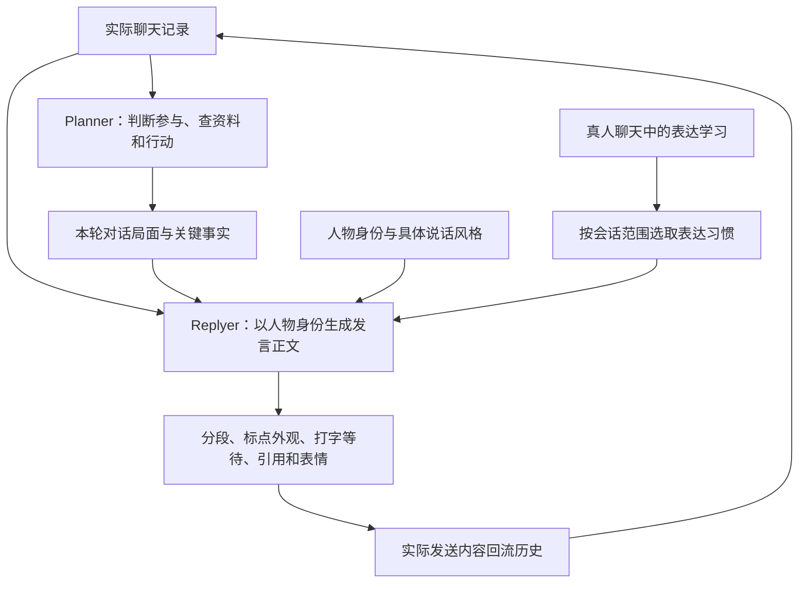

# MaiBot“活人感”机制深读

2026-11-16。作者认为成稿转译方向正确，但实际观察到不少转译稿比原v8更有人机感，要求先学习MaiBot机制，再讨论调整。本次研究固定于此前已核验的MaiBot提交`478f671e64467121fd3e39205c8d3507b5ce0bd6`，覆盖普通DeepSeek等通用模型的默认路径，并标出可选分支。

## 核心发现

MaiBot把自然聊天的信号放在正文生成之前：人物身份、具体说话风格、真实聊天、从真人语料提炼的表达习惯，以及本轮对话局面。Replyer据此直接形成自己的发言。分段、标点外观、打字等待、引用和表情在正文之后形成即时通讯的观感。

普通Replyer并不接收一份已完整定稿、要求保留全部观点和建议的回答。上游确有后置翻译，但属于默认关闭的“超级创意”分支，不能把它当作普通路径活泼口吻的唯一来源。

因此，当前最有解释力的区别是**最终生成任务的身份和表达材料**，而不是工程代码多寡。MaiBot同样有大量工程指令、JSON和校验；其学习／规划任务承担结构化职责，通常由最后的Replyer直接输出发言正文。JSON是否影响PCAR自然度、哪段提示导致变僵，尚未做独立消融，不能仅凭文风定因。

## 1. 先看完整路径

这是普通模型、创意模式开启、默认reply工具流程的概括。表达库需要会话允许且库存足够；图片、插件和额外要求按实际启用状态加入。[源码：Planner模板](https://github.com/Mai-with-u/MaiBot/blob/478f671e64467121fd3e39205c8d3507b5ce0bd6/prompts/zh-CN/main/maisaka_chat.prompt)，[reply工具合同](https://github.com/Mai-with-u/MaiBot/blob/478f671e64467121fd3e39205c8d3507b5ce0bd6/src/maisaka/builtin_tool/reply.py#L127)。

## 2. 人物身份和说话风格提供了具体方向

上游把三类材料分开：

| 配置 | 面向的职责 | 源码中的内容性质 |
| --- | --- | --- |
| `personality` | 人物是谁、有什么性格 | 默认是正在网上聊天的女大学生，性格有日常的一面，也有反常态和锋利的一面 |
| `behavior_style` | Planner怎样参与和行动 | 何时参与、保持安静、自行了解信息；默认也包含不硬找话题 |
| `reply_style` | Replyer怎样说出来 | 默认趋向简短、随意、白话的社区回复语体，允许省略主语与倒装，抑制生硬句子和滥用比喻 |

这些默认值有明显审美取向，并不代表所有MaiBot人物都应有同一性格。它们的价值是把风格落实到语言动作：句子是否完整、用词有多口语、能否省略、怎样表达反应。

“温和、坦率、耐心”描述的是人格倾向；“常省略已经明白的主语、先接眼前的反差、口语化收尾”才进一步规定语言如何形成。PCAR当前四种测试角色的style大多强调清楚、具体、自然、有层次，即使夏栀有活泼设定，文字实现要求仍较宽泛。[人格与风格默认值](https://github.com/Mai-with-u/MaiBot/blob/478f671e64467121fd3e39205c8d3507b5ce0bd6/src/config/official_configs.py#L169)。

Replyer的身份装配直接把配置写成第二人称角色身份，再进入聊天。当前PCAR表达层以“将稿件改写成口吻资料对应人物……”定义工作，模型承担编辑者任务。**两种任务姿态确实不同；前者更容易把回复作为人物自己的反应来组织，这是源码差异支持的推断，尚不是同模型消融结论。** [身份装配](https://github.com/Mai-with-u/MaiBot/blob/478f671e64467121fd3e39205c8d3507b5ce0bd6/src/chat/replyer/maisaka_generator_base.py#L122)。

## 3. 默认创意模式改变的是提示组织，不是增加随机数

`chat.creative_mode=True`是该基线默认。普通模型使用通用复古模板：system放人物和聊天注意事项；user把真实会话、必要参考、当前目标和说话风格组织成一个聊天场景。

私聊模板在会话前后明确正在和谁聊天，结尾让人物直接接话。群聊模板把自己的历史标为自己说过的话，鼓励围绕眼前话题生成正文。补充自己上一条发言的私聊场景另有专用模板，其随意程度要求更突出，不能把这个分支的句子当作所有私聊的统一模板。

创意模式的差别不在“使用两条消息”。PCAR转译也使用两条消息，但承载的是角色资料和完整待编辑稿；上游承载的是人物正在参与的交流。上游关闭创意模式后仍可使用常规多消息模板；默认开关及“减少刻板句式”的配置说明属于上游设计意图，源码没有给出自然度提升比例。[模式说明](https://github.com/Mai-with-u/MaiBot/blob/478f671e64467121fd3e39205c8d3507b5ce0bd6/docs/replyer-prompt-profiles.md)，[复古组装](https://github.com/Mai-with-u/MaiBot/blob/478f671e64467121fd3e39205c8d3507b5ce0bd6/src/chat/replyer/retro_prompt.py#L93)，[普通私聊模板](https://github.com/Mai-with-u/MaiBot/blob/478f671e64467121fd3e39205c8d3507b5ce0bd6/prompts/zh-CN/main/reply_private.prompt)，[私聊补充模板](https://github.com/Mai-with-u/MaiBot/blob/478f671e64467121fd3e39205c8d3507b5ce0bd6/prompts/zh-CN/main/reply_private_followup.prompt)。

## 4. 表达学习给模型提供可用的语言材料

### 学的是场景与说法

聊天学习提示要求从真人文字中概括适用情境与语言风格，关注特殊句式和梗，避免具体人名／名词混入通用习惯。实际写入的数据是`situation/style`等记录。它不是在本机训练DeepSeek权重；后续通过检索或抽样把这些记录重新放进提示。[聊天学习模板](https://github.com/Mai-with-u/MaiBot/blob/478f671e64467121fd3e39205c8d3507b5ce0bd6/prompts/zh-CN/main/learn_style.prompt)，[学习和入库](https://github.com/Mai-with-u/MaiBot/blob/478f671e64467121fd3e39205c8d3507b5ce0bd6/src/learners/expression_learner.py#L398)。

流程从真实会话中收集材料。自己的消息可以帮助理解上下文，但不被当成新的真人表达来源；代码还校验来源编号、黑名单与来源文字。相同记录合并可增加count，索引是可重建派生数据。这使使用较久、真人语料较丰富的实例能积累更具体的口语资源，也意味着不同实例的效果依赖其语料。

提示中的几个示例不是预装表达库。上游另有示例污染过滤，避免模型把提示示例原样学进库。拿示例台词硬塞给每个角色，并不等同于上游机制。[来源过滤](https://github.com/Mai-with-u/MaiBot/blob/478f671e64467121fd3e39205c8d3507b5ce0bd6/src/learners/expression_learner.py#L669)，[示例过滤](https://github.com/Mai-with-u/MaiBot/blob/478f671e64467121fd3e39205c8d3507b5ce0bd6/src/learners/expression_style_utils.py)。

### 使用方式有快慢两档

| 路径 | 实现 | 对语言的作用 |
| --- | --- | --- |
| 快速档，默认 | 根据count加权抽样，候选直接交Replyer；不额外调用选择LLM | 让回复模型从若干具体语言习惯中自行取舍，带来会话积累与一定变化 |
| 精细档，可选 | 根据表达意图／对话局面构造查询，向量候选再经LLM选择，最多选5条 | 更贴近当前场景；缺少模型或选择失败时有直接注入等回退 |

快速档不是“最多5条精排结果”：代码可把一组较高count样本与一组全库样本合并去重，最多形成10条参考。少于10条可用库存时，自动选择直接跳过。count的抽样权重被限制在1到5之间，不能理解为越常见就无限占据输入。候选还有会话／相通组范围及可选人工精选限制。[选择器](https://github.com/Mai-with-u/MaiBot/blob/478f671e64467121fd3e39205c8d3507b5ce0bd6/src/chat/replyer/maisaka_expression_selector.py#L115)，[快速与精细分支](https://github.com/Mai-with-u/MaiBot/blob/478f671e64467121fd3e39205c8d3507b5ce0bd6/src/chat/replyer/maisaka_expression_selector.py#L494)，[权重计算](https://github.com/Mai-with-u/MaiBot/blob/478f671e64467121fd3e39205c8d3507b5ce0bd6/src/learners/weighted_sampling.py)。

最终注入的形式是“在某种情境下，可采用某种说法”的参考块。相比只告诉模型“活泼一点”，它提供了可落地的句式、语气和场景对应关系。这是具体表达资源的作用，不是每次强制套一句口头禅。[习惯块构建](https://github.com/Mai-with-u/MaiBot/blob/478f671e64467121fd3e39205c8d3507b5ce0bd6/src/chat/replyer/maisaka_expression_selector.py#L153)。

PCAR已经具备E2表达资产管理，但当前v2路径明确跳过候选检索，口吻只来自`core_traits`和`expression.style`。本轮B链因此没有使用上面这项语言资源机制。这符合作者首版最小输入约束；应把“资产能力已建好”和“这轮实际用于说话”分开。

## 5. Planner把局面和事实交给Replyer，保留最后的表达空间

此基线默认reply工具要求`chat_anlyze`：精炼转述当前交流局面和查到的关键事实，并明确要求不去构想或指导如何回复。另有短／正常／长回复参数；精细表达档才额外提供表达意图字段。

Replyer优先使用这份对话分析，缺省再取`reply_reason`，把它当作参考。同时只保留实际收到和实际发出的IM历史，过滤内部规划输出、工具结果、通知和回想等。工具信息并非完全丢弃：它通过整理后的关键事实传递，避免整个工具账目和推理过程成为人物聊天口气。[reply参数定义](https://github.com/Mai-with-u/MaiBot/blob/478f671e64467121fd3e39205c8d3507b5ce0bd6/src/maisaka/builtin_tool/reply.py#L147)，[局面材料装配](https://github.com/Mai-with-u/MaiBot/blob/478f671e64467121fd3e39205c8d3507b5ce0bd6/src/chat/replyer/maisaka_generator_base.py#L499)，[真实历史过滤](https://github.com/Mai-with-u/MaiBot/blob/478f671e64467121fd3e39205c8d3507b5ce0bd6/src/chat/replyer/maisaka_generator_base.py#L904)。

这修正了对上游“Planner出稿、Replyer润色”的粗略理解：默认工具合同更接近“前级理解局面并给事实，最后的人物自己说”。后者可以决定先接哪个细节、怎样回应气氛、是否只留一句反应。PCAR当前转译拿到完整主稿并需要保留观点、建议和承诺，能改变语言组织，但内容选择空间比上游普通Replyer窄。

例如一句话为什么有趣，可能取决于抓住了对方叙述中的反差，而不只是把“建议休息”换成更口语的词。这个差别发生在成稿之前。它解释了完整MaiBot与成稿转译的能力边界，不意味着需要把历史或回复决策重新塞进PCAR表达层。

## 6. 参与行为让人感觉它在聊天

Planner模板允许参与话题、主动提出话题或沉默；实际可见发言通过reply工具发送。人物还有观察聊天进度、适当减少工具调用、按照实际说过的话继续行为的要求。

群聊在进入Planner之前有动态发言门控、强制触发和空闲退避。门控参考是否提到机器人、是否在和别人说话、媒体占位、近期自发言比例及时间等特征。它决定何时值得处理，不负责把一句正文改得俏皮。私聊另走直接触发，源码明确不沿用群聊拟合门控，不能据群聊实现推断私聊也会概率性忽略消息。[群聊调度](https://github.com/Mai-with-u/MaiBot/blob/478f671e64467121fd3e39205c8d3507b5ce0bd6/src/maisaka/scenes/group/scheduling.py)，[门控特征](https://github.com/Mai-with-u/MaiBot/blob/478f671e64467121fd3e39205c8d3507b5ce0bd6/src/maisaka/turn_trigger/reply_likelihood.py)，[私聊调度](https://github.com/Mai-with-u/MaiBot/blob/478f671e64467121fd3e39205c8d3507b5ce0bd6/src/maisaka/scenes/private/scheduling.py)。

“参与得自然”会影响对整个人物的感觉，和单句文字是否生动是两个层面。PCAR本轮关注正文，应先把这两种收益分清。

## 7. 哪些看似关键的功能其实默认关闭

| 机制 | 本基线默认 | 作用与边界 |
| --- | --- | --- |
| 普通创意模式 | 开启 | 复古聊天模板的组织方式；普通DeepSeek路径可用 |
| 表达选择 | 快速档 | 还取决于会话开关和库存；默认不经过额外精排LLM |
| 备用风格随机切换 | 概率0 | 有备用列表，但默认不会随机切换，不能把活泼归因于它 |
| 注意力漂移 | 关闭 | 开启后鼓励抓住新鲜、好笑或有反差的细节，短暂联想后保持关联；是提示注入，不是实际随机破坏任务执行 |
| 超级创意 | 关闭 | 先用日语、俄语、法语或文言文生成，再由同一个实际Replyer模型译回中文 |
| 回复缓存 | 关闭 | 复用Planner请求前缀及模型，主要是另一种请求组织路径 |
| 被动式Replyer | 关闭 | Planner自然语言指导启动正文生成，附件等补充并行处理，属于另一分支 |
| Mai Replier专用适配 | 按实际模型名判断 | 训练适配强调persona-only system，并跳过动态表达习惯，不能直接等同于通用DeepSeek路径 |

[默认配置](https://github.com/Mai-with-u/MaiBot/blob/478f671e64467121fd3e39205c8d3507b5ce0bd6/src/config/official_configs.py#L970)，[注意力漂移实现](https://github.com/Mai-with-u/MaiBot/blob/478f671e64467121fd3e39205c8d3507b5ce0bd6/src/maisaka/attention_drift.py#L82)，[按实际模型选模板](https://github.com/Mai-with-u/MaiBot/blob/478f671e64467121fd3e39205c8d3507b5ce0bd6/src/chat/replyer/maisaka_generator_base.py#L599)。

后置翻译值得研究的职责边界是：前级已经生成有角色语气和创意的正文，后级要求保留这些性质译回中文。其目标主要是保存已经产生的表达。PCAR当前研究则希望把一份偏工程的中文成稿变得自然，两者的起点不同。上游该分支的存在不能证明只要增加一个翻译调用，就能把普通中文稿变活泼。[语言配置与译文任务](https://github.com/Mai-with-u/MaiBot/blob/478f671e64467121fd3e39205c8d3507b5ce0bd6/src/chat/replyer/creative_language.py)，[同实际模型翻译](https://github.com/Mai-with-u/MaiBot/blob/478f671e64467121fd3e39205c8d3507b5ce0bd6/src/chat/replyer/maisaka_generator_base.py#L993)。

## 8. 气泡和节奏负责表现方式

上游默认开启后处理与规则分段；也可选择LLM语义分段。文本片段保留分隔符，用于需要合并时还原连接。发送时首片不额外模拟打字，后片应用打字等待；引用、表情和发送结果一起进入实际聊天历史。

这解释了“像在即时聊天”的一部分体验。它不自动改善用词、幽默或人物态度。规则路径也会删除某些中文括号内容，并可能在超长／溢出时替换成短默认话语；这些可能减轻书面外观，同时损失内容，不能全部作为可迁入的优势。[规则后处理](https://github.com/Mai-with-u/MaiBot/blob/478f671e64467121fd3e39205c8d3507b5ce0bd6/src/chat/utils/utils.py#L439)，[typing计算](https://github.com/Mai-with-u/MaiBot/blob/478f671e64467121fd3e39205c8d3507b5ce0bd6/src/chat/utils/utils.py#L557)，[逐片发送](https://github.com/Mai-with-u/MaiBot/blob/478f671e64467121fd3e39205c8d3507b5ce0bd6/src/maisaka/builtin_tool/reply.py#L818)。

## 9. 对PCAR当前差距的定位

| 比较项 | MaiBot普通路径 | PCAR当前v2转译 | 可以确认的差异 |
| --- | --- | --- | --- |
| 最终任务 | 人物在当前聊天中发言 | 根据口吻资料改写完整主稿 | 任务姿态不同 |
| 语言资料 | 人设＋具体语体＋可选真人表达习惯 | 精简性格＋四种较抽象style | 当前未使用上游表达习惯供给 |
| 前级材料 | 局面、关键事实、实际交流 | 完整已定稿的正文 | 改写空间受源稿与意思保持约束 |
| 输出职责 | 一般只输出人物正文 | 正文及segments的JSON对象 | 运输／分段也占据同一任务的指令空间 |
| 实际历史 | 上游人物自己发送过的内容 | 主模型读取实际转译稿，转译模型不读历史 | PCAR保持最小输入；同一句话的关系语气需由源稿和口吻表达充分携带 |
| 气泡与时序 | 正文之后独立处理 | 已复用映射、保护和呈现合同 | 这是已取得的工程／呈现成果 |

PCAR原v8本身已有随口接话、自然省略和意思到了就收住的指导。后置转译却以完整改写、枚举保留项、JSON与分段作为显著任务信号，同时削去大量语境。**它可能把已经自然的主稿重新整理得更完整、更规整，或把风格变成外加语气词。** 这是当前最值得验证的解释，不能据此认定所有约束都应删除，或者JSON必然损害自然度。

当前移植中，来源、表达资产、气泡和恢复能力与上游关联明确；“上游有资产机制”不等于这轮已经把上游活泼语言的生成机制接通。作者最小输入约束仍有效。本研究没有修改角色资料、转译prompt、输入范围、主模型、正式策略或阶段门。

## 10. 同为DeepSeek也需核对实际调用条件

PCAR本轮转译使用`deepseek-flash`、temperature 1.0、关闭思考。上游固定基线的默认Replyer候选却是`deepseek-v4-pro-think`和`deepseek-v4-pro-nonthink`，配置模型标识为`deepseek-v4-pro`，默认按random策略选候选，temperature为1；Planner默认另用flash。[上游模型模板](https://github.com/Mai-with-u/MaiBot/blob/478f671e64467121fd3e39205c8d3507b5ce0bd6/src/config/default_model_config.py)。

这只说明源码默认，不代表作者观察的MaiBot实例就用了默认配置。“同一实际模型”的体验差异可以存在；要量化归因，应核对那一实例实际的模型标识、思考模式、提示profile、表达库存和插件，而不是仅看提供商名称。本次未获得该实例的运行记录，因此只给出源码机制与已验证的PCAR差异。

## 证据与阅读入口

已核对46份固定源码的Git blob及SHA256，保存在所选数据目录`tmp/maibot-liveliness-research-20261116/source`。同目录有`source-verification.json`和普通私聊模板的静态展开TXT／JSON，后者的历史与Planner材料为人工说明示例，未发送给模型。

建议阅读顺序：`official_configs.py`的人格／语体 → `reply_private.prompt` → `retro_prompt.py` → `reply.py`的`chat_anlyze`合同 → `learn_style.prompt` → `maisaka_expression_selector.py` → `creative_language.py`。前三项解释怎么让模型进入聊天，随后三项解释素材和内容边界，最后一项说明后置翻译实验。

本次新模型调用0，未启动MaiBot服务，未修改PCAR运行代码，未调用Computer Use。表达层尚未获完整体验优越性认可，E4继续等待。后续先根据本研究和作者审阅讨论调整，再实施新的有限对照。
