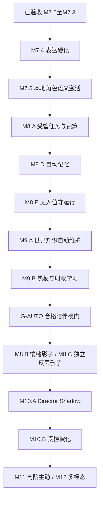

# 02 总施工路线图

## M7.4已验收增量（2026-10-29）

M7.4规定范围收尾，后接M7.5角色语义激活；M7.5.1–.3定向自检、.4唯一联合验收，不直接进入M8.A。

0.7.4.dev1／主库14／导出11／桥接0.7.0，规定范围验收完成。24次质量12/12自然不劣、2次实际QQ取消/继续通过，共26次55,269 tokens，配置和三服务停止初态恢复；历史条件携带。见[施工合同](../M7.4-自然表达与投递节奏实施计划.md)、[使用](../M7.4.md)、[机器结论](../acceptance/M7.4-机器验收结论.md)。本轮不提交推送，下方历史按当时语境理解。

## M7.5规划增量（2026-10-29，已采纳/未施工）

M7.5.1底座/索引 → .2融合检索 → .3上下文/Manifest → .4唯一正式联合验收。M8.A必须等待.4通过，不能把前三包自检称为阶段通过。

[用户原稿](../PCAR-M7.5-角色语义激活开发指导与施工计划.md) · [现状衔接](../M7.5-规划采纳与现状衔接.md) · [阶段入口](../M7.5.md)。当前9c49848/0.7.3.dev1，M7.4尚未实施，本轮仅规划并按授权提交推送。旧编号/验收历史不改写；新角色语义要求优先于旧“向量可选”的笼统表述。

> **M7.3当前进度（2026-10-28）：** M7.3规定范围验收完成，历史条件继续携带。0.7.3.dev1/主库13/导出10/桥接0.6.0；最终全量427项454.702秒通过，32/8人工集、迁移恢复、实际工作台与QQ通过。真实5次主要＋2次整理，共15,700 tokens、7份Manifest。长时门按用户修订采用受控截止模拟与5秒调度管线，未宣称真实30分钟通过。模拟退出，原人格、完整配置/30/6/20、每日整理及三服务停止初态恢复，无未决测试输入。仅准备M7.4；用户随后授权提交本地与远端，源码/测试/工具已归档为e7d45d5，文档独立提交并普通推送，实际结果见Git日志及D盘git-publication.json。 本阶段完成后仅准备M7.4表达硬化；不接入M8模型，不自动开启自治或向量。 [阶段](../M7.3.md) · [机器证据](../acceptance/M7.3-机器验收结论.md)。下方旧阶段快照保留历史含义。

> **M7.2当前收尾（2026-10-28）：** M7.2规定范围验收完成，历史条件继续携带。0.7.2.dev1/主库12/导出9/桥接0.6.0；自动召回默认开启、跨会话另开、明确引用失败零调用，缓冲及回复模式保持。最终全量390项161.670秒通过，48/16人工集、两条副本恢复及实际Tk通过；真实8次固定主要＋1次整理＋1次修复复验，共20,340 tokens，实际QQ一片纯文本sent可追溯。原R01中文句号漏召回及SDK超时现场保留；R01已修复复验关闭。原人格、完整配置/30/6/20、每日整理开关及三服务停止初态恢复，无未决输入/新片段。 [实现](../M7.2.md) · [机器结论](../acceptance/M7.2-机器验收结论.md) · [M7.3准备](../M7.3-开工输入与待定事项.md)。下方旧阶段及“未实施/待验”等为历史快照，当前事实以上述为准；用户现已授权M7.2两笔归档与普通推送，源码为b9fc03d、文档提交见Git日志。

> **下一阶段授权（2026-10-28）：** [M7.2实施合同](../M7.2-CognitiveContext与工作集实施计划.md)已批准，M7.1两笔提交推送后立即开工；[M7.2入口](../M7.2.md)目前仅为计划，不改写M7.1既有验收或声称新功能已上线。

> **M7.1当前实施（2026-10-28）：** [阶段说明](../M7.1.md)、[机器结论](../acceptance/M7.1-机器验收结论.md)及[实际手册](../acceptance/M7.1-中文全文与时间检索验收手册.md)记录管理员中文/时间检索、完整回合、recent_50只读预览和派生缓存验收。0.7.1.dev1/主库11/导出8/桥接0.6.0；最终全量359项通过120.537秒，人工80/80、两条副本恢复及实际隔离Tk可操作，0真实模型/QQ调用，正式三服务保持停止。新指导与原稿字节不改。下一步仅准备新M7.2 CognitiveContext；M4 O01–O03、M5 P09、M6.1旧付费续跑继续携带。下方旧阶段、未实施和编号均保留历史语境，当前编排见[规划衔接](../后续开发指导与规划衔接.md)。

> **2026-10-28 M7.0规定范围验收完成：** 0.7.0.dev1 / 结构11 / 导出8 / 桥接0.6.0。真实QQ完整回合引用、跨人格拒绝、撤回后零调用、正式工作台、导出及重启数据一致性均通过；最终核对两个递增的新鲜桥接心跳及正确入口身份，三个服务归属明确并运行，原人格、政策及30/6/20额度恢复，无未决输入。本轮恢复没有新增主要/整理调用或确认片重放。见[最终收尾](../acceptance/M7.0-最终收尾-20261028.md)和[机器验收结论](../acceptance/M7.0-机器验收结论.md)。
> [M7.1复评](../M7.1-封存规划复评.md)结论为“局部修订后复用”，原稿继续封存，不自动开工；FTS、向量和工作集尚未实施。M4 O01–O03、M5 P09及M6.1旧付费显式续跑条件继续携带，不声明全部历史条件通过。下方旧阶段的版本、计数及服务状态按当时范围保留。

> **M7.0暂停时的历史快照（2026-10-28，恢复门现已关闭）：** 0.7.0.dev1 / 结构11 / 导出8 / 桥接0.6.0已实现部署。真实QQ完整回合引用、跨人格拒绝、R06撤回后零调用、正式工作台引用与草稿保护、导出8及最终R08数据一致性均有通过证据；用户选择“暂不恢复，保存交接”，最终QQ运行恢复门暂停，不能标M7.0全部退出。当时续接材料见[机器验收结论](../acceptance/M7.0-机器验收结论.md)及[续验交接](../acceptance/M7.0-续验交接-20261028.md)。
> **M7.0施工中历史记录（早于最终276项及本次续验）：** M7.0已实现并部署：0.7.0.dev1/结构11/导出8/桥接0.6.0；最新工程全量258项通过136.338秒，实际SDK零平台动作探针及D盘副本迁移恢复通过，工作台隔离实操已验。真实QQ引用验收进行中，未标阶段完成。M7.1封存，不实施FTS/向量/工作集；历史条件继续携带。见[阶段证据](../M7.0.md)。M7.1原规划已封存，需M7.0验收后复评。

> **M7准备期历史记录：** 材料已完成：[开发准备](../M7-开发准备.md)、[M7.0候选实施计划](../M7.0-原始档案与精确引用实施计划.md)。本次不实现M7，不更改原始路线中的后续阶段边界。

## M6.4历史实施状态（2026-10-28）

M6.4联合验收完成，M6核心范围收尾，历史条件继续携带。0.6.4.dev1 / 结构10 / 导出7 / 桥接0.5.0；本次全量237项通过（86.141秒）。72次固定质量对照完成，两种情境模式均22/24不劣于兼容模式；实际QQ快速三输入同批及修复后纯文本平台读回通过。首组含Markdown缺陷记录保留。合计74次真实主要调用、144,059 tokens，金额未知。原人格、入口政策及30/6/20额度已恢复，按验收前状态恢复人格服务停止、AstrBot/QQ在线。M4 O01–O03、M5 P09及M6.1旧付费显式续跑条件仍待验；M7仅准备，不提前实现。见[M6.4联合结论](../M6.4.md)、[质量结果](../acceptance/M6.4-质量对照结果.md)。以下原始规划、历史证据及复选框不单独代表当前实现状态。

[总入口](README.md) · [现状证据](01-现状证据与需求对照.md) · [M6任务单](09-M6施工任务单与决策登记.md) · [验收](08-开发流程与验收计划.md)

## 1. 路线原则与阶段定位（2026-10-29修订草案）

**用户目标：先完成无需日常人工监管的合格陪伴机器人，再接入Director模型和研究人格自我演化。** 当前main@33eccf2、M7.3规定范围已验收；新增方案规划已采纳，本次提交推送已获用户授权。详见[指导1.1](../pcar_project_plan_zh.md)、[完整修订](../无人值守陪伴优先-路线修订草案.md)。下方M6历史施工记录不重写为新验收结果。

编号用于保留历史追踪，不决定先后。G-AUTO之前不接入Director，包括影子模型；自动记忆校验器无治理权限。基础自然表达、来源正确、费用及恢复同时达标，不能用人格演化研究代替可用陪伴。角色本地Embedding已纳入M7.5硬依赖；聊天档案向量扩展和特定外部框架仍非前置硬依赖。

## 2. 阶段总表

| 阶段 | 当前状态/任务 | 必交产物与退出门 |
| --- | --- | --- |
| M6/M7.0–M7.3 | 已验收规定范围，历史条件继续携带 | 复用角色、成员、来源/检索、Manifest、包及实际投递证据 |
| M7.4 | 下一阶段，表达硬化准备 | 语义完整、自然纯文本、节奏及取消账本，不破坏领取/恢复 |
| M7.5 | 规划已采纳，角色语义激活 | 真本地Embedding、词法融合、冻结上下文；.1–.3自检/.4唯一正式验收 |
| M8.A | 规划已采纳，统一任务底座 | 预授权、幂等、预算、有限恢复；现有M4任务不双调度 |
| M8.D | 规划已采纳，自动记忆 | 自动分批/校验/冲突处置/提交/撤回重建/召回，无日常人审 |
| M8.E | 规划已采纳，受管运行 | 宿主单实例、窗口分离、服务与投递恢复、明确停止、可选基础提醒 |
| M9.A/B | 规划已采纳，世界知识与时效学习 | 授权获取、校验、更新、过期、更正和聊天使用；不是仅采集候选 |
| G-AUTO | 新增，未验收 | [矩阵](../acceptance/无人值守陪伴-阶段门与验收矩阵.md)全部必需门通过后才能接入Director/演化 |
| M8.B/C | 排至门后，保留原编号 | 情绪/独立反思影子，不改正典、不循环自证 |
| M10.A/B | 门后研究 | 导演对照、有限演化、观察/暂停/回滚，再过自身验收 |
| M11/M12 | 后续扩展 | 高阶主动节律、多模态；不阻碍基础陪伴先行完成 |

基础约定提醒是规划已采纳的可选前移项，一次授权、静默/频率/费用约束齐备后才开启。群聊、其他联系人及无限制工具自主行动不进入该目标。

## 3. M6 子阶段与迁移步骤

### M6.0 角色系统和基础合同

1. 冻结 `persona_id` 为身份主键、字段所有权、角色事实来源类型，整理许可登记。
2. 新增版本化角色扩展资料、Lorebook 条目和表达示例合同；提供精确字段读取及未知值处理。
3. 对旧 PersonaSpec 建只读兼容投影，保留 core/expression 为既有字段权威，不创建第二套可编辑姓名/性格/表达。
4. 提供同身份编辑、差异、回退、迁移初版标识；不伪造历史角色版本。
5. 完成工作台最小编辑/版本显示，更新实际界面验收手册；外部 CCv2/v3 导入暂为可选适配器。

退出：旧人格 ID、事件、关系与记忆不变；字段查询确定；设定背景与真实经历分离；版本冲突保留用户草稿。详见 [角色规范](05-角色系统与人设人格规范.md)。

### M6.1 持久输入与缓冲

1. 先建 IngressReceipt 与最小原始消息档案，确认账号/联系人/正文校验，原子去重。
2. 建 InputBatch 与成员关联，不在 QQ 插件各建一套缓冲池。
3. 单调时钟控制等待；落库到期时间用于重启诊断；静默窗口与整批上限共同触发。
4. 原子封批创建一个逻辑 turn；旧单条 API 适配为单成员批次，新批次 API 独立版本标识。
5. 旧默认处理行为先保留；新模式在隔离与影子模式验证，不私自给运行中用户增加五秒等待。

退出：重复入站不延长计时；并发到期只建一个 turn；未满五秒重启可查回原文且不自动收费重放；所有已受理输入都有明确归宿。

### M6.2 情境表达与结构化回复

状态：源码已实现，离线受影响回归通过；真实体验和发布门未完成。具体合同与限制以[M6.2实施计划](../M6.2-情境表达与结构化回复实施计划.md)为准。

1. 已实现 `legacy_full`、`context_full`、`context_structured` 版本模式，按受理时快照生效；默认兼容全文。
2. 已实现确定性词法弱情境线索和按场景选择创作者表达样例，不新增每轮理解模型。
3. 已实现单次主生成、ReplyBatch严格校验、失败用量保留及成功全文/语义段原子持久化。结构错误明确失败，不自动修复或再次收费。
4. 现有投递器仍投递完整文本；分片账本、工作台实际体验、真实模型自然度、正式迁移和QQ送达待验。

退出：全量工程测试通过，真实模型/工作台样例无关键表达错误，迁移恢复有证据，内部结构不泄漏。当前这些真人/发布门尚未关闭。

### M6.3 片段投递

状态：源码已实现并完成离线专项/受影响回归；M6.3迁移本身为9→10，D盘结构8运行库的临时隔离副本已完成8→9→10迁移、恢复和再次升级。工作台真实点击、AstrBot/QQ实际送达和平台消息 ID核对待验。当前版本0.6.3.dev1/结构10/导出7/桥接0.5.0，默认仍兼容全文。具体合同以[M6.3实施计划](../M6.3-片段可靠投递实施计划.md)和[阶段说明](../M6.3.md)为准。

1. 原子保存回复全文、语义段、平台传输块与待发送记录，再允许桥接领取。
2. 领取权、顺序、发送尝试、平台消息 ID、确认时间分片记录。
3. 任何 uncertain 均停止本批余段，等待显式核对/处置；已确认段禁止整批重发。
4. 服务重启时 `sending` 变 `uncertain`；未开始的片段保留，不推断成未发送重跑。
5. 桌面可显示整批与片段账本；原插件同步升级，老插件不能误取新批次用旧整段发送。

退出：三段中第 3 段异常时前两段仍可证明已发送；新旧投递器不会同时发同一回复。详见 [04](04-即时交互与缓冲池规范.md)。

### M6.4 联合验收与默认切换

保持同一人格、同一模型、同一上下文做旧/新模式对照；先过工程硬门，再盲评角色一致性和表达自然度。五秒是待校准起点，不是不可更改产品承诺。根据真实输入间隔、首段延迟、重复率、调用量记录是否开启新模式；默认切换是单独配置变更，保留回退开关与手册。

## 4. M7 已完成底座与表达硬化

M7.0精确档案/引用、M7.1管理检索、M7.2上下文/自动召回、M7.3会话/手动主题与封存均按各阶段新版合同完成规定范围。旧可选向量M7.3和检索收尾M7.4编号保留在历史稿，当前采用[规划衔接](../后续开发指导与规划衔接.md)映射。

下一步[M7.4表达硬化](../M7.4-开工输入与待定事项.md)继续保护完整成员、明确引用、QQ纯文本、代码/数字/URL及已发送账本。取消/失败状态需能接入后续自动恢复，不能创建只能靠管理点击解锁的隐藏状态。本次不实施。

## 5. M8 自动任务、记忆与运行先行

M8.A统一触发、预算、执行所有权与恢复；M8.D统一封存/增量/周期覆盖，自动继续完整批次、校验与版本提交，冲突可隔离但不堵全局；M8.E负责显式受管宿主、服务状态、片段不确定的安全收敛与后续聊天恢复。

M7.3已有的手动整理与主题接口作为检查/覆盖入口继续兼容，不是最终产品日常依赖。模型不能借整理修改Core/Character、正式关系/表达政策或费用权限。原M8.B/C情绪和独立反思影子移至G-AUTO后；日常记忆模型不等于独立人格反思模型。

## 6. M9 世界知识与时效更新前置

M9.A实现授权源自动获取、来源/版本、校验、入库、检索、过期与更正；M9.B实现热梗语境及衰退、时政更新与冲突来源处理。发现和写入均不依赖逐条人工确认；不确定主张保持出处和不确定性，不伪装确定事实。

时效参数、数据源许可与费用在开工冻结；不承诺覆盖全网，也不自动向QQ广播新闻。公共知识与私人经历隔离，外部文本不得操纵工具/权限或改人格。两阶段均为G-AUTO前置，不再作为演化后的可选增强。

## 7. G-AUTO与之后的研究

[G-AUTO](../acceptance/无人值守陪伴-阶段门与验收矩阵.md)要求零日常管理介入、确实完成有用记忆/知识工作、质量不退化、可恢复故障安全收敛、费用有限且真实平台可追溯。不能用全部NO_ACTION、人工代理点击或合成QQ事件冒充产品自动运行。

通过后才开展M8.B/C和Director接入；M10.A影子与M10.B受控演化分别再验。创作者正典/权限保护继续有效。外部强制扫码、断电等限制单列，不伪称永不需维护；各历史条件按[新旧验收映射](../acceptance/无人值守陪伴-阶段门与验收矩阵.md#5-历史条件映射)保留。

## 8. 每阶段的共同迁移门

1. 在 D 盘隔离副本生成新结构，核对旧表行数、主键、原列内容摘要和外键。
2. 只添加必要新结构；每次实际 schema 版本按仓库当时最新版本分配，不在计划里预占 7–N。
3. 新读路径先兼容旧记录，必要时双读对比；不要双写两份权威状态。
4. 新插件与核心协议协商，旧客户端遇到新对象应明确拒绝而非错误发送。
5. 正式迁移前验证备份可恢复，按现有服务归属机制停写、持锁、事务升级；失败恢复整份一致备份。
6. 开关回退不等于数据库可直接降级。只有新程序的兼容读取路径已验证时才回退功能；旧二进制不能随意打开新 schema。
7. 收尾同步 README、STATUS、HANDOFF、architecture、CHANGELOG、路线、阶段说明和验收目录索引；历史状态不抹除。

## 9. 优先级与阻断事项

丢消息、错人格/账号投递、来源撤回失效、版本覆盖和不可恢复迁移为 P0，立即阻断新功能。重复发送、费用越限、代码拆坏为发布阻断。风格不够自然、参数尚待校准可在保留旧默认且有明确限制时继续实验。

M4 O01–O03/M5 P09 不阻止离线设计和隔离施工；凡改到对应模块必须补影响回归，不能把旧条件项删除。真实 24 小时必须实等；第二模型未配置则 P09 继续待验，不猜测新模型或服务名。
