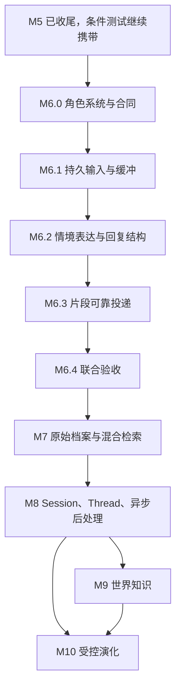

# 02 总施工路线图

## 实施状态更新（2026-10-27）

M6.0 T00–T02、M6.1 T03–T04已实现；M6.2 T05源码已实现。当前源码0.6.2.dev1/结构9/导出6/桥接0.4.0，生产默认兼容全文；54项受影响回归及198项全量unittest通过（83.744秒，含离线SDK探针，无QQ/模型调用）。真实模型/工作台体验、正式迁移恢复及QQ送达未验，正式环境仍结构8且服务停止。M4 O01–O03、M5 P09和M6.1显式续跑/QQ送达继续待补。T06/M6.3尚未实施，整个M6未完成；详见[最新M6.2状态](../M6.2.md)。历史规划复选框不代表当前状态。

[总入口](README.md) · [现状证据](01-现状证据与需求对照.md) · [M6任务单](09-M6施工任务单与决策登记.md) · [验收](08-开发流程与验收计划.md)

## 1. 路线原则与阶段定位

M1–M5 的持久化、来源、版本、受理和恢复底座继续使用。当前最先需要的是完整角色定义与自然交互的数据合同；不能先建完整 Thread/反思系统，再临时改变其最小消息单位。

新路线采用历史后续讨论的 M6–M10 编号，并吸收最后一次角色系统讨论：**Character System 进入 M6.0，优先于消息合并。** 原讨论里更早的“M6.0 架构合同与许可”作为 M6.0 的第一任务保留；原讨论里旧 M6 的世界知识移至新 M9。此为本次规划重排，旧阶段文档保留历史，不改写已经完成的验收。

阶段工期暂不估算日历日期。每个子阶段按“数据/接口合同→隔离实现→故障与兼容验证→体验评估→部署说明”退出；没有证据时不得用到期日期代替完成条件。

图表示主要施工依赖。M9 是外部知识影响观点时的必要来源基础，纯表达习惯提议实验不必等待整个知识库。人格演化全面启用仍最后进行。自然表达样本集贯穿各阶段，不能认为 M6 验收后自然度已永久解决。

## 2. 阶段总表

| 阶段 | 核心问题 | 必交产物 | 退出门 |
| --- | --- | --- | --- |
| 文档基线（本次） | 要建什么，哪些已有 | 本套十文件、证据与待定登记 | 链接/覆盖/状态核验；不改运行策略 |
| M6 | 角色是谁，一轮对话如何自然而可靠地完成 | Character Profile、批次合同、输入缓冲、情境表达、ReplyBatch/片段账本、工作台可见性 | 原文完整、一次主要生成、片段不盲目重发、兼容模式可用、角色事实准确 |
| M7 | 如何准确找到过去 | 原始档案补齐、引用 ID、FTS、本地向量可选、约五十轮工作集、证据组装 | 精确引用必测全对；混合检索有量化收益；撤回和渠道隔离通过 |
| M8 | 如何组织整次交流和跨天主题 | Session 封存、固定边界后处理、TopicSegment/Thread、统一任务去重 | 新消息不污染旧边界；重启不重复提交；A-B-A 续聊可解释 |
| M9 | 如何认识外部世界 | 紧凑本地知识、显式/按需搜索、来源/时效/冲突、热梗小条目 | 本地有效命中零搜索；过期或不足证据不伪装成当前确定知识 |
| M10 | 如何基于经历渐进改变 | 观察积累、提议、版本并发、分层政策、拒绝/回退 | 身份正典不被自动改写；旧提议不能覆盖新版本；可追溯可撤回 |

主动问候、群聊、多参与者、图像/语音、角色身体模拟、工具自主行动均不包含在新 M6–M10 的默认交付。未来另立任务，不把它们用作“活人感”前置条件。

## 3. M6 子阶段与迁移步骤

### M6.0 角色系统和基础合同

1. 冻结 `persona_id` 为身份主键、字段所有权、角色事实来源类型，整理许可登记。
2. 新增版本化角色扩展资料、Lorebook 条目和表达示例合同；提供精确字段读取及未知值处理。
3. 对旧 PersonaSpec 建只读兼容投影，保留 core/expression 为既有字段权威，不创建第二套可编辑姓名/性格/表达。
4. 提供同身份编辑、差异、回退、迁移初版标识；不伪造历史角色版本。
5. 完成工作台最小编辑/版本显示，更新实际界面验收手册；外部 CCv2/v3 导入暂为可选适配器。

退出：旧人格 ID、事件、关系与记忆不变；字段查询确定；设定背景与真实经历分离；版本冲突保留用户草稿。详见 [角色规范](05-角色系统与人设人格规范.md)。

### M6.1 持久输入与缓冲

1. 先建 IngressReceipt 与最小原始消息档案，确认账号/联系人/正文校验，原子去重。
2. 建 InputBatch 与成员关联，不在 QQ 插件各建一套缓冲池。
3. 单调时钟控制等待；落库到期时间用于重启诊断；静默窗口与整批上限共同触发。
4. 原子封批创建一个逻辑 turn；旧单条 API 适配为单成员批次，新批次 API 独立版本标识。
5. 旧默认处理行为先保留；新模式在隔离与影子模式验证，不私自给运行中用户增加五秒等待。

退出：重复入站不延长计时；并发到期只建一个 turn；未满五秒重启可查回原文且不自动收费重放；所有已受理输入都有明确归宿。

### M6.2 情境表达与结构化回复

状态：源码已实现，离线受影响回归通过；真实体验和发布门未完成。具体合同与限制以[M6.2实施计划](../M6.2-情境表达与结构化回复实施计划.md)为准。

1. 已实现 `legacy_full`、`context_full`、`context_structured` 版本模式，按受理时快照生效；默认兼容全文。
2. 已实现确定性词法弱情境线索和按场景选择创作者表达样例，不新增每轮理解模型。
3. 已实现单次主生成、ReplyBatch严格校验、失败用量保留及成功全文/语义段原子持久化。结构错误明确失败，不自动修复或再次收费。
4. 现有投递器仍投递完整文本；分片账本、工作台实际体验、真实模型自然度、正式迁移和QQ送达待验。

退出：全量工程测试通过，真实模型/工作台样例无关键表达错误，迁移恢复有证据，内部结构不泄漏。当前这些真人/发布门尚未关闭。

### M6.3 片段投递

1. 原子保存回复全文、语义段、平台传输块与待发送记录，再允许桥接领取。
2. 领取权、顺序、发送尝试、平台消息 ID、确认时间分片记录。
3. 任何 uncertain 均停止本批余段，等待显式核对/处置；已确认段禁止整批重发。
4. 服务重启时 `sending` 变 `uncertain`；未开始的片段保留，不推断成未发送重跑。
5. 桌面可显示整批与片段账本；原插件同步升级，老插件不能误取新批次用旧整段发送。

退出：三段中第 3 段异常时前两段仍可证明已发送；新旧投递器不会同时发同一回复。详见 [04](04-即时交互与缓冲池规范.md)。

### M6.4 联合验收与默认切换

保持同一人格、同一模型、同一上下文做旧/新模式对照；先过工程硬门，再盲评角色一致性和表达自然度。五秒是待校准起点，不是不可更改产品承诺。根据真实输入间隔、首段延迟、重复率、调用量记录是否开启新模式；默认切换是单独配置变更，保留回退开关与手册。

## 4. M7 原始经历和检索

- **M7.0**：扩展 M6 档案；补平台消息/引用映射和发送输出映射，旧历史标 `legacy_normalized_only`。
- **M7.1**：精确 ID、时间、中文全文检索与脱敏标注集；模型不可用也能定位原文。
- **M7.2**：近期工作集以五十个逻辑 turn 为初始容量；按预算召回，不全量上传。
- **M7.3**：本地 Embedding/索引兼容实验，比较 FTS 与混合效果；无收益时维持 FTS，不为了“混合”强装依赖。
- **M7.4**：证据来源、被裁内容、时间硬过滤、纠错失效和索引重建联合验收。

先验证当前 Windows/Python 3.12 的 FTS5 能力，再选中文分词/字符片段路径。向量模型、权重许可、占用及下载均单列评估，不预先承诺具体模型。引用组件必须精确放行，不能顺带开放图片、语音或陌生联系人。

## 5. M8 会话、主题与后台整理

1. 在 existing sessions 上增补生命周期元数据；旧会话不按猜测批量重切，留原 ID 与映射。
2. 以约三十分钟空闲作实验阈值；有打开批次、排队/运行 turn、发送中回复时不封存。
3. 固定输入清单、边界及版本，建立 SessionPackage。
4. 复用 M4 任务/尝试/额度/屏蔽；统一每日和 Session 任务的覆盖登记，避免重复提取和提交。
5. 摘要→主题段→Thread 关联→记忆候选；反思和表达样例只产候选。
6. 后台崩溃可恢复确定性阶段；失败的收费调用显式续跑。额度等待按日程恢复，不能新增无限自动重试。

M8 不自动获得 M4 每日正常记忆自动生效权限。新 Session 候选默认待审；若以后启用自动写入，独立政策版本、开关、冲突测试与审计不可少。

## 6. M9 世界知识与热梗

先建立小而可用的来源条目、事实版本和时效政策，再接搜索。区分用户“告诉角色某个梗”与公共事实已经核验；未知→搜索→核验→本地复用形成可测闭环。新增热点监控、定期下载或长驻爬虫不属于本阶段默认功能。

知识保存原子事实及时间语境。失效仅影响当前回答，不抹除历史“当时知道什么”。真实搜索成本和模型提取成本分别统计；事实、角色观点、私人经历分别隔离。

## 7. M10 受控演化

先完成观察→候选→提议，验证跨 Session 多次证据与反例，再允许接受提议生成版本。表达习惯、关系理解、观点、临时状态和核心正典使用不同权限。核心身份/生日/身高/家庭设定不允许后台自动演化；创作者改设定走显式编辑。

首版持久变化均待审，成熟后可为低风险表达习惯另定自动政策。接受时校验来源有效性、政策版本、目标当前版本、幂等操作号；冲突转 stale，不强行覆盖。回退只新建版本，不复活屏蔽来源和过期状态。

## 8. 每阶段的共同迁移门

1. 在 D 盘隔离副本生成新结构，核对旧表行数、主键、原列内容摘要和外键。
2. 只添加必要新结构；每次实际 schema 版本按仓库当时最新版本分配，不在计划里预占 7–N。
3. 新读路径先兼容旧记录，必要时双读对比；不要双写两份权威状态。
4. 新插件与核心协议协商，旧客户端遇到新对象应明确拒绝而非错误发送。
5. 正式迁移前验证备份可恢复，按现有服务归属机制停写、持锁、事务升级；失败恢复整份一致备份。
6. 开关回退不等于数据库可直接降级。只有新程序的兼容读取路径已验证时才回退功能；旧二进制不能随意打开新 schema。
7. 收尾同步 README、STATUS、HANDOFF、architecture、CHANGELOG、路线、阶段说明和验收目录索引；历史状态不抹除。

## 9. 优先级与阻断事项

丢消息、错人格/账号投递、来源撤回失效、版本覆盖和不可恢复迁移为 P0，立即阻断新功能。重复发送、费用越限、代码拆坏为发布阻断。风格不够自然、参数尚待校准可在保留旧默认且有明确限制时继续实验。

M4 O01–O03/M5 P09 不阻止离线设计和隔离施工；凡改到对应模块必须补影响回归，不能把旧条件项删除。真实 24 小时必须实等；第二模型未配置则 P09 继续待验，不猜测新模型或服务名。
