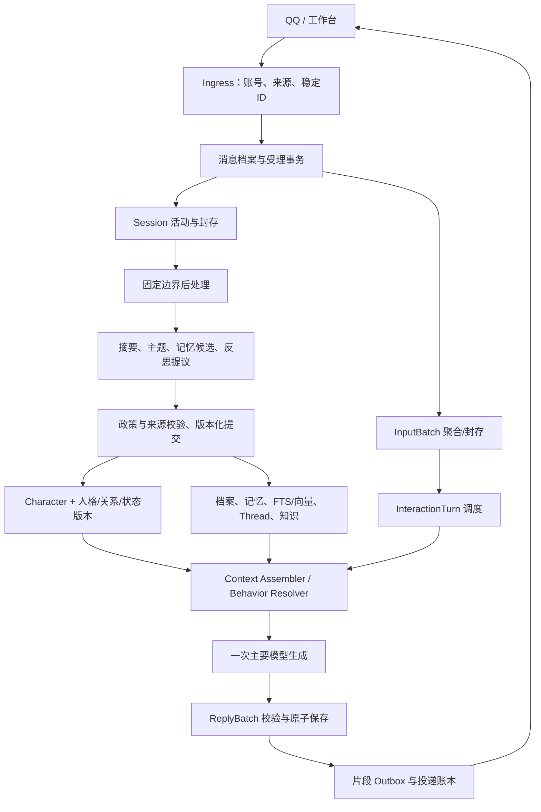

# 03 架构与领域模型

## 无人值守目标架构增量（规划已采纳，2026-10-29）

依据[路线修订](../无人值守陪伴优先-路线修订草案.md)，M8.A/D/E与M9.A/B先形成日常陪伴闭环。模型/框架仍是计算组件，Persona、档案、版本、权限和提交保持单一权威。

| 责任 | 拟议合同 | 复用与边界 |
| --- | --- | --- |
| 任务与自治政策 | 类型/触发/范围/窗口/预算/幂等/恢复 | 适配M4任务及账本，不引入两套收费调度 |
| 自动记忆 | 覆盖、来源、候选、校验、提交/隔离/复核 | 完整成员与撤回贯通；不依赖Director |
| 受管宿主 | 单实例所有权、停止意图、健康、恢复 | 显式模式；不隐性驻留，不管理其他项目 |
| 世界知识 | 外部事件、有效期、版本、分类和来源 | 与私人经历/角色设定分区；派生索引不是权威 |
| 自动处置审计 | 政策版本、触发依据、结果/副作用和下一状态 | 不把跳过/解除阻塞写成实际sent |

实体名为设计责任，并非本轮新增表/API；持久结构在各阶段开工冻结。G-AUTO前不接入Director模型或人格演化，当前0.7.3.dev1/主库13保持。旧领域图的治理链仅适用于门后的演化提案，不是日常记忆/知识每次提交的前提。

> **M7.3当前进度（2026-10-28）：** M7.3规定范围验收完成，历史条件继续携带。0.7.3.dev1/主库13/导出10/桥接0.6.0；最终全量427项454.702秒通过，32/8人工集、迁移恢复、实际工作台与QQ通过。真实5次主要＋2次整理，共15,700 tokens、7份Manifest。长时门按用户修订采用受控截止模拟与5秒调度管线，未宣称真实30分钟通过。模拟退出，原人格、完整配置/30/6/20、每日整理及三服务停止初态恢复，无未决测试输入。仅准备M7.4；用户随后授权提交本地与远端，源码/测试/工具已归档为e7d45d5，文档独立提交并普通推送，实际结果见Git日志及D盘git-publication.json。 Session生命周期与任务状态分离；封存包只存ID/哈希/版本，事件、实际part仍是正文权威。 [阶段](../M7.3.md) · [机器证据](../acceptance/M7.3-机器验收结论.md)。下方旧阶段快照保留历史含义。

> **M7.2当前收尾（2026-10-28）：** M7.2规定范围验收完成，历史条件继续携带。0.7.2.dev1/主库12/导出9/桥接0.6.0；自动召回默认开启、跨会话另开、明确引用失败零调用，缓冲及回复模式保持。最终全量390项161.670秒通过，48/16人工集、两条副本恢复及实际Tk通过；真实8次固定主要＋1次整理＋1次修复复验，共20,340 tokens，实际QQ一片纯文本sent可追溯。原R01中文句号漏召回及SDK超时现场保留；R01已修复复验关闭。原人格、完整配置/30/6/20、每日整理开关及三服务停止初态恢复，无未决输入/新片段。 [实现](../M7.2.md) · [机器结论](../acceptance/M7.2-机器验收结论.md) · [M7.3准备](../M7.3-开工输入与待定事项.md)。下方旧阶段及“未实施/待验”等为历史快照，当前事实以上述为准；用户现已授权M7.2两笔归档与普通推送，源码为b9fc03d、文档提交见Git日志。

> **下一阶段授权（2026-10-28）：** [M7.2实施合同](../M7.2-CognitiveContext与工作集实施计划.md)已批准，M7.1两笔提交推送后立即开工；[M7.2入口](../M7.2.md)目前仅为计划，不改写M7.1既有验收或声称新功能已上线。

> **M7.1当前实施（2026-10-28）：** [阶段说明](../M7.1.md)、[机器结论](../acceptance/M7.1-机器验收结论.md)及[实际手册](../acceptance/M7.1-中文全文与时间检索验收手册.md)记录管理员中文/时间检索、完整回合、recent_50只读预览和派生缓存验收。0.7.1.dev1/主库11/导出8/桥接0.6.0；最终全量359项通过120.537秒，人工80/80、两条副本恢复及实际隔离Tk可操作，0真实模型/QQ调用，正式三服务保持停止。新指导与原稿字节不改。下一步仅准备新M7.2 CognitiveContext；M4 O01–O03、M5 P09、M6.1旧付费续跑继续携带。下方旧阶段、未实施和编号均保留历史语境，当前编排见[规划衔接](../后续开发指导与规划衔接.md)。

> **2026-10-28 M7.0规定范围验收完成：** 0.7.0.dev1 / 结构11 / 导出8 / 桥接0.6.0。真实QQ完整回合引用、跨人格拒绝、撤回后零调用、正式工作台、导出及重启数据一致性均通过；最终核对两个递增的新鲜桥接心跳及正确入口身份，三个服务归属明确并运行，原人格、政策及30/6/20额度恢复，无未决输入。本轮恢复没有新增主要/整理调用或确认片重放。见[最终收尾](../acceptance/M7.0-最终收尾-20261028.md)和[机器验收结论](../acceptance/M7.0-机器验收结论.md)。
> [M7.1复评](../M7.1-封存规划复评.md)结论为“局部修订后复用”，原稿继续封存，不自动开工；FTS、向量和工作集尚未实施。M4 O01–O03、M5 P09及M6.1旧付费显式续跑条件继续携带，不声明全部历史条件通过。下方旧阶段的版本、计数及服务状态按当时范围保留。

> **M7.0暂停时的历史快照（2026-10-28，恢复门现已关闭）：** 0.7.0.dev1 / 结构11 / 导出8 / 桥接0.6.0已实现部署。真实QQ完整回合引用、跨人格拒绝、R06撤回后零调用、正式工作台引用与草稿保护、导出8及最终R08数据一致性均有通过证据；用户选择“暂不恢复，保存交接”，最终QQ运行恢复门暂停，不能标M7.0全部退出。当时续接材料见[机器验收结论](../acceptance/M7.0-机器验收结论.md)及[续验交接](../acceptance/M7.0-续验交接-20261028.md)。
> **M7.0施工中历史记录（早于最终276项及本次续验）：** M7.0已实现并部署：0.7.0.dev1/结构11/导出8/桥接0.6.0；最新工程全量258项通过136.338秒，实际SDK零平台动作探针及D盘副本迁移恢复通过，工作台隔离实操已验。真实QQ引用验收进行中，未标阶段完成。M7.1封存，不实施FTS/向量/工作集；历史条件继续携带。见[阶段证据](../M7.0.md)。M7.1原规划已封存，需M7.0验收后复评。

## M6.4历史实施状态（2026-10-28）

M6.4联合验收完成，M6核心范围收尾，历史条件继续携带。0.6.4.dev1 / 结构10 / 导出7 / 桥接0.5.0；本次全量237项通过（86.141秒）。72次固定质量对照完成，两种情境模式均22/24不劣于兼容模式；实际QQ快速三输入同批及修复后纯文本平台读回通过。首组含Markdown缺陷记录保留。合计74次真实主要调用、144,059 tokens，金额未知。原人格、入口政策及30/6/20额度已恢复，按验收前状态恢复人格服务停止、AstrBot/QQ在线。M4 O01–O03、M5 P09及M6.1旧付费显式续跑条件仍待验；M7仅准备，不提前实现。见[M6.4联合结论](../M6.4.md)、[质量结果](../acceptance/M6.4-质量对照结果.md)。以下原始规划、历史证据及复选框不单独代表当前实现状态。

[总入口](README.md) · [交互细则](04-即时交互与缓冲池规范.md) · [角色细则](05-角色系统与人设人格规范.md) · [记忆细则](06-记忆与会话检索规范.md)

## M7.0 已落实的档案与引用边界

结构11只新增`input_references`与`reference_checks`：前者在原始输入、事件、回执和成员的同一受理事务中固定目标及来源哈希，后者保留初次执行和显式重试的调用前检查。档案是原有事件、完整输入成员及实际发送片段的只读投影，没有另一套可编辑正文。

普通引用校验人格、用户、渠道及QQ的Bot/peer范围，恢复目标所属完整回合，不递归展开其他引用。QQ只注入已确认`sent`的实际纯文本；未知、歧义、不可用或完整引用超预算时保存失败记录并保持零主要调用。管理员审计读取不能作为聊天引用，预览不写事件、turn、attempt或引用记录。

桥接宿主在消息循环前安装进程内`get_reply=False`保护，不修改第三方安装文件，不向平台自动取回引用正文。工作台按来源选择/清除引用并保护草稿；最终R08核对来源绑定、检查和投递账本不变。此处不表示FTS、Session生命周期、Thread或自动后处理已经实现。

## M6.4 已落实的QQ展示边界

ReplyBatch/事件保存原语义文本；QQ传输片段在事务中先转换纯文本，再切块、计算hash和落账。平台实际发送内容与账本一致，旧已发送片段不改写；旧逐条路径也转换。代码正文、数值、URL保持，不新增模型调用或公共接口。见[阶段说明](../M6.4.md)。

## 1. 架构合同

角色和人格属于持久化 Runtime；模型输出属于待验证计算结果。前台负责当前回应，后台负责派生整理和提议；适配器只负责入口身份、载荷、协议和平台发送。每个实体只能有一个权威写入服务，所有入口经业务层执行同一套来源、权限与版本校验。



图为总目标架构。Character、输入批次、ReplyBatch、投递账本及M7.0精确档案/引用已实现；FTS/向量、Thread、Session封存和反思仍属后续设计。M4后台和M5版本继续复用，不能把整张图标成已交付。

## 2. 领域术语与基数

| 实体 | 定义 | 关联 |
| --- | --- | --- |
| PersonaIdentity | 持久身份 | 现有 `persona_id`，M6 不另换主键 |
| CharacterProfile | 结构化虚构角色设定 | 一个 persona 有多版本；不重存已有 core/expression 权威字段 |
| RawEvent | 入口实际收到或平台确认的消息/事件证据 | 有平台键、载荷表示形式、解析版本，可映射规范化 Event |
| Event | 规范化发言、回复或笔记 | 现有 events；保持来源、顺序、角色和 Session |
| IngressReceipt | 已受理输入的稳定回执 | 一个输入键最多映射一个有效成员；先于模型执行 |
| InputBatch | 一次连续表达的 1–N 个输入 | 一个活动 Session 内、同入口/身份/版本策略；封存后不追加 |
| InteractionTurn | 一次理解与回应的逻辑回合 | 复用现有 turns 主体；一个 InputBatch 最多一个 turn |
| Attempt | 某个 turn 的一次模型尝试 | 显式重试可有多次；快照与账本分别保留 |
| ReplyBatch | 一次成功生成的结构化输出 | 绑定成功 attempt；包含 1–N 个语义段 |
| ReplySegment | 模型建议的语义发送段 | 可因平台尺寸限制拆为多个传输块 |
| DeliveryPart | 实际一次平台发送单元 | 含领取/尝试/发送结果，唯一顺序号 |
| Session | 一段有开始、活动及封存边界的交流 | 多个逻辑 turn；不是模型上下文窗口 |
| TopicSegment | Session 内的一段主题成员集合 | 不强制仅用连续 seq 范围，需能表示夹杂消息 |
| Thread | 跨 Session 的持续主题 | 多对多关联 TopicSegment，关联有版本和证据 |
| Memory / KnowledgeItem | 接受的私人认识 / 公共知识 | 与档案分开，有来源、修订、时效和撤回 |
| EvolutionProposal | 待审持久变化 | 绑定证据与目标版本，接受后产生新版本 |

Thread 不是 Session 的物理父目录。一条 Session 可以 A→B→A，一个 Thread 可以跨天、跨多个 Session；不能通过移动原始事件来“合并话题”。

## 3. 权威写入和字段所有权

| 数据 | 权威位置/服务 | 禁止的第二写入源 |
| --- | --- | --- |
| 身份 UUID | 现有 personas | 新 character_id 不能替换旧身份或断开记忆 |
| 姓名、introduction、core_traits、values_and_boundaries、initial_background | M5 core 版本 | Character Profile 不保留另一份可编辑同名事实 |
| expression_style | M5 expression 版本 | SocialPresentation 只扩展情境规则，投影显示原 style |
| 关系、临时状态 | M5 relationship/state 及当前指针 | 角色卡不得覆盖；情绪影子结果不得暗写正式状态 |
| 身体、外貌、生日、职业、设定人物/地点、角色时间线 | Character 扩展版本/Lorebook | 不能由普通事实记忆直接修订 |
| 已发生的真实交流 | 事件档案、批次成员、模型尝试、投递事实 | 角色背景与摘要不能补造 |
| 有效记忆与来源屏蔽 | 既有 memory service 扩展 | 后台、CLI、插件不直写有效记忆绕过屏蔽 |
| 搜索来源和知识有效期 | Knowledge service | 不能放进用户共同经历字段 |

现有 background 暂保持 core 所有。更细的虚构传记条目由 character 扩展承载，并引用 core 中的概述；同一事实若已结构化，不再维护另一份可独立编辑的冲突文本。将来要移动字段，先建迁移 ADR 和兼容投影，不同时双写。

## 4. 拟新增结构（设计合同，不是可执行 SQL）

| 拟表/关联 | 最小字段和约束 |
| --- | --- |
| raw_events | id、channel、bot/peer 范围键、platform_message_id、引用 ID、接收/平台时间、representation、payload/hash、parser_version、事件关联、内容有效状态 |
| ingress_receipts | id、source_key UNIQUE、payload_fingerprint、persona/user/session、raw/event/member ID、受理状态/错误、accepted_seq |
| input_batches | id、scope_key、session/persona/user、状态、first/last/deadline/max_deadline、policy_version、profile/character 快照、封存原因 |
| input_batch_members | batch_id、event_id、receipt_id、member_order；event_id/receipt_id 在有效批次唯一，复合归属校验 |
| turns 扩展 | nullable input_batch_id，批次非空时 UNIQUE；旧字段继续保留，不改旧 turn ID |
| reply_batches/segments | attempt_id、turn_id、schema_version、完整内容 hash；段号唯一、文本/格式、source/version 使用记录 |
| delivery_parts | bot/peer/stream_key、reply/segment/part ID、part_order、state、platform_message_id、lease/claim、error、时间；单部分最多一个有效领取 |
| character_versions/heads/operations | persona_id、版本号、父版本、JSON/结构化事实、来源类型、预期版本、操作幂等键；与 profile_versions 协同 |
| session_lifecycle / session_jobs | active/sealed、最后活动、固定边界、封存原因、任务版本；不混用生命周期和任务状态 |
| topic_segments / thread_links | 成员清单、Thread ID、方法、证据、置信标签、版本和解除关联记录 |
| derived_dependencies / coverage | 派生产物→来源集合、任务/模型/政策版本、有效状态及覆盖范围，供失效和去重 |

所有新表沿用 `(persona_id,user_id)` 归属。仅引用单独 event_id 不足以防串人格，应使用现有复合唯一键/外键或等效的数据库约束与业务检查。平台键至少含 channel、bot、peer、message_id，不能假定平台 ID 全局唯一。索引键含来源版本与可见性，避免向量缓存绕过访问范围。

输入原文和载荷不能带 API 密钥、Cookie 或 Authorization。只能取得 SDK 对象时标 `normalized_payload`，不能宣称平台字节无损。用户删除政策优先于“追加档案”原则，详见 [06](06-记忆与会话检索规范.md)。

## 5. 与现有 turns / events 的兼容

1. 旧数据保留原貌，按单输入、整段输出读取；不得假造原来已经记录了平台发送片段。
2. 新入站时即创建原文 Event 与 RawEvent/Receipt，先确定当前 Session，再入 InputBatch。到期时只创建一个 turn，不为每条成员各启动生成。
3. 新 turn 的 `user_event_id` 保留指向首条成员以兼容外键；**任何新业务不得把首条视为完整输入**。统一 `load_turn_input()` 返回有序成员，`load_turn_sources()` 返回全部真实来源。
4. `ChatEngine._view/history`、Context Assembler、M4 `eligible_turns`、摘要提取、关系建议、撤回、CLI、导出均通过适配器读完整成员集合。旧 API 的 text 可投影为带分界的显示文本，但投影不得登记为新的用户原话。
5. `reply_event_id` 可保存成功生成的逻辑回复全文；另记录 generated_only/partially_delivered/delivered 状态及段映射。生成成功不证明用户已经看过，后处理不能声称未投递内容已构成双方共同交流。
6. 所有重试读取同一输入成员集合；与 M5 一致，显式重试采用当前模型及设定快照，每次尝试另留历史，不能篡改首次受理快照或旧 context_uses。

上述适配必须在 M6.1 实施，不能等到 M8 才修；否则合并输入中除首条之外的信息会被 M4 后台遗漏或撤回失效。

## 6. 事务、顺序和快照

| 操作 | 同一事务内必须完成 |
| --- | --- |
| 受理 | 去重/冲突判断，档案及 Event/Receipt，加入或创建合法批次，记录 accepted_seq |
| 封批 | CAS 校验仍 collecting，固定成员/快照/hash，创建唯一 turn 和排队活动，改批次状态 |
| 生成完成 | 保存逻辑回复、结构段、传输块、待投递记录、尝试用量及 turn 完成 |
| 领取发送 | 校验原始接收账号/目标和顺序，对单 part 原子 pending→sending，生成 claim token |
| 封 Session | 确认无活动批次/运行/发送工作，active→sealed，固定成员边界并登记唯一任务 |
| 接受提议 | 复核来源/政策/预期版本，幂等建新版本，更新 head，记录审阅 |

事务不得包住网络调用或人为发送延迟。保留现有每人格生成串行锁与队列上限；多个入口仍按各自 Session 读上下文。投递顺序按实际 bot/peer 的 stream_key 维护，跨 persona 切换也不能把旧消息发给新账号。

本计划选择首条输入受理时固定 core/expression/relationship/character 与批次策略；后续消息必须快照相同，否则先封旧批次再创建新批。临时 state 延续 M5，在模型调用开始时查有效期。模型配置在 turn 正式封批创建时冻结；显式重试重新记录快照。该快照粒度需在 M6.0 ADR 冻结并测试，不能在运行中悄悄混用。

## 7. 模块边界与建议接口

```text
IngressService.accept(source, payload, request_id) -> IngressReceipt
BatchService.append(receipt_id) / seal(batch_id, expected_revision, reason)
TurnInputReader.load(turn_id) -> ordered messages + evidence IDs
CharacterService.read_fact(path, at_version) / propose_edit / commit
ContextAssembler.build(turn_id, attempt_id) -> messages + ContextManifest
ReplyValidator.validate(raw, mode) -> ReplyBatch or explicit error
DeliveryService.claim(part_id, expected_state) / record_result(claim_token, result)
SessionService.try_seal(scope, observed_activity_version) -> SessionPackage
RetrievalService.query(query, scope, time, exact_ids, budget) -> EvidenceSet
ProposalService.accept(id, expected_version, operation_id) -> new_version
```

这些接口未存在于当前代码；命名是施工建议。优先按职责从既有文件提取小模块，如 `ingress.py`、`interaction.py`、`character.py`、`delivery.py`，不借机一次性重写工作台或更换技术栈。

ContextManifest 至少记录 persona/session/turn/attempt、profile 与 character 版本、状态及到期、证据 ID 与来源状态、激活 Lorebook/样例 ID、检索路径/索引版本、预算裁减、政策版本和缺口。普通日志只写 ID/状态/耗时，不能记录整份上下文正文或推理草稿。

## 8. 权限与错误语义

在进入检索候选、恢复原文、组装上下文和提交派生结果前分别校验来源范围；不能只在最后让模型自行删敏。角色卡、Lorebook、网页及历史消息都是数据，不能获得 Runtime 管理权限。

必须区分 `duplicate`、`payload_conflict`、`buffer_full`、`queued`、`failed`、`interrupted`、`waiting_quota`、`delivery_uncertain`、`stale_version`、`source_revoked` 和 `not_found`。错误返回带可执行下一步；不能把未找到当作从未发生，把不确定发送当作确定失败，把模型超时当作未计费。
