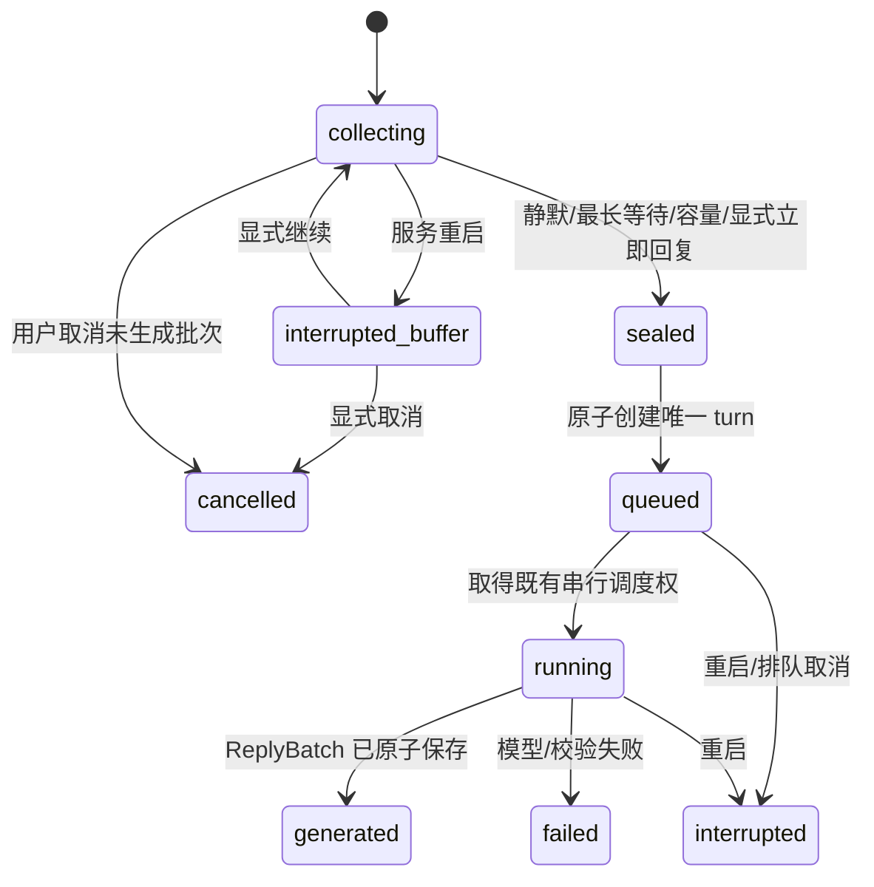

# 04 即时交互、活人感与缓冲池规范

> 2026-10-29 M8前维护：系统承担无提示纯文本，窗口/QQ自然输入与必要局部检查通过；旧有格式提示证据不再作为无提示自然度证明。个人资料仅本机，正式人格禁止验收写入，使用可删除副本并保持文学原文。见[维护合同](../M8启动前-自然纯文本与私有角色维护实施计划.md)与[验收边界](../acceptance/M8启动前-自然纯文本验收结论.md)。不启动M8。

> 2026-10-29 R3收尾：M7.5云端候选选择修复及M7已实现功能实装完成，历史条件继续携带。开发16/16、新独立48/48及真实8次主要调用通过；新增69次选择，累计194/205。正式0.7.5.dev2/主库15/导出12/配置2，日常桌面和QQ启用5秒自然缓冲、自然结构回复、当前会话工作集及hybrid_llm/v2；其他默认不变。原额度/每日设置恢复，三服务及工作台已停止，实例锁释放。见[最终结果与实装矩阵](../acceptance/M7.5.4-R3-续验与实装结果.md)；旧失败不撤销，不重跑有效全量，不自动提交或开工M8。

> 历史记录：2026-10-29 R2断点：选择等待已延长至60秒，开发门通过；独立48例最终17/20、合同7/8且3例禁止来源额外激活，质量门未通过。累计125选择/0主要调用，暂停QQ及正式实装。正式库14/配置1及日常政策不变。见[最新R2合同](../M7.5.4-R2-云端候选选择与全系统适配实施计划.md)和[完整结论/断点](../acceptance/M7.5-云端候选选择联合验收结论.md)。旧失败、原指导和历史条件保留，不开工M8。

## M7.5.4-R1当前断点（2026-10-29）

分层评测已修复，新64例开发校准未通过：正确激活13/32（设定书9/16、样例4/16），24负例零误激活、8合同通过；网格内没有符合全部开发门的阈值组合。候选0.525/0.55未启用，原配置保持。59项定向与受影响检查＋1项新增统计回归通过，无全量、付费、QQ或正式变更。按计划停止在R2，不生成/运行新独立集，不推进正式实装或提交推送。见[修复记录与后续边界](../M7.5.4-R1-拒识校准修复与复验记录.md)；下方旧结果按原阶段理解，失败历史不撤销。

## M7.5.4当前断点：独立质量门未通过（2026-10-29）

M7.5.4已执行P00冻结和P01独立48例：语义正例Recall@5与最终正确激活均为7/20，低于85%及17/20门槛；其中设定书7/12、表达样例0/8。负例误激活0/20，合同8/8。**M7.5尚未验收通过，日常实装停止在质量门前。**

[本轮结论与断点](../acceptance/M7.5-联合质量验收结论.md) · [验收与实装合同](../M7.5.4-联合验收与M7实装实施计划.md)。已保存冻结集和失败结果，未改算法/阈值；P02–P05尚未执行。主要调用0、QQ发送0，正式人格/政策/额度未变，不提交推送。接续先安排检索改进及新的独立复验，不能针对已观察锁定集调参后冒称独立通过；质量通过再继续工程、性能、工作台、真实场景和正式实装。历史条件继续携带，下方阶段记录保留其当时语境。

## M7.4已验收增量（2026-10-29）

natural_structured显式启用，第一条立即领取，后续按min(1800,600+15×前条字符数)等待；同组不加延迟。新持久输入仅取消全部pending且零attempt的可省略chat组；不取消模型或自动重算。

0.7.4.dev1／主库14／导出11／桥接0.7.0，规定范围验收完成。24次质量12/12自然不劣、2次实际QQ取消/继续通过，共26次55,269 tokens，配置和三服务停止初态恢复；历史条件携带。见[施工合同](../M7.4-自然表达与投递节奏实施计划.md)、[使用](../M7.4.md)、[机器结论](../acceptance/M7.4-机器验收结论.md)。本轮不提交推送，下方历史按当时语境理解。

## M7.5规划增量（2026-10-29，已采纳/未施工）

M7.5不改入站、取消、可靠投递或回复模式；查询需覆盖完整InputBatch成员，不因编码器token上限静默丢失非首成员。语义故障词法降级，不追加主要调用或重发片段。

[用户原稿](../PCAR-M7.5-角色语义激活开发指导与施工计划.md) · [现状衔接](../M7.5-规划采纳与现状衔接.md) · [阶段入口](../M7.5.md)。当前9c49848/0.7.3.dev1，M7.4尚未实施，本轮仅规划并按授权提交推送。旧编号/验收历史不改写；新角色语义要求优先于旧“向量可选”的笼统表述。

## 无人值守交互衔接（2026-10-29，规划已采纳）

M7.4继续负责内容完整、自然表达、节奏及未发送片段取消；M8.E再实现无人值守恢复。新输入/取消/claim竞态必须能提供后续恢复所需的稳定状态，不能靠隐藏人工步骤解锁。当前缓冲参数与模式未切换。

[拟议D-AUTO03/05](../无人值守陪伴优先-路线修订草案.md#8-需要本次审阅的核心决议)：只有按类型授权且确定可安全恢复的任务才自动续跑；未知费用/调用结果不盲目重放。uncertain先核对，无法确认时按政策有界隔离并跳过余段、释放后续新请求，不伪sent、不重发已确认或未知片段。sending先解决领取所有权，迟到结果校验token与版本。

该规则尚未实现，当前仍按M6.3显式处置。G-AUTO A06/A10/A11验证连续消息、完整成员、单次有效提交、自然纯文本与故障后可继续聊天。关闭管理窗口不应成为未来受管模式的停止条件，但显式停止必须生效，详见[运行方案](../无人值守陪伴优先-路线修订草案.md#5-无人值守运行与投递恢复)。

> **M7.3当前进度（2026-10-28）：** M7.3规定范围验收完成，历史条件继续携带。0.7.3.dev1/主库13/导出10/桥接0.6.0；最终全量427项454.702秒通过，32/8人工集、迁移恢复、实际工作台与QQ通过。真实5次主要＋2次整理，共15,700 tokens、7份Manifest。长时门按用户修订采用受控截止模拟与5秒调度管线，未宣称真实30分钟通过。模拟退出，原人格、完整配置/30/6/20、每日整理及三服务停止初态恢复，无未决测试输入。仅准备M7.4；用户随后授权提交本地与远端，源码/测试/工具已归档为e7d45d5，文档独立提交并普通推送，实际结果见Git日志及D盘git-publication.json。 输入、生成和投递未决工作阻塞封存；新输入与封存CAS协调，不取消旧请求，不自动收费。 [阶段](../M7.3.md) · [机器证据](../acceptance/M7.3-机器验收结论.md)。下方旧阶段快照保留历史含义。

> **M7.2当前收尾（2026-10-28）：** M7.2规定范围验收完成，历史条件继续携带。0.7.2.dev1/主库12/导出9/桥接0.6.0；自动召回默认开启、跨会话另开、明确引用失败零调用，缓冲及回复模式保持。最终全量390项161.670秒通过，48/16人工集、两条副本恢复及实际Tk通过；真实8次固定主要＋1次整理＋1次修复复验，共20,340 tokens，实际QQ一片纯文本sent可追溯。原R01中文句号漏召回及SDK超时现场保留；R01已修复复验关闭。原人格、完整配置/30/6/20、每日整理开关及三服务停止初态恢复，无未决输入/新片段。 [实现](../M7.2.md) · [机器结论](../acceptance/M7.2-机器验收结论.md) · [M7.3准备](../M7.3-开工输入与待定事项.md)。下方旧阶段及“未实施/待验”等为历史快照，当前事实以上述为准；用户现已授权M7.2两笔归档与普通推送，源码为b9fc03d、文档提交见Git日志。

> **下一阶段授权（2026-10-28）：** [M7.2实施合同](../M7.2-CognitiveContext与工作集实施计划.md)已批准，M7.1两笔提交推送后立即开工；[M7.2入口](../M7.2.md)目前仅为计划，不改写M7.1既有验收或声称新功能已上线。

> **M7.1当前实施（2026-10-28）：** [阶段说明](../M7.1.md)、[机器结论](../acceptance/M7.1-机器验收结论.md)及[实际手册](../acceptance/M7.1-中文全文与时间检索验收手册.md)记录管理员中文/时间检索、完整回合、recent_50只读预览和派生缓存验收。0.7.1.dev1/主库11/导出8/桥接0.6.0；最终全量359项通过120.537秒，人工80/80、两条副本恢复及实际隔离Tk可操作，0真实模型/QQ调用，正式三服务保持停止。新指导与原稿字节不改。下一步仅准备新M7.2 CognitiveContext；M4 O01–O03、M5 P09、M6.1旧付费续跑继续携带。下方旧阶段、未实施和编号均保留历史语境，当前编排见[规划衔接](../后续开发指导与规划衔接.md)。

> **2026-10-28 M7.0规定范围验收完成：** 0.7.0.dev1 / 结构11 / 导出8 / 桥接0.6.0。真实QQ完整回合引用、跨人格拒绝、撤回后零调用、正式工作台、导出及重启数据一致性均通过；最终核对两个递增的新鲜桥接心跳及正确入口身份，三个服务归属明确并运行，原人格、政策及30/6/20额度恢复，无未决输入。本轮恢复没有新增主要/整理调用或确认片重放。见[最终收尾](../acceptance/M7.0-最终收尾-20261028.md)和[机器验收结论](../acceptance/M7.0-机器验收结论.md)。
> [M7.1复评](../M7.1-封存规划复评.md)结论为“局部修订后复用”，原稿继续封存，不自动开工；FTS、向量和工作集尚未实施。M4 O01–O03、M5 P09及M6.1旧付费显式续跑条件继续携带，不声明全部历史条件通过。下方旧阶段的版本、计数及服务状态按当时范围保留。

> **M7.0暂停时的历史快照（2026-10-28，恢复门现已关闭）：** 0.7.0.dev1 / 结构11 / 导出8 / 桥接0.6.0已实现部署。真实QQ完整回合引用、跨人格拒绝、R06撤回后零调用、正式工作台引用与草稿保护、导出8及最终R08数据一致性均有通过证据；用户选择“暂不恢复，保存交接”，最终QQ运行恢复门暂停，不能标M7.0全部退出。当时续接材料见[机器验收结论](../acceptance/M7.0-机器验收结论.md)及[续验交接](../acceptance/M7.0-续验交接-20261028.md)。
## M6.4历史实施状态（2026-10-28）

M6.4联合验收完成，M6核心范围收尾，历史条件继续携带。0.6.4.dev1 / 结构10 / 导出7 / 桥接0.5.0；本次全量237项通过（86.141秒）。72次固定质量对照完成，两种情境模式均22/24不劣于兼容模式；实际QQ快速三输入同批及修复后纯文本平台读回通过。首组含Markdown缺陷记录保留。合计74次真实主要调用、144,059 tokens，金额未知。原人格、入口政策及30/6/20额度已恢复，按验收前状态恢复人格服务停止、AstrBot/QQ在线。M4 O01–O03、M5 P09及M6.1旧付费显式续跑条件仍待验；M7仅准备，不提前实现。见[M6.4联合结论](../M6.4.md)、[质量结果](../acceptance/M6.4-质量对照结果.md)。以下原始规划、历史证据及复选框不单独代表当前实现状态。

[总入口](README.md) · [领域模型](03-架构与领域模型.md) · [角色](05-角色系统与人设人格规范.md) · [验收](08-开发流程与验收计划.md)

本文为 M6 设计规范；M6.1 输入缓冲、M6.2 情境表达/结构回复及 M6.3 片段可靠投递源码均已实现，本阶段平台发送与处置已补验；联合条件继续携带。目标是把多条短输入理解为一次表达，并通过一次主要生成产生自然、可靠的回复。输入缓冲、近期记忆池、后台任务队列是三种不同结构：分别处理数秒内聚合、历史召回和延迟认知任务，不得共用一个无边界的列表。

## QQ出站新增硬规则（M6.4）

QQ不展示Markdown装饰；强调、井号标题、引用/项目符号前缀、表格、链接包装和代码围栏转换为纯文本，保留代码正文及真实运算符、数值和URL。普通数字序号可保留。纯文本先落片段账再发送；不重写历史确认片段。首组缺陷与新编号复验证据分别保留，格式硬门不得由平均质量分抵消。

## 1. 与 M3 的关系

M3 当前是逐条有序、不合并；新 M6 引入明确可切换的自然交互模式。保留 `legacy_per_message` 与 `natural_batch` 两条政策路径，统一使用受理、来源、快照和账本。先影子计算分批结果，再显式启用新模式。更新 AGENTS 及旧测试的适用范围，不能直接删除“逐条有序”的回归。

首版不做运行中取消、远端请求重发、流式输出或抢先生成后重算。已经封存的批次不再追加；模型运行期间到来的新消息进入下一批。待当前回复投递或明确处理后再按顺序回应。

## 2. 首版参数及其性质

| 项目 | 初始施工建议 | 说明 |
| --- | --- | --- |
| 静默等待 `quiet_ms` | 5000 ms | 来自用户初始方案，仍需延迟体验校准 |
| 单批最长等待 `max_wait_ms` | 15000 ms | 原讨论建议，防连续输入无限续期 |
| 单批消息数 | 20 条 | 本次新增容量建议，达到后封批；不是已有设置 |
| 单批正文总量 | 12000 字符 | 本次新增建议；还受完整模型输入预算限制 |
| 单条正文 | 保持现有最多 24000 字符 | 超单批目标的合法单条作为独立批；不能截断或因此拒绝旧合法输入 |
| 闲聊语义段 | 1–3 段 | 原讨论建议，不强制凑三段 |
| 普通短段间隔 | 0.6–1.5 秒实验范围 | 第一段立即发送，故障通知不延迟；长任务可 0 间隔 |
| 后续队列 | 延续每人格最多 10 个 queued turn | 输入缓冲另设有界容量，不能拿合并规避队列限额 |

新参数均作为有版本的可调整配置，实施时先检查当前配置格式，不把表格当作已存在字段。缓冲容量建议每 scope 最多 10 个未终结批次、总 120000 字符，达到上限停止新增受理并返回明确拒绝；已受理的原文不可丢弃。D 盘磁盘不足、服务 draining、未授权来源应在成功回执前拒绝。

`deadline = min(last_unique_arrival + quiet_ms, first_unique_arrival + max_wait_ms)`。

这里 arrival 使用服务已接受的单调时间顺序，不用平台发送时间排序。落盘保存 UTC 到期时间供重启展示和诊断，进程内用 monotonic 驱动；操作系统时间跳变不应让单批无限等待。重启后未封批进入 `interrupted_buffer`，由界面明确继续或取消，不自行创建收费请求。

## 3. 入站身份、幂等和分批键

scope_key 至少包括 persona_id、local user、channel、bot account、peer account、session_id 和策略/设定快照指纹。工作台用自身入口 ID，QQ 以已校验的本人好友范围为准。

1. 完成现有平台类型、好友私聊、bot/owner 和文本校验；命令、系统管理操作、机器人自发消息不当作普通聊天。
2. 提取平台消息 ID、引用 ID（新 M7 才完整支持）、平台时间、接收时间和原文。不修改空格、表情、标点、大小写或消息分界。
3. 按 `(channel, bot, peer, platform_message_id)` 或工作台稳定 request_id 幂等。哈希只作指纹，不能代替可查的来源键。
4. 相同 ID 与相同载荷返回旧 Receipt，不加新成员、不续期、不多调用。相同 ID 内容不同记 conflict 并拒绝本次变体，不覆盖旧正文。
5. 在同一事务完成档案、规范化事件、回执和批次成员登记，成功后立刻回受理 ID，无须等五秒。
6. 同一 scope 只有一个 collecting 批次；设定/身份/Session/策略变化要在边界处分批。

用户正文中的 JSON、分隔符或“system”字样均作为内容转义，不能控制批次元数据。消息到达顺序由 accepted_seq 固定，平台时间仅作证据；迟到旧消息保留迟到标识，不倒插已经封存的批次。

## 4. InputBatch 状态与原子封存



实现可将 sealed→queued 合并为同一事务可见状态，避免出现“已封批但无 turn”的悬空窗口。状态机是逻辑合同，实际表中可分别保存 batch 和 turn 状态，不重复维护两套互相矛盾的运行状态。

并发定时器、手动“立即回复”和容量触发都调用 `seal(batch_id, expected_revision)`。只有一个调用成功建立 turn；其余返回已有结果。网络模型调用必须在事务提交之后启动，提交失败不调用模型。

封批边界竞争规则：持锁/事务顺序先到者生效。到期先封则新消息进入下一批；新消息先加入且旧批仍合法，则重算 deadline，但绝不越过 max_deadline。重复消息不参与此竞争。

达到容量时先封当前非空批，再把新消息放进下一批；若新消息本身大于普通批目标，则独立处理。模型预算放不下整条输入时明确 `context_limit_exceeded`，不能截掉用户未说完的内容或静默漏掉某成员。

“立即回复”是工作台操作/明确受控入口，不把用户普通句子中的“现在回答”当作无条件系统命令。切换到 legacy 模式只影响后续输入；旧 collecting 批先明确封存或取消，不一条条拆成多个收费请求。

## 5. 队列、忙碌与恢复

后台缓冲可以在当前 turn 运行时积累，但到期后固定成员，不因为模型忙碌无限把新消息塞入已到期批。多个已封批按 accepted_seq 顺序排队；队列满时保留 `sealed_waiting_capacity` 状态，由本地调度在容量恢复后入队，这一步不产生模型调用。服务重启时依旧标中断并等待显式恢复，不能将容量等待偷换成自动收费重放。

已封批不会因新消息取消现有远端调用。用户补充“还有个事”进入下一批，不重跑前一批。投递中先完成或处置当前批，后续回复不穿插。将来实现过时回复抑制需独立方案，区分远端费用、已执行工具和已发送内容。

受理 UI 展示 collecting/queued/running/generated/delivery 等阶段，允许看见成员列表、剩余等待和封存原因。取消已受理但未生成的批次时保留原文及取消记录，默认不进入记忆提取；不能把取消理解为删除历史。运行中取消按钮继续不提供。

## 6. Context 与 InteractionTurn

InteractionTurn 不是“一条 QQ 消息”。一轮包含有序输入成员与一个主要生成结果；一次失败后显式重试属于同一 turn 的新 attempt。五十轮工作集、Session 统计和摘要覆盖均按该定义，另保留 raw_message_count 避免计数歧义。

模型输入保留每条原文和分界，如依次呈现的带 ID 数据块，或者单个 user role 中的结构化列表。运行时解释其为同次连续表达；不是把多段正文拼成一个无标点字符串，也不是让用户伪造 role 元数据。

记忆证据引用成员 Event ID，不能只引用合成显示文本或 turn 首条。引用某一成员撤回后，涉及该成员的派生产物必须失效；若摘要把多成员混合成一句且无法拆依赖，则整条摘要项失效。

## 7. 活人感的前台实现

目标是情境合适，不是固定短句或随机拟人动作。首版只需现有一次主模型调用，结合角色约束、当前批次、最近上下文和少量表达示例。Dialogue Act、tone、target 和 uncertainty 是解释线索，不写成对用户心理状态的确定诊断。

| 场景 | 期望行为 | 回归风险 |
| --- | --- | --- |
| 吐槽小事 | 接住重点，可以轻松回应 | 无端说教、把轻微抱怨当危机 |
| 熟人调侃 | 依据角色合理回应，歧义时保守 | 把玩笑当恶意，过度道歉 |
| 技术/学习问题 | 准确且按需要展开，代码完整 | 为短句指标删推理或拆坏代码 |
| 明确纠错 | 承认、更正、记录来源 | 为维持人设嘴硬或写入新错误 |
| 喜讯 | 具体回应、适度庆祝 | 每次固定夸赞套话 |
| 陈述结束 | 可自然收住 | 强制以一个问题结尾 |
| 角色事实询问 | 精确查询设定 | 即兴造身高/生日、混入真实经历 |

Expression Library 保存 `scenario`、语境、适合表达、禁忌、来源与许可、版本和启停状态。首版人工编写/审核样例，选择 2–4 条相关项；不得从私人群聊或未授权人群自动采集。示例用于长度和语感，不能照搬真实姓名、事件或第三方人设。重复口癖检测只提示或选择不同样例，不盲目删改用户需要的术语。

自动情绪推断与表达学习先影子记录，不写正式 state、不参与回复。M5 手动状态及到期规则继续有效；后续启用需有目标、来源、强度、TTL、恢复条件和人工状态优先级，放入 M8/M10，不偷塞入 M6 默认。

## 8. ReplyBatch 合同和校验

建议内部结构：

```json
{
  "schema_version": 1,
  "segments": [
    {"text": "原来是变量名", "format": "plain"},
    {"text": "这种确实能查一下午", "format": "plain"}
  ]
}
```

示例为虚构测试文本。模型只提供内容/语义分段，turn、attempt、接收账号、policy、数据库 ID 和发送时间由程序赋值。不得让模型指定文件操作、平台目标、自动重试或持久版本修改。

校验至少包括 JSON 顶层和字段白名单、非空字符串、总长度、段数、格式类型及必要的代码/结构完整性。拒绝额外工具指令；内部 JSON、tone 标签和“第几条发送中”不能原样发给用户。

首版解析失败政策：普通文本模式直接一个完整语义段；期望 JSON 但不可解析时，若判断为普通文本可明确退化为单段；残缺 JSON/控制字段泄漏风险时记 `reply_schema_invalid` 并显示明确失败，**不再自动调用模型修复**。该策略在验收中测试，不把“解析错误”包装成成功。

模型完整生成后本地组织段落。技术代码、公式、列表和引用默认不按换行强拆。自然语义段与平台尺寸限制两层分离：一个完整语义段可拆传输块，但应优先不跨代码围栏、URL 和公式；实在超过平台能力时明确展示可下载内容或安全分块策略，不能承诺所有长代码都能在 QQ 一条发送。

## 9. 片段账本和实际送达

M6.3 已以实际发送单元记录解决 450 字切块与 turn 级 delivery 无法表示部分完成的问题：`reply_delivery_parts` 保存片段、归属、序号、hash、状态、token及当前结果；`reply_delivery_attempts` 逐次记录起止、状态、错误和平台消息 ID。发送前先持久化，领取后再调用平台。

状态为 `pending→sending→sent`；明确未发送的失败可进入 `failed`，无法判断是否送达进入 `uncertain`。接口超时、进程崩溃、取消或发送结果为空而无法核对时不能推断 sent。QQ API 返回成功仅是平台接受证据，不证明用户阅读。

发送原子领取使用 CAS，适配器原处理器与后台投递器竞争同一个 part；令牌不匹配的迟到确认不得覆盖新结果。发送中宕机恢复为 uncertain，不靠租约到期自动再发。

M6.3 uncertain 处置采用保守策略：暂停本批余段，并阻塞该接收 stream 的后续自动投递；工作台提供核对、明确跳过余段/释放队列、或显式重发单段。若无平台可靠去重，重发必须告知可能重复；不能提供“必不重复”保证。真实工作台可用性仍待验收。

旧 turn 的 `deliveries` 保留为兼容汇总，新批次汇总根据各 part 派生。对已发送的历史 450 字块不补造平台 ID 或 sent 时间。升级协议时，旧插件不得领取新批次整段 delivery；新插件只走 part 发送路径，避免双发。

## 10. 必测时间轴

| 用例 | 输入/故障 | 必须观察到 |
| --- | --- | --- |
| I01 | t=0、1、3 秒三条输入 | t≈8 秒封一批，三条顺序不变，一次主要生成 |
| I02 | 每四秒持续发送 | 第一批不晚于 t=15 秒具备封批资格；实际回复另计排队/生成 |
| I03 | 重复投递同一消息 | 原 Receipt，不延长等待，不多计费 |
| I04 | 相同 ID 不同正文 | conflict，旧正文/成员不变 |
| I05 | 到期和新消息并发 | 依据事务次序落入一个合法批，消息不丢不重复 |
| I06 | 缓冲中重启 | 原文与成员仍在，标中断，零自动付费重放 |
| I07 | 生成期间新消息 | 下一批，不取消、不合并重算前一请求 |
| I08 | 三段回复，第 3 段发送超时 | 前两段 sent，第 3 段 uncertain，不重发前两段 |
| I09 | 原处理器与后台同时领取 | 同一 part 只有一方可发送 |
| I10 | 发送成功但写回前崩溃 | uncertain，等待核对；不声称严格恰好一次 |
| I11 | 中途换人格/账号/设定/策略 | 新消息分批，旧批绑定原始目标及版本 |
| I12 | 代码、URL、情绪标点、空白 | 不损坏内容，不机械删标点或补标点 |
| I13 | 撤回批次中非首条来源 | 对应记忆/摘要/关系建议不再使用该信息 |
| I14 | 缓冲/turn队列满、磁盘写入失败 | 不给虚假成功回执；已有受理仍可查询 |
| I15 | JSON 不合法 | 按约定退化/失败，零额外修复调用，结构标签不外泄 |

时间测试使用可控时钟只证明算法；真实输入体验另测。观测 `ingress_ms/buffer_ms/queue_ms/context_ms/model_ms/first_send_ms/last_send_ms`，五秒等待不能被藏在“模型耗时”里。

## 11. 禁止事项

禁止只在 QQBridge 中 sleep 五秒而继续每条建 turn；禁止只存内存；禁止字符串无分界拼接替代原文；禁止静默取消并重新收费；禁止不确定时整批重发；禁止并行多模型各自对用户说话；禁止为真人感故意改错字、删技术标点、随机制造情绪或自动采集群友语料。
