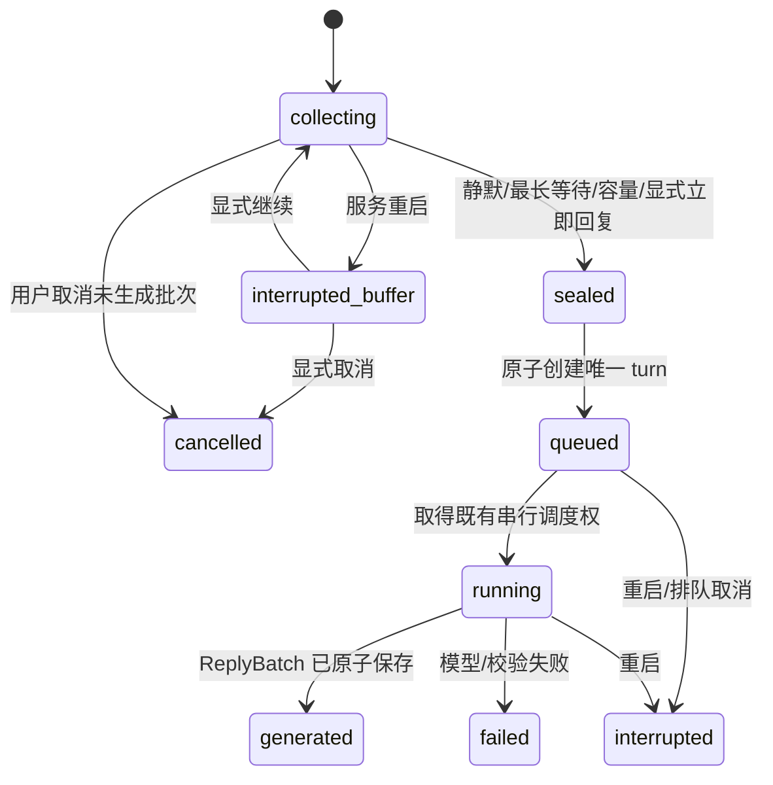

# 04 即时交互、活人感与缓冲池规范

## 实施状态更新（2026-10-27）

M6.0 T00–T02及M6.1 T03–T04现已实现，当前0.6.1.dev1/结构8/导出5/桥接0.4.0；默认逐条，缓冲按人格/入口手动开启。最终187项全量通过，核心真实合并/版本验证完成；显式付费继续与实际QQ送达待补，整个M6未完成。以下未实现/复选框文字保留为原规划快照，当前实际字段、范围和验收以[最新实施说明](../M6.1.md)为准，T05及后续尚未实施。

[总入口](README.md) · [领域模型](03-架构与领域模型.md) · [角色](05-角色系统与人设人格规范.md) · [验收](08-开发流程与验收计划.md)

本文为新 M6 规范，未实现。目标是把多条短输入理解为一次表达，并通过一次主要生成产生自然、可靠的回复。输入缓冲、近期记忆池、后台任务队列是三种不同结构：分别处理数秒内聚合、历史召回和延迟认知任务，不得共用一个无边界的列表。

## 1. 与 M3 的关系

M3 当前是逐条有序、不合并；新 M6 引入明确可切换的自然交互模式。保留 `legacy_per_message` 与 `natural_batch` 两条政策路径，统一使用受理、来源、快照和账本。先影子计算分批结果，再显式启用新模式。更新 AGENTS 及旧测试的适用范围，不能直接删除“逐条有序”的回归。

首版不做运行中取消、远端请求重发、流式输出或抢先生成后重算。已经封存的批次不再追加；模型运行期间到来的新消息进入下一批。待当前回复投递或明确处理后再按顺序回应。

## 2. 首版参数及其性质

| 项目 | 初始施工建议 | 说明 |
| --- | --- | --- |
| 静默等待 `quiet_ms` | 5000 ms | 来自用户初始方案，仍需延迟体验校准 |
| 单批最长等待 `max_wait_ms` | 15000 ms | 原讨论建议，防连续输入无限续期 |
| 单批消息数 | 20 条 | 本次新增容量建议，达到后封批；不是已有设置 |
| 单批正文总量 | 12000 字符 | 本次新增建议；还受完整模型输入预算限制 |
| 单条正文 | 保持现有最多 24000 字符 | 超单批目标的合法单条作为独立批；不能截断或因此拒绝旧合法输入 |
| 闲聊语义段 | 1–3 段 | 原讨论建议，不强制凑三段 |
| 普通短段间隔 | 0.6–1.5 秒实验范围 | 第一段立即发送，故障通知不延迟；长任务可 0 间隔 |
| 后续队列 | 延续每人格最多 10 个 queued turn | 输入缓冲另设有界容量，不能拿合并规避队列限额 |

新参数均作为有版本的可调整配置，实施时先检查当前配置格式，不把表格当作已存在字段。缓冲容量建议每 scope 最多 10 个未终结批次、总 120000 字符，达到上限停止新增受理并返回明确拒绝；已受理的原文不可丢弃。D 盘磁盘不足、服务 draining、未授权来源应在成功回执前拒绝。

`deadline = min(last_unique_arrival + quiet_ms, first_unique_arrival + max_wait_ms)`。

这里 arrival 使用服务已接受的单调时间顺序，不用平台发送时间排序。落盘保存 UTC 到期时间供重启展示和诊断，进程内用 monotonic 驱动；操作系统时间跳变不应让单批无限等待。重启后未封批进入 `interrupted_buffer`，由界面明确继续或取消，不自行创建收费请求。

## 3. 入站身份、幂等和分批键

scope_key 至少包括 persona_id、local user、channel、bot account、peer account、session_id 和策略/设定快照指纹。工作台用自身入口 ID，QQ 以已校验的本人好友范围为准。

1. 完成现有平台类型、好友私聊、bot/owner 和文本校验；命令、系统管理操作、机器人自发消息不当作普通聊天。
2. 提取平台消息 ID、引用 ID（新 M7 才完整支持）、平台时间、接收时间和原文。不修改空格、表情、标点、大小写或消息分界。
3. 按 `(channel, bot, peer, platform_message_id)` 或工作台稳定 request_id 幂等。哈希只作指纹，不能代替可查的来源键。
4. 相同 ID 与相同载荷返回旧 Receipt，不加新成员、不续期、不多调用。相同 ID 内容不同记 conflict 并拒绝本次变体，不覆盖旧正文。
5. 在同一事务完成档案、规范化事件、回执和批次成员登记，成功后立刻回受理 ID，无须等五秒。
6. 同一 scope 只有一个 collecting 批次；设定/身份/Session/策略变化要在边界处分批。

用户正文中的 JSON、分隔符或“system”字样均作为内容转义，不能控制批次元数据。消息到达顺序由 accepted_seq 固定，平台时间仅作证据；迟到旧消息保留迟到标识，不倒插已经封存的批次。

## 4. InputBatch 状态与原子封存



实现可将 sealed→queued 合并为同一事务可见状态，避免出现“已封批但无 turn”的悬空窗口。状态机是逻辑合同，实际表中可分别保存 batch 和 turn 状态，不重复维护两套互相矛盾的运行状态。

并发定时器、手动“立即回复”和容量触发都调用 `seal(batch_id, expected_revision)`。只有一个调用成功建立 turn；其余返回已有结果。网络模型调用必须在事务提交之后启动，提交失败不调用模型。

封批边界竞争规则：持锁/事务顺序先到者生效。到期先封则新消息进入下一批；新消息先加入且旧批仍合法，则重算 deadline，但绝不越过 max_deadline。重复消息不参与此竞争。

达到容量时先封当前非空批，再把新消息放进下一批；若新消息本身大于普通批目标，则独立处理。模型预算放不下整条输入时明确 `context_limit_exceeded`，不能截掉用户未说完的内容或静默漏掉某成员。

“立即回复”是工作台操作/明确受控入口，不把用户普通句子中的“现在回答”当作无条件系统命令。切换到 legacy 模式只影响后续输入；旧 collecting 批先明确封存或取消，不一条条拆成多个收费请求。

## 5. 队列、忙碌与恢复

后台缓冲可以在当前 turn 运行时积累，但到期后固定成员，不因为模型忙碌无限把新消息塞入已到期批。多个已封批按 accepted_seq 顺序排队；队列满时保留 `sealed_waiting_capacity` 状态，由本地调度在容量恢复后入队，这一步不产生模型调用。服务重启时依旧标中断并等待显式恢复，不能将容量等待偷换成自动收费重放。

已封批不会因新消息取消现有远端调用。用户补充“还有个事”进入下一批，不重跑前一批。投递中先完成或处置当前批，后续回复不穿插。将来实现过时回复抑制需独立方案，区分远端费用、已执行工具和已发送内容。

受理 UI 展示 collecting/queued/running/generated/delivery 等阶段，允许看见成员列表、剩余等待和封存原因。取消已受理但未生成的批次时保留原文及取消记录，默认不进入记忆提取；不能把取消理解为删除历史。运行中取消按钮继续不提供。

## 6. Context 与 InteractionTurn

InteractionTurn 不是“一条 QQ 消息”。一轮包含有序输入成员与一个主要生成结果；一次失败后显式重试属于同一 turn 的新 attempt。五十轮工作集、Session 统计和摘要覆盖均按该定义，另保留 raw_message_count 避免计数歧义。

模型输入保留每条原文和分界，如依次呈现的带 ID 数据块，或者单个 user role 中的结构化列表。运行时解释其为同次连续表达；不是把多段正文拼成一个无标点字符串，也不是让用户伪造 role 元数据。

记忆证据引用成员 Event ID，不能只引用合成显示文本或 turn 首条。引用某一成员撤回后，涉及该成员的派生产物必须失效；若摘要把多成员混合成一句且无法拆依赖，则整条摘要项失效。

## 7. 活人感的前台实现

目标是情境合适，不是固定短句或随机拟人动作。首版只需现有一次主模型调用，结合角色约束、当前批次、最近上下文和少量表达示例。Dialogue Act、tone、target 和 uncertainty 是解释线索，不写成对用户心理状态的确定诊断。

| 场景 | 期望行为 | 回归风险 |
| --- | --- | --- |
| 吐槽小事 | 接住重点，可以轻松回应 | 无端说教、把轻微抱怨当危机 |
| 熟人调侃 | 依据角色合理回应，歧义时保守 | 把玩笑当恶意，过度道歉 |
| 技术/学习问题 | 准确且按需要展开，代码完整 | 为短句指标删推理或拆坏代码 |
| 明确纠错 | 承认、更正、记录来源 | 为维持人设嘴硬或写入新错误 |
| 喜讯 | 具体回应、适度庆祝 | 每次固定夸赞套话 |
| 陈述结束 | 可自然收住 | 强制以一个问题结尾 |
| 角色事实询问 | 精确查询设定 | 即兴造身高/生日、混入真实经历 |

Expression Library 保存 `scenario`、语境、适合表达、禁忌、来源与许可、版本和启停状态。首版人工编写/审核样例，选择 2–4 条相关项；不得从私人群聊或未授权人群自动采集。示例用于长度和语感，不能照搬真实姓名、事件或第三方人设。重复口癖检测只提示或选择不同样例，不盲目删改用户需要的术语。

自动情绪推断与表达学习先影子记录，不写正式 state、不参与回复。M5 手动状态及到期规则继续有效；后续启用需有目标、来源、强度、TTL、恢复条件和人工状态优先级，放入 M8/M10，不偷塞入 M6 默认。

## 8. ReplyBatch 合同和校验

建议内部结构：

```json
{
  "schema_version": 1,
  "segments": [
    {"text": "原来是变量名", "format": "plain"},
    {"text": "这种确实能查一下午", "format": "plain"}
  ]
}
```

示例为虚构测试文本。模型只提供内容/语义分段，turn、attempt、接收账号、policy、数据库 ID 和发送时间由程序赋值。不得让模型指定文件操作、平台目标、自动重试或持久版本修改。

校验至少包括 JSON 顶层和字段白名单、非空字符串、总长度、段数、格式类型及必要的代码/结构完整性。拒绝额外工具指令；内部 JSON、tone 标签和“第几条发送中”不能原样发给用户。

首版解析失败政策：普通文本模式直接一个完整语义段；期望 JSON 但不可解析时，若判断为普通文本可明确退化为单段；残缺 JSON/控制字段泄漏风险时记 `reply_schema_invalid` 并显示明确失败，**不再自动调用模型修复**。该策略在验收中测试，不把“解析错误”包装成成功。

模型完整生成后本地组织段落。技术代码、公式、列表和引用默认不按换行强拆。自然语义段与平台尺寸限制两层分离：一个完整语义段可拆传输块，但应优先不跨代码围栏、URL 和公式；实在超过平台能力时明确展示可下载内容或安全分块策略，不能承诺所有长代码都能在 QQ 一条发送。

## 9. 片段账本和实际送达

当前 450 字切块与 turn 级 delivery 不足以表示部分完成，M6.3 必须新增实际发送单元记录：`reply_batch_id/semantic_index/part_index/text_hash/state/claim_token/attempt/platform_message_id/sent_at/error`。发送前先保存，领取后再调用平台。

状态为 `pending→sending→sent`；明确未发送的失败可进入 `failed`，无法判断是否送达进入 `uncertain`。接口超时、进程崩溃、取消或发送结果为空而无法核对时不能推断 sent。QQ API 返回成功仅是平台接受证据，不证明用户阅读。

发送原子领取使用 CAS，适配器原处理器与后台投递器竞争同一个 part；令牌不匹配的迟到确认不得覆盖新结果。发送中宕机恢复为 uncertain，不靠租约到期自动再发。

首版 uncertain 处置采用保守策略：暂停本批余段，并阻塞该接收 stream 的后续自动投递，界面提供核对、明确跳过余段/释放队列、或显式重发单段。若无平台可靠去重，重发必须告知可能重复；不能提供“必不重复”保证。此项比旧 turn 级队列更严格，是本计划新增建议，需在 M6.3 冻结并做可用性验证。

旧 turn 的 `deliveries` 保留为兼容汇总，新批次汇总根据各 part 派生。对已发送的历史 450 字块不补造平台 ID 或 sent 时间。升级协议时，旧插件不得领取新批次整段 delivery；新插件只走 part 发送路径，避免双发。

## 10. 必测时间轴

| 用例 | 输入/故障 | 必须观察到 |
| --- | --- | --- |
| I01 | t=0、1、3 秒三条输入 | t≈8 秒封一批，三条顺序不变，一次主要生成 |
| I02 | 每四秒持续发送 | 第一批不晚于 t=15 秒具备封批资格；实际回复另计排队/生成 |
| I03 | 重复投递同一消息 | 原 Receipt，不延长等待，不多计费 |
| I04 | 相同 ID 不同正文 | conflict，旧正文/成员不变 |
| I05 | 到期和新消息并发 | 依据事务次序落入一个合法批，消息不丢不重复 |
| I06 | 缓冲中重启 | 原文与成员仍在，标中断，零自动付费重放 |
| I07 | 生成期间新消息 | 下一批，不取消、不合并重算前一请求 |
| I08 | 三段回复，第 3 段发送超时 | 前两段 sent，第 3 段 uncertain，不重发前两段 |
| I09 | 原处理器与后台同时领取 | 同一 part 只有一方可发送 |
| I10 | 发送成功但写回前崩溃 | uncertain，等待核对；不声称严格恰好一次 |
| I11 | 中途换人格/账号/设定/策略 | 新消息分批，旧批绑定原始目标及版本 |
| I12 | 代码、URL、情绪标点、空白 | 不损坏内容，不机械删标点或补标点 |
| I13 | 撤回批次中非首条来源 | 对应记忆/摘要/关系建议不再使用该信息 |
| I14 | 缓冲/turn队列满、磁盘写入失败 | 不给虚假成功回执；已有受理仍可查询 |
| I15 | JSON 不合法 | 按约定退化/失败，零额外修复调用，结构标签不外泄 |

时间测试使用可控时钟只证明算法；真实输入体验另测。观测 `ingress_ms/buffer_ms/queue_ms/context_ms/model_ms/first_send_ms/last_send_ms`，五秒等待不能被藏在“模型耗时”里。

## 11. 禁止事项

禁止只在 QQBridge 中 sleep 五秒而继续每条建 turn；禁止只存内存；禁止字符串无分界拼接替代原文；禁止静默取消并重新收费；禁止不确定时整批重发；禁止并行多模型各自对用户说话；禁止为真人感故意改错字、删技术标点、随机制造情绪或自动采集群友语料。
