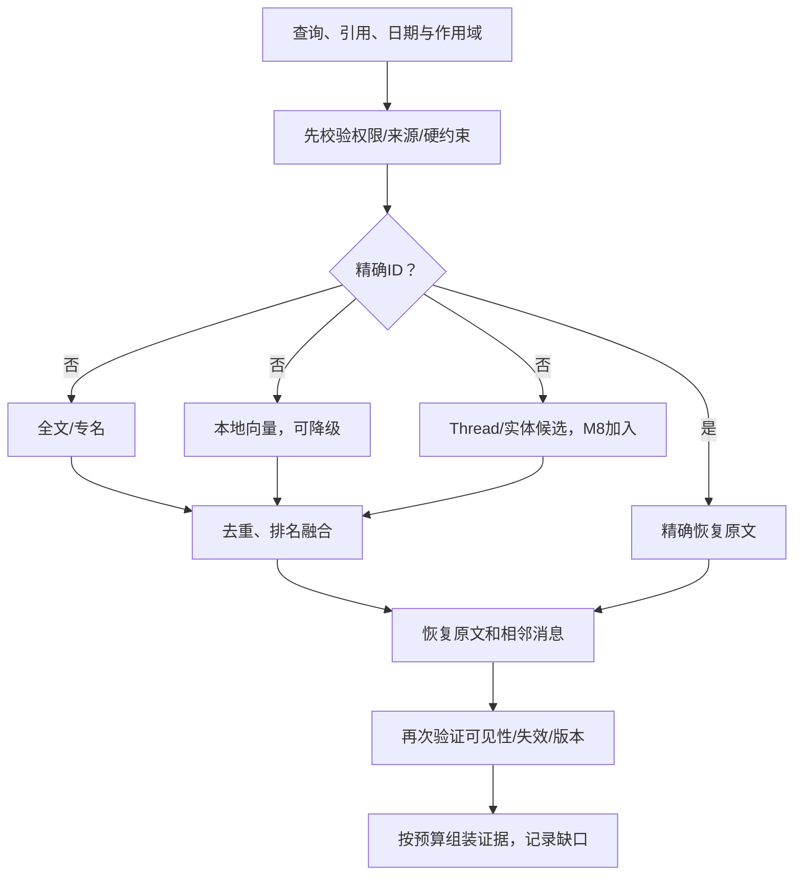

# 06 记忆、Session/Thread、混合检索与异步认知

> M6.4联合验收完成，M6核心范围收尾，历史条件继续携带。0.6.4.dev1 / 结构10 / 导出7 / 桥接0.5.0；本次全量237项通过（86.141秒）。72次固定质量对照完成，两种情境模式均22/24不劣于兼容模式；实际QQ快速三输入同批及修复后纯文本平台读回通过。首组含Markdown缺陷记录保留。合计74次真实主要调用、144,059 tokens，金额未知。原人格、入口政策及30/6/20额度已恢复，按验收前状态恢复人格服务停止、AstrBot/QQ在线。M4 O01–O03、M5 P09及M6.1旧付费显式续跑条件仍待验；M7仅准备，不提前实现。见[M6.4联合结论](../M6.4.md)。

> 历史M6.3实现与验收见[收尾记录](../acceptance/M6.3-机器验收收尾-20261028.md)，当前以本页上方M6.4记录为准。原始核查和未来设计保留其编制日期；Session/Thread、向量检索、联网与演化未实现。

[总入口](README.md) · [架构](03-架构与领域模型.md) · [路线](02-总施工路线图.md) · [验收](08-开发流程与验收计划.md)

## 1. 分层与事实地位

| 层 | 内容 | 地位 |
| --- | --- | --- |
| L0 | RawEvent、原文 Event、生成与实际发送记录 | 历史证据；载荷字节与 SDK 序列化对象明确区分 |
| L1 | InputBatch、InteractionTurn、Attempt、Session 时间边界 | 运行与时间事实；保留版本及成员映射 |
| L2 | 精确索引、FTS、向量、工作集缓存 | 可重建加速结构，不保存唯一事实 |
| L3 | Session 摘要、主题片段、Thread 链接/摘要 | 派生解释，有覆盖和有效性 |
| L4 | 接受的事实/偏好/情景/共同经历记忆 | 经政策提交的认知，不等于客观真理 |
| L5 | 公共世界知识 | 外部来源、时间和冲突单独管理 |
| L6 | 观察、反思、表达学习与演化提议 | 解释或候选；接受后才能影响持久状态 |

Character Bible 不属于真实聊天记忆层，而是另一类创作者权威设定。检索可共享组件，但必须保留来源域，不把三种“事实”混成一个向量池。

## 2. 原始档案和精确引用

M6 先存防丢输入，M7 扩展完整来源与引用。每条消息记录 raw ID、平台/bot/peer/message ID、引用目标 ID、平台时间/接收时间、accepted_seq、原文、载荷表示形式和解析版本，关联 Event、InputBatch、turn。输出另记录实际 part 与平台消息 ID，允许用户引用某一已发段。

旧记录按现存规范化文本原样保留。缺完整 OneBot 载荷、引用 ID、平台成功 ID 时标 `legacy_normalized_only` 或 unknown，不能从 hash、摘要或聊天内容反推原载荷。历史导入/补档只能来自实际可得文件/平台记录，并保留导入来源和映射。

精确路径：平台引用键→权限和状态检查→原文消息/实际发送段→相邻原文/turn→必要 Session/Thread。无需先语义检索 Session；用户只记得模糊主题时才先搜 Session/Thread，再恢复原文。精确 ID 无结果不能用语义相似消息冒充。

当前 QQ 入口拒绝非 text 组件，因此 M7 引用支持需要明确允许“文本+reply 元数据”且保持其他媒体拒绝；对引用的不可见消息只返回找不到/不可访问，不跨账号主动抓取未知联系人历史。

用户撤回有两种操作：纠错/停用来源时保留档案并屏蔽派生使用；明确删除时按数据删除政策清除正文/载荷、FTS/向量/摘要/导出缓存，并处理备份保留期限。审计可保留最小 tombstone/ID 与操作事实，不能借“不可变历史”拒绝用户删除，也不能宣称删除当前库等于所有备份物理擦除。

## 3. 近期工作集：约五十轮，不等于全部进模型

容量初值为最近五十个成功逻辑 InteractionTurn，另记录原始输入数/输出段数和字节/token 占用。按当前 persona、当前入口及可见范围组织，当前 Session 优先；不足五十轮不跨入口凑数。跨 Session 的近期窗口可在同入口内显式配置，但新 Session 不自动注入其他入口的原文。

工作集从档案重建，包含 ID、时间、摘要/主题线索和本地索引。每次只把当前问题需要的原文、少量近邻与检索证据装进预算；不是把原文改成摘要以满足“无损”名义，也不要求模型窗口承载五十轮全量内容。

当前预算是 `max_input_chars`，不是 token 上限。改造时先保留确定字符保护；若加入 tokenizer 需记录模型/编码器版本，校准供应商实际计费差异，不能把 24000 字符说成 24000 token。

## 4. 混合检索流水线

顺序：精确引用优先；明确时间/身份/渠道是硬过滤；全文与语义结果按排名融合；必要时受限扩展近邻。不得直接比较 BM25 分数与向量距离。可用 RRF `sum(1/(k+rank))`，其中 k、各路候选数、去重规则与时间加权通过标注集调优，分数不是事实概率。

中文全文首版比较默认 FTS5、显式分词、字符 bigram/trigram 与精确子串。`unicode61` 不等于中文语义分词；先检测当前 SQLite build 的 FTS5 可用性。时间词按用户时区解析，“昨天/上周”使用半开区间 `[start,end)`；若表达歧义则解释选择或澄清，不能用最近相似记录代替。

本地向量以多语言/中文效果、Windows/Python 安装、离线可运行、模型/权重许可、磁盘/内存、CPU 延迟和版本可重建为选型条件。索引可用 SQLite 扩展或本地独立文件，经基准才冻结。所有权重、下载、缓存与构建文件放 D 盘；不默认引入云向量服务、图数据库或大型框架。

向量库故障或缺模型时精确/FTS 仍工作；明确记录 semantic_unavailable，不能把路径失败伪装成“没有历史”。Embedding 更新使用新 index_generation 并重建，切换前校验覆盖；原档案不变。不让检索失败触发无限多轮代理；ReFind 式迭代只在证据不足且有独立调用/延迟预算时启用。

## 5. EvidenceSet 与上下文预算

每个命中包含 source_event_id/raw_id/turn_id/session_id、可选 Thread/segment、原文位置、时间、来源域、有效状态、retrieval_methods、rank、索引/模型版本、是否近邻、为何选中。结果不足、被屏蔽或某路径失败分别记录。

Context Assembler 合并：受控身份锚点→当前完整输入→精确引用/直接相关事实→必要近邻与当前关系状态→近期上下文→摘要/弱关联 Lore。具体排序预算须在 M7 评估；不得因摘要过长挤掉当前用户成员或关键边界，也不得静默裁掉输入半句话。

ContextManifest 记录所选和被裁 ID、版本、字符/token 估算、裁减原因、未覆盖历史范围。引用正文必须能从本地源校验，模型编出的 event ID 或 quote 子串不一致拒绝使用。可信来源不等于结论必然正确，模型仍可能误解，需要回答级评估。

## 6. Session 生命周期和历史兼容

Session 管时间，Thread 管主题。用户“上午聊 A、午间 B、晚间 A”诉求在 UI 可以显示同一 A 主题连续展开，但底层上午/晚上保持不同 Session。此分层满足接续体验，并保留时间和处理边界；不是把用户希望的语义连续性丢掉。

现有 sessions/channel_sessions 主要是入口映射。新结构建议独立 session_lifecycle 保存 start、last_user_activity、last_runtime_activity、status、sealed_at/reason、activity_revision、end_seq/成员清单。

- 首版空闲阈值约三十分钟，可调；“晚安”等语义结束只作未来优化，不需要每条消息额外调用封口模型。
- 有 collecting 批次、queued/running turn、发送中/未处置余段时不封口，避免回复落入已冻结包。uncertain 需先明确处置后封存或标未送达边界。
- 定时扫描读取 activity_revision，封存事务再次比较；若新消息先到则取消本次封存，若封存先完成则新消息建新 Session。
- 生命周期使用 active/sealed；processing/waiting_quota/failed 属于任务，不混在 Session 主状态里。
- 超长连续交流可按稳定 turn 边界建立增量 checkpoint/主题段，不移动事件、不强制伪造一次空闲结束。

旧 Session 标 `legacy_open/legacy_imported`，默认不批量重新切分。迁移设置新的活动追踪起点，后续新会话采用新规则；若用户需要重建旧主题，仅新增派生链接并保留旧 ID。恢复索引不能改变 sessions/events 原始归属。

## 7. SessionPackage 与异步处理

封存包至少含 persona/user/channel/session、开始/结束时间、稳定有序 turn/event/member 清单、边界 hash、每个回复的投递状态、来源有效状态版本、模型/设定版本、pipeline_version 和包状态。不能仅靠 `seq<=end` 假设所有中间记录同属此 Session，仍要过滤归属与有效成员。

首版只把成功完成且合格来源纳入事实提取；失败/取消请求保留原档案，可在明确查询时查看，但不自动提炼长期事实。成功生成但没送达的角色文本仅是 generated_only，不能作为双方共同经历的证据；用户输入的来源事实仍可按独立政策提取。

处理阶段：

1. 验证包范围/来源，固定输入 hash。
2. 生成带原文证据的 Session 摘要与覆盖清单。
3. 主题分段与实体/Thread 候选召回。
4. 抽取事实、偏好、共同经历、关系观察、未知知识待学习条目。
5. 低频生成表达学习和人格反思提议，不直接改 head。
6. 提交前重新校验来源、预期版本、去重、冲突、政策与额度。
7. 保存产物版本、依赖、覆盖和任务进度。

复用 M4 `organization_tasks/attempts/summaries/candidates/memory_sources/source_exclusions/context_uses` 的能力和政策；可扩展 stage/lease/coverage，不另起不受额度控制的后台队列。无法直接容纳的 SessionPackage/Thread 数据单独建表，适配层避免污染既有任务语义。

## 8. 每日任务、Session 任务和恢复协调

任务幂等键建议 `(persona,session,package_hash,pipeline_version,task_kind)`，派生产物还需来源集合/提取版本 fingerprint。**任务去重、调用去重、结果去重是三个层级**：仅 INSERT OR IGNORE 结果不能避免重复付费。

新增 coverage/lease 登记：每日或 Session 任务准备同类来源批次时先查已完成覆盖和活动 lease，领取可处理范围再调用；并发重叠先合并/跳过或排队，不同时生成相同候选。已提交有效结果复用；不同 pipeline 的重建有显式版本与费用理由。

后台保留目前默认最多 1 运行/10 等待、6 次/小时、20 次/滚动 24 小时，前后台合计现有 30 次/小时限制；以部署当前配置为准，本计划不提高额度。测试、失败和显式重试仍入账。新 Session 后处理不能再开第二套“免费限额”。

收费模型失败/超时/重启中断进入 failed/interrupted，显式重试；不能因任务可恢复就自动再调用。额度不足进入 waiting_quota，按既有政策恢复；确定性索引/阶段提交可幂等恢复。远端是否计费未知时保留 uncertain attempt，不把没有 usage 当成没有消耗。

M4 每日正常记忆自动生效、明显冲突待授权的既有政策保留；手动及可选空闲增量仍待审。新 Session 任务普通记忆默认候选待审，摘要/主题索引可按明确派生保存政策提交；人格/关系提议始终单独受控。

## 9. Thread 与主题关联

TopicSegment 保存成员 ID 清单，可包含同一 turn 的多个成员。首版可先按完整 turn 连续段实现，但保留扩展，不假定主题只能对应一个 Session 或一段连续 seq。

关联流程：主题摘要/实体→关键词/全文/向量召回 Thread 候选→范围和来源过滤→规则判断→必要时预算内语义比较→自动高置信关联/待审/新建。阈值取自标注集，模型自报 0.99 不当作校准置信度。保守场景宁可暂分开，不错并不同项目。

Thread 维护标题、概要版本、实体、决定/未决问题、关联来源、当前进展和最近活动。合并/拆分是版本化链接修改，允许解除并重建摘要；原事件不搬家。同一词指不同项目时保留实体区分，例如不同仓库的“部署失败”。

跨入口 Thread 可以共享经过确认的长期主题索引，但索引不能成为读取另一入口近期原文的后门；默认查询仍按当前入口和授权范围过滤，跨入口详细接续需要显式操作。

## 10. 来源撤回与失效传播

维护依赖图：原事件→摘要项/主题段→Thread 摘要/记忆/表达候选/演化提议/向量文档。来源被屏蔽时立即进入检索硬过滤，异步失效派生缓存；提交前再检查，防止“计算时有效、保存前已撤回”。

已接受的人格/关系版本保留历史但标待复核，后续上下文不得继续注入被屏蔽来源支持的内容，沿用 M5 的保守策略。需要重建的内容不能用旧摘要继续自举。对多个来源共同支持的事实可保留其余有效证据，但必须显式重算支持度，不能只删一个 source ID 就假装原结论不受影响。

## 11. 世界知识域（M9）

知识条目至少包含 subject/predicate/value、适用语境、来源 URL/标题、发布/事件/访问时间、原文证据或受限摘要、valid_from/to、fresh_until、验证状态、冲突组、版本与提取任务。按许可证和必要性保存内容，不默认镜像整站。

查询路由：角色事实查 Character；私人经历查档案/记忆；公共常识先本地知识与模型能力；最新信息、明确要来源或证据不足时搜索。模型自带知识可用于普通解释，但需来源的问题不能伪称已有本地核验证据。

搜索开关、提供商、超时/次数/费用上限单独配置。检索请求最小化，不把私人聊天全文、身份 ID、凭据或不必要的敏感细节发到搜索引擎。搜索结果是数据，不执行网页指令、不自动改权限或人格。

热梗条目用词形/别名、解释、圈层语境、例句来源、首次/最近观察、验证/过期时间和多义关联；单一来源可暂存未核验，不当成公共确定事实。后续同问题命中仍有效本地条目应零搜索；过期/冲突/语境变化可请求更新，离线时明确日期和不确定性。

不承诺全知、不常驻爬全网、不自动下载大型百科、不默认订阅热点。知识摄取和表达生成费用分别入账。

## 12. 受控演化（M8提议，M10提交政策）

Session 观察先保留可证事实，解释与建议单独存。示例：用户多次要求先给结论是观察；“在技术排障时偏好短步骤”是解释；修改表达策略是提议。单次情绪、一次玩笑或模型自述不能直接成为稳定人格。

Proposal 至少包含 target_layer、proposed_patch、source_event/session IDs、正/反证据、rationale、impact、reversible、expected_profile/character_heads、policy_version、status。接受时复核全部版本与来源，旧版本转 stale。候选累积阈值如“多次 Session”仍待标注与试验，不冻结任意次数为人格科学规律。

核心身份与 canon 不自动修改；关系与长期习惯首版待审；表达/观点可以合理变化但不能无限迎合。拒绝、撤回、回退和重新提议有版本记录，不把反思日志当作意识证明，不把亲密度增长当作主要优化目标。

## 13. 验收与禁止事项

检索、Session、后台、知识和演化的具体用例见 [08](08-开发流程与验收计划.md)。硬性禁止：摘要替代唯一档案、重建索引改原文、语义相似度绕过时间/权限、把向量失效当历史不存在、封存后悄悄追加、重复任务重复计费、默认自动关系/核心更新、世界知识混入私人共同经历、从无 usage 推断免费、模拟时间冒充真实 24 小时。
